# PlaywrightDotNet — JobLens

> **Status:** planning complete; implementation has not started.
>
> A cross-platform .NET 10 job-board automation and public job-posting collector for Naukri, Indeed India, and (opt-in) LinkedIn.

## Screenshots

The ops-deck control plane at 1920 width, full-page height. Light left, dark right. Full gallery with per-page notes lives in [docs/screenshots](docs/screenshots/README.md).

### 01 Overview

Central dashboard. Engine state, proxy latency, tac-map, endpoint catalog, and killfeed.

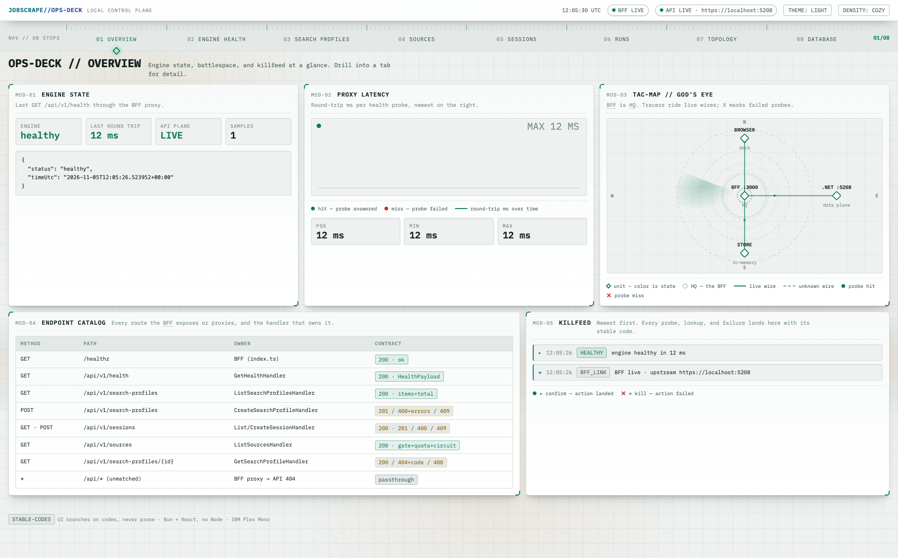
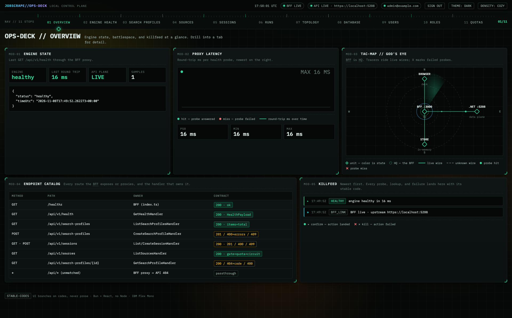

### 02 Engine Health

Probe control, full health payload, latency stats, and sample history.

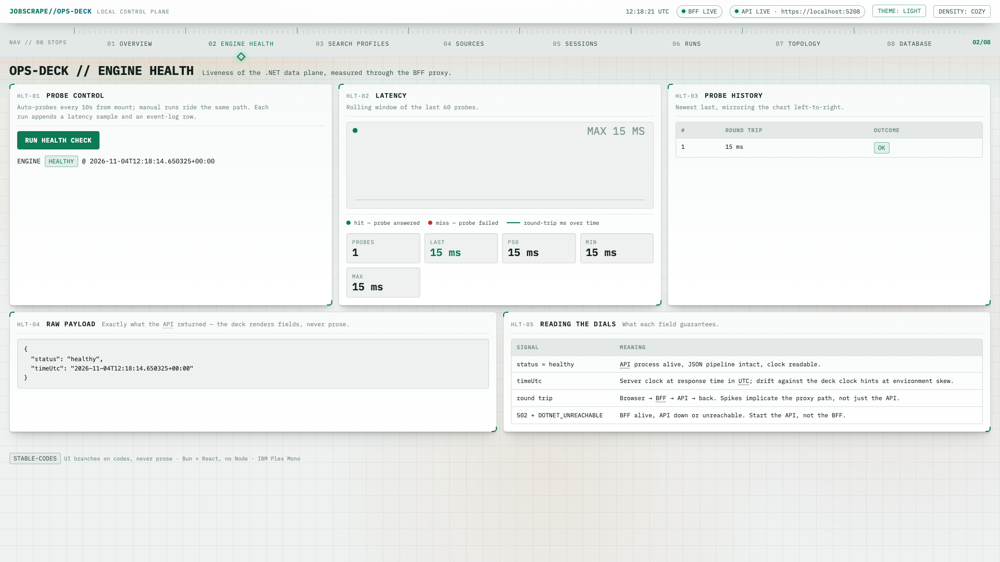
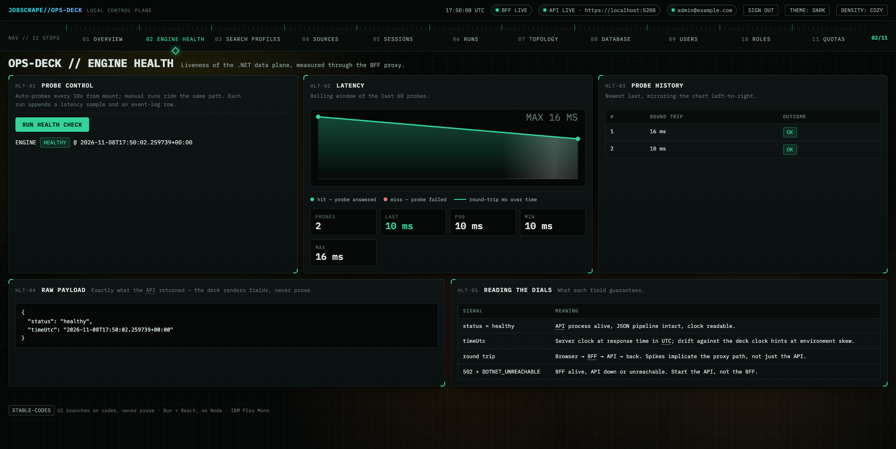

### 03 Search Profiles

Create and edit search profiles with inline server field errors. Persisted in SQLite.

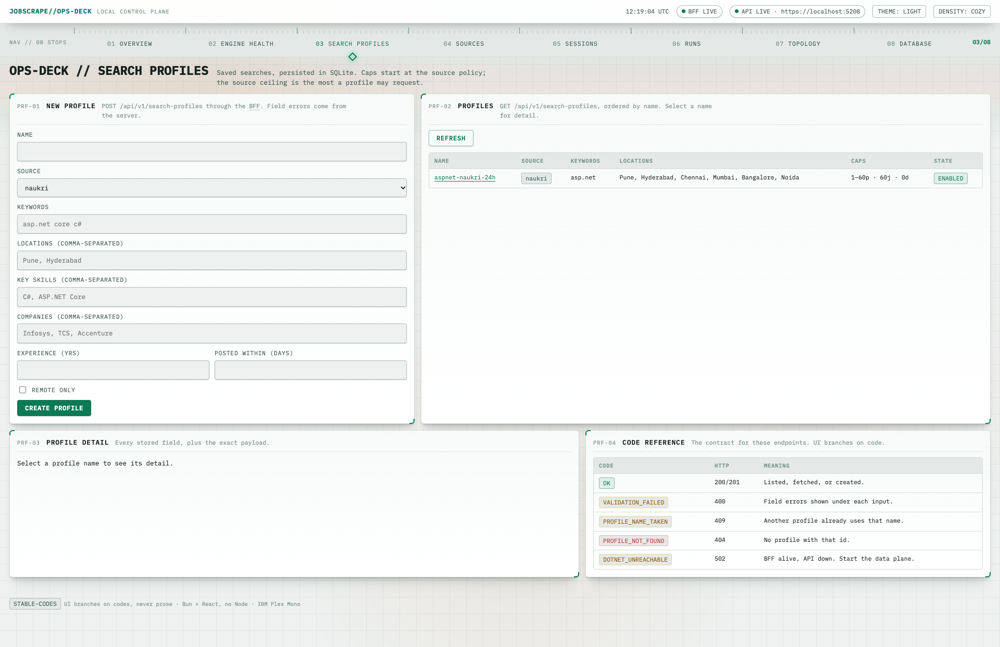
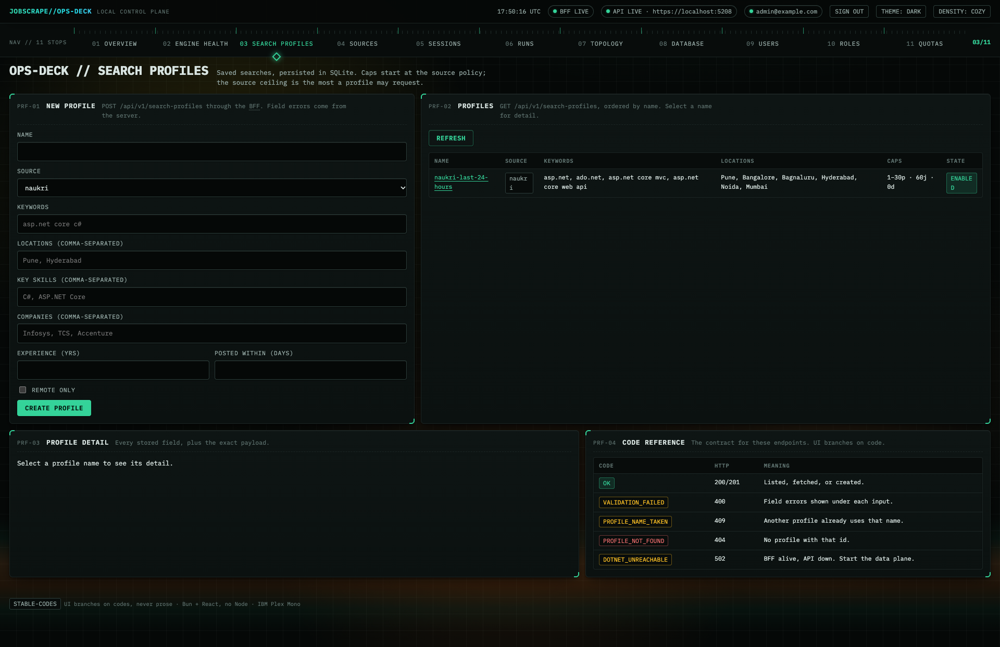

### 04 Sources

One card per job source. Compliance gate, daily quota meters, policy caps, circuit state.

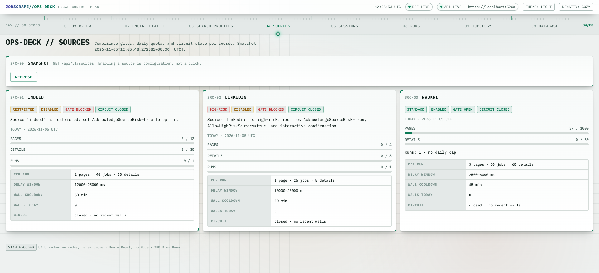
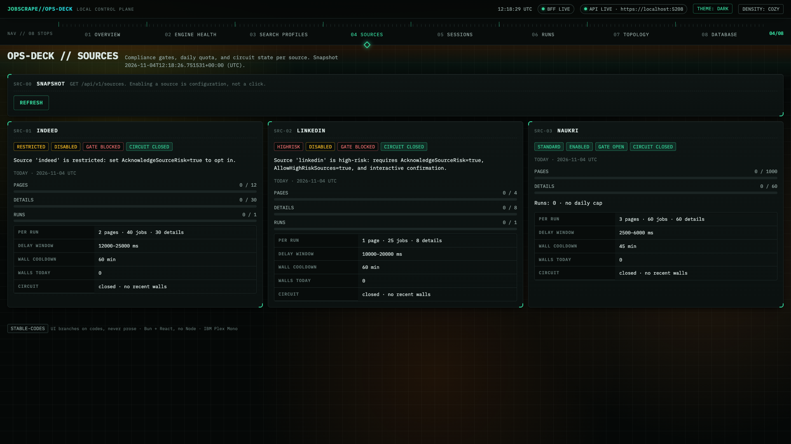

### 05 Sessions

Browser-profile sessions. One identity per source, launch readiness at a glance.

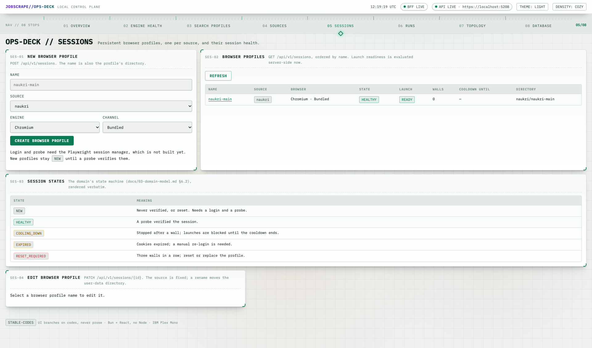
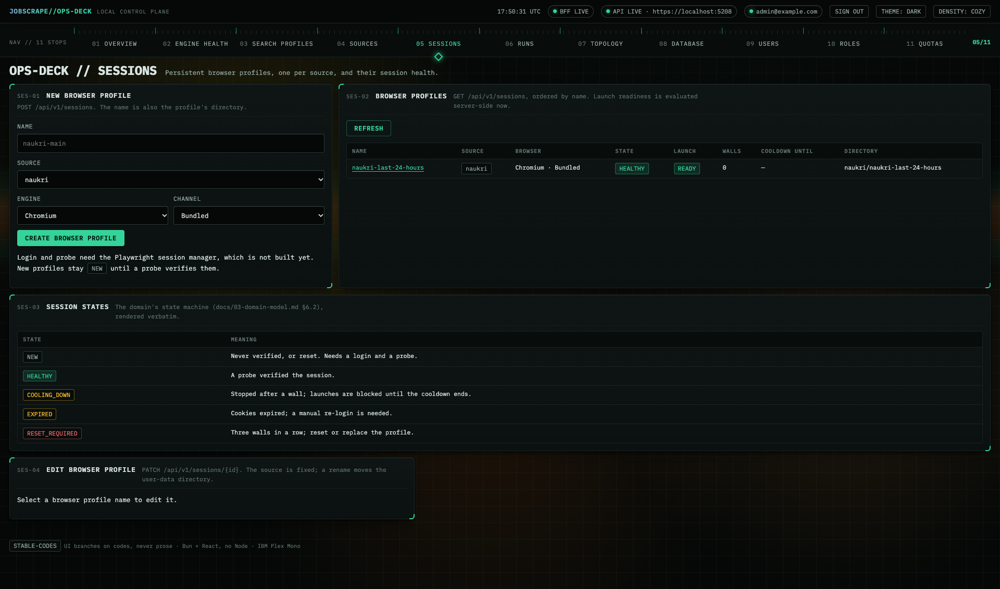

### 06 Runs

Start a scrape, follow it live, cancel it, read postings with CSV and XLSX export.

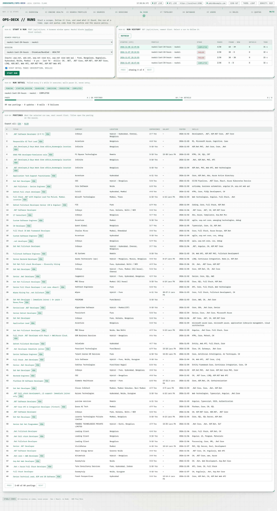
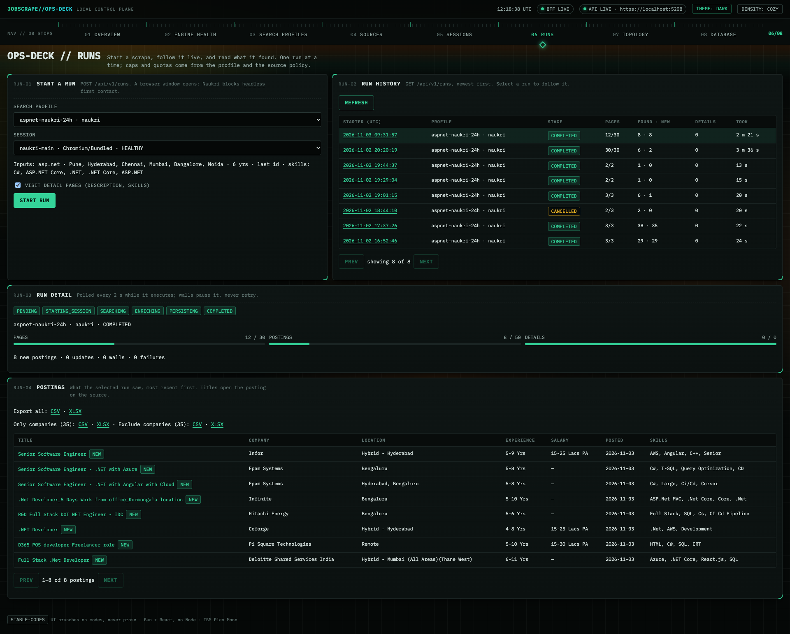

### 07 Topology

Request lifecycle sequence, component map of the two processes, layer contract.

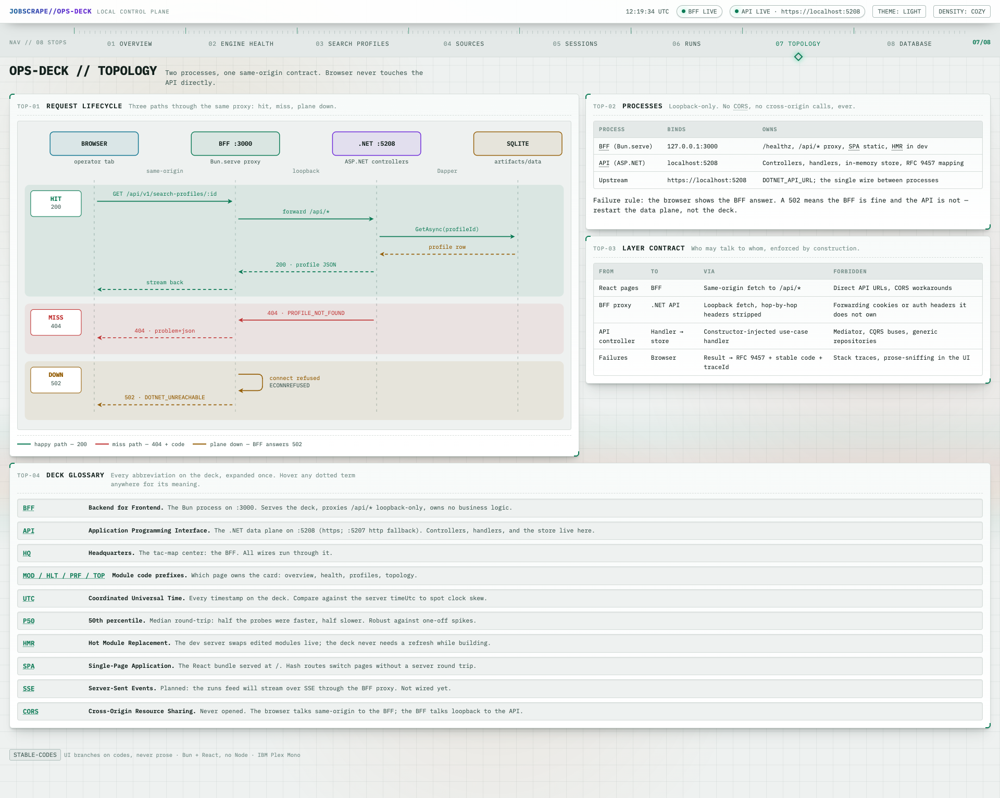
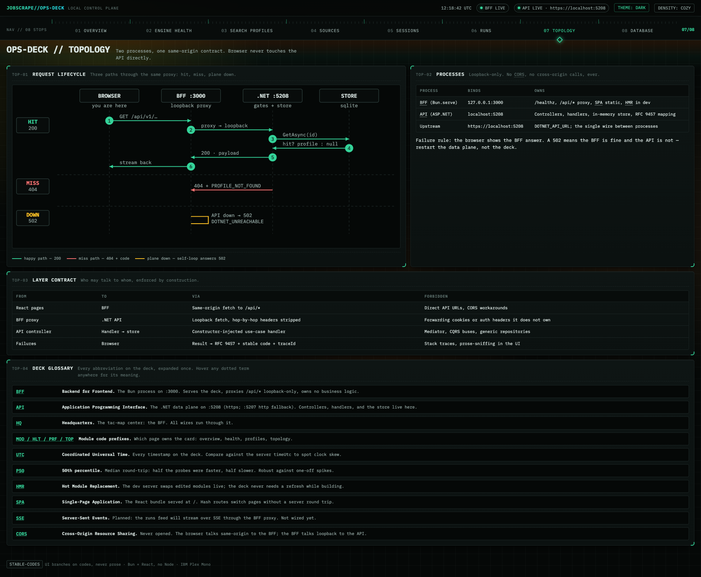

### 08 Database

Browse every user table in the SQLite store. Live schema, paged rows, CRUD, live diagram.

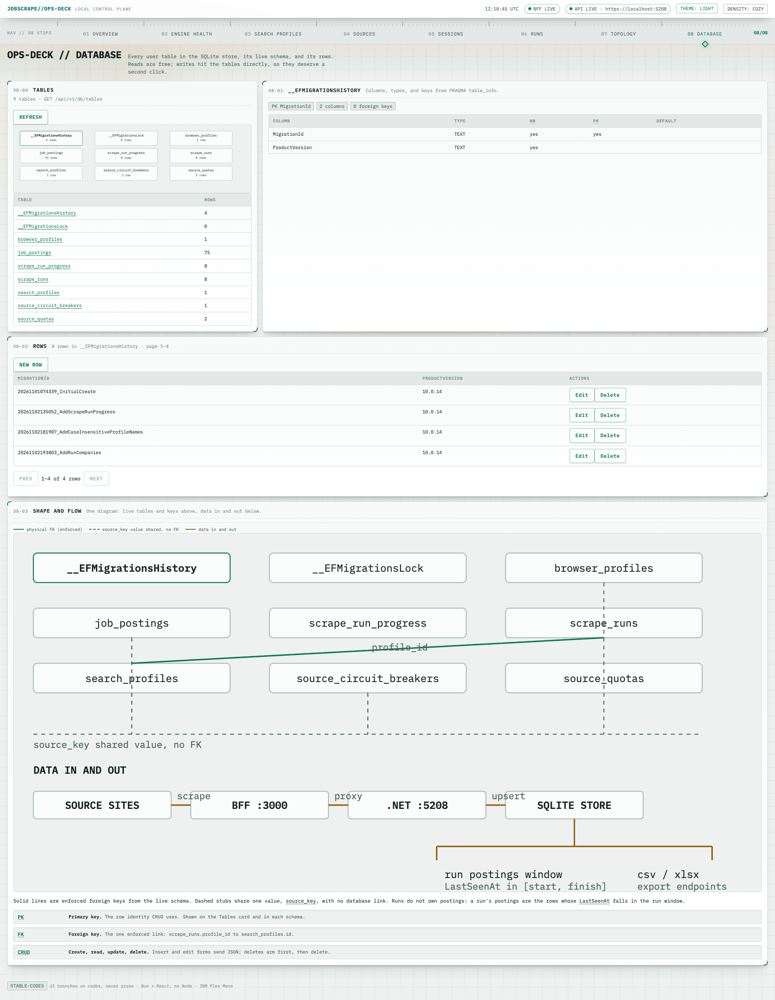
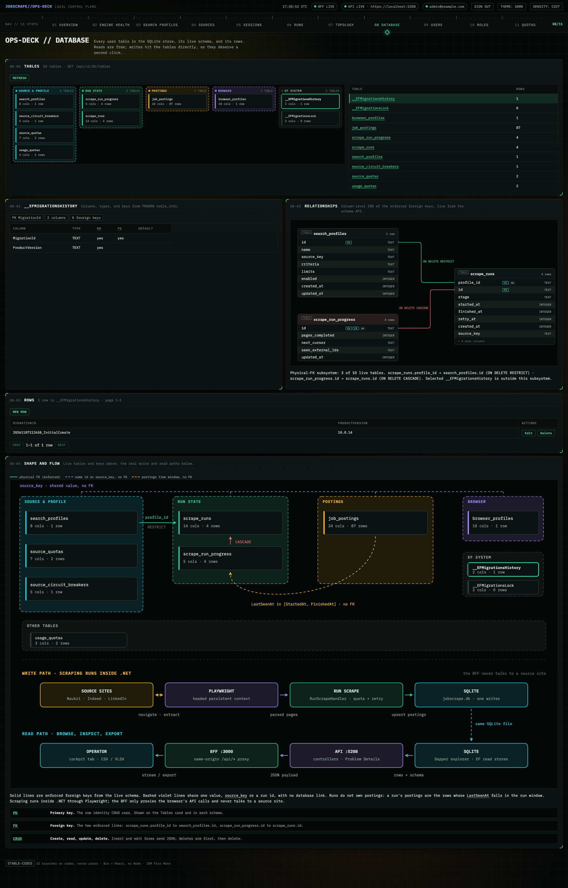

## Start here

Read the documentation in this order:

1. [Documentation index](docs/README.md)
2. [Executive summary](docs/00-executive-summary.md)
3. [Research analysis](docs/01-research-analysis.md)
4. [Architecture](docs/02-architecture.md)
5. [Domain model](docs/03-domain-model.md)
6. [Solution & tooling](docs/04-solution-and-tooling.md)
7. [Gameplan](docs/05-gameplan.md)
8. [Testing strategy](docs/06-testing-strategy.md)
9. [Anti-bot & compliance](docs/07-anti-bot-and-compliance.md)
10. [Site playbooks](docs/08-site-playbooks.md)
11. [Operations runbook](docs/09-operations-runbook.md)
12. [Open decisions](docs/11-open-decisions.md)
13. [Web cockpit (v2)](docs/12-web-cockpit.md)
14. [Conventional Commits](docs/13-conventional-commits.md)
15. [Application patterns](docs/14-application-patterns.md)
16. [Runtime hardening](docs/15-runtime-hardening.md)
17. [Library usage policy](docs/16-library-usage-policy.md)
18. [ADRs](docs/10-adr/README.md)

## Verified stack

- .NET SDK **10.0.403** / runtime **10.0.14** (LTS through 2028-11-14)
- xUnit.net v3 **4.0.2** (VS adapter 4.0.1)
- Playwright for .NET **1.64.1** (Chromium 156, Firefox 157, WebKit 27.2)
- EF Core / Microsoft.Extensions **10.0.14**
- SQLite, System.CommandLine 2.0.14, AngleSharp, ClosedXML 0.105.1
- Serilog 10.0.0 (compact JSON file logs, enrichers, 90-day retention) + Polly v8 HTTP resilience via `Microsoft.Extensions.Http.Resilience` 10.0.0
- Scalar.AspNetCore 2.18.5 local API reference at `/scalar` (Development only) + `Microsoft.AspNetCore.OpenApi` 10.0.14

## What this project will be

A **modular monolith + CLI** that:

- Searches public job pages with Playwright and a persistent, headed browser profile.
- Extracts, validates, deduplicates, and stores postings in SQLite.
- Optionally enriches details and exports CSV/Excel.
- Handles anti-bot walls by **stopping, cooling down, and asking a human** — no CAPTCHA solving, fingerprint spoofing, auth-wall bypass, or proxy rotation.
- Uses explicit use-case handlers — **no CQRS/MediatR** — with Result, Options, Specification, and Problem Details patterns.
- Uses each library in its documented, recommended configuration; AOT/trimming is not a design constraint.
- Treats LinkedIn as high-risk and disabled by default.

## Before implementation

Answer the decisions in [docs/11-open-decisions.md](docs/11-open-decisions.md). If unanswered, the recommended defaults apply and Phase 0 can start.

## Next step

Phase 0: solution skeleton, SDK/package pinning, CI, ADRs, and the first failing domain tests. See [docs/05-gameplan.md](docs/05-gameplan.md).
