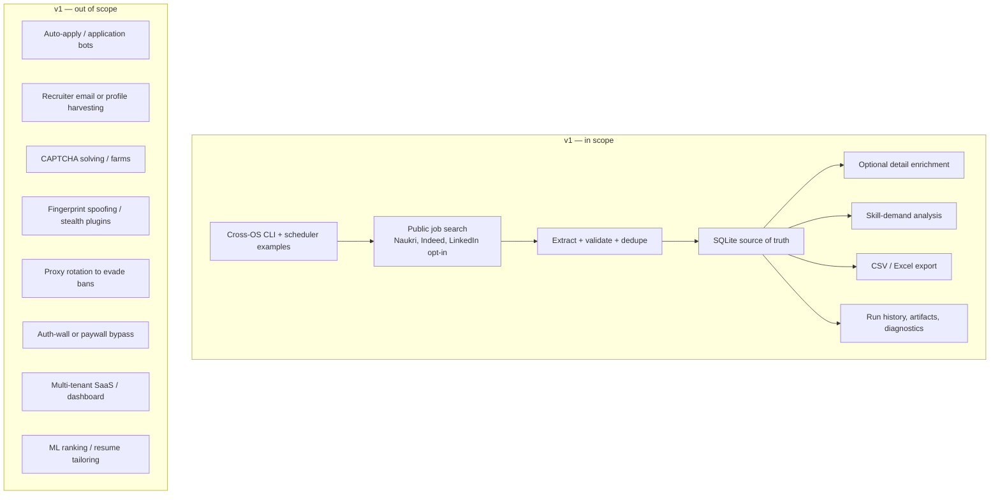
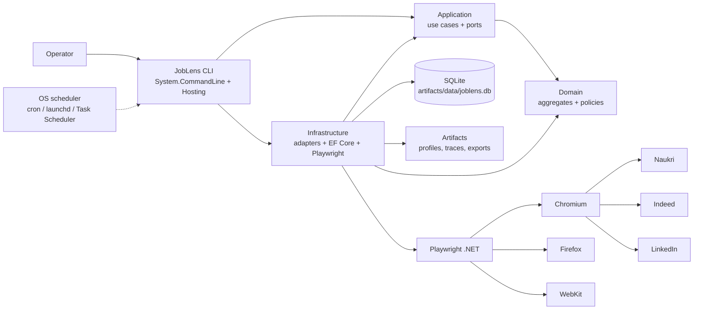

# Executive Summary

> **Decision in one line:** Build **JobLens**, a .NET 10 modular monolith and CLI that uses Playwright for .NET to collect public job postings from Naukri, Indeed, and (opt-in) LinkedIn, stores them in SQLite, and exports analysis-ready CSV/Excel — with compliance-first anti-bot controls, not evasion tooling.

---

## 1. The ask

Build a brand-new automation/web-scraping solution that:

- Runs on **macOS, Linux, and Windows**.
- Works with **Chromium/Chrome, Firefox, WebKit, and Edge** where technically possible.
- Targets **Naukri**, **LinkedIn**, and **Indeed India**.
- Uses **.NET 10**, **latest xUnit**, and **latest Playwright**.
- Follows **Clean Architecture, DDD, TDD, SOLID, YAGNI, and DRY** where each adds value.
- Reuses the **anti-bot lessons** of the old Python project without copying its structure or mess.
- Is understandable to a developer who knows C#/OOP and ASP.NET Core Web APIs but not xUnit or Playwright.

The immediate deliverable is this **documentation set**: research, architecture, domain model, execution plan, testing strategy, site playbooks, anti-bot policy, and runbook. Implementation starts after the open decisions are approved.

---

## 2. Recommendation

### Build a modular monolith, not a microservice fleet

A single deployable CLI with clean internal boundaries is the right size for one user, one machine, and three sources. It gives us:

- One process, one SQLite writer, one browser session at a time.
- Simple debugging and artifacts.
- Clean seams (`IJobSource`, repositories, policies) without distributed-systems overhead.
- A straight path to the v2 local API and React/Bun cockpit if the use case grows: [Web Cockpit](12-web-cockpit.md).

### Use Playwright browser automation as the default collection path

The three sites are JavaScript-heavy and protected by different bot-management layers. A real browser with a persistent profile is more robust than raw HTTP and easier to keep consistent. A private API fast path may be added for Naukri later **behind a feature flag**, with browser fallback, but it is not the foundation.

### Keep DDD focused

DDD is applied to the genuinely complex parts:

- **Sourcing:** search profiles, scrape runs, postings, deduplication.
- **Access:** browser profiles, session health, challenge handling, quotas, circuit breakers.

Reporting/export is a simple read model. We will not force aggregates and repositories onto every CRUD-shaped table.

### Treat anti-bot as policy, not a library

The old project's most important finding is that **headed, persistent, consistent browser sessions are low-signal; headless and spoofing are high-signal**. We will:

- Use headed first contact and persistent profiles.
- Never override the user agent or stub browser APIs.
- Pace requests, cap pages/jobs, and run one pass at a time.
- Detect walls, stop, capture evidence, and require a human.
- Measure exposure with public diagnostics, without chasing a “human” score.

No stack is undetectable. The realistic goal is **not getting banned**, which comes from low volume, consistency, and stopping before escalation.

---

## 3. Why this stack

| Choice | Version (verified 2026-10-29) | Why |
|---|---|---|
| **.NET 10 LTS** | SDK `10.0.403`, runtime `10.0.14` | Supported until **2028-11-14**; cross-platform; strong async/DI/tooling; familiar to you. |
| **xUnit.net v3** | `xunit.v3` `4.0.2`, adapter `4.0.1` | v2 is in maintenance; v3 has in-process runner, Microsoft Testing Platform support, assembly fixtures, dynamic skip, `TestContext`, and first-class Playwright integration. |
| **Playwright for .NET** | `1.64.1` | Chromium/Firefox/WebKit on all three OSes, auto-wait, locators, tracing, codegen, persistent contexts, network interception. |
| **Microsoft.Playwright.Xunit.v3** | `1.64.1` | Official `PageTest` base class for xUnit v3. |
| **SQLite + EF Core 10** | `10.0.14` | Zero-ops local database, cross-platform, transactional, easy backup, good enough for personal volume. PostgreSQL remains an option later. |
| **System.CommandLine** | `2.0.14` | Stable, testable CLI parsing without a heavy framework. |
| **Microsoft.Extensions.Hosting** | `10.0.14` | DI, configuration, logging, cancellation, lifetime — the ASP.NET Core patterns you already know. |
| **Serilog** | `10.0.0` | Structured JSON file logs with enrichers, daily retention, correlation, and redaction; console + async file sinks. |
| **Polly v8** | via `Microsoft.Extensions.Http.Resilience` `10.0.0` | HTTP retry, circuit breaker, timeout, and safe fallback for optional API clients; browser navigation keeps its own stop-on-wall policy. |
| **AngleSharp** | `1.8.6` | CSS-selector HTML parsing for fixtures and server-rendered pages; no browser needed in unit tests. |
| **ClosedXML** | `0.105.1` | Trusted cross-platform Excel with hyperlinks. |
| **Scalar.AspNetCore** | `2.18.5` | Local interactive API reference/testing at `/scalar`; Development only, paired with `Microsoft.AspNetCore.OpenApi` `10.0.14`. |

Deliberately **not** used in v1: CQRS, MediatR, AutoMapper, FluentValidation, Dapper, Selenium, microservices, message buses, dashboards, ML ranking. Each can be added when a real requirement appears; none is needed to ship the first vertical slice.

Application code uses explicit use-case handlers and four small patterns: **Result**, **Options**, **Specification**, and **Problem Details**. See [Application Patterns](14-application-patterns.md).

Operational baseline: Serilog JSON logs with 90-day retention, global exception handling, `IHttpClientFactory` + Polly v8 HTTP resilience, and strict async/disposal/disk rules. See [Runtime Hardening](15-runtime-hardening.md).

Library policy: use each package’s documented, recommended configuration. AOT/trimming is not a design constraint; Serilog, DataAnnotations, ClosedXML, Scalar, EF Core, and Playwright are all used as designed. See [Library Usage Policy](16-library-usage-policy.md).

> **Browser reality:** Playwright drives Chromium, Firefox, and WebKit (Safari's engine) on macOS/Linux/Windows. It does **not** automate real Safari; WebKit is the closest cross-platform proxy. Real Safari automation would require a separate macOS SafariDriver adapter. Windows 10 and macOS 13 or older are outside Playwright's supported matrix.

---

## 4. Scope

### In scope

- Public search-result pages and public job-detail pages.
- Configurable search profiles (keywords, locations, experience, posted-within days).
- Page/job caps, enrichment, retries for transient failures only.
- Session bootstrap (manual login/challenge solve where needed).
- Normalized job postings, skills, salary/location parsing when present.
- Analysis and export.
- Diagnostics, run artifacts, and a compliance gate per source.

### Out of scope (v1)

- Automated job applications. This is a different risk class and needs explicit approval, dry-run defaults, quotas, and post-submit verification.
- Recruiter email collection (the old project's `collect-emails` paths). v1 collects job postings only, to minimize personal-data exposure.
- Any attempt to defeat a bot wall, login wall, CAPTCHA, or access control.
- Multi-user hosting or billing. v1 is CLI-only; the local, single-operator v2 cockpit is specified in [Web Cockpit](12-web-cockpit.md) and [ADR-0010](10-adr/0010-react-bun-cockpit.md).

---

## 5. Architecture in one picture

The dependency rule is strict: **Domain has no dependencies; Application depends on Domain; Infrastructure implements Application ports; CLI is the composition root.** Playwright and EF Core never appear in Domain or Application. Full detail: [Architecture](02-architecture.md).

---

## 6. Delivery plan

| Phase | Focus | Duration (part-time) | Exit criteria |
|---|---|---|---|
| **0** | Foundation: solution, SDK pin, CI, ADRs | 3 days | Clean clone builds and tests green on macOS; CI skeleton green |
| **1** | Domain + Application core (TDD, no browser) | 5 days | Aggregates, value objects, policies, state machines, use-case contract tests pass |
| **2** | Browser/session infrastructure + diagnostics | 5 days | `doctor`, `session login`, browser matrix smoke, challenge fixture classified |
| **3** | Naukri vertical slice | 5 days | One page → SQLite → CSV/Excel, then full pagination/enrichment; fixture + live canary |
| **4** | Indeed + LinkedIn (opt-in) | 7 days | Indeed works or stops gracefully on challenge; LinkedIn refuses without consent and stops on wall |
| **5** | Operations + packaging | 3 days | Publish for macOS/Linux/Windows; scheduler examples; runbook complete |
| **6** | Hardening + release | 4 days | Failure drills, security/dependency review, release checklist, v1.0.0 tag |

**Total:** ~32 working days (6–7 weeks part-time; 3–4 weeks full-time), plus a 3-day buffer. Detailed dates, backlog, risks, and gates: [Gameplan](05-gameplan.md).

---

## 7. Success criteria

v1 is successful when all of these are true:

1. **Cross-platform build:** `dotnet build` and `dotnet test` pass on macOS, Linux, and Windows CI.
2. **Onboarding:** a clean machine can install, build, install browsers, and run `joblens doctor` in **under 15 minutes**.
3. **Naukri end-to-end:** a search profile produces validated postings, persists to SQLite, and exports CSV/Excel in one run.
4. **Indeed behavior:** a run either completes at very low volume or stops gracefully with a classified challenge and artifact — no retry storm.
5. **LinkedIn safety:** without explicit consent, the adapter refuses to run with actionable guidance. With consent, it is guest-only, low-volume, and stops on an auth wall.
6. **Anti-bot discipline:** 100% of challenge fixtures are detected; no 403/429/CAPTCHA is retried automatically; every wall event produces a screenshot/HTML artifact.
7. **Quality:** Domain coverage ≥ 95% line / 90% branch; Application ≥ 90/85; overall ≥ 85/80; architecture tests pass; no critical vulnerabilities.
8. **Hygiene:** no secrets, cookies, browser profiles, or real personal data in git; logs redact sensitive headers.
9. **Operability:** run history, logs, artifacts, backup, and restore are documented and exercised.
10. **Release:** self-contained publishes for `osx-arm64`, `linux-x64`, and `win-x64`; version `v1.0.0`.

> A ban-free run is not a guarantee. Success is **measured by low challenge/block rates and graceful stops**, not by claiming invisibility.

---

## 8. Top risks

| Risk | Likelihood | Impact | Mitigation |
|---|---|---|---|
| LinkedIn ToS/legal exposure | High | High | Default disabled; explicit consent; guest-only; legal review; recommend official API/manual export |
| Indeed Cloudflare challenge | High | Medium | Very low volume; headed persistent profile; stop on challenge; no bypass |
| Naukri Akamai/headless detection | Medium | Medium | Headed first contact; persistent profile; native pagination; optional API fast path behind flag |
| Selector/DOM drift | High | Medium | JSON-LD first; fallback selector chains; HTML fixtures; canary tests; adapter isolation |
| Browser/OS matrix breakage | Medium | Medium | Pin Playwright; CI matrix; monthly upgrade; Docker for Linux |
| Session/profile loss | Medium | Medium | Persistent profiles; backup; explicit re-login flow; profile lock handling |
| SQLite write contention | Low | Low | Single writer; WAL; busy timeout; one run at a time |
| Log/artifact growth fills disk | Medium | Medium | Daily rotation; 90/30-day retention; size caps; free-space checks |
| Socket/handle/browser leaks | Medium | Medium | `IHttpClientFactory`, `await using`, bounded queues, soak test |
| Scope creep into auto-apply | Medium | High | Explicit non-goals; separate future decision; no v1 code paths |
| Flaky live tests | High | Low | Live tests are manual/nightly, not CI; deterministic fixtures for CI |
| Over-engineering | Medium | Medium | YAGNI checklist; vertical slices; no CQRS/MediatR/AutoMapper/microservices |

Full register: [Gameplan §7](05-gameplan.md#7-risk-register).

---

## 9. What I need from you

Before Phase 0, please confirm the decisions in [Open Decisions](11-open-decisions.md). The most important are:

1. **Name:** keep `JobLens` or choose another working name.
2. **LinkedIn:** accept the ToS risk with an opt-in adapter, or keep LinkedIn out of v1 and use official/manual export? *(Recommendation: keep the adapter behind a hard consent gate and default disabled; do not make it the first source.)*
3. **Indeed:** enable by default with conservative caps, or opt-in like LinkedIn?
4. **Data fields:** title, company, location, experience, salary, posted date, skills, description, apply URL — anything else?
5. **Output:** CSV + Excel enough, or JSON/Parquet/Postgres too?
6. **Scheduling:** OS scheduler (recommended) or in-process daemon?
7. **API/dashboard:** defer to v2 (recommended) or include in v1?
8. **Egress:** normal network only, or a user-supplied static residential proxy (no rotation)?

---

## 10. Next action

If the plan is approved:

1. Answer the open decisions.
2. Start **Phase 0**: create the solution skeleton, pin the SDK/packages, add CI, and write the first failing domain tests.
3. Deliver the **walking skeleton** in Phase 3: one Naukri page → SQLite → CSV before expanding.

No code has been written yet. This is intentional: the architecture and compliance boundaries are cheaper to change now than after three adapters and a database schema exist.
