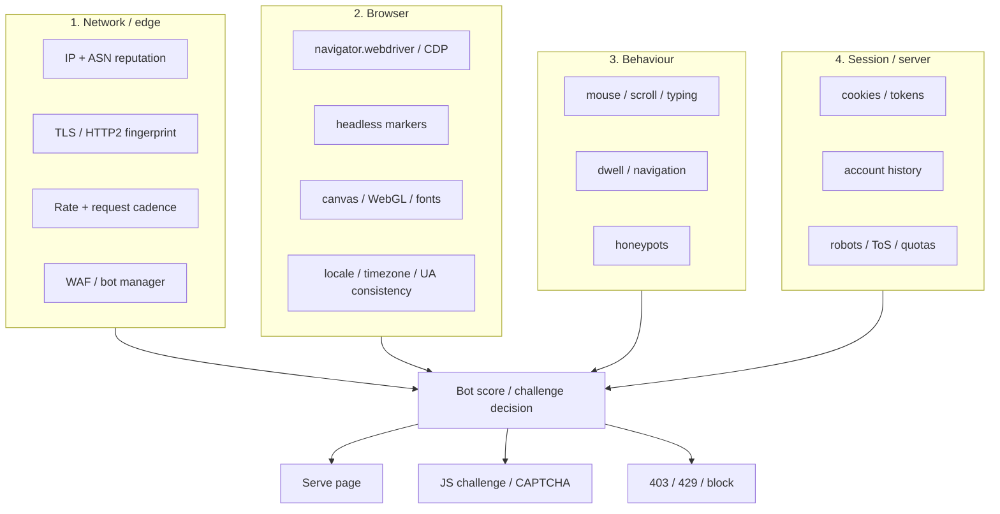

# Research Analysis

> **Research date:** 2026-10-29
>
> **Scope:** .NET 10, xUnit.net v3, Playwright for .NET, cross-platform browser support, Naukri/LinkedIn/Indeed access constraints, anti-bot detection, architecture/testing options, and build-vs-buy.
>
> **Method:** official documentation and NuGet metadata were verified live; the old Python project's measured findings were reviewed; target-site `robots.txt` files were fetched on the research date. Third-party anti-bot observations are labelled as such and require a local spike before being treated as fact.
>
> **This is engineering research, not legal advice.** LinkedIn/Indeed terms and local law must be reviewed before enabling those adapters beyond personal, low-volume use.

---

## 1. Verified versions and dates

| Component | Version / date | Evidence |
|---|---|---|
| .NET SDK | **10.0.403** | `dotnet --info` on this Mac, 2026-10-29 |
| .NET runtime | **10.0.14** | `dotnet --list-runtimes`, 2026-10-29 |
| .NET 10 support | Released 2025-11-11; **LTS until 2028-11-14** | Microsoft .NET support policy, updated 2026-10-25 |
| xUnit.net v3 | **4.0.2** (`xunit.v3`) | xunit.net latest release table + NuGet |
| xUnit.net v2 | 2.9.3 (maintenance only) | xunit.net |
| xUnit VS adapter | **4.0.1** | xunit.net + NuGet |
| xUnit v3 templates | **4.0.2** | NuGet |
| Playwright for .NET | **1.64.1** | NuGet + Playwright release notes |
| Playwright browsers | Chromium **156.0.8078.4**, Firefox **157.0**, WebKit **27.2** | Playwright 1.64 release notes |
| Branded channels tested | Chrome **155**, Edge **155** | Playwright 1.64 release notes |
| EF Core / Microsoft.Extensions | **10.0.14** | NuGet |
| `Microsoft.Playwright.Xunit.v3` | **1.64.1** | NuGet; Playwright added xUnit v3 support in 1.55 |
| `Microsoft.NET.Test.Sdk` | **18.11.0** | NuGet |
| `System.CommandLine` | **2.0.14** | NuGet |
| `AngleSharp` | **1.8.6** | NuGet |
| `ClosedXML` | **0.105.1** | NuGet |

> **Naming note:** xUnit's product line is “v3”, but the current `xunit.v3` package version is **4.0.2**. The 4.x package line is the v3 framework; do not confuse it with xUnit v2's `2.9.3`.

---

## 2. .NET 10: the runtime baseline

### 2.1 What the official policy says

- .NET 10 is an **LTS** release: released **2025-11-11**, supported until **2028-11-14**.
- The latest patch on the research date is **10.0.14** (2026-10-25).
- .NET 9 (STS) and .NET 8 (LTS) are both in maintenance and end support on **2026-11-10**; .NET 8 users should plan to move to .NET 10.
- .NET 11 is in RC as of October 2026; it is not a stable target for this project.

### 2.2 Why .NET 10 is the right baseline

| Criterion | Assessment |
|---|---|
| Support window | LTS through Nov 2028 — enough for a long-lived personal tool. |
| Cross-platform | First-class on macOS, Linux, Windows; self-contained publish per RID. |
| Language/tooling | C# 14, `TimeProvider`, `System.Threading.RateLimiting`, modern async/DI/options — all useful here. |
| Your skills | You already know C# and ASP.NET Core; no new runtime mental model. |
| Ecosystem | xUnit v3, Playwright .NET, EF Core 10, Serilog, AngleSharp all support `net10.0`. |
| Deployment | Framework-dependent or self-contained; `dotnet tool` possible later. |

### 2.3 OS support is stricter for Playwright than for .NET

.NET 10 runs on a broad OS set, but **Playwright has its own requirements** (see §4.4). We target the intersection:

- **macOS 14 (Sonoma) or later.**
- **Windows 11+, Windows Server 2019+, or WSL.**
- **Debian 12/13, Ubuntu 22.04/24.04/26.04**, x86-64 or arm64.

Windows 10, older macOS, 32-bit Linux, and unsupported distros are outside the supported matrix. “All PC/laptop/desktop OSes” is not achievable; the docs state the real matrix rather than pretending otherwise.

### 2.4 SDK pinning

Use a `global.json` with SDK `10.0.403` and `rollForward: latestFeature`. This keeps local/CI behavior reproducible while allowing a newer 10.0.4xx/10.0.5xx patch band on other machines.

```json
{
  "sdk": {
    "version": "10.0.403",
    "rollForward": "latestFeature",
    "allowPrerelease": false
  }
}
```

**Decision:** target `net10.0`, pin the SDK, update monthly with the .NET patch cadence.

---

## 3. xUnit.net v3: the test baseline

### 3.1 Current state

- xUnit **v3** is the active line; **v2 is in maintenance** (critical fixes only).
- Current `xunit.v3` package: **4.0.2**; VS adapter: **4.0.1**; templates: **4.0.2**.
- v3 requires **.NET 8+** (or .NET Framework 4.7.2+), so `net10.0` is comfortably supported.
- v3 test projects are **stand-alone executables**, not libraries. `dotnet run` runs the tests directly; `dotnet test` works through the Visual Studio adapter or Microsoft Testing Platform (MTP).

### 3.2 Features that matter for this project

| Feature | Why it matters here |
|---|---|
| In-process runner + stand-alone executable | Fast local TDD loop; no external runner required. |
| Microsoft Testing Platform (MTP) support | Modern `dotnet test` experience; TRX/CTRF reporting. |
| `IAsyncLifetime` (`ValueTask`) | Async database/browser fixture setup and teardown. |
| Assembly fixtures (`[AssemblyFixture]`) | Launch/stop a browser or fixture server once per test assembly. |
| `TestContext.Current` | Cancellation token, diagnostics, attachments, warnings. |
| Dynamic skip (`Assert.Skip`, `SkipWhen`, `SkipUnless`) | Skip live/browser tests when the environment is not configured. |
| `MatrixTheoryData` | Cross-product tests for source × browser × fixture cases. |
| Parallel collections | Fast unit tests; browser tests isolated in a non-parallel collection. |
| `Microsoft.Playwright.Xunit.v3` | Official `PageTest` base class for browser E2E. |

### 3.3 Why v3 instead of v2

- v2 is maintenance; new features and fixes go to v3.
- v3's runner and `TestContext` reduce custom test infrastructure.
- Playwright's official xUnit v3 package (`Microsoft.Playwright.Xunit.v3`) exists and is current.
- The migration cost is low because this is a greenfield project.

### 3.4 Caveats

- The runner ecosystem is newer; pin `xunit.v3`, `xunit.runner.visualstudio`, and `Microsoft.NET.Test.Sdk`, and verify `dotnet test` in CI on all three OSes.
- Choose **one** runner mode per CI job (VSTest adapter or MTP); mixing them can create confusing discovery/coverage behavior.
- Browser tests must disable collection parallelization; a shared browser/profile is not safe for parallel tests.
- Use `ValueTask InitializeAsync()` / `DisposeAsync()` in v3; `async void` tests are rejected.

**Decision:** xUnit v3 `4.0.2` + VS adapter `4.0.1` + `Microsoft.Playwright.Xunit.v3` `1.64.1`.

---

## 4. Playwright for .NET: the browser baseline

### 4.1 What Playwright gives us

- One API for **Chromium, Firefox, and WebKit** on Windows, macOS, and Linux.
- **Auto-waiting** and web-first assertions, which reduce flaky sleeps.
- **Locators** that mirror user-visible semantics (`GetByRole`, `GetByLabel`, `GetByTestId`).
- **Persistent browser contexts** — essential for cookies/session reuse.
- **Tracing** (DOM snapshots, network, screenshots), codegen, and a trace viewer.
- **Network interception** and response inspection, useful for API fast paths and diagnostics.
- **Multiple isolated contexts** per browser — fast test isolation.

### 4.2 Version 1.64 specifics

- Bundled Chromium **156.0.8078.4**, Firefox **157.0**, WebKit **27.2**.
- Tested against stable **Chrome 155** and **Edge 155** channels.
- 1.57+ uses **Chrome for Testing** builds for headed Chromium; headless uses **chrome-headless-shell** by default.
- 1.64 adds WebMCP, better video/screencast options, `Locator.Within`, and hidden-iframe visibility changes.
- Breaking change in 1.64: elements inside a hidden iframe are considered hidden. This is good for our honeypot/visibility guards, but verify selectors if a target site embeds content in iframes.

### 4.3 Browser reality check

| User expectation | Reality |
|---|---|
| “Safari on Windows/Linux” | **Not possible.** Playwright's WebKit is a patched WebKit build, not Apple Safari. Real Safari is macOS-only and requires WebDriver/SafariDriver, not Playwright. |
| “Firefox” | Playwright uses a **patched Firefox build**, not the branded Firefox installed on the machine. |
| “Chrome/Edge” | Playwright can drive installed **stable/beta channels** (`chrome`, `msedge`) on supported platforms; enterprise policies can interfere. |
| “Any OS” | Playwright supports a specific OS matrix; Windows 10 and older macOS are not supported by current versions. |
| “Headless is fine” | Headless is detectable and often blocked by Naukri/Indeed/LinkedIn. Use **headed first contact** and persistent profiles. |

> **Decision:** The cross-browser promise is **test/automation compatibility**, not “run real Safari everywhere.” Chromium is the default production engine; Firefox/WebKit are compatibility and diagnostic targets. If true Safari automation becomes a hard requirement, add a separate SafariDriver adapter later — outside the Playwright abstraction.

### 4.4 Official system requirements (Playwright .NET)

- **Windows 11+, Windows Server 2019+, or WSL.**
- **macOS 14 (Sonoma) or later.**
- **Debian 12/13, Ubuntu 22.04/24.04/26.04**, x86-64 or arm64.
- Linux requires system dependencies; use `playwright.ps1 install-deps` or the official Docker image.

### 4.5 Browser install model

- Playwright downloads browser binaries into an OS-specific cache (`~/Library/Caches/ms-playwright` on macOS, `~/.cache/ms-playwright` on Linux, `%LOCALAPPDATA%\ms-playwright` on Windows).
- Each Playwright version expects specific browser builds; **upgrade Playwright and reinstall browsers together**.
- Branded Chrome/Edge are not installed by default; use the channel option or install `msedge`/`chrome`.
- CI should cache the browser cache keyed by Playwright version.

### 4.6 Why Playwright over Selenium/Puppeteer here

| Criterion | Playwright | Selenium | Puppeteer |
|---|---|---|---|
| .NET support | First-class | First-class | Weak/unofficial |
| Cross-browser engines | Chromium/Firefox/WebKit | Real browsers + drivers | Chromium/Firefox |
| Auto-wait/locators | Strong | Improving | Strong (Node) |
| Tracing/debugging | Excellent | Limited | Good (Node) |
| Persistent profile | Built-in | Driver-profile complexity | Built-in |
| Real Safari | No (WebKit only) | Yes (macOS SafariDriver) | No |
| Fit for this project | **Chosen** | Only if real Safari is mandatory | Not .NET-first |

---

## 5. Cross-platform matrix

### 5.1 OS matrix

| OS | Supported | Notes |
|---|---|---|
| macOS 14+ | Yes | Best WebKit fidelity; Apple Silicon and Intel. |
| Windows 11 / Server 2019+ | Yes | Edge/Chrome channels; WSL2 also works. |
| Debian 12/13 | Yes | Install deps; x64/arm64. |
| Ubuntu 22.04 / 24.04 / 26.04 | Yes | CI baseline; x64/arm64. |
| Windows 10 | No (Playwright) | Do not claim support. |
| macOS 13 or older | No (current Playwright WebKit) | Upgrade or pin an older Playwright version, which is not recommended. |
| Alpine/musl | Not officially supported | Use the Debian-based Playwright Docker image. |

### 5.2 Browser matrix

| Engine | Playwright build | Branded channel | Real Safari? | Role |
|---|---|---|---|---|
| Chromium | 156 | `chrome`, `msedge` 155 | No | **Default** production engine |
| Firefox | 157 | No branded integration | No | Compatibility/diagnostic |
| WebKit | 27.2 | No Safari integration | Approximate only | Safari-like compatibility/diagnostic |

### 5.3 Deployment matrix

| Mode | Use |
|---|---|
| Local framework-dependent | Daily development; requires .NET 10 runtime. |
| Self-contained per RID | Release artifacts for `osx-arm64`, `osx-x64`, `linux-x64`, `linux-arm64`, `win-x64`. |
| Docker (Linux) | CI/E2E and headless server runs; headed runs need Xvfb. |
| `dotnet tool` | Possible later; not needed for v1. |

---

## 6. Target-site analysis

> **Read this first:** “public” does not mean “free to scrape.” Each site's terms, robots policy, and local law still apply. The table below is an engineering summary, not a legal clearance.

### 6.1 Comparison

| Dimension | Naukri | LinkedIn | Indeed India |
|---|---|---|---|
| Public search | Yes, no login needed for search results | Guest search possible, but auth wall appears quickly | Yes, public search |
| Primary anti-bot | **Akamai** (observed in old project: `errors.edgesuite.net`); headless blocked | Internal auth wall + rate limits (429/999); aggressive session checks | **Cloudflare** managed challenge + proprietary layer (2026 reports); headless often blocked |
| Search URL shape | `/jobs?k=&l=&experience=&jobPostDate=&page=` and slug URLs | `/jobs/search?keywords=&location=&f_TPR=&start=` | `/jobs?q=&l=&fromage=&start=` |
| Detail URL shape | `/job-listings-<slug>-<id>` | `/jobs/view/<id>` | `/viewjob?jk=<id>` |
| Pagination | SPA; **click native Next** to preserve filters | `start` increments (typically 25) | `start` increments (typically 10) |
| Auth | Not required for public search | Login wall/authwall after a few requests; login raises ToS risk | Not required for public search |
| robots.txt (2026-10-29) | Blocks AI crawlers; disallows specific paths; `/jobs` not blanket-disallowed | Explicit notice: automated access strictly prohibited without permission; User Agreement prohibits scraping | Allows many `/jobs` and `/viewjob` paths; disallows `/graphql`, `/job/`, several `/api/` paths |
| Official jobs API | No public self-serve API for this use | Partner API only; no general public jobs API | Partner/publisher APIs only; no general public jobs API |
| Risk tier | **Standard** (public pages, low volume) | **High risk** (contractual prohibition) | **Restricted** (public pages, strong anti-bot) |
| Default in JobLens | Enabled | **Disabled**; explicit consent required | **Disabled**; explicit consent required |
| Recommended path | Browser-first; optional private search API behind a flag | Official/manual export, or guest-only opt-in with hard caps | Browser-first, very low volume, stop on challenge |

### 6.2 Naukri

**What the old project measured (2026-09/10):**

- Headed Chromium with a persistent profile works; headless is blocked.
- Akamai is the observed wall (`errors.edgesuite.net`); a visible block page appears for unknown sessions.
- The search results page is an SPA. Directly navigating to a `-2` slug URL loses SPA filter state; pagination must click the native **Next** control and wait for the result range to change.
- Job cards expose key skills directly (`ul.tags-gt > li.tag-li`, promoted-card variants). This avoids visiting every detail page for a skills scan.
- A private search API (`jobapi/v3/search` with an RSA `nkparam` token) exists and is used by third-party scrapers. It can return 20 cards/page with `tagsAndSkills`, but it is reverse-engineered, fragile, and not officially supported.

**Engineering implication:** Naukri is the best first adapter. It has a public search flow, a measurable wall, and a mature set of DOM lessons. Start browser-first; add an API fast path only if a time-boxed spike proves it stable and compliant, always with browser fallback.

### 6.3 LinkedIn

**What the evidence says:**

- LinkedIn's `robots.txt` opens with: *“The use of robots or other automated means to access LinkedIn without the express permission of LinkedIn is strictly prohibited.”*
- LinkedIn's User Agreement prohibits scraping, crawling, and automated data collection without permission. Crawling permission is a separate application/contract.
- Guest job search can return public cards, but an **auth wall** appears after a small number of requests. Rate limits surface as **HTTP 429** and LinkedIn's **999** request-denied response.
- Login increases access but also increases account risk; LinkedIn explicitly prohibits automation and may restrict accounts.
- There is no general public jobs API for this use case; partner APIs require an agreement.

**Engineering implication:** LinkedIn is **not** a normal scraping target. The responsible design is:

1. Default **disabled**.
2. Require an explicit, logged acknowledgment of the ToS risk.
3. Prefer **official API or manual export**.
4. If the operator still opts in: guest-only, no credential automation, one page at a time, stop on the first auth wall/429/999, no retries, no alternate accounts.
5. Keep the adapter isolated so it can be removed without touching the core.

### 6.4 Indeed India

**What the evidence says:**

- Public search and viewjob pages exist, but Indeed is protected by **Cloudflare** plus a proprietary bot layer. Multiple 2026 third-party reports describe managed challenges even on the homepage, and blocks within a handful of requests.
- `robots.txt` allows many search paths, but disallows `/graphql`, `/job/`, and several `/api/` endpoints. Private GraphQL/mobile endpoints are not a compliant shortcut.
- Headless browsers are frequently challenged; a real headed browser on a normal residential/office IP has the best chance, but no guarantee.
- There is no general public jobs API for this use case.

**Engineering implication:** Indeed is a **very low-volume, opt-in** source. Use a real headed browser, one or two search pages, long delays, and stop immediately on a challenge. Do not build a Cloudflare-bypass layer; that is both fragile and outside the project's policy.

### 6.5 What all three have in common

- Public search results are server-rendered or hydrated with job data; **JSON-LD** is often available and should be the first parsing choice.
- Detail pages are richer but expensive; enrichment must be capped.
- Job IDs and canonical URLs are the stable identity; titles/companies are not unique.
- Rate limits and bot scores are **per IP + session + behaviour**, not just per request.
- The biggest predictor of a ban is **volume and cadence**, not the browser binary.

---

## 7. Anti-bot landscape and legacy evidence

### 7.1 The four detection layers



### 7.2 What the old project measured

The Python project documented a measured comparison on this Mac (headed vs headless, 2026-09/10):

| Test | Headed Playwright Chromium | Headless | Interpretation |
|---|---|---|---|
| FingerprintJS BotD | `{"bot": false}` | `{"bot": true, "botKind": "headless_chrome"}` | Headed is low-signal; headless is explicitly flagged. |
| BrowserScan | 44 → **100** after removing UA/language stubs | Lower | Consistency beats spoofing. |
| CreepJS | Trust **93/100**, “no automation indicator” | — | Still not “undetectable”; CDP remains. |
| Iphey | MX 90, one tripwire: **`hasCDP: true`** | — | CDP is inherent to automation. |
| Sannysoft | All rows green | Headless markers fire | Headed genuine browser is materially better. |
| DeviceAndBrowserInfo | Bot on CDP/timing/worker only | — | No classic flags, but CDP/timing remain. |
| Naukri | Works headed | Blocked | Headed first contact is required. |

**Lessons that directly shape JobLens:**

1. **Never pin the user agent.** A stale `Chrome/126` string against a `Chrome/153` engine is a self-inflicted inconsistency.
2. **Never stub `navigator`, plugins, languages, WebGL, or `window.chrome`.** Inconsistent stubs are worse than the real values.
3. **Persistent profile > fresh incognito.** Cookies, history, and storage make a session look established.
4. **Headed live collection > headless.** Keep headless for fixture E2E/diagnostics; headless live runs are flagged and often blocked.
5. **CDP/TLS/IP/behaviour residuals are unavoidable.** Do not promise invisibility; design for low volume and graceful stopping.
6. **A wall is a stop signal, not a retry signal.** 403/429/CAPTCHA must pause the run and require a human.

### 7.3 What we will not do

- CAPTCHA solving or CAPTCHA farms.
- Fingerprint-spoofing/stealth plugins that lie about `navigator`, WebGL, canvas, or plugins.
- Account rotation, proxy rotation to evade bans, or datacenter proxy pools.
- Auth-wall, paywall, or login bypass.
- TLS/JA3 impersonation on the browser path.
- Retry loops against 403/429/CAPTCHA.
- Auto-apply, mass messaging, or recruiter/profile harvesting in v1.

Full policy and runbook: [Anti-Bot & Compliance](07-anti-bot-and-compliance.md).

---

## 8. Option analysis

### 8.1 Collection approach

| Option | Speed | Robustness | Legal/compliance | Maintenance | Verdict |
|---|---|---|---|---|---|
| Raw HTTP + TLS impersonation (JobSpy-style) | High | Low–medium; breaks on JS/WAF | Medium; fingerprint mismatch visible | High | **Only** optional Naukri API fast path, behind a flag, with browser fallback |
| Playwright browser automation | Medium | High; executes JS, real session | Medium; ToS still applies | Medium | **Default** |
| Managed scraping API (Bright Data/Scrapfly/Apify/etc.) | High | High | Vendor-dependent; may not resolve ToS | Low | **Fallback** if local access fails; not v1 |
| Official/partner API | High | High | High (contractual) | Low | **Preferred where available**; LinkedIn/Indeed not generally available |
| Manual export | Low | High | High | None | **Baseline for LinkedIn** |

**Decision:** browser-first, with an optional Naukri API fast path only after a spike. No managed API dependency in v1; keep the `IJobSource` port so a hosted adapter can be added later.

### 8.2 Architecture approach

| Option | Fit | Why |
|---|---|---|
| Modular monolith + Clean Architecture | **Chosen** | Single user/machine; clean seams; one deployable; easy debugging. |
| Microservices | No | Operational overhead, distributed transactions, no scale need. |
| Vertical slices only | Partial | Use feature folders inside Application, but keep a domain layer for run/session rules. |
| CRUD-only | No | Run lifecycle, session health, challenge policy, quotas, and dedupe are real domain logic. |
| DDD everywhere | No | Reporting/export is a simple read model; forcing aggregates there adds noise. |
| Event sourcing | No | Audit needs are met by `RunEvent`; event sourcing is overkill. |

**Decision:** modular monolith, Clean Architecture layers, DDD for **Sourcing** and **Access**, simple read models for **Insight/Export**.

### 8.3 Testing approach

| Option | Use |
|---|---|
| TDD | Domain rules, value objects, policies, state machines, URL builders, parsers. |
| Test-after | CLI glue, DI wiring, logging configuration. |
| Contract tests | Every `IJobSource` implementation. |
| Browser E2E with local fixtures | Navigation, waits, selectors, pagination, challenge pages. |
| Live canary | Manual/nightly, opt-in, low volume; **never in CI on every commit**. |
| 100% coverage | Rejected as a vanity target; use risk-based gates. |

**Decision:** test pyramid with strong unit/contract coverage and a small, deterministic browser suite. See [Testing Strategy](06-testing-strategy.md).

### 8.4 Storage approach

| Option | Fit | Why |
|---|---|---|
| SQLite + EF Core | **Chosen** | Zero-ops, single file, transactional, cross-platform, easy backup. |
| PostgreSQL | Later | Better concurrency/ops at scale; unnecessary for one user. |
| LiteDB | No | Smaller ecosystem, weaker EF/tooling, less familiar. |
| Files/JSON only | No | No querying, dedupe, or transactional run state. |
| SQL Server | No | Licensing/ops overhead; not cross-platform-native for this use. |

**Decision:** SQLite is the source of truth; exports are disposable snapshots. Keep provider-agnostic EF Core code so PostgreSQL is a later option.

### 8.5 Build vs buy

| Need | Build | Buy/managed | Decision |
|---|---|---|---|
| Browser automation | Playwright + adapters | Browserbase/Bright Data/etc. | Build; keep a hosted-adapter seam. |
| CAPTCHA/anti-bot bypass | — | Various | **Do not buy**; outside policy. |
| Job data | Scrape public pages | Licensed job feeds | Build for personal use; consider licensed feeds if going commercial. |
| Storage | SQLite | Cloud DB | Build/local. |
| Scheduling | OS scheduler | Quartz/cloud scheduler | OS scheduler for v1. |

---

## 9. Spikes required before or during Phase 0–2

Each spike is time-boxed and produces a written note + fixture, not open-ended exploration.

| # | Spike | Timebox | Question | Fallback |
|---|---|---|---|---|
| S1 | Naukri private API fast path | 1 day | Does `jobapi/v3/search` still work from a normal session? Is `nkparam` stable? | Browser-only adapter |
| S2 | Indeed challenge behavior | 0.5 day | Does a headed persistent profile get a public page from the target network? How quickly does Cloudflare challenge? | Keep Indeed opt-in; document block |
| S3 | LinkedIn guest search | 0.5 day | How many guest pages before auth wall/429/999? Does a manual session help? | Keep disabled; official/manual path |
| S4 | WebKit on target sites | 0.5 day | Do Naukri/Indeed/LinkedIn render under Playwright WebKit? | Chromium-only production; WebKit for diagnostics |
| S5 | Excel hyperlinks | 0.5 day | Does ClosedXML produce clickable titles with long URLs cross-platform? | CSV + HTML report |
| S6 | Profile lock/concurrency | 0.5 day | What happens when two runs share a user-data dir? How to detect stale locks? | Global semaphore + explicit error |
| S7 | SQLite WAL + EF Core | 0.5 day | Write throughput/locking under page-by-page upserts? | Batch writes per page |

Spikes S1–S3 are **research only**; they do not authorize bypassing a wall. If a spike hits a challenge, record it and stop.

---

## 10. Findings → decisions

| Finding | Decision |
|---|---|
| .NET 10 is LTS through 2028 | Target `net10.0`; pin SDK `10.0.403`; monthly patch. |
| xUnit v2 is maintenance; v3 is active | Use `xunit.v3` `4.0.2` + `Microsoft.Playwright.Xunit.v3` `1.64.1`. |
| Playwright supports three engines, not real Safari | Chromium default; Firefox/WebKit compatibility; document Safari limitation. |
| Headed persistent Chromium is the lowest-signal path | Headed first contact; persistent profile per source; no UA/JS spoofing. |
| Naukri is public-search friendly but Akamai-protected | First adapter; browser-first; native Next pagination; optional API flag. |
| LinkedIn prohibits automated access | Default disabled; explicit consent; guest-only; stop on wall; recommend official/manual. |
| Indeed is Cloudflare-protected | Opt-in; very low volume; headed; stop on challenge; no private GraphQL. |
| Microservices/MediatR/AutoMapper add no value | Modular monolith; explicit handlers/mapping; YAGNI. |
| 100% coverage is not the goal | Risk-based gates: Domain 95/90, Application 90/85, overall 85/80. |
| Live scraping is nondeterministic | Fixtures in CI; live canaries manual/nightly. |

---

## 11. References

### Official documentation

- .NET support policy: <https://dotnet.microsoft.com/en-us/platform/support/policy/dotnet-core>
- xUnit.net: <https://xunit.net/>
- xUnit.net quick start (C#): <https://xunit.net/index.html?tabs=cs>
- xUnit v3 “What's new”: <https://xunit.net/docs/getting-started/v3/whats-new>
- xUnit v3 migration: <https://xunit.net/docs/getting-started/v3/migration>
- Playwright for .NET: <https://playwright.dev/dotnet/>
- Playwright browsers: <https://playwright.dev/dotnet/docs/browsers>
- Playwright release notes: <https://playwright.dev/dotnet/docs/release-notes>
- Playwright system requirements: <https://playwright.dev/dotnet/docs/intro#system-requirements>
- EF Core docs: <https://learn.microsoft.com/ef/core/>
- AngleSharp: <https://anglesharp.github.io/>
- ClosedXML: <https://github.com/ClosedXML/ClosedXML>

### Target-site policies (fetched 2026-10-29)

- Naukri robots: <https://www.naukri.com/robots.txt>
- LinkedIn robots: <https://www.linkedin.com/robots.txt>
- LinkedIn User Agreement: <https://www.linkedin.com/legal/user-agreement>
- LinkedIn Crawling Terms: <https://www.linkedin.com/legal/crawling-terms>
- Indeed India robots: <https://in.indeed.com/robots.txt>
- Indeed robots (global): <https://www.indeed.com/robots.txt>

### Legacy project evidence

- `/Users/aslamshaikh/Projects/PythonWebScraping/docs/BOT_DETECTION.md` — measured headed/headless signal table, BotD/BrowserScan/CreepJS/Iphey results.
- `/Users/aslamshaikh/Projects/PythonWebScraping/docs/LINKEDIN_RESEARCH.md` — LinkedIn auth wall, 429/999, JobSpy/joeyism/MCP references.
- `/Users/aslamshaikh/Projects/PythonWebScraping/docs/PROJECT.md` — Naukri pipeline, SPA pagination, environment notes.
- `/Users/aslamshaikh/Projects/PythonWebScraping/src/stealth_browser.py` — persistent profile, no JS spoofing, manual-solve policy.
- `/Users/aslamshaikh/Projects/PythonWebScraping/src/naukri_scraper.py` — honeypot-safe extraction, native Next pagination, transient-only retries.

### Third-party observations (require local verification)

- Cloudflare/Indeed blocking reports (2026): vendor and community write-ups; used only to justify a conservative default and a spike.
  - Scrapfly, “How to Scrape Indeed.com (2026 Update)”: <https://scrapfly.io/blog/posts/how-to-scrape-indeedcom>
  - Bright Data, “Best Indeed Scrapers in 2026”: <https://brightdata.com/blog/web-data/best-indeed-scrapers>
- LinkedIn 429/999 reports (2026): community write-ups plus the legacy project's measurements.
  - Microsoft LinkedIn API rate limits: <https://learn.microsoft.com/en-us/linkedin/shared/api-guide/concepts/rate-limits>
- Akamai/Naukri: legacy project's live observation of `errors.edgesuite.net`; re-verify with S2/spike.
  - Akamai Bot Manager: <https://www.akamai.com/products/bot-manager>
- Cloudflare bot management overview: <https://www.cloudflare.com/products/bot-management/>
- Multi-board scraper reference (HTTP-based, not our primary path): <https://github.com/speedyapply/JobSpy>
- Async Playwright + Pydantic LinkedIn reference: <https://github.com/joeyism/linkedin_scraper>

---

## 12. What remains uncertain

1. **Naukri private API longevity.** The `nkparam` scheme can rotate; the browser path must remain the fallback.
2. **Indeed challenge behavior from your network.** Results vary by IP/ASN/session; spike S2 decides whether Indeed is usable at all.
3. **LinkedIn guest access.** It may change without notice; the adapter must fail closed.
4. **WebKit fidelity on target sites.** It may render, but anti-bot treatment can differ; keep it diagnostic.
5. **Commercial anti-bot changes.** Cloudflare/Akamai update continuously; monthly canaries and fixture refreshes are mandatory.

These uncertainties are why the plan uses **thin adapters, feature flags, and stop-on-wall behavior** rather than a single brittle scraping path.
