# Architecture

> **Style:** Modular monolith · Clean Architecture · DDD for the core · API-first (CLI deferred).
>
> **Dependency rule:** source-code dependencies point inward. Domain knows nothing about Playwright, EF Core, HTTP, AngleSharp, Serilog, or the file system.

---

## 1. Architectural drivers

| Driver | Consequence |
|---|---|
| Three volatile websites | Each source is an isolated adapter; core never references site-specific selectors. |
| Anti-bot walls and rate limits | Session, pacing, quota, challenge, and circuit-breaker policies are first-class domain/application concerns. |
| Cross-platform | No Windows-only APIs; paths via `Environment`/options; self-contained publishes; Playwright browser install per OS. |
| Testability without a browser | URL builders, parsers, validators, and policies are pure and unit-tested. |
| Single user / single machine | SQLite, one writer, one browser context per source, no distributed infrastructure. |
| Auditability | Every run has state, events, logs, and artifacts (screenshot/HTML/trace). |
| Source volatility | JSON-LD first, fallback selector chains, fixture tests, feature flags, canaries. |
| Compliance | Per-source risk tier, explicit consent gates, stop-on-wall, no evasion tooling. |
| Future growth | API/dashboard/Postgres can be added behind existing ports; no rewrite. |

---

## 2. Principles applied (and how they are enforced)

| Principle | Concrete rule | Enforcement |
|---|---|---|
| **SRP** | One adapter per source; one handler per use case; one policy per rule. | Code review + architecture tests. |
| **OCP** | Add a source by implementing `IJobSource` and registering it; no core edits. | Contract tests; registry. |
| **LSP** | Every adapter honors the same contract and failure semantics. | Per-source fixture tests + browser tests. |
| **ISP** | Small ports (`IJobSource`, `IJobPostingRepository`, `ISessionManager`) instead of one god interface. | Interface review. |
| **DIP** | Application defines ports; Infrastructure implements them; Api wires them. | Architecture tests: no `Microsoft.Playwright`/`Microsoft.EntityFrameworkCore` in Domain/Application. |
| **DRY** | Shared pacing, retry, URL canonicalization, visibility guards, and validation helpers. | Shared libraries inside Infrastructure; no copy-paste selectors. |
| **YAGNI** | No microservices, message bus, CQRS/MediatR, AutoMapper, dashboard, auto-apply, or ML in v1. | Scope gate in every phase. |
| **Libraries as designed** | Use each library’s documented/recommended configuration. AOT/trimming is not a design constraint. | Official docs; package review; no custom replacement for standard features. |
| **KISS** | API + SQLite + one process at a time. | Deployment and runbook simplicity. |
| **Fail fast** | Invalid options fail startup before any run starts. | `IValidateOptions<T>` + `ValidateOnStart` for every options section. |
| **Idempotency** | Upsert by `(source, externalJobId)`; re-running a page never duplicates. | Unique index + repository tests. |
| **Observability** | Run ID, source, page, and challenge kind appear in logs and artifacts. | Structured logging + run events. |
| **Least privilege** | No admin rights; profile/data directories are user-scoped. | Install/runbook. |

> **DDD boundary:** DDD is used for **Sourcing** and **Access**. Reporting/export uses read models and query objects; it is not forced into aggregates.

---

## 3. System context

> **As implemented.** No CLI or scheduler exists. The API starts runs on
> demand (`POST /api/v1/runs`): `RunCoordinator` executes one run at a time
> through `RunScrapeHandler`, which drives a visible Playwright browser
> (`BrowserSessionPool`) via `PlaywrightSessionManager` and one of three
> registered adapters: `NaukriJobSource`, `IndeedJobSource`, or
> `LinkedInJobSource`. Naukri is enabled by default; Indeed and LinkedIn
> ship disabled and are consent-gated. Dashed edges show the disabled
> sources; their adapters are registered.

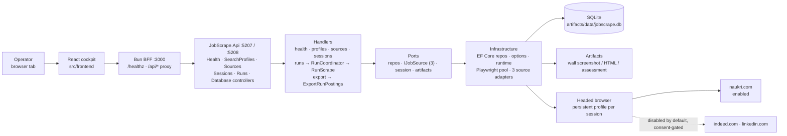

**Actors**

- **Operator:** drives the cockpit, reviews payloads and problem codes.
- **Target sites:** external, untrusted, rate-limited, and subject to change. All three have adapters and are reached through a visible browser window on the operator's machine. Naukri is enabled; Indeed (restricted tier) and LinkedIn (high-risk tier) are disabled by default and gated on explicit consent.

**Trust boundaries**

- The browser profile is a **credential** (cookies/session). `BrowserProfile.UserDataDirectory` is derived, never stored; treat profiles as sensitive.
- Scraped HTML/artifacts may contain personal data; `IArtifactStore` captures evidence only, never cookies or authorization headers. Keep local and expire.
- The target site is untrusted input: value objects validate shape, scraped rows that fail domain validation are dropped, never stored.

---

## 4. Containers

> **As implemented.** `JobScrape.Api` is the only composition root. No CLI,
> TestKit, or E2E project exists. Export writers are implemented
> (`CsvPostingWriter`, `ExcelPostingWriter`); the diagram shows only shipped
> types.

```mermaid
flowchart TB
    subgraph API["JobScrape.Api — composition root"]
        CTRL["Controllers<br/>Health · SearchProfiles · Sources<br/>Sessions · Runs · Database"]
        MW["HTTP pipeline<br/>CorrelationMiddleware ·<br/>GlobalExceptionHandler · ErrorMapper"]
        COMP["Composition<br/>Options · Logging · Database<br/>BrowserRegistration"]
        RC["Runs/RunCoordinator<br/>IRunLauncher + IHostedService<br/>one run at a time"]
    end

    subgraph APP["JobScrape.Application"]
        UC["Use-case handlers<br/>health · profiles (list/get/create/update)<br/>sources · sessions (list/get/create/update)<br/>Start/List/Get/Cancel run · run postings · export<br/>RunScrape"]
        PORTS["Ports (24)<br/>9 repositories · IUnitOfWork<br/>SearchProfile/Session/Run stores · IRunLauncher<br/>IJobSource · ISessionManager · export writer<br/>IBrowserProfileWorkspace · IArtifactStore · IDelay<br/>IDatabaseExplorer · ITokenService<br/>IIdempotencyStore · ICallerContext"]
        DTO["DTOs<br/>GetHealthResponse · SearchProfileResponse<br/>RunResponse · RunPostingResponse<br/>SearchPageResult · JobSnapshot · ScrapeRunSummary"]
        RES["Results<br/>Result / Result<T> · ErrorInfo · ErrorKind"]
    end

    subgraph DOM["JobScrape.Domain"]
        AGG["Aggregates<br/>SearchProfile · ScrapeRun · JobPosting<br/>BrowserProfile · SourceQuota · SourceCircuitBreaker"]
        VO["Value objects + invariants"]
        POL["Policies<br/>politeness · retry · challenge<br/>compliance · quota"]
        EVT["Domain events"]
    end

    subgraph INF["JobScrape.Infrastructure"]
        PERSIST["EF Core repositories +<br/>JobScrapeDbContext + migrations"]
        OPT["Options<br/>Storage · Run · Compliance · Logging · Sources"]
        RUN["Runtime<br/>TimeProviderDelay · SystemRandomSource"]
        READ["Read stores (EF, no-tracking)<br/>SearchProfile · Session · Run"]
        BROW["Browser<br/>BrowserSessionPool · PlaywrightSessionManager<br/>BrowserProfileWorkspace · FileArtifactStore"]
        EXPORT["Export<br/>CsvPostingWriter · ExcelPostingWriter"]
        EXPLORE["Persistence/SqliteDatabaseExplorer<br/>Dapper · validated identifiers"]
        NAUK["Sources/Naukri<br/>NaukriJobSource · URL builder<br/>search/detail parsers · challenge classifier"]
        INDE["Sources/Indeed<br/>IndeedJobSource · URL builder<br/>search/detail parsers · challenge classifier"]
        LINK["Sources/LinkedIn<br/>LinkedInJobSource · URL builder<br/>search parser · challenge classifier"]
    end

    CTRL --> UC
    CTRL --> MW
    COMP --> UC
    COMP --> OPT
    COMP --> RUN
    COMP --> BROW
    UC --> PORTS
    UC --> DOM
    UC --> RES
    RC --> PORTS
    RC --> UC
    PERSIST --> PORTS
    READ --> PORTS
    RUN --> PORTS
    BROW --> PORTS
    EXPORT --> PORTS
    EXPLORE --> PORTS
    NAUK --> PORTS
    INDE --> PORTS
    LINK --> PORTS
    NAUK --> BROW
    INDE --> BROW
    LINK --> BROW
    PERSIST --> DB[("SQLite<br/>artifacts/data/jobscrape.db")]
    EXPLORE --> DB
```

`RunCoordinator` implements `IRunLauncher` (an Application port) because a run
outlives the request that starts it. Every port is implemented:
`ISessionManager` → `PlaywrightSessionManager`, `IArtifactStore` →
`FileArtifactStore`, `IJobSource` → `NaukriJobSource` / `IndeedJobSource` /
`LinkedInJobSource`, `IRunStore` → `RunReadStore`, `IPostingExportWriter` →
`CsvPostingWriter` / `ExcelPostingWriter`, and `IDatabaseExplorer` →
`SqliteDatabaseExplorer`.

`JobScrape.Api` is the only composition root. It may reference Domain, Application, and Infrastructure (to bind ports). Infrastructure references Application and Domain. Application references Domain. Domain references nothing (BCL only — enforced by `LayerRulesTests` + `GuardrailTests`).

---

## 5. Layers and dependency rule

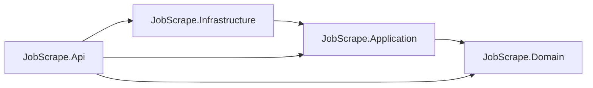

Every edge above is a `ProjectReference` in `src/backend` (see [Solution & Tooling](04-solution-and-tooling.md) §2).

**Allowed references**

| Project | May reference | Must not reference |
|---|---|---|
| `JobScrape.Domain` | BCL only | EF Core, Playwright, AngleSharp, HTTP, Serilog, Api |
| `JobScrape.Application` | Domain, `Microsoft.Extensions.Logging.Abstractions` | EF Core, Playwright, AngleSharp, Api, file system |
| `JobScrape.Infrastructure` | Application, Domain, EF Core, `Microsoft.Extensions.Options.DataAnnotations`, `Microsoft.Playwright`, AngleSharp | Api |
| `JobScrape.Api` | Domain, Application, Infrastructure (composition root binds the ports) | — |

**Architecture tests** (`JobScrape.Architecture.Tests`: `LayerRulesTests`, `GuardrailTests`, NetArchTest + xUnit) enforce:

- Domain references neither Application, Infrastructure, nor Api; and none of `Microsoft.Playwright`, `Microsoft.EntityFrameworkCore`, `AngleSharp`-family libraries (verified: Domain has zero package references).
- Application references neither Infrastructure nor Api.
- No production assembly references MediatR, and no production type is mediator-shaped (`IRequest`, `ISender`, `ICommand`, `IQuery`-style buses are banned).
- Domain has no static mutable state.
- Repositories live under `JobScrape.Infrastructure.Persistence` (+ `Repositories/`) and implement Application ports; adapters live under `Infrastructure/Sources/{Naukri,Indeed,LinkedIn}` and implement `IJobSource`.

### 5.1 Composition root (`Program.cs`)

Exact service-registration and middleware order, as written in
`src/backend/JobScrape.Api/Program.cs`:

```mermaid
flowchart TB
    B["WebApplication.CreateBuilder"] --> CTRL["AddControllers"]
    CTRL --> OA["AddOpenApi"]
    OA --> PD["AddProblemDetails<br/>Instance + traceId extension"]
    PD --> EXH["AddExceptionHandler<br/>&lt;GlobalExceptionHandler&gt;"]
    EXH --> CLK["AddSingleton TimeProvider.System"]
    CLK --> OPT["AddJobScrapeOptions<br/>Storage · Compliance · Run<br/>Logging · Sources + validators"]
    OPT --> LOGG["AddJobScrapeLogging<br/>Serilog console JSON + async file"]
    LOGG --> H1["AddTransient GetHealthHandler"]
    H1 --> H2["AddTransient Get/List/Create/UpdateSearchProfileHandler<br/>ListSourcesHandler<br/>List/Get/Create/UpdateSessionHandler"]
    H2 --> H3["AddTransient Start/List/Get/CancelRunHandler<br/>ListRunPostingsHandler · ExportRunPostingsHandler"]
    H3 --> EXP["AddSingleton IPostingExportWriter<br/>CsvPostingWriter · ExcelPostingWriter"]
    EXP --> RSH["AddScoped RunScrapeHandler<br/>(one scope per run)"]
    RSH --> COORD["AddSingleton RunCoordinator<br/>as IRunLauncher + AddHostedService"]
    COORD --> BRWS["AddJobScrapeBrowser<br/>JobScrape:Browser options · BrowserSessionPool<br/>ISessionManager (scoped) · IArtifactStore<br/>IJobSource ×3 (Naukri · Indeed · LinkedIn)<br/>JobSourceRegistry"]
    BRWS --> DB["AddJobScrapeDatabase<br/>Storage:DatabasePath → SQLite file<br/>AddJobScrapePersistence (scoped)"]
    DB --> EXPLORE["AddSingleton IDatabaseExplorer<br/>SqliteDatabaseExplorer (Dapper)"]
    EXPLORE --> BUILD["app = builder.Build()"]
    BUILD --> MAPOA["MapOpenApi (Development only)"]
    MAPOA --> MIG["MigrateInDevelopment<br/>(Database.Migrate, Development only)"]
    MIG --> CORR["UseMiddleware CorrelationMiddleware"]
    CORR --> EXHMW["UseExceptionHandler"]
    EXHMW --> SERILOG["UseSerilogRequestLogging"]
    SERILOG --> MAPC["MapControllers"]
    MAPC --> RUN["app.Run()"]
```

`AddJobScrapeBrowser` lives in `JobScrape.Api/Composition/BrowserRegistration.cs`; it resolves `ProfilesRoot` and `ArtifactsRoot` against the content root into `BrowserSessionSettings`. `BrowserSessionPool` is a singleton, so container disposal on shutdown closes every browser and flushes profile cookies.

### 5.2 Implemented feature slices

Seventeen handlers are registered one by one in `Program.cs` (Health 1,
SearchProfiles 4, Sources 1, Sessions 4, Runs 6, Scraping 1); the Database
page bypasses handlers and calls its port directly.

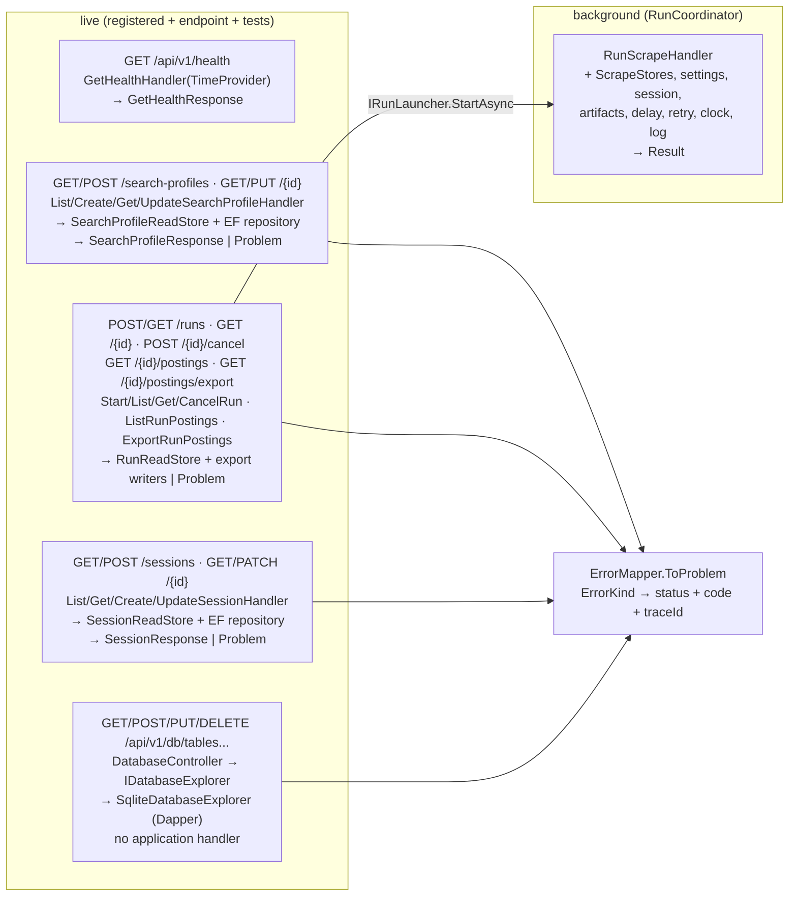

| Slice | Endpoint | Handler (ctor) | Ports → implementations | Status |
|---|---|---|---|---|
| Health | `GET /api/v1/health` | `GetHealthHandler(TimeProvider)` | none (DTO direct) | Live, tested |
| Profile lookup | `GET /api/v1/search-profiles/{id:guid}` | `GetSearchProfileHandler(ISearchProfileStore)` | `ISearchProfileStore` → `SearchProfileReadStore` (SQLite) | Live, tested |
| Profile list | `GET /api/v1/search-profiles` | `ListSearchProfilesHandler(ISearchProfileStore)` | `SearchProfileReadStore` → `{ items, total }` by name | Live, tested |
| Sources | `GET /api/v1/sources` | `ListSourcesHandler(SourceSettingsCatalog, ComplianceConsent, ISourceQuotaRepository, ISourceCircuitBreakerRepository, TimeProvider)` | Per source: tier, enabled, `CompliancePolicy` gate under the configured consent (interactive confirmation is per run, so always false here), policy caps, today's quota usage, circuit state; read-only | Live, tested; cockpit `#/sources` |
| Sessions | `GET /api/v1/sessions`, `GET /api/v1/sessions/{id:guid}`, `POST /api/v1/sessions` | `ListSessionsHandler(ISessionStore)`, `GetSessionHandler(ISessionStore)`, `CreateSessionHandler(IBrowserProfileRepository, IUnitOfWork, TimeProvider)` | `SessionReadStore` (EF no-tracking, `CanLaunch` on the injected clock); create validates with `BrowserProfile.IsValidName` and exact engine/channel names (branded channels need Chromium); `201` + `Location`, `400` field `errors`, `409 SESSION_NAME_TAKEN`, `404 SESSION_NOT_FOUND`. Login/probe are not exposed as endpoints; a run verifies its session through `PlaywrightSessionManager` | Live, tested; cockpit `#/sessions` |
| Profile create | `POST /api/v1/search-profiles` | `CreateSearchProfileHandler(ISearchProfileRepository, IUnitOfWork, SourceSettingsCatalog, TimeProvider)` | EF repository; `201` + `Location`, `400` field `errors`, `409 PROFILE_NAME_TAKEN`; caps default to and may only tighten the source policy (`SourceSettings.DefaultLimits`) | Live, tested; cockpit `#/profiles` |
| Profile update | `PUT /api/v1/search-profiles/{id:guid}` | `UpdateSearchProfileHandler(ISearchProfileRepository, IUnitOfWork, SourceSettingsCatalog, TimeProvider)` | EF repository; source is immutable; full replacement through `SearchProfileValidator`; `200`, `400` field `errors`, `404 PROFILE_NOT_FOUND`, `409 PROFILE_NAME_TAKEN`; enabling a high-risk source without interactive consent is a `400` field error | Live, tested; cockpit `#/profiles` |
| Session update | `PATCH /api/v1/sessions/{id:guid}` | `UpdateSessionHandler(IBrowserProfileRepository, IBrowserProfileWorkspace, IUnitOfWork, TimeProvider, ILogger)` | EF repository; source immutable; a rename moves the user-data directory through `BrowserProfileWorkspace` (pool-backed) before the row is saved; `200`, `400` field `errors`, `404 SESSION_NOT_FOUND`, `409 SESSION_NAME_TAKEN` / `SESSION_RENAME_BLOCKED` | Live, tested; cockpit `#/sessions` |
| Runs | `POST /api/v1/runs` (`{ profileId, browserProfileId, enrich = true }`), `GET /api/v1/runs`, `GET /api/v1/runs/{id:guid}`, `POST /api/v1/runs/{id:guid}/cancel`, `GET /api/v1/runs/{id:guid}/postings` | `StartRunHandler(IRunLauncher, IRunStore, ComplianceConsent)`, `ListRunsHandler(IRunStore)`, `GetRunHandler(IRunStore)`, `CancelRunHandler(IRunLauncher, IScrapeRunRepository, IUnitOfWork, IRunStore, TimeProvider)`, `ListRunPostingsHandler(IRunStore)` | `RunReadStore` (EF no-tracking). Start → `202` + `Location` with the recorded run, or the gate's problem; `409 RUN_IN_PROGRESS` while another run executes; `503 RUN_NOT_STARTED` when the host stops before the run is recorded. List: newest 50 (`ListRunsHandler.Limit`). Cancel is idempotent: an executing run is signalled, a paused run that is not executing is cancelled directly, a terminal run is returned unchanged. Postings: the run's source postings whose `LastSeenAt` falls in `[StartedAt, FinishedAt ?? now]`, max 200 — valid because runs execute one at a time. `404 RUN_NOT_FOUND` | Live, tested; cockpit `#/runs` |
| Export postings | `GET /api/v1/runs/{id:guid}/postings/export?format=csv\|xlsx&group=all\|only\|exclude` | `ExportRunPostingsHandler(IRunStore, IEnumerable<IPostingExportWriter>)` | `RunReadStore.ListExportPostingsAsync` (max 20,000), then `CsvPostingWriter` or `ExcelPostingWriter`; company groups filter against the run's captured `companies`; `400 EXPORT_FORMAT_UNSUPPORTED` / `EXPORT_GROUP_UNSUPPORTED` / `EXPORT_COMPANIES_MISSING`, `404 RUN_NOT_FOUND` | Live, tested; cockpit `#/runs` |
| Database explorer | `GET /api/v1/db/tables`, `GET /api/v1/db/tables/{table}/schema`, `GET/POST/PUT /api/v1/db/tables/{table}/rows`, `DELETE /api/v1/db/tables/{table}/rows/{primaryKeyValue}` | none — `DatabaseController` calls `IDatabaseExplorer` directly | `SqliteDatabaseExplorer` (Dapper) over the same SQLite file; identifiers validated against the live schema and quoted, values parameterized; `400 INVALID_TABLE` / `INVALID_INPUT` / `DB_ERROR`, `404 TABLE_NOT_FOUND` / `ROW_NOT_FOUND`, `204` on writes | Live, tested; cockpit `#/database` |
| Run scrape | (background) | `RunScrapeHandler(ScrapeStores, JobSourceRegistry, SourceSettingsCatalog, ISessionManager, IArtifactStore, IDelay, RetryPolicy, IRandomSource, TimeProvider, ILogger)` | 6 domain repositories and `IUnitOfWork` via `ScrapeStores`; `PlaywrightSessionManager`, `FileArtifactStore`, and the adapter `JobSourceRegistry` returns. Scoped; `RunCoordinator` resolves it in a fresh scope per run and calls `HandleAsync(request, started, ct)` | Live, tested; verified live against Naukri (§7.1) |

---

## 6. Solution structure

> **As implemented** (`src/backend/`, verified by directory listing; the
> `JobLens.*` tree below it is the pre-rename design-doc target).

```text
PlaywrightDotNet/
├── src/
│   ├── backend/
│   │   ├── JobScrape.slnx              (9 projects)
│   │   ├── global.json                 (+ MTP test runner)
│   │   ├── Directory.Build.props       (net10.0, warnings-as-errors, XML docs)
│   │   ├── Directory.Packages.props    (31 pinned versions)
│   │   ├── NuGet.config                (nuget.org only)
│   │   ├── JobScrape.Domain/
│   │   │   ├── Common/                 (IDs, SourceKey, Text, ComplianceTier)
│   │   │   ├── Sourcing/               (SearchProfile, ScrapeRun, ScrapeRunProgress, JobPosting + events)
│   │   │   ├── Access/                 (BrowserProfile, quotas, circuit breaker, policies)
│   │   │   └── Abstractions/           (DomainEvent, AggregateRoot, IRandomSource)
│   │   ├── JobScrape.Application/
│   │   │   ├── Abstractions/           (driven ports: 6 repositories, UoW, browser workspace, artifacts, delay, explorer)
│   │   │   ├── Features/Health/        (GetHealthHandler, GetHealthResponse)
│   │   │   ├── Features/SearchProfiles/ (Get/List/Create/Update handlers, store port, request/response DTOs)
│   │   │   ├── Features/Sources/       (ListSourcesHandler, source status read model)
│   │   │   ├── Features/Sessions/      (List/Get/Create/Update session handlers, store port, DTOs)
│   │   │   ├── Features/Runs/          (Start/List/Get/Cancel run, run postings, export, IRunStore, IRunLauncher, DTOs)
│   │   │   ├── Features/Scraping/      (RunScrapeHandler, IJobSource, registry, settings)
│   │   │   └── Results/                (Result, Result{T}, ErrorInfo, ErrorKind, Errors)
│   │   ├── JobScrape.Infrastructure/
│   │   │   ├── Configuration/          (Storage/Run/Compliance/Logging/Browser/Sources options)
│   │   │   ├── Persistence/            (DbContext, 6 configurations, 6 repositories, 3 read stores, SqliteDatabaseExplorer, 5 migrations)
│   │   │   ├── Export/                 (CsvPostingWriter, ExcelPostingWriter, ExportColumns)
│   │   │   ├── Browser/                (BrowserSessionPool, BrowserProfileWorkspace, PlaywrightSessionManager, FileArtifactStore, PageText)
│   │   │   ├── Sources/Naukri/         (NaukriJobSource, URL builder, search/detail parsers, challenge classifier)
│   │   │   ├── Sources/Indeed/         (IndeedJobSource, URL builder, search/detail parsers, challenge classifier)
│   │   │   ├── Sources/LinkedIn/       (LinkedInJobSource, URL builder, search parser, challenge classifier)
│   │   │   └── Runtime/                (TimeProviderDelay, SystemRandomSource)
│   │   ├── JobScrape.Api/
│   │   │   ├── Controllers/            (Health, SearchProfiles, Sources, Sessions, Runs, Database)
│   │   │   ├── Http/                   (ErrorMapper, CorrelationMiddleware, GlobalExceptionHandler)
│   │   │   ├── Composition/            (Options, Logging, Database, BrowserRegistration)
│   │   │   ├── Runs/                   (RunCoordinator: background runs, one at a time)
│   │   │   └── Program.cs              (composition root)
│   │   ├── JobScrape.Domain.Tests/
│   │   ├── JobScrape.Application.Tests/
│   │   ├── JobScrape.Api.Tests/
│   │   ├── JobScrape.Infrastructure.Tests/
│   │   └── JobScrape.Architecture.Tests/
│   └── frontend/                       (React + Bun ops deck, separate package)
└── docs/                               (this documentation set)
```

> Design-doc target (pre-rename reference): `JobLens.slnx` at the repo root
> with `JobLens.Domain/Application/Infrastructure/Cli` (+ v2 `JobLens.Api`),
> `tests/JobLens.*` (incl. `TestKit`, `Cli.Tests`, `E2E.Tests`), `build/`,
> and `artifacts/`. None of `JobLens.Cli`, `JobLens.TestKit`,
> `JobLens.E2E.Tests`, or `JobLens.Cli.Tests` exist in the tree above.

Persistence ships one migration: `20261107112658_InitialCreate`
(current). History was squashed during development; no downgrade path is kept.

---

## 7. Runtime flows

### 7.1 Scrape run

> **Live.** `POST /api/v1/runs` → `StartRunHandler` → `IRunLauncher`
> (`RunCoordinator`), which resolves `RunScrapeHandler` in a fresh DI scope
> and calls `HandleAsync(request, started, ct)`. The `started` callback fires
> once the gates pass and the run's first save lands; the coordinator then
> returns the run id (the API answers `202`) while the scrape continues in
> the background. The diagram traces exactly what the handler does.

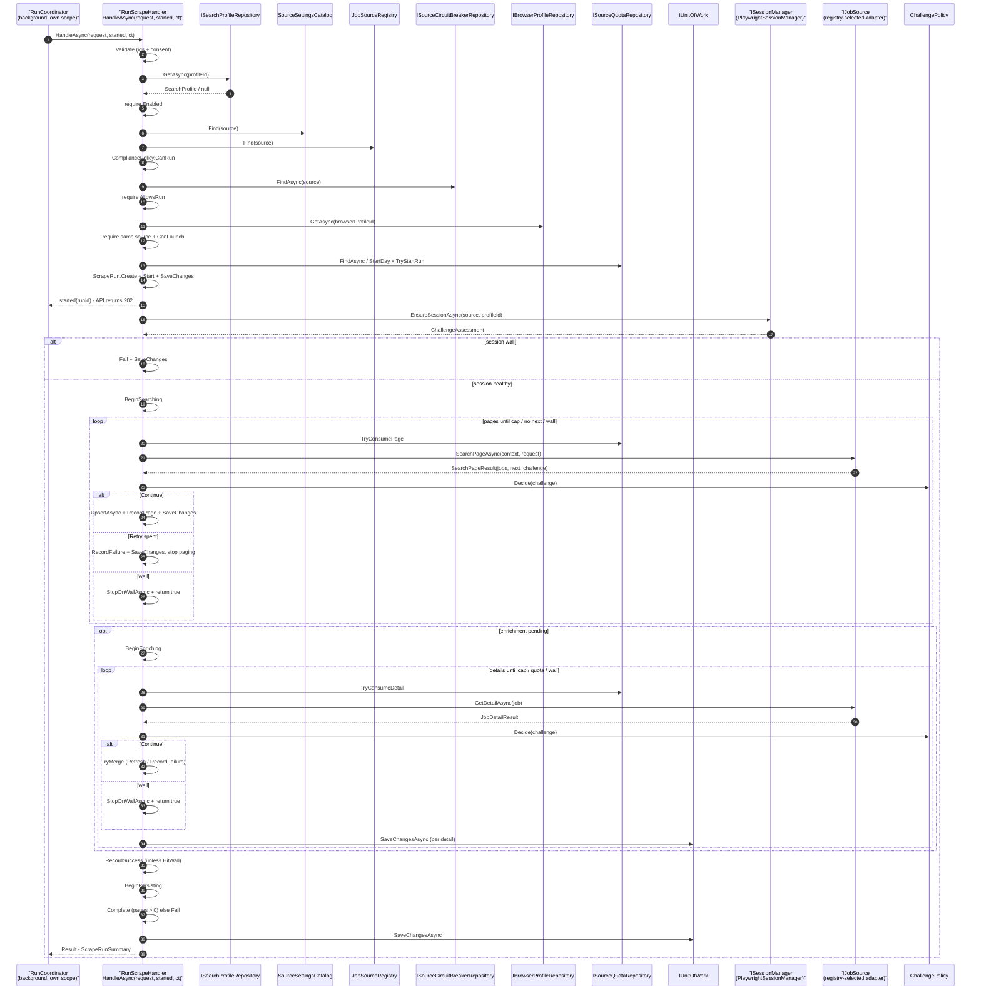

Gate failures return typed `Result` errors instead of throwing: `VALIDATION_FAILED`, `PROFILE_NOT_FOUND`, `PROFILE_DISABLED`, `SOURCE_UNAVAILABLE`, `SOURCE_DISABLED`, `COMPLIANCE_BLOCKED`, `SOURCE_COOLING_DOWN`, `BROWSER_PROFILE_NOT_FOUND`, `SESSION_UNAVAILABLE` / `SESSION_RESET_REQUIRED`, `QUOTA_EXCEEDED`. Cancellation records `Run.Cancelled` with partial results and rethrows; unexpected exceptions record `Run.Fail` before reaching the global handler.

**`RunCoordinator`** (`JobScrape.Api/Runs/RunCoordinator.cs`, singleton `IRunLauncher` + `IHostedService`):

- One run at a time: a second start gets `409 RUN_IN_PROGRESS` (with `activeRunId`) while a run executes.
- Each run gets its own DI scope (its own unit of work); a gate refusal comes back as the start's problem, and a host stop before the run is recorded returns `503 RUN_NOT_STARTED`.
- `POST /runs/{id}/cancel` signals the executing run's linked token (`TryCancel`); the handler records `Cancelled` with partial results.
- Host start: runs left in an executing stage (`IScrapeRunRepository.ListExecutingAsync`: pending, starting a session, searching, enriching, persisting) are failed with `Interrupted: the API stopped while the run was executing.`
- Host stop: the executing run is cancelled cooperatively and awaited within the shutdown timeout.
- Always: the run's browser is released (`BrowserSessionPool.ReleaseAsync`) and the slot freed, even when closing the browser fails.

**Live verification (2026-11-01):** headed Chromium (`Bundled` channel), profile "dot net developer" in Pune, caps 2 pages / 40 jobs / 3 details. The run completed in ~30 s: 2 pages (the second through native **Next**), 40 new postings, 3 details enriched, 0 walls, session `Healthy`, quota charged 2 pages / 3 details / 1 run.

### 7.2 Challenge handling

`RunScrapeHandler.StopOnWallAsync` — the only place a wall turns into run state. Verified against `StopOnWallAsync`, `BlameSession`, `ChallengePolicy.Decide`, and `ChallengeAction`:

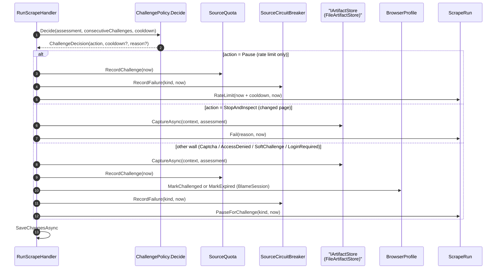

Notes the code forces: `BlameSession` marks `MarkExpired` only for `LoginRequired` on a healthy profile (a cooldown would block the re-login); every other wall cools the profile down via `MarkChallenged`. `RecordFailure` opens the breaker after 2 consecutive failures, 3 walls in 24h, any `AccessDenied`, with cooldowns 60m (rate limit) / 24h (challenge) / 7d (repeated block). Walls are never retried and never auto-solved; `SourceChanged` and `TransientError` are not walls and never reach this path.

### 7.3 Session verification

> **Implemented by `PlaywrightSessionManager`** (`JobScrape.Infrastructure/Browser`,
> scoped with the run's unit of work). `RunScrapeHandler` calls it before
> pagination. The contract, verbatim:

```csharp
Task<ChallengeAssessment> EnsureSessionAsync(
    SourceKey source,
    BrowserProfileId profileId,
    CancellationToken cancellationToken);
```

What it does:

1. Opens the profile's persistent context through `BrowserSessionPool` (one Playwright persistent context per `BrowserProfile`, in `{ProfilesRoot}/{source}/{name}`; engine → Chromium/Firefox/WebKit, channel → `chrome`/`msedge`/bundled; real window size and the browser's own user agent — no viewport or UA override; headed by default, `JobScrape:Browser:Headless=false`).
2. For Naukri: warm-up on the home page, a random 1.5–3 s pause, one scroll, then `NaukriChallengeClassifier` on URL, status, title, and body text.
3. A clean home page marks the profile verified (`MarkVerified`); a navigation failure or timeout returns `TransientError`.

The handler proceeds on `None`; anything else fails the run (`Session not ready: {kind}.`) without retry, and a wall also blames the session (`MarkChallenged` / `MarkExpired`). Credentials are never typed — login stays manual in the visible browser window.

> Manual login is the only supported authentication flow. JobScrape never stores a site password or automates a login form.

### 7.4 Export

**Implemented.** `GET /api/v1/runs/{id:guid}/postings/export?format=csv|xlsx&group=all|only|exclude`
returns one run's postings as a download. `ExportRunPostingsHandler` reads
at most 20,000 rows (`RunLimits.MaxJobsCeiling`) through
`IRunStore.ListExportPostingsAsync`, filters the company group against the
run's captured `companies` list, and hands the rows to the matching
`IPostingExportWriter`. `CsvPostingWriter` emits UTF-8 CSV with a BOM;
`ExcelPostingWriter` emits a ClosedXML workbook with each posting URL as a
hyperlink. There is no separate `JobQueryHandler`; export reads through
`IRunStore`.

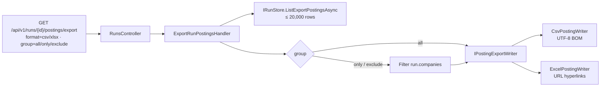

`group=only|exclude` returns `EXPORT_COMPANIES_MISSING` when the run has no
company list. An unknown format or group is `EXPORT_FORMAT_UNSUPPORTED` /
`EXPORT_GROUP_UNSUPPORTED`; a missing run is `RUN_NOT_FOUND`. The cockpit's
Runs page offers the same CSV and XLSX downloads.

---

## 8. Ports and adapters

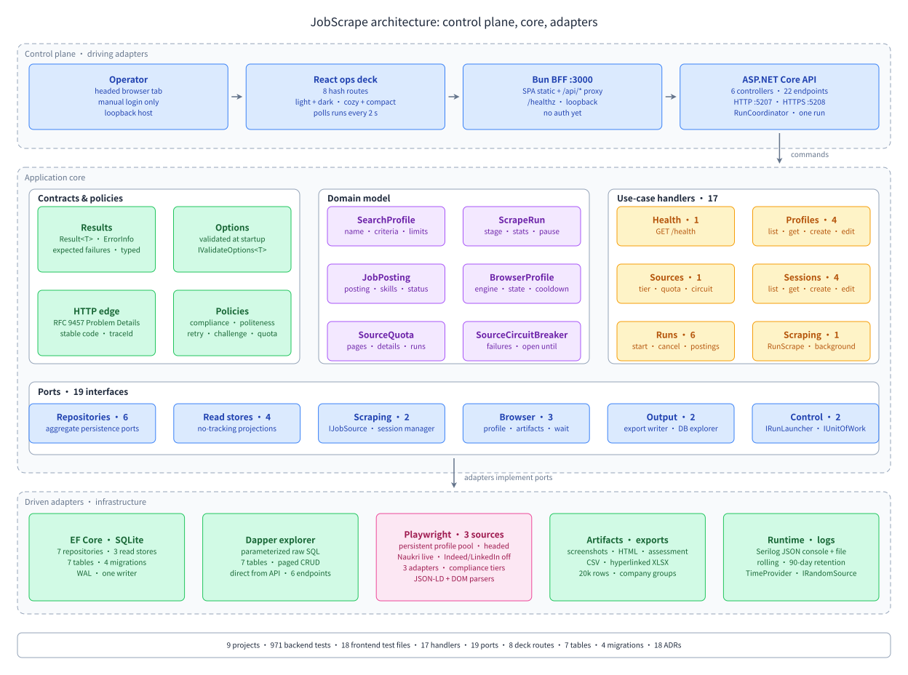

### 8.1 Application ports

> Verified verbatim against the interfaces (parameter names shortened to `ct` only where the doc abbreviates; everything else is exact).

```csharp
public interface IJobSource
{
    SourceKey Key { get; }
    SourceCapabilities Capabilities { get; }

    Task<SearchPageResult> SearchPageAsync(
        SourceRunContext context,
        SearchPageRequest request,
        CancellationToken cancellationToken);

    Task<JobDetailResult> GetDetailAsync(
        SourceRunContext context,
        JobReference job,
        CancellationToken cancellationToken);
}

public interface ISessionManager   // PlaywrightSessionManager (scoped)
{
    Task<ChallengeAssessment> EnsureSessionAsync(
        SourceKey source,
        BrowserProfileId profileId,
        CancellationToken cancellationToken);
}

public interface IJobPostingRepository
{
    Task<JobPosting?> FindAsync(SourceKey source, ExternalJobId id, CancellationToken ct);
    Task AddAsync(JobPosting posting, CancellationToken ct);
}

public interface IUnitOfWork
{
    Task<int> SaveChangesAsync(CancellationToken ct);
}
```

All 24 ports, grouped (they live beside their features: `Abstractions/` for
driven ports, the feature folder for read/run/export contracts). The count is
the number of public interfaces under `src/backend/JobScrape.Application`
(verified with `grep -rn "interface I" src/backend/JobScrape.Application`,
which yields 24 names). Implementations are Infrastructure unless noted.

- **Repositories (9)** — `ISearchProfileRepository` (`GetAsync`, `NameExistsAsync`, `AddAsync`), `IScrapeRunRepository` (`GetAsync`, `AddAsync`, `ListExecutingAsync`; used on host start to fail interrupted runs), `IJobPostingRepository` (`FindAsync`, `AddAsync`), `IBrowserProfileRepository` (`GetAsync`, `NameExistsAsync`, `AddAsync`), `ISourceQuotaRepository` (`FindAsync`, `AddAsync`), `ISourceCircuitBreakerRepository` (`FindAsync`, `AddAsync`), `IUserRepository` (`GetByEmailAsync`, `GetAsync`, `AddAsync`, `ListAsync`; identity persistence), `IRoleRepository` (`GetAsync`, `GetByNameAsync`, `AddAsync`, `ListAsync`; identity persistence), `IUsageQuotaRepository` (`GetAsync`, `ListAsync`, `AddAsync`; quota definitions) — EF Core repositories. The run's resume position is an owned part of `ScrapeRun`, not a port.
- **Unit of work (1)** — `IUnitOfWork.SaveChangesAsync` — `JobScrapeDbContext`.
- **Read stores (3)** — `ISearchProfileStore` (`GetAsync`, `ListAsync`) → `SearchProfileReadStore`; `ISessionStore` (`GetAsync`, `ListAsync`) → `SessionReadStore`; `IRunStore` (`GetAsync`, `ListAsync`, `ListPostingsAsync`, `ListExportPostingsAsync`) → `RunReadStore`. All EF no-tracking reads.
- **Browser/artifacts (3)** — `IBrowserProfileWorkspace` (`RenameAsync`) → `BrowserProfileWorkspace` (pool-backed); `IArtifactStore.CaptureAsync` → `FileArtifactStore` (see §12.5); `IDelay.WaitAsync` → `TimeProviderDelay`.
- **Source (1)** — `IJobSource` → `NaukriJobSource`, `IndeedJobSource`, `LinkedInJobSource`.
- **Session (1)** — `ISessionManager.EnsureSessionAsync` → `PlaywrightSessionManager` (scoped).
- **Run (1)** — `IRunLauncher` (`StartAsync` → run id once recorded, `TryCancel`) → `RunCoordinator` in the Api host, because a run outlives its request.
- **Export (1)** — `IPostingExportWriter.WriteAsync` → `CsvPostingWriter`, `ExcelPostingWriter`.
- **Explorer (1)** — `IDatabaseExplorer` → `SqliteDatabaseExplorer` (Dapper).
- **Token (1)** — `ITokenService` (`CreateToken` → opaque bearer) → `JwtTokenService` (HS256, Infrastructure/Security).
- **Idempotency (1)** — `IIdempotencyStore` (`GetAsync`, `SaveAsync`, `TryReserveAsync`, `RemoveAsync`) → `IdempotencyStore` (SQLite, 24-hour retention).
- **Caller context (1)** — `ICallerContext` (`ActorId`, `Roles`, `Permissions`, `MustChangePassword`) → scoped per request from the bearer token's claims; unauthenticated callers get a denied empty-permission context.

Deliberately absent (no such types exist): `IJobReadModel`, `ISkillDemandReadModel`, `IDiskSpace`, `IClock` (use BCL `TimeProvider`), `Specification<T>`, `BootstrapAsync`/`ProbeAsync` session methods, `SessionStatus`, `UpdateAsync` on `IJobPostingRepository`.

### 8.1.1 Handler collaborators

`RunScrapeHandler` is the application-level orchestrator (registered scoped, executed by `RunCoordinator` — see §7.1). It coordinates, but does not replace, the domain policies and infrastructure ports:

- `SearchProfile`, `ScrapeRun` (with its owned resume position), and `JobPosting` (domain state) via `ScrapeStores` (6 domain repositories + `IUnitOfWork`, grouped so the 8-parameter constructor stays readable)
- `SourceSettingsCatalog` and `JobSourceRegistry` (settings/adapters by source; holds `NaukriJobSource`, `IndeedJobSource`, and `LinkedInJobSource`)
- `ISessionManager` (`PlaywrightSessionManager`) and the `IJobSource` the registry returns for the run's source (one of three adapters)
- `IArtifactStore.CaptureAsync` (`FileArtifactStore`)
- `CompliancePolicy`, `ChallengePolicy`, `PolitenessPolicy`, `RetryPolicy`, `SourceCircuitBreaker`, `SourceQuota` (domain)

It owns sequencing, cancellation, and outcome mapping. Selectors, browser code, and persistence details stay in Infrastructure; cancellation records partial results and rethrows, unexpected failures are recorded before they reach the global handler.

### 8.2 Result pattern, not exceptions, for expected operational outcomes

```csharp
public sealed record SearchPageResult(
    IReadOnlyList<JobSnapshot> Jobs,
    string? NextCursor,
    PageFingerprint? Fingerprint,
    ChallengeAssessment Challenge);

public enum ChallengeKind
{
    None,
    RateLimited,
    SoftChallenge,
    Captcha,
    LoginRequired,
    AccessDenied,
    SourceChanged,
    TransientError
}

public sealed record ChallengeAssessment(
    ChallengeKind Kind,
    double Confidence,
    string Evidence,
    TimeSpan? RetryAfter)
```

`SearchPageResult` is an adapter DTO, not the generic application result. Use cases return `Result<T>` with a typed `ErrorInfo` (code, title, detail, kind); only the API edge maps that error to HTTP. See [Application Patterns §3](14-application-patterns.md#3-result-pattern).

Rules:

- Domain invariant violations throw domain exceptions (programmer error).
- Expected operational failures return results (challenge, rate limit, source changed).
- `OperationCanceledException` propagates; the run is marked `Cancelled` and partial results are kept.
- No `catch (Exception) { }` in adapters; every catch either classifies, enriches, or rethrows.

### 8.3 Adapter contract tests

No shared `JobSourceContractTests` suite exists; coverage is per source. The
pure parts are fixture-tested under
`JobScrape.Infrastructure.Tests/Sources/{Naukri,Indeed,LinkedIn}`: Naukri and
Indeed cover the URL builder, search and detail parsers, and challenge
classifier; LinkedIn covers the URL builder, search parser, and challenge
classifier, with no detail parser because the adapter declares
`SupportsDetails: false`. The browser-driving classes (`NaukriJobSource`,
`BrowserSessionPool`, `PlaywrightSessionManager`, `FileArtifactStore`) run
against real headless Chromium in `JobScrape.Infrastructure.Tests/Browser`
(trait `Category=Browser`), with Playwright routes serving the Naukri fixtures
for every `www.naukri.com` request (no network); Naukri was also verified live
(§7.1). `RunsEndpointTests` drive `RunCoordinator` end to end with a fake
`IJobSource`. Every adapter must satisfy:

- `Key` is stable and lowercase (`SourceKey` singletons: `naukri`, `indeed`, `linkedin`).
- `Capabilities` declares what the source supports (`SupportsDetails` today).
- `SearchPageAsync` returns walls through `Challenge`, never throws for them; retries are the handler's decision, never the adapter's.
- URL builder produces canonical URLs and strips tracking parameters.
- Parser fixture yields the expected job count, IDs, titles, companies, URLs.
- Challenge fixture is classified correctly and never extracted as jobs.
- Empty/partial/malformed HTML does not throw; it returns `SourceChanged` or drops bad cards with diagnostics.
- Detail parser handles missing fields and returns `null`/partial detail, never a fake success.

### 8.4 Specifications for query criteria

Not implemented: no `Specification<T>` type and no `Queries/` folder. Query criteria today are identity lookups (`FindAsync`/`GetAsync` by id) plus the read stores (`ISearchProfileStore`, `ISessionStore`, `IRunStore`), which project read models but do not compose query specifications. When the first real filter need appears, add the smallest `Specification<T>` that composes with `And`/`Or`/`Not` — see [Application Patterns §5](14-application-patterns.md#5-specification-pattern) for the deferred design.

---

## 9. Source adapter design

> **Three adapters, all registered as `IJobSource`.** The contract below is
> verbatim from `JobScrape.Application/Features/Scraping/IJobSource.cs`.
> `NaukriJobSource` (`Sources/Naukri`), `IndeedJobSource` (`Sources/Indeed`),
> and `LinkedInJobSource` (`Sources/LinkedIn`) implement it, and
> `BrowserRegistration` registers each as a singleton `IJobSource`, so
> `JobSourceRegistry` holds all three. Naukri is enabled by default; Indeed
> and LinkedIn ship disabled and are consent-gated.

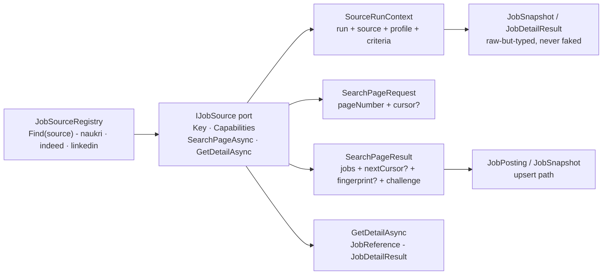

| Adapter | Source | Enabled by default | `SupportsDetails` | Pagination |
|---|---|---|---|---|
| `NaukriJobSource` | `naukri` (Standard) | Yes | `true` | Native **Next** button |
| `IndeedJobSource` | `indeed` (Restricted) | No; `AcknowledgeSourceRisk=true` required | `true` | `start` offset, +10 per page |
| `LinkedInJobSource` | `linkedin` (HighRisk) | No; risk acknowledgment, `AllowHighRiskSources=true`, and interactive per-run consent required | `false` | `start` offset, +25 per page |

Adapter rules (from the port's own doc comments; all three adapters follow them):

- Classify walls in `Challenge` (`ChallengeAssessment.Kind`); never throw for a wall.
- Never retry: retries are `RunScrapeHandler.FetchWithRetryAsync`'s decision (transient errors only, with backoff and `Retry-After`).
- Missing detail fields stay null, never faked; malformed cards are dropped and counted by the parser, never stored.
- `SourceKey` singletons are the only valid keys (`naukri`, `indeed`, `linkedin`); `TryParse` rejects everything else.

**`NaukriJobSource` internals** (site rules and selectors: [Site Playbooks §3](08-site-playbooks.md#3-naukri-playbook)):

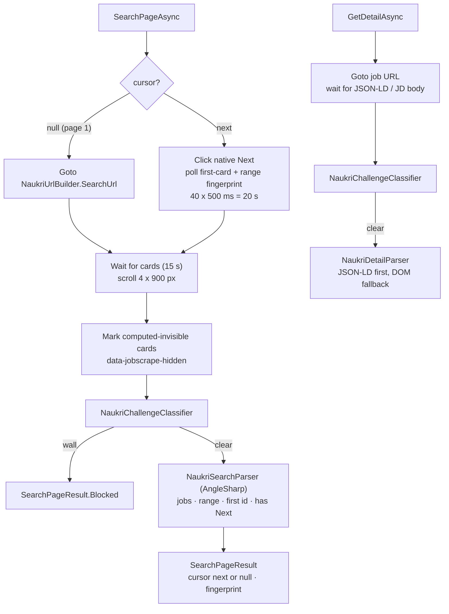

- The page comes from `BrowserSessionPool.Find(browserProfileId)`, opened earlier by `PlaywrightSessionManager`.
- Later pages never navigate to `-N` URLs. If Next is absent/disabled or the fingerprint does not change, the same page is reported; the handler's repeated-page guard re-requests it once, then fails the run with a named reason.
- `PlaywrightException` / `TimeoutException` (unless cancelled) → `TransientError`, which only the handler may retry.

**`IndeedJobSource`:** page 1 navigates to `IndeedUrlBuilder.SearchUrl`; later pages navigate directly with the cursor's `start` offset. A null cursor derives the offset from the absolute page number, so windowed runs start at their own offset. Cards are semantic DOM (`div.job_seen_beacon` / `data-testid`); details read JSON-LD first, then DOM. It is restricted-tier and disabled by default.

**`LinkedInJobSource`:** guest search only, with DOM cards (`li.jobs-search-results__list-item` / `div.job-card-container`) and a fallback link selector. `SupportsDetails: false`; `GetDetailAsync` returns `LoginRequired` without fetching because guest detail pages sit behind the sign-in wall. It is high-risk and disabled by default.

### 9.1 Pagination strategies (all three implemented; cursor fast path is design target)

| Strategy | Used by | Implementation |
|---|---|---|
| Click native next | Naukri | Implemented: click `Next`, wait for result range/first-card fingerprint to change. |
| Query param `start` | Indeed, LinkedIn | Implemented: page 1 has no `start`; each next page adds 10 (Indeed) or 25 (LinkedIn) to the cursor's offset; stop on empty/repeated page or cap. |
| Cursor/API token | Naukri API fast path (not enabled) | Design target only; no adapter uses it. |

Every page result includes a **fingerprint** (first card ID/href + result range text) so a repeated page is re-requested once and, while Next stays live, fails the run with a named reason.

### 9.2 Extraction priority (implemented)

1. **Detail pages, Naukri and Indeed:** JSON-LD (`script[type="application/ld+json"]`, `@type: JobPosting`) first, then DOM fallback. Details parsed without JSON-LD carry `LowConfidence`.
2. **Search pages, all three adapters:** semantic DOM through AngleSharp. Primary card selectors come first, then fallback selectors; a card without a visible link, title, or source id is dropped and counted. The browser pass marks computed-invisible cards (`data-jobscrape-hidden`) so honeypots are skipped.
3. **LinkedIn has no detail extraction:** `SupportsDetails: false`, and `GetDetailAsync` fails closed with `LoginRequired` rather than fetching a guest detail page.
4. **Not implemented:** selector-hit logging (`selectorHit`). Adapters log dropped-card counts only; coarser fallback parsing is surfaced through `LowConfidence`.

---

## 10. Persistence design

### 10.1 Source of truth

SQLite is the source of truth. CSV/Excel/JSON files are disposable snapshots.

### 10.2 Repositories

- Domain repositories return aggregates, not `IQueryable`; each root has a purpose-built contract (`ISearchProfileRepository`, `IScrapeRunRepository`, `IJobPostingRepository`, `IBrowserProfileRepository`, `ISourceQuotaRepository`, `ISourceCircuitBreakerRepository`).
- No generic `IRepository<T>`.
- No lazy loading; explicit includes or projections.
- No tracking for read models; `AsNoTracking()` (`SearchProfileReadStore`, `SessionReadStore`, `RunReadStore`).

### 10.3 Unit of work

- One transaction per **page batch** and one per **detail update** (`IUnitOfWork.SaveChangesAsync` after each page/detail in `RunScrapeHandler`, including after failures).
- Run state is saved after each page so a crash loses at most one page.
- Idempotent upsert by `(SourceKey, ExternalJobId)` (unique index on `job_postings`).
- SQLite: WAL mode, `foreign_keys=ON`, `busy_timeout=5000`, one writer (see `SqlitePragmaInterceptor`).

### 10.4 Schema overview

> Verified against `JobScrapeDbContext`, the ten `IEntityTypeConfiguration`
> classes (eleven tables), and migration `20261107112658_InitialCreate`.
> Tables and columns
> are snake_case; every `DateTimeOffset` is stored as UTC ticks
> (`UtcTicksConverter`). Foreign keys are enforced for
> `scrape_runs → search_profiles` (restrict) and
> `scrape_run_progress → scrape_runs` (cascade); cross-aggregate links (quota, circuit
> breaker, browser profile) are by convention, not constraint.

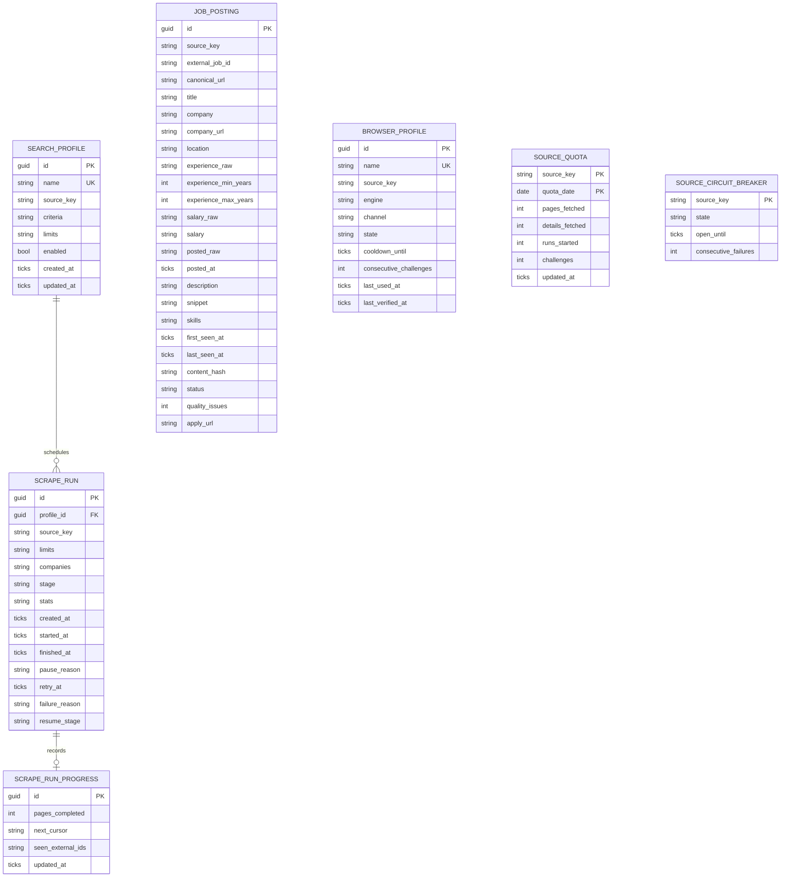

`JobSkill` is an owned value inside `JOB_POSTING.skills` (dedupe key `NormalizedName`) — not a table. `scrape_runs.companies` is a JSON string-list column captured from the profile at run creation; exports filter against it. `scrape_run_progress` holds at most one row per run: the run id, pages completed, next cursor, seen external ids, and update time, replaced after every fetched page. There are no `RUN_EVENT` / `RUN_POSTING` tables. `BROWSER_PROFILE.used_by`, `SOURCE_QUOTA.governs`, `SCRAPE_RUN_PROGRESS`'s logical link, and postings-vs-runs links that older revisions drew are logical relationships only; the database enforces exactly two FKs (`scrape_runs.profile_id → search_profiles.id`, restrict on delete; `scrape_run_progress.id → scrape_runs.id`, cascade on delete).

Full domain model and invariants: [Domain Model](03-domain-model.md).

### 10.5 Migrations

- EF Core migrations live in `JobScrape.Infrastructure/Persistence/Migrations`; one exists:
  - `20261107112658_InitialCreate` (current)
- The context is registered by `PersistenceServiceCollectionExtensions.AddJobScrapePersistence` (scoped per run/request), called from the API through `DatabaseRegistration.AddJobScrapeDatabase`, which resolves `JobScrape:Storage:DatabasePath` against the content root and creates its directory.
- Migrations apply automatically **only in Development** (`DatabaseRegistration.MigrateInDevelopment`, used by the `http` launch profile and the API tests). Any other environment applies them explicitly with `dotnet tool run dotnet-ef database update --project src/backend/JobScrape.Infrastructure`.
- `JobScrapeDesignTimeFactory` exists for `dotnet ef` tooling only.
- Migrations are reviewed like code; no automatic destructive changes.

---

## 11. Configuration and secrets

### 11.1 Precedence

1. `appsettings.json`
2. `appsettings.Local.json` (gitignored)
3. Environment variables (`JOBSCRAPE_*` by convention; no `JOBLENS_*` reader exists)

### 11.2 Options pattern

Options are bound and validated once at the composition root, then consumed as immutable values. Application code receives plain records; it does not read `IConfiguration` or `IOptions<T>`. See [Application Patterns §4](14-application-patterns.md#4-options-pattern).

- `StorageOptions` (`JobScrape:Storage`)
- `ComplianceOptions` (`JobScrape:Compliance`)
- `RunOptions` (`JobScrape:Run`)
- `BrowserOptions` (`JobScrape:Browser`: `Headless=false` — Naukri blocks headless first contact — and `NavigationTimeoutSeconds=45`, range 5–120; registered by `AddJobScrapeBrowser`)
- `LoggingOptions` (`JobScrape:Logging`)
- `SourcesOptions` (`JobScrape`, dictionary keyed by source)
- `ComplianceOptions`
- `LoggingOptions`

Validate on startup with DataAnnotations plus custom `IValidateOptions<T>` validators. What `SourcesOptionsValidator` actually enforces today:

- Every `Sources:<key>` parses via `SourceKey.TryParse` (unknown keys fail with the section path).
- Per-source DataAnnotations validate (caps, delays, cooldowns within range).
- `RunLimits` domain ranges hold (`maxPages` 1–1000, `maxJobs` 1–20 000, `maxDetails` 0–1000, delay 1s–2m).
- Enabling a non-`Standard` tier requires `Compliance:AcknowledgeSourceRisk = true`; `HighRisk` additionally requires `Compliance:AllowHighRiskSources = true`.
- `StorageOptions` ranges hold (retention 1–3650 days, `MinimumFreeDiskBytes ≥ 1`); `RunOptions.RetryMaxAttempts` is 1–3.

### 11.3 Secrets

- **No credentials are stored by JobScrape.** There is no login automation; `PlaywrightSessionManager` verifies a session by loading the source's home page and never types credentials.
- Browser profiles contain cookies and are treated as secrets (never committed/shared).
- Future API keys use user secrets in development and environment variables in production.
- Cookies, authorization headers, and form values must never enter a log message. No automatic redaction filter is registered (§12.5).

---

## 12. Cross-cutting concerns

### 12.1 Error taxonomy

| Category | Examples | Retry? | Handling |
|---|---|---|---|
| Transient | connection reset, 5xx, timeouts | **Yes, if attempts remain** (see §12.2) | Retry with backoff; then `RecordFailure` and stop paging. |
| Rate limit | 429, 999, `Retry-After` | Only after the stated delay | `RateLimit(retryAt)`; resume via `Resume` once elapsed. |
| Challenge | CAPTCHA, access denied, soft challenge | **No** | Stop, capture evidence, open circuit, `PauseForChallenge`. |
| Auth | login wall on a healthy session | **No** | `MarkExpired`; manual re-login, then resume. |
| Parse | missing fields, DOM change | **No** | `SourceChanged` → `Fail` with evidence; bad card dropped. |
| Validation | empty id, bad request fields | **No** | `Result.Fail` → 400 with `code: VALIDATION_FAILED`. |
| Config | invalid options | **No** | Fail fast at startup (`ValidateOnStart`). |
| Storage | disk full, write failure | **No** | `ErrorKind.Storage` → 507 via `ErrorMapper`. |
| Cancelled | Ctrl+C, shutdown | **No** | Stop, keep partial results, rethrow. |
| Source changed | empty page with no challenge | **No** | Capture evidence, `Fail`, canary alert. |

**Never retry** challenges, walls, auth, parse, or config failures. Only `ChallengeKind.TransientError` is ever retried.

Expected failures return `Result<T>`; the API edge maps them to RFC 9457 Problem Details with a stable `code` (`ErrorMapper`, `jobscrape.local` type host). See [Application Patterns §6](14-application-patterns.md#6-problem-details-pattern).

### 12.2 Retry policy

- Only `ChallengeKind.TransientError` is ever retried (`RetryPolicy.ShouldRetry`); walls, rate limits, and changed pages never are.
- Ceiling `MaxAllowedAttempts = 3`; configured default `RunOptions.RetryMaxAttempts = 2` (1 retry).
- Backoff: 2s base, 4× growth per retry, up to 1s jitter; honors source-stated `Retry-After`.
- Retry only idempotent fetches; a page that fails after retries records a failure and stops pagination.
- No retries for parse/validation failures (cards are dropped with a named reason instead).

### 12.3 Time and randomness

- Inject `TimeProvider` everywhere; never call `DateTime.Now`/`DateTimeOffset.UtcNow` directly in Domain/Application (`TimeProvider.System` is registered in `Program.cs`; tests use `FakeTimeProvider`).
- Inject `IRandomSource` for jitter (`SystemRandomSource` in production); tests use deterministic fakes.
- Store timestamps in UTC (`UtcTicksConverter`; `QuotaDate` is a UTC `DateOnly`). No timezone rendering exists yet.

### 12.4 Cancellation

- Every async method takes a `CancellationToken`; request paths never pass `CancellationToken.None`.
- Ctrl+C cancels the run cooperatively; the current page may finish, then the run is marked `Cancelled`.
- Use linked tokens for timeouts; distinguish an operator cancel from a timeout.
- `OperationCanceledException` propagates. It is not converted to a `Result`, not logged as an error, and never swallowed.
- No sync-over-async (`.Result`, `.Wait()`, `GetAwaiter().GetResult()`); no `async void`.
- `DbContext` instances are scoped per run/request (`AddJobScrapePersistence`), never long-lived or shared.
- `TimeProvider.Delay` (via `IDelay`) is cancellable; cancellation aborts the wait.
- Full rules: [Runtime Hardening §5](15-runtime-hardening.md#5-async-and-cancellation).

### 12.5 Logging and artifacts

- Serilog structured logs: `RunId`, `Source`, `Page`, `JobId`, `ChallengeKind`, `ElapsedMs`, `TraceId`/`SpanId`, `CorrelationId` (via `CorrelationMiddleware` + span/process/thread/assembly enrichers).
- Compact JSON console sink plus an async rolling compact-JSON file sink (`artifacts/logs/jobscrape-api-*.jsonl`), 200-file cap or `RetentionDays` (default 90), 10k-event buffer that blocks rather than drops.
- Both sinks use named message templates, never string interpolation.
- Artifacts per wall: `IArtifactStore.CaptureAsync` → `FileArtifactStore` writes `{ArtifactsRoot}/runs/{runId}/{yyyyMMddTHHmmss}-{kind}/` with `assessment.json` (kind, confidence, evidence, URL), `screenshot.png` (full page), and `page.html` (capped at 2,000,000 chars). Best effort: a failed screenshot/HTML capture is logged, not thrown. No Playwright trace is recorded.
- **Not implemented: automatic redaction.** No Serilog destructuring/redaction filter is registered. The rule is that cookies, authorization headers, and form values never enter a message template; the current sinks write whatever the caller passes, so this is a review-time obligation and a known gap. The global handler returns Problem Details with a trace ID, never stack traces.
- Full logging/error/resource rules: [Runtime Hardening §2–3](15-runtime-hardening.md#2-structured-logging-with-serilog).

### 12.6 Idempotency and dedupe

- Identity: `(SourceKey, ExternalJobId)` (unique index on `job_postings`).
- Content hash: lowercase SHA-256 over the posting's stable fields (`ContentHash.Compute`); `Refresh` updates `LastSeenAt` always and content only when the hash changes. No-change re-sightings raise no event.
- `FirstSeenAt` never changes; `LastSeenAt` updates on every successful sighting.
- Re-running the same page updates no duplicates (`seenJobs` per run + unique index).
- Detail enrichment updates the same posting; it never creates a second row.
- `JobPosting.Merge` keeps a stated work mode when the new sighting's location says `Unknown` (Naukri detail headers list cities only), so a detail page never erases a card's `Hybrid`/`Remote`.

### 12.7 Problem Details mapping

The API returns `application/problem+json` for every error. One mapper (`ErrorMapper.ToProblem`) translates `ErrorKind` to an HTTP status and adds `code`, `traceId`, and optional `retryAfter`; endpoints do not hand-build error bodies (`Validation` uses `ValidationProblem` so the errors dictionary renders correctly, plus the same `code`/`traceId` extensions). Stack traces, SQL, cookies, and HTML never appear in `detail`. Problem Details is HTTP-only. See [Application Patterns §6](14-application-patterns.md#6-problem-details-pattern).

### 12.8 Resource budgets

- Bound every queue/channel; stream artifacts instead of loading them.
- `StorageOptions.MinimumFreeDiskBytes` (default 1 GiB) declares the floor, but no check enforces it yet — disk-full surfaces as `ErrorKind.Storage` (507).
- Clean temp files in `finally`; retain artifacts/logs by policy, never unbounded.
- Dispose `DbContext`, token sources, and semaphores in reverse order (`await using`).
- No `GC.Collect()`; profile with `dotnet-counters`/`dotnet-trace` before optimizing.
- Full matrix: [Runtime Hardening §6](15-runtime-hardening.md#6-resource-management).

---

## 13. Deployment

### 13.1 Local desktop

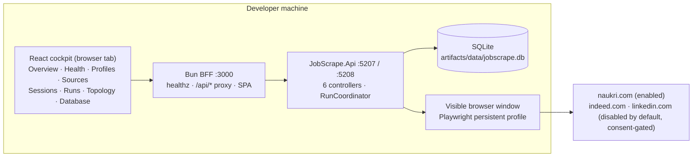

- `dotnet run --project src/backend/JobScrape.Api/JobScrape.Api.csproj` (Development serves the OpenAPI document at `/openapi/v1.json` and the Scalar reference UI at `/scalar`).
- `bun run dev` in `src/frontend/` (BFF `:3000` + Tailwind watcher); `DOTNET_API_URL` points the proxy at the API.
- Install a Playwright browser once after a build (see [Operations Runbook](09-operations-runbook.md)); a run opens a visible browser window on this machine.
- No scheduler and no CLI. Exports are API endpoints, not a separate process; the deployable surface is the API plus the BFF.

### 13.2 Linux server / CI

No CI workflow exists in the repo yet. When one lands: `dotnet build` with warnings-as-errors, `dotnet test` per test project (native MTP runner), `dotnet-coverage` merge for the 100% gate, `bun run format:check` + `bun test` for `src/frontend/`. No live scraping in CI (no automated test touches the network; the Naukri run was verified by hand). The `Category=Browser` tests need Playwright's Chromium installed on the runner (see the runbook's install command).

### 13.3 API and cockpit (present, v1)

- `JobScrape.Api` is a controller-based ASP.NET Core API (not minimal-API): `HealthController`, `SearchProfilesController`, `SourcesController`, `SessionsController`, `RunsController`, and `DatabaseController` make 22 endpoints. The first five call use-case handlers directly and map `Result` through `ErrorMapper`; `DatabaseController` bypasses handlers and calls `IDatabaseExplorer` directly.
- The cockpit is a React SPA served by the Bun BFF on loopback (`src/frontend/`) with eight routes (`#/overview` through `#/database`); the browser talks to the BFF, the BFF proxies `/api/*` to the API. Runs are started, followed (polled every 2 s, no SSE), cancelled, and exported as CSV/XLSX from `#/runs`; `#/database` browses raw SQLite tables. There is no separate Jobs page.

The v2 control plane is specified in [Web Cockpit](12-web-cockpit.md) and [ADR-0010](10-adr/0010-react-bun-cockpit.md). It is a React SPA served by a Bun BFF on loopback; the browser never calls a source site, and Playwright stays in Infrastructure. The API is the cockpit’s only backend.

---

## 14. Security

| Asset | Risk | Control |
|---|---|---|
| Browser profile/cookies | Account/session takeover | Treat as secrets; never commit/share; profiles live in `{ProfilesRoot}/{source}/{name}`; the pool creates them with default permissions, so restrict them to the owner (`0700`) yourself |
| SQLite DB | Personal job-search data | User-scoped path; disk encryption; backup access controls. |
| Artifacts/HTML | Page content may contain personal data | Local only; retention; keep secrets out of logs (no automatic redaction filter); no upload. |
| Config/secrets | API keys (future) | User secrets/env vars; no secrets in git. |
| Dependencies | Supply-chain risk | Pin versions; `dotnet list package --vulnerable`; monthly updates. |
| Target sites | Legal/ToS/abuse | Compliance gates; caps; stop-on-wall; no evasion. |

Threat model in one line: **the browser profile is the crown jewel; the target site is untrusted input; the operator's account is the thing we must not get banned.**

---

## 15. What we are deliberately not building

- Microservices, message bus, distributed locks, Kubernetes.
- A generic “scrape any website” framework; only shared primitives + per-source adapters.
- CQRS command/query buses, MediatR, mediator pipelines, AutoMapper, and FluentValidation pipelines; explicit handlers and validation are clearer at this size.
- Custom replacements for documented library features (logging, validation, Excel, API reference); use the library as designed. See the [Library Usage Policy](16-library-usage-policy.md).
- Auto-apply, cover-letter generation, recruiter messaging.
- CAPTCHA solving, fingerprint spoofing, proxy rotation, account rotation.
- ML ranking, resume tailoring, vector databases.
- Multi-tenant SaaS, billing, team permissions.

Each is a separate product decision, not a refactor.

### 15.1 Reuse beyond job boards

The reusable automation primitives that actually exist:

- `PolitenessPolicy` / `RetryPolicy` / `CompliancePolicy` / `ChallengePolicy` (pacing, retry, consent, challenge response).
- `SourceCircuitBreaker` + `SourceQuota` (per-source breaker and daily caps, persisted).
- `IJobSource`-style adapter contracts (a new workflow gets its own port, not a generic “scrape anything” interface).
- `Result` / `ErrorInfo` / `ErrorKind` (typed failures) and `ErrorMapper` (RFC 9457 rendering with `code` + `traceId`).

Built for the job-board sources: `BrowserSessionPool` (persistent context per browser profile), the per-source challenge classifiers (`NaukriChallengeClassifier`, `IndeedChallengeClassifier`, `LinkedInChallengeClassifier`), and `FileArtifactStore` (wall evidence). A generic, source-neutral challenge detector does not exist.

The **Sourcing** domain stays job-specific. A future automation case (e.g., form filling, price monitoring) should get its own bounded context/use case and adapters, reusing the browser/session/pacing infrastructure rather than stretching `JobPosting`.

---

## 16. ADR index

- [ADR-0001: .NET 10 LTS](10-adr/0001-dotnet-10-lts.md)
- [ADR-0002: xUnit.net v3](10-adr/0002-xunit-v3.md)
- [ADR-0003: Playwright for .NET](10-adr/0003-playwright-dotnet.md)
- [ADR-0004: Modular monolith + Clean Architecture](10-adr/0004-modular-monolith-clean-architecture.md)
- [ADR-0005: SQLite + EF Core 10](10-adr/0005-sqlite-ef-core.md)
- [ADR-0006: Browser-first with optional API fast path](10-adr/0006-browser-first-optional-api-fast-path.md)
- [ADR-0007: Compliance-first low-signal automation](10-adr/0007-compliance-first-low-signal-automation.md)
- [ADR-0008: CLI first, API later](10-adr/0008-cli-first-api-later.md)
- [ADR-0009: Test pyramid and coverage gates](10-adr/0009-test-pyramid-coverage-gates.md)
- [ADR-0010: React + Bun web cockpit](10-adr/0010-react-bun-cockpit.md)
- [ADR-0011: Explicit use-case handlers, no CQRS or MediatR](10-adr/0011-no-cqrs-mediatr.md)
- [ADR-0012: Serilog and Polly runtime hardening](10-adr/0012-serilog-polly-runtime-hardening.md)
- [ADR-0013: AOT-friendly code, no NativeAOT release](10-adr/0013-aot-friendly-policy.md) — superseded
- [ADR-0014: Use libraries as designed](10-adr/0014-use-libraries-as-designed.md)
- [ADR-0015: JobScrape solution naming, backend-first scaffold, native MTP tests](10-adr/0015-jobscrape-naming-mtp-tests.md)
- [ADR-0016: C# style guides and csharpier formatting](10-adr/0016-csharp-style-csharpier.md)
- [ADR-0017: XML documentation as a global build rule](10-adr/0017-xml-documentation-rule.md)
- [ADR-0018: Dapper for the raw SQLite explorer](10-adr/0018-dapper-sqlite-explorer.md)
