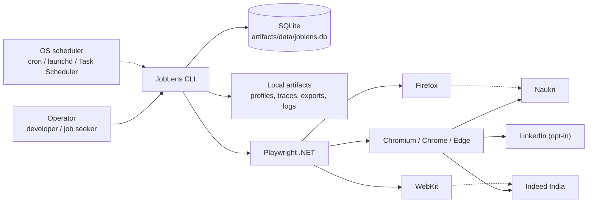
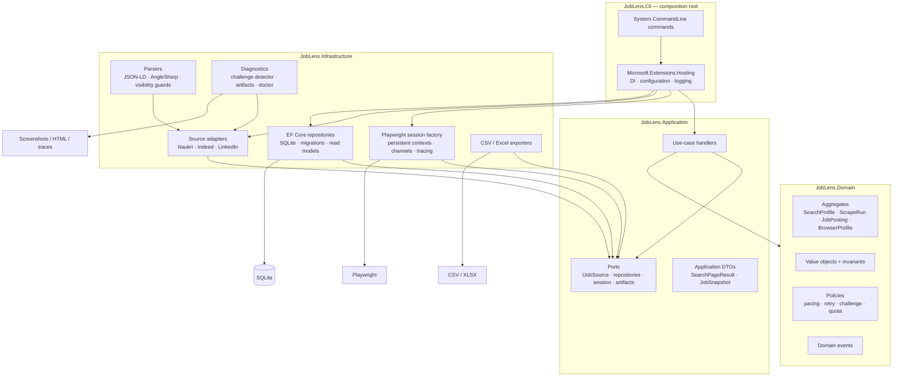
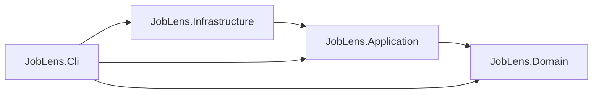
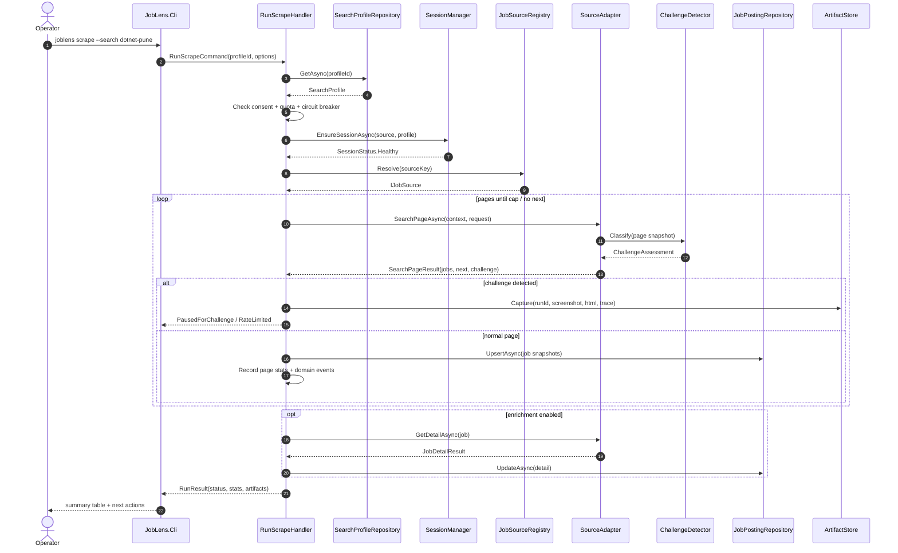
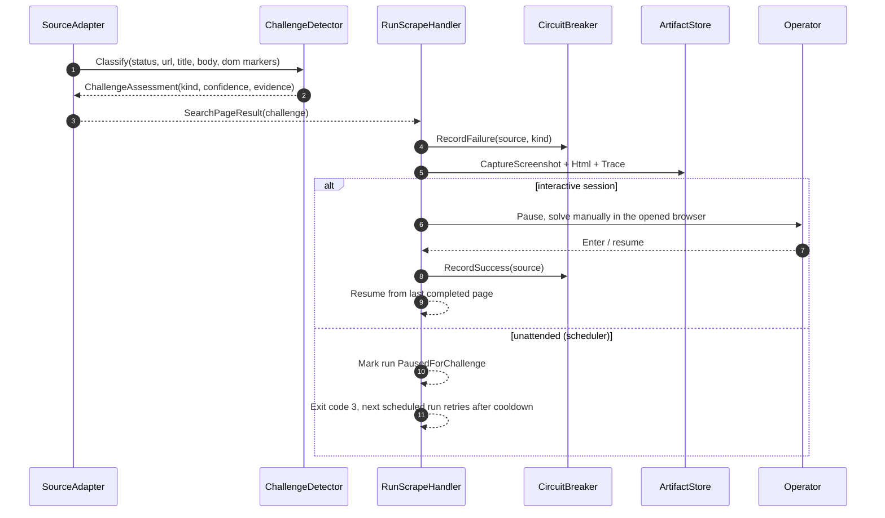
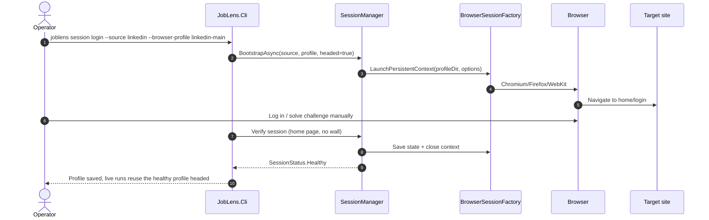
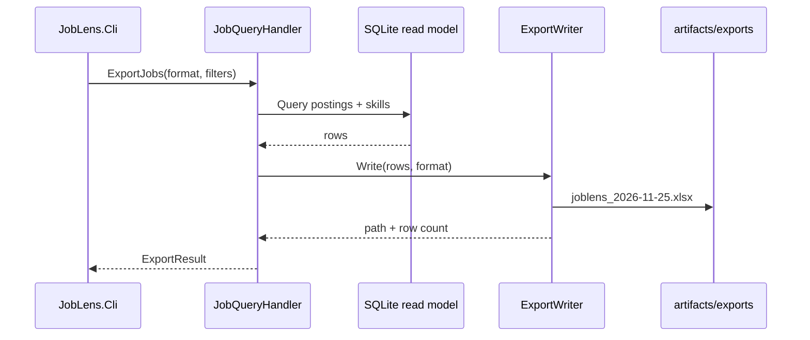
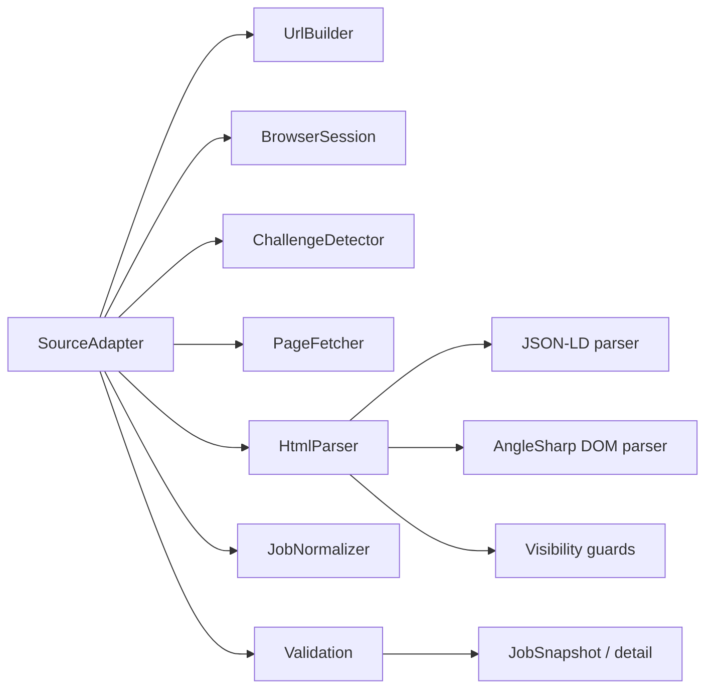
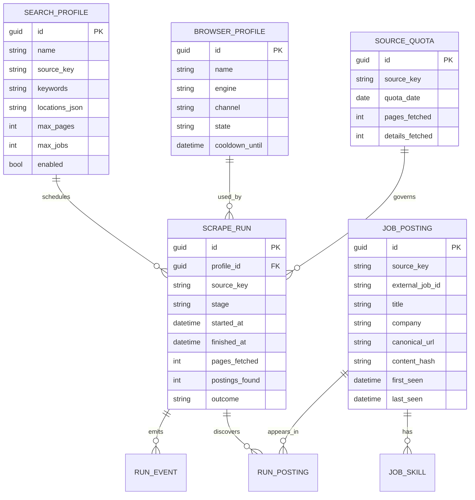
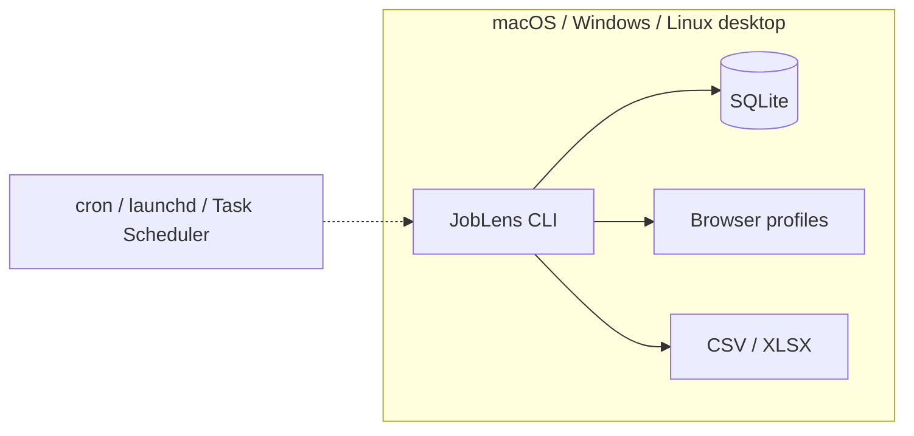

# Architecture

> **Style:** Modular monolith · Clean Architecture · DDD for the core · CLI-first.
>
> **Dependency rule:** source-code dependencies point inward. Domain knows nothing about Playwright, EF Core, HTTP, AngleSharp, Serilog, or the file system.

---

## 1. Architectural drivers

| Driver | Consequence |
|---|---|
| Three volatile websites | Each source is an isolated adapter; core never references site-specific selectors. |
| Anti-bot walls and rate limits | Session, pacing, quota, challenge, and circuit-breaker policies are first-class domain/application concerns. |
| Cross-platform | No Windows-only APIs; paths via `Environment`/options; self-contained publishes; Playwright browser install per OS. |
| Testability without a browser | URL builders, parsers, validators, and policies are pure and unit-tested. |
| Single user / single machine | SQLite, one writer, one browser context per source, no distributed infrastructure. |
| Auditability | Every run has state, events, logs, and artifacts (screenshot/HTML/trace). |
| Source volatility | JSON-LD first, fallback selector chains, fixture tests, feature flags, canaries. |
| Compliance | Per-source risk tier, explicit consent gates, stop-on-wall, no evasion tooling. |
| Future growth | API/dashboard/Postgres can be added behind existing ports; no rewrite. |

---

## 2. Principles applied (and how they are enforced)

| Principle | Concrete rule | Enforcement |
|---|---|---|
| **SRP** | One adapter per source; one handler per use case; one policy per rule. | Code review + architecture tests. |
| **OCP** | Add a source by implementing `IJobSource` and registering it; no core edits. | Contract tests; registry. |
| **LSP** | Every adapter honors the same contract and failure semantics. | Shared `JobSourceContractTests`. |
| **ISP** | Small ports (`IJobSource`, `IJobPostingRepository`, `ISessionManager`) instead of one god interface. | Interface review. |
| **DIP** | Application defines ports; Infrastructure implements them; CLI wires them. | Architecture tests: no `Microsoft.Playwright`/`Microsoft.EntityFrameworkCore` in Domain/Application. |
| **DRY** | Shared pacing, retry, URL canonicalization, visibility guards, and validation helpers. | Shared libraries inside Infrastructure; no copy-paste selectors. |
| **YAGNI** | No microservices, message bus, CQRS/MediatR, AutoMapper, dashboard, auto-apply, or ML in v1. | Scope gate in every phase. |
| **Libraries as designed** | Use each library’s documented/recommended configuration. AOT/trimming is not a design constraint. | Official docs; package review; no custom replacement for standard features. |
| **KISS** | CLI + SQLite + one browser at a time. | Deployment and runbook simplicity. |
| **Fail fast** | Invalid options, missing browser, unsafe compliance settings fail before a run starts. | `IValidateOptions`, `doctor`, startup checks. |
| **Idempotency** | Upsert by `(source, externalJobId)`; re-running a page never duplicates. | Unique index + repository tests. |
| **Observability** | Run ID, source, page, and challenge kind appear in logs and artifacts. | Structured logging + run events. |
| **Least privilege** | No admin rights; profile/data directories are user-scoped. | Install/runbook. |

> **DDD boundary:** DDD is used for **Sourcing** and **Access**. Reporting/export uses read models and query objects; it is not forced into aggregates.

---

## 3. System context



**Actors**

- **Operator:** runs commands, solves manual challenges, reviews exports.
- **OS scheduler:** optional; invokes the CLI at fixed times, one run at a time.
- **Target sites:** external, untrusted, rate-limited, and subject to change.

**Trust boundaries**

- The browser profile is a **credential** (cookies/session). Treat it as sensitive.
- Scraped HTML/artifacts may contain personal data; keep local and expire.
- The target site is untrusted input: validate URLs, cap text, never execute downloaded content.

---

## 4. Containers



The CLI is the only composition root. It may reference Application and Infrastructure. Infrastructure may reference Application and Domain. Application references Domain. Domain references nothing.

---

## 5. Layers and dependency rule



**Allowed references**

| Project | May reference | Must not reference |
|---|---|---|
| `JobLens.Domain` | BCL only | EF Core, Playwright, AngleSharp, HTTP, Serilog, CLI |
| `JobLens.Application` | Domain, `Microsoft.Extensions.Logging.Abstractions` | EF Core, Playwright, AngleSharp, CLI, file system |
| `JobLens.Infrastructure` | Application, Domain, EF Core, Playwright, AngleSharp, ClosedXML | CLI |
| `JobLens.Cli` | Application, Infrastructure, Hosting, Serilog, System.CommandLine | — (composition root) |

**Architecture tests** (NetArchTest) enforce:

- Domain has no dependency on `Microsoft.Playwright`, `Microsoft.EntityFrameworkCore`, `AngleSharp`, or `JobLens.Infrastructure`.
- Application does not reference Infrastructure or Playwright.
- Infrastructure types are not public API of Domain/Application.
- Source adapters live under `JobLens.Infrastructure.Sources.*` and implement `IJobSource`.
- Repositories live under `JobLens.Infrastructure.Persistence` and implement Application ports.

---

## 6. Solution structure

```text
PlaywrightDotNet/
├── JobLens.slnx
├── global.json
├── Directory.Build.props
├── Directory.Packages.props
├── NuGet.config
├── .editorconfig
├── .gitignore
├── README.md                         (root, added in Phase 0)
├── docs/                             (this documentation set)
├── src/
│   ├── JobLens.Domain/
│   │   ├── Common/                   (IDs, value objects, domain exceptions)
│   │   ├── Sourcing/                 (SearchProfile, ScrapeRun, JobPosting)
│   │   ├── Access/                   (BrowserProfile, quotas, challenge kinds)
│   │   └── Abstractions/             (domain events, policies)
│   ├── JobLens.Application/
│   │   ├── Abstractions/             (ports)
│   │   ├── Sourcing/                 (RunScrape, EnrichPostings, SearchProfiles)
│   │   ├── Sessions/                 (BootstrapSession, ProbeSession)
│   │   ├── Reporting/                (queries, exports)
│   │   └── DependencyInjection.cs    (application service registration)
│   ├── JobLens.Infrastructure/
│   │   ├── Browser/                  (Playwright factory, profiles, tracing)
│   │   ├── Sources/
│   │   │   ├── Naukri/
│   │   │   ├── Indeed/
│   │   │   └── LinkedIn/
│   │   ├── Parsing/                  (JSON-LD, AngleSharp helpers, visibility)
│   │   ├── Persistence/              (DbContext, mappings, repositories, migrations)
│   │   ├── Export/                   (CSV, XLSX)
│   │   ├── Diagnostics/              (challenge detector, doctor, artifacts)
│   │   └── DependencyInjection.cs
│   └── JobLens.Cli/
│       ├── Commands/                 (scrape, session, export, doctor, runs, db)
│       ├── Program.cs
│       └── appsettings.json
├── tests/
│   ├── JobLens.TestKit/              (builders, fakes, fixture server helpers)
│   ├── JobLens.Domain.Tests/
│   ├── JobLens.Application.Tests/
│   ├── JobLens.Infrastructure.Tests/
│   ├── JobLens.Architecture.Tests/
│   ├── JobLens.Cli.Tests/
│   └── JobLens.E2E.Tests/
├── build/
│   ├── scripts/                      (bootstrap, publish, browser install)
│   └── docker/                       (Linux E2E image)
└── artifacts/                        (gitignored: db, profiles, runs, logs, exports)
```

---

## 7. Runtime flows

### 7.1 Scrape run



### 7.2 Challenge handling



### 7.3 Session bootstrap



> Manual login is the only supported authentication flow. JobLens never stores a LinkedIn/Naukri password or automates a login form.

### 7.4 Export



---

## 8. Ports and adapters

### 8.1 Application ports

```csharp
public interface IJobSource
{
    SourceKey Key { get; }
    SourceCapabilities Capabilities { get; }

    Task<SearchPageResult> SearchPageAsync(
        SourceRunContext context,
        SearchPageRequest request,
        CancellationToken cancellationToken);

    Task<JobDetailResult> GetDetailAsync(
        SourceRunContext context,
        JobReference job,
        CancellationToken cancellationToken);
}

public interface ISessionManager
{
    Task<SessionStatus> EnsureSessionAsync(
        SourceKey source,
        BrowserProfileId profileId,
        CancellationToken cancellationToken);

    Task<SessionStatus> BootstrapAsync(
        SourceKey source,
        BrowserProfileId profileId,
        bool headed,
        CancellationToken cancellationToken);

    Task<SessionStatus> ProbeAsync(
        SourceKey source,
        BrowserProfileId profileId,
        CancellationToken cancellationToken);
}

public interface IJobPostingRepository
{
    Task<JobPosting?> FindAsync(SourceKey source, ExternalJobId id, CancellationToken ct);
    Task AddAsync(JobPosting posting, CancellationToken ct);
    Task UpdateAsync(JobPosting posting, CancellationToken ct);
}

public interface IUnitOfWork
{
    Task<int> SaveChangesAsync(CancellationToken ct);
}
```

Other ports:

- `ISearchProfileRepository`
- `IScrapeRunRepository`
- `IBrowserProfileRepository`
- `ISourceQuotaRepository`
- `IArtifactStore`
- `IExportWriter`
- `IJobReadModel`
- `IDiskSpace` (free-space checks; fake in tests)
- `IRandomSource`
- `IClock` → prefer BCL `TimeProvider`

### 8.1.1 Handler collaborators

`RunScrapeHandler` is the application-level orchestrator. It coordinates, but does not replace, the domain policies and infrastructure ports:

- `SearchProfile` and `ScrapeRun` (domain state)
- `ISearchProfileRepository` and `IJobPostingRepository`
- `ISessionManager` and `IJobSource` (resolved through `JobSourceRegistry`)
- `ChallengeDetector` and `ArtifactStore`
- `CompliancePolicy`, `QuotaPolicy`, `ChallengePolicy`, and the per-source `CircuitBreaker`

It owns sequencing, cancellation, and outcome mapping. Selectors, browser code, and persistence details stay in Infrastructure; the handler must not catch `OperationCanceledException` and continue. This is the application boundary that connects scraping orchestration, the job-posting domain, and compliance policy; it is not a reason to split the handler before the first vertical slice proves the seams.

### 8.2 Result pattern, not exceptions, for expected operational outcomes

```csharp
public sealed record SearchPageResult(
    IReadOnlyList<JobSnapshot> Jobs,
    PageCursor? Next,
    int? TotalCount,
    ChallengeAssessment Challenge,
    PageFingerprint Fingerprint);

public enum ChallengeKind
{
    None,
    RateLimited,
    SoftChallenge,
    Captcha,
    LoginRequired,
    AccessDenied,
    SourceChanged,
    TransientError
}

public sealed record ChallengeAssessment(
    ChallengeKind Kind,
    double Confidence,
    string Evidence,
    TimeSpan? RetryAfter,
    bool RequiresManualIntervention);
```

`SearchPageResult` is an adapter DTO, not the generic application result. Use cases return `Result<T>` with a typed `Error` (code, title, detail, kind); only the API edge maps that error to HTTP. See [Application Patterns §3](14-application-patterns.md#3-result-pattern).

Rules:

- Domain invariant violations throw domain exceptions (programmer error).
- Expected operational failures return results (challenge, rate limit, source changed).
- `OperationCanceledException` propagates; the run is marked `Cancelled` and partial results are kept.
- No `catch (Exception) { }` in adapters; every catch either classifies, enriches, or rethrows.

### 8.3 Adapter contract tests

Every `IJobSource` must pass a shared suite:

- `Key` is stable and lowercase.
- `Capabilities` declares compliance tier, detail support, pagination kind.
- `SearchPageAsync` rejects unsupported criteria with a typed failure.
- URL builder produces canonical URLs and strips tracking parameters.
- Parser fixture yields the expected job count, IDs, titles, companies, URLs.
- Challenge fixture is classified correctly and never extracted as jobs.
- Empty/partial/malformed HTML does not throw; it returns `SourceChanged` or drops bad cards with diagnostics.
- Detail parser handles missing fields and returns `null`/partial detail, never a fake success.

### 8.4 Specifications for query criteria

Reusable query predicates use the Specification pattern: an expression tree that EF Core translates. Specifications live in `JobLens.Application/Queries`, compose with `And`/`Or`/`Not`, and are accepted by read-model ports. They never expose `IQueryable`, never call `Expression.Compile()` in production, and never make authorization or compliance decisions.

```csharp
var specification = new ActivePostingSpecification(now, retentionDays)
    .And(new PostedWithinSpecification(now, criteria.PostedWithinDays));
```

Simple one-off filters stay as inline LINQ. Identity lookups use repository methods, not specifications. See [Application Patterns §5](14-application-patterns.md#5-specification-pattern).

---

## 9. Source adapter design



Each adapter is a thin composition of reusable infrastructure:

- **UrlBuilder:** search/detail URLs, query params, canonicalization.
- **PageFetcher:** navigation, wait strategy, transient retry, response capture.
- **ChallengeDetector:** status/URL/title/body/DOM classification.
- **HtmlParser:** JSON-LD first, then DOM selectors with fallback chains.
- **Visibility guards:** hidden/aria-hidden/zero-size/off-screen/honeypot checks.
- **Normalizer:** trim, cap text, parse salary/location, canonicalize URL.
- **Validator:** required fields, URL host allowlist, source-specific ID.
- **JobSnapshot:** typed, source-agnostic DTO handed to the Application/Domain.

### 9.1 Pagination strategies

| Strategy | Used by | Implementation |
|---|---|---|
| Click native next | Naukri | Click `Next`, wait for result range/first-card fingerprint to change. |
| Query param `start` | LinkedIn, Indeed | Increment by 25/10; stop on empty/repeated page or cap. |
| Cursor/API token | Naukri API fast path (if enabled) | Use returned cursor; feature-flagged. |

Every page result includes a **fingerprint** (first card ID/href + result range text) so a loop cannot silently re-read the same page.

### 9.2 Extraction priority

1. **JSON-LD** (`script[type="application/ld+json"]`, `@type: JobPosting`) — most stable, least layout-dependent.
2. **Semantic DOM** (`article`, `h2 a`, `a[href*="/jobs/view/"]`, `data-testid`) — readable and resilient.
3. **Stable class substrings** (`[class*="job-card"]`) — fallback only, logged.
4. **Full-page text/regex** — last resort for fields like salary/posted date; never for identity.

Every selector hit is logged (`selectorHit`), so drift is visible before it breaks the run.

---

## 10. Persistence design

### 10.1 Source of truth

SQLite is the source of truth. CSV/Excel/JSON files are disposable snapshots.

### 10.2 Repositories

- Domain repositories return aggregates, not `IQueryable`.
- Read models use dedicated query ports (`IJobReadModel`) that return DTOs and can use EF Core projections.
- No generic `IRepository<T>`; each root has a purpose-built contract.
- No lazy loading; explicit includes or projections.
- No tracking for read models; `AsNoTracking()`.

### 10.3 Unit of work

- One transaction per **page batch** (upsert postings + run stats + events).
- One transaction per **detail update**.
- Run state is saved after each page so a crash loses at most one page.
- Idempotent upsert by `(SourceKey, ExternalJobId)`.
- SQLite: WAL mode, `foreign_keys=ON`, `busy_timeout=5000`, one writer.

### 10.4 Schema overview



Full domain model and invariants: [Domain Model](03-domain-model.md).

### 10.5 Migrations

- EF Core migrations live in `JobLens.Infrastructure/Persistence/Migrations`.
- `joblens db migrate` applies them explicitly; `doctor` reports pending migrations.
- Tests use a real SQLite file per test class (not the EF in-memory provider) to catch SQL/constraint behavior.
- Migrations are reviewed like code; no automatic destructive changes.

---

## 11. Configuration and secrets

### 11.1 Precedence

1. `appsettings.json`
2. `appsettings.Local.json` (gitignored)
3. Environment variables (`JOBLENS_*`)
4. CLI options (highest)

### 11.2 Options pattern

Options are bound and validated once at the composition root, then consumed as immutable values. Application code receives plain records; it does not read `IConfiguration` or `IOptions<T>`. See [Application Patterns §4](14-application-patterns.md#4-options-pattern).

- `JobLensOptions`
- `BrowserOptions`
- `SourceOptions` (per source)
- `StorageOptions`
- `ComplianceOptions`
- `LoggingOptions`

Validate on startup with DataAnnotations plus custom `IValidateOptions<T>` validators:

- `maxPages >= 1`, `maxJobs >= 1`, `minDelay <= maxDelay`.
- Daily caps non-negative.
- LinkedIn `Enabled` requires `AcknowledgeSourceRisk = true`.
- Profile directory must be writable.
- Database directory must exist or be creatable.
- Browser channel must be valid for the engine.
- Artifact caps (HTML/screenshot/trace) are positive and bounded.
- Log retention days and file-size limit are positive and bounded.
- `MinimumFreeDiskBytes` is positive; low disk fails before writing.

### 11.3 Secrets

- **No credentials are stored by JobLens.** Login is manual in a headed browser.
- Browser profiles contain cookies and are treated as secrets (directory mode `0700`; never committed/shared).
- Future API keys (optional managed fallback) use user secrets in development and environment variables in production.
- Logs redact cookies, authorization headers, and form values.

---

## 12. Cross-cutting concerns

### 12.1 Error taxonomy

| Category | Examples | Retry? | Handling |
|---|---|---|---|
| Transient | timeout, connection reset, 5xx | **Yes, max 2**, exponential + jitter | Retry idempotent navigation/fetch. |
| Rate limit | 429, 999, `Retry-After` | Only after the stated delay | Pause, cool down, reduce caps. |
| Challenge | Cloudflare/Akamai JS, CAPTCHA | **No** | Stop, artifact, manual handoff, circuit open. |
| Auth | authwall, login wall, 401/403 | **No** | Stop, session bootstrap. |
| Parse | missing fields, DOM change | **No** | Artifact, drop bad card, mark degraded. |
| Validation | bad URL/title/salary | **No** | Drop item with a named-field warning. |
| Config | invalid options, missing browser | **No** | Fail fast with actionable message. |
| Storage | disk full, write failure, locked file | **No** | Fail with `STORAGE_LOW_DISK`/`IO_FAILURE`, clean temp files, stop. |
| Cancelled | Ctrl+C, shutdown | **No** | Stop, keep partial results. |
| Source changed | empty page with no challenge | **No** | Artifact, `SourceChanged`, canary alert. |

**Never retry** 403/429/CAPTCHA/challenge/auth-wall responses. A retry storm is how a soft block becomes a ban.

Expected failures return `Result<T>`; the API edge maps them to RFC 9457 Problem Details. CLI exit codes and SSE events use the same stable error codes, not the HTTP envelope. See [Application Patterns §6](14-application-patterns.md#6-problem-details-pattern).

### 12.2 Retry policy

- Max **2 attempts** (1 retry) for transient failures.
- Exponential backoff: ~2s then ~8s, plus jitter.
- Honor `Retry-After` if present.
- Retry only idempotent GET/navigation.
- If a page fails after retries, record the page as failed and continue or stop based on the run policy.
- No retries for parse/validation failures.
- Browser navigation uses this explicit policy. HTTP API clients use a Polly v8 pipeline (retry, circuit breaker, timeout, fallback) from [Runtime Hardening §4](15-runtime-hardening.md#4-http-clients-and-polly-resilience). Do not stack a manual retry loop on top of Polly, and never retry a challenge/wall.

### 12.3 Time and randomness

- Inject `TimeProvider` everywhere; never call `DateTime.Now`/`DateTimeOffset.UtcNow` directly in Domain/Application.
- Inject `IRandomSource` for jitter; tests use deterministic fakes.
- Store timestamps in UTC; render in the configured timezone (`Asia/Kolkata` by default).

### 12.4 Cancellation

- Every async method takes a `CancellationToken`; request paths never pass `CancellationToken.None`.
- Ctrl+C cancels the run cooperatively; the current page may finish, then the run is marked `Cancelled`.
- Use linked tokens for timeouts; distinguish an operator cancel from a timeout.
- `OperationCanceledException` propagates. It is not converted to a `Result`, not logged as an error, and never swallowed.
- No sync-over-async (`.Result`, `.Wait()`, `GetAwaiter().GetResult()`); no `async void`.
- Browser contexts/pages are disposed in `finally`/`await using`, in reverse acquisition order.
- Scheduler runs have a hard timeout (e.g., 30 minutes) to avoid orphaned processes.
- Full rules: [Runtime Hardening §5](15-runtime-hardening.md#5-async-and-cancellation).

### 12.5 Logging and artifacts

- Serilog structured logs: `RunId`, `Source`, `Page`, `JobId`, `ChallengeKind`, `ElapsedMs`, `TraceId`/`SpanId`, `CorrelationId`.
- Compact JSON file sink per process (`artifacts/logs/joblens-{role}-YYYYMMDD.jsonl`), daily + 100 MB rolling, 90-day retention, 200-file cap, async writes with backpressure.
- Standard enrichers: log context, machine/environment, process, thread, span, assembly, detailed exceptions, demystified stack traces.
- Console sink for live output; file sink for audit. Both use named message templates, never string interpolation.
- Artifacts per run: `run.json`, page HTML, screenshots, Playwright trace on failure.
- Redact cookies/auth headers/form values; cap HTML (10 MB), screenshots (5 MB), and traces (100 MB); artifacts retain 30 days.
- Global API exception handling returns Problem Details with a trace ID; CLI uses documented exit codes.
- Full logging/error/resource rules: [Runtime Hardening §2–3](15-runtime-hardening.md#2-structured-logging-with-serilog).

### 12.6 Idempotency and dedupe

- Identity: `(SourceKey, ExternalJobId)`.
- Content hash: SHA-256 over stable fields (title, company, location, salary raw, description, skills).
- `FirstSeenAt` never changes; `LastSeenAt` updates on every successful sighting.
- Re-running the same page updates no duplicates.
- Detail enrichment updates the same posting; it never creates a second row.

### 12.7 Problem Details mapping

The v2 API returns `application/problem+json` for every error. One mapper translates `ErrorKind` to an HTTP status and adds `code`, `traceId`, and optional `retryAfter`; endpoints do not hand-build error bodies. Stack traces, SQL, cookies, and HTML never appear in `detail`. Problem Details is HTTP-only: the CLI maps the same error kinds to exit codes, and SSE emits a typed `run.failed` event. See [Application Patterns §6](14-application-patterns.md#6-problem-details-pattern).

### 12.8 Resource budgets

- Bound every queue/channel; stream artifacts and exports instead of loading them.
- Cap HTML, screenshots, traces, and in-memory caches.
- Check free disk before runs/exports; fail with `STORAGE_LOW_DISK` before filling the volume.
- Clean temp files in `finally`; retain artifacts/logs by policy, never unbounded.
- Dispose browser/context/page, streams, responses, DB contexts, token sources, and semaphores in reverse order.
- No `GC.Collect()`; profile with `dotnet-counters`/`dotnet-trace` before optimizing.
- Full matrix: [Runtime Hardening §6](15-runtime-hardening.md#6-resource-management).

---

## 13. Deployment

### 13.1 Local desktop



- Framework-dependent build for development.
- Self-contained publish for release.
- Playwright browsers installed separately (they are large and version-coupled).

### 13.2 Linux server / CI

- Use the official Playwright Docker image or install OS dependencies.
- Headless is acceptable for **fixture E2E tests**, not for first contact with a protected site.
- Headed runs on a server need Xvfb; document it but do not make it the default.
- No live scraping in CI.

### 13.3 Optional API/dashboard (v2+)

- ASP.NET Core minimal API can reference Application and Infrastructure.
- Expose read models and run commands; keep long-running work in a hosted service with a queue.
- Do not put scraping logic in controllers.
- Reuse the same application handlers; no duplicate business rules.

The v2 control plane is specified in [Web Cockpit](12-web-cockpit.md) and [ADR-0010](10-adr/0010-react-bun-cockpit.md). It is a React SPA served by a Bun BFF on loopback; the browser never calls a source site, and Playwright stays in Infrastructure. The API is the cockpit’s only backend.

---

## 14. Security

| Asset | Risk | Control |
|---|---|---|
| Browser profile/cookies | Account/session takeover | Directory `0700`; never commit/share; optional OS keychain later. |
| SQLite DB | Personal job-search data | User-scoped path; disk encryption; backup access controls. |
| Artifacts/HTML | Page content may contain personal data | Local only; retention; redact logs; no upload. |
| Config/secrets | API keys (future) | User secrets/env vars; no secrets in git. |
| Dependencies | Supply-chain risk | Pin versions; `dotnet list package --vulnerable`; monthly updates. |
| Target sites | Legal/ToS/abuse | Compliance gates; caps; stop-on-wall; no evasion. |

Threat model in one line: **the browser profile is the crown jewel; the target site is untrusted input; the operator's account is the thing we must not get banned.**

---

## 15. What we are deliberately not building

- Microservices, message bus, distributed locks, Kubernetes.
- A generic “scrape any website” framework; only shared primitives + per-source adapters.
- CQRS command/query buses, MediatR, mediator pipelines, AutoMapper, and FluentValidation pipelines; explicit handlers and validation are clearer at this size.
- Custom replacements for documented library features (logging, validation, Excel, API reference); use the library as designed. See the [Library Usage Policy](16-library-usage-policy.md).
- Auto-apply, cover-letter generation, recruiter messaging.
- CAPTCHA solving, fingerprint spoofing, proxy rotation, account rotation.
- ML ranking, resume tailoring, vector databases.
- Multi-tenant SaaS, billing, team permissions.

Each is a separate product decision, not a refactor.

### 15.1 Reuse beyond job boards

The reusable automation primitives are:

- `BrowserSessionFactory` (persistent profiles, engines/channels, tracing).
- `ChallengeDetector` + `ArtifactStore` (wall evidence and manual handoff).
- `PolitenessPolicy` / `QuotaPolicy` / circuit breaker (low-volume operation).
- `IJobSource`-style adapter contracts (a new workflow gets its own port, not a generic “scrape anything” interface).

The **Sourcing** domain stays job-specific. A future automation case (e.g., form filling, price monitoring) should get its own bounded context/use case and adapters, reusing the browser/session/pacing infrastructure rather than stretching `JobPosting`.

---

## 16. ADR index

- [ADR-0001: .NET 10 LTS](10-adr/0001-dotnet-10-lts.md)
- [ADR-0002: xUnit.net v3](10-adr/0002-xunit-v3.md)
- [ADR-0003: Playwright for .NET](10-adr/0003-playwright-dotnet.md)
- [ADR-0004: Modular monolith + Clean Architecture](10-adr/0004-modular-monolith-clean-architecture.md)
- [ADR-0005: SQLite + EF Core 10](10-adr/0005-sqlite-ef-core.md)
- [ADR-0006: Browser-first with optional API fast path](10-adr/0006-browser-first-optional-api-fast-path.md)
- [ADR-0007: Compliance-first low-signal automation](10-adr/0007-compliance-first-low-signal-automation.md)
- [ADR-0008: CLI first, API later](10-adr/0008-cli-first-api-later.md)
- [ADR-0009: Test pyramid and coverage gates](10-adr/0009-test-pyramid-coverage-gates.md)
- [ADR-0010: React + Bun web cockpit](10-adr/0010-react-bun-cockpit.md)
- [ADR-0011: Explicit use-case handlers, no CQRS or MediatR](10-adr/0011-no-cqrs-mediatr.md)
- [ADR-0012: Serilog and Polly runtime hardening](10-adr/0012-serilog-polly-runtime-hardening.md)
- [ADR-0013: AOT-friendly code, no NativeAOT release](10-adr/0013-aot-friendly-policy.md) — superseded
- [ADR-0014: Use libraries as designed](10-adr/0014-use-libraries-as-designed.md)
