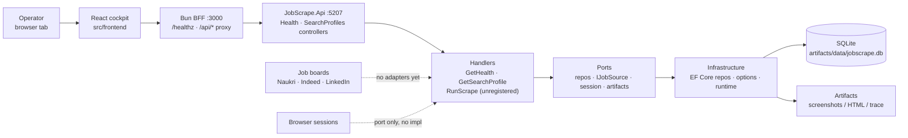
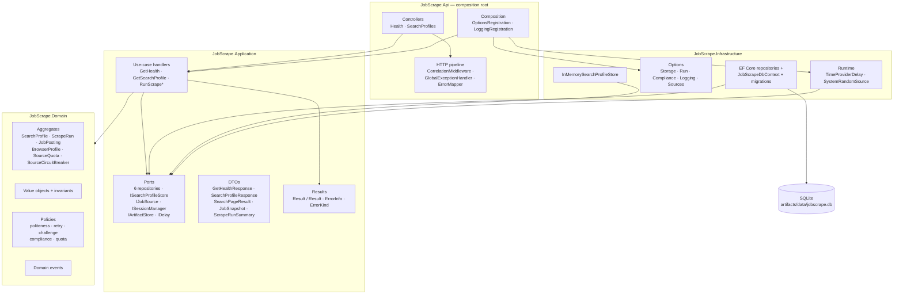
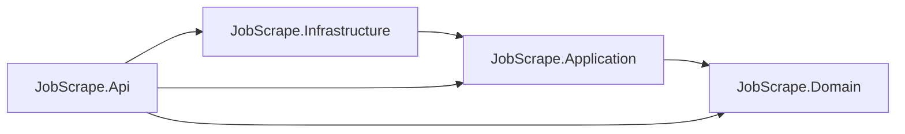
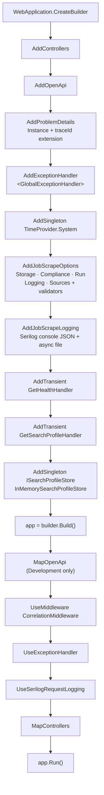
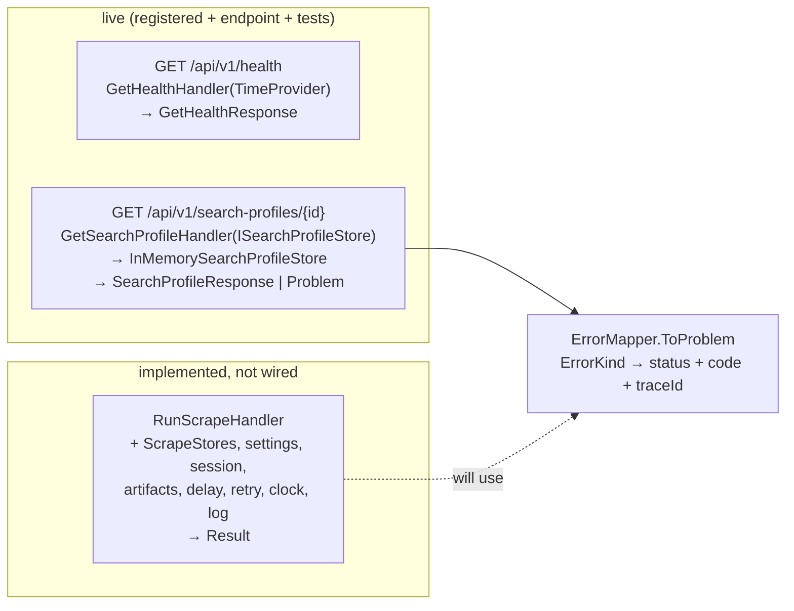
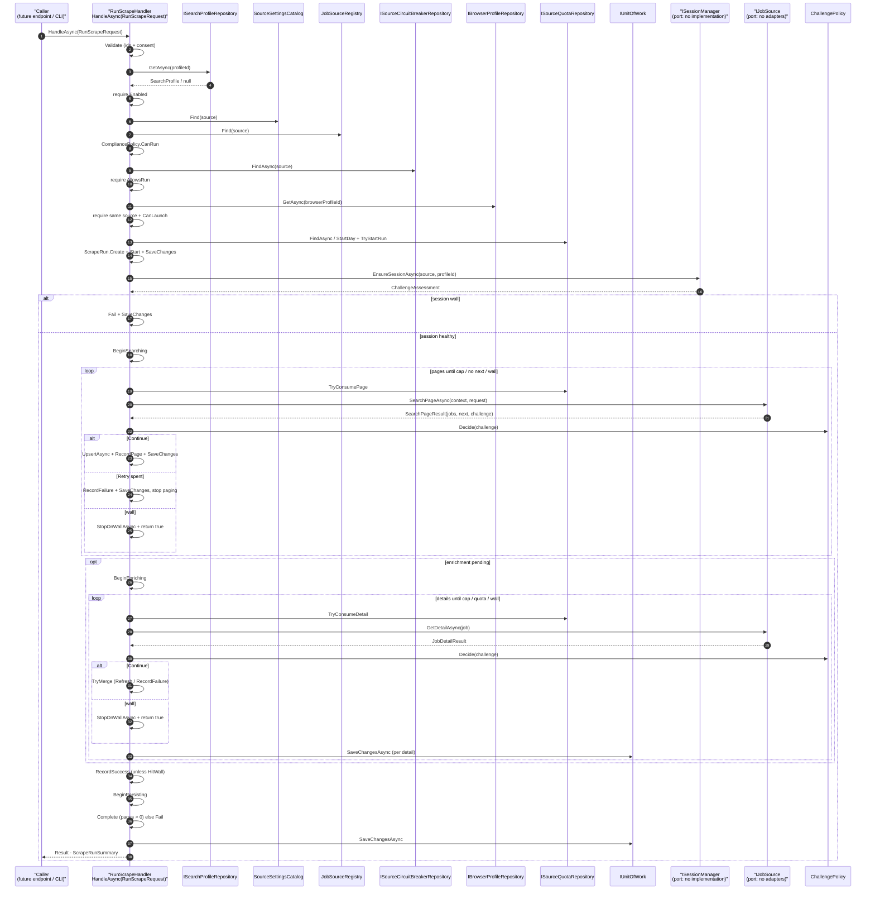
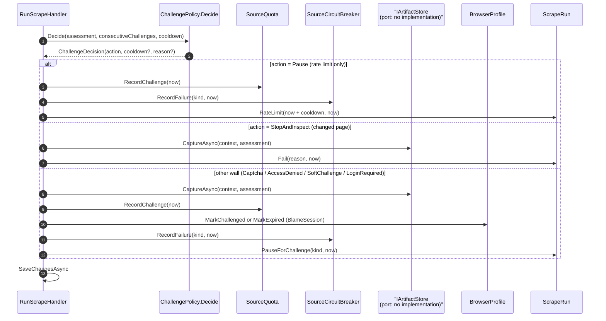
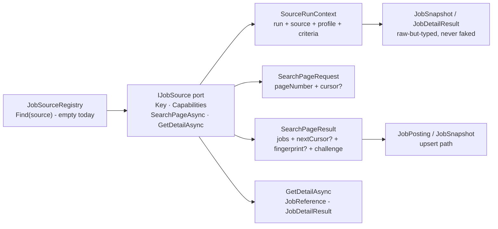
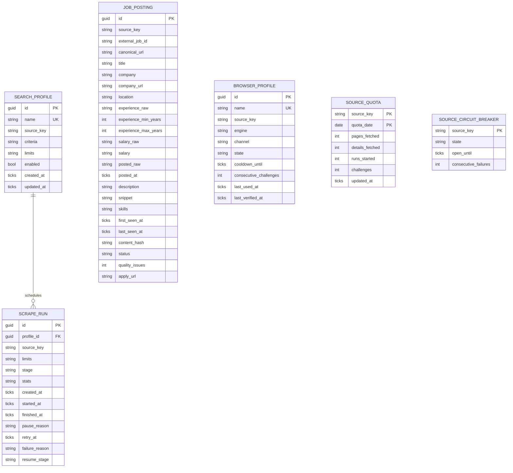
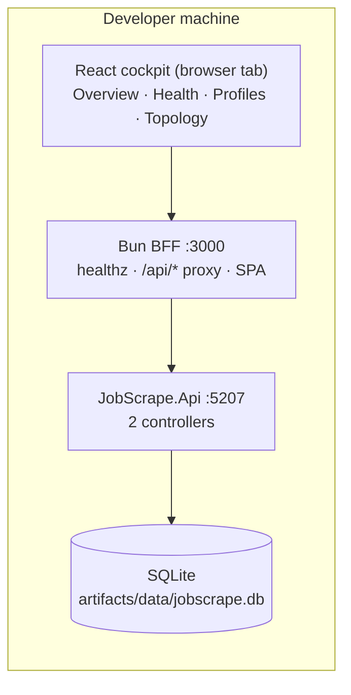

# Architecture

> **Style:** Modular monolith · Clean Architecture · DDD for the core · API-first (CLI deferred).
>
> **Dependency rule:** source-code dependencies point inward. Domain knows nothing about Playwright, EF Core, HTTP, AngleSharp, Serilog, or the file system.

---

## 1. Architectural drivers

| Driver | Consequence |
|---|---|
| Three volatile websites | Each source is an isolated adapter; core never references site-specific selectors. |
| Anti-bot walls and rate limits | Session, pacing, quota, challenge, and circuit-breaker policies are first-class domain/application concerns. |
| Cross-platform | No Windows-only APIs; paths via `Environment`/options; self-contained publishes; Playwright browser install per OS. |
| Testability without a browser | URL builders, parsers, validators, and policies are pure and unit-tested. |
| Single user / single machine | SQLite, one writer, one browser context per source, no distributed infrastructure. |
| Auditability | Every run has state, events, logs, and artifacts (screenshot/HTML/trace). |
| Source volatility | JSON-LD first, fallback selector chains, fixture tests, feature flags, canaries. |
| Compliance | Per-source risk tier, explicit consent gates, stop-on-wall, no evasion tooling. |
| Future growth | API/dashboard/Postgres can be added behind existing ports; no rewrite. |

---

## 2. Principles applied (and how they are enforced)

| Principle | Concrete rule | Enforcement |
|---|---|---|
| **SRP** | One adapter per source; one handler per use case; one policy per rule. | Code review + architecture tests. |
| **OCP** | Add a source by implementing `IJobSource` and registering it; no core edits. | Contract tests; registry. |
| **LSP** | Every adapter honors the same contract and failure semantics. | Shared `JobSourceContractTests`. |
| **ISP** | Small ports (`IJobSource`, `IJobPostingRepository`, `ISessionManager`) instead of one god interface. | Interface review. |
| **DIP** | Application defines ports; Infrastructure implements them; Api wires them. | Architecture tests: no `Microsoft.Playwright`/`Microsoft.EntityFrameworkCore` in Domain/Application. |
| **DRY** | Shared pacing, retry, URL canonicalization, visibility guards, and validation helpers. | Shared libraries inside Infrastructure; no copy-paste selectors. |
| **YAGNI** | No microservices, message bus, CQRS/MediatR, AutoMapper, dashboard, auto-apply, or ML in v1. | Scope gate in every phase. |
| **Libraries as designed** | Use each library’s documented/recommended configuration. AOT/trimming is not a design constraint. | Official docs; package review; no custom replacement for standard features. |
| **KISS** | API + SQLite + one process at a time. | Deployment and runbook simplicity. |
| **Fail fast** | Invalid options fail startup before any run starts. | `IValidateOptions<T>` + `ValidateOnStart` for every options section. |
| **Idempotency** | Upsert by `(source, externalJobId)`; re-running a page never duplicates. | Unique index + repository tests. |
| **Observability** | Run ID, source, page, and challenge kind appear in logs and artifacts. | Structured logging + run events. |
| **Least privilege** | No admin rights; profile/data directories are user-scoped. | Install/runbook. |

> **DDD boundary:** DDD is used for **Sourcing** and **Access**. Reporting/export uses read models and query objects; it is not forced into aggregates.

---

## 3. System context

> **As implemented.** No CLI, scheduler wiring, Playwright sessions, or source
> adapters exist yet: `SourceKey` names the three future sources, and the
> session/artifact/adapter ports are declared but have no implementations and
> no registrations in `Program.cs`. Dashed nodes are declared-not-wired.



**Actors**

- **Operator:** drives the cockpit, reviews payloads and problem codes.
- **Target sites:** external, untrusted, rate-limited, and subject to change. No adapter talks to one yet.

**Trust boundaries**

- The browser profile is a **credential** (cookies/session). `BrowserProfile.UserDataDirectory` is derived, never stored; treat profiles as sensitive.
- Scraped HTML/artifacts may contain personal data; `IArtifactStore` captures evidence only, never cookies or authorization headers. Keep local and expire.
- The target site is untrusted input: value objects validate shape, scraped rows that fail domain validation are dropped, never stored.

---

## 4. Containers

> **As implemented.** `JobScrape.Api` is the only composition root. No CLI,
> TestKit, E2E, exporters, Playwright sessions, source adapters, parsers,
> or read models exist — the diagram shows only shipped types.



`*RunScrapeHandler` is implemented but **not registered** in `Program.cs` and no
endpoint invokes it yet. `ISessionManager`, `IArtifactStore`, and `IJobSource`
likewise have **no implementations** — the ports exist, the wiring does not.

`JobScrape.Api` is the only composition root. It may reference Domain, Application, and Infrastructure (to bind ports). Infrastructure references Application and Domain. Application references Domain. Domain references nothing (BCL only — enforced by `LayerRulesTests` + `GuardrailTests`).

---

## 5. Layers and dependency rule



Every edge above is a `ProjectReference` in `src/backend` (see [Solution & Tooling](04-solution-and-tooling.md) §2).

**Allowed references**

| Project | May reference | Must not reference |
|---|---|---|
| `JobScrape.Domain` | BCL only | EF Core, Playwright, AngleSharp, HTTP, Serilog, Api |
| `JobScrape.Application` | Domain, `Microsoft.Extensions.Logging.Abstractions` | EF Core, Playwright, AngleSharp, Api, file system |
| `JobScrape.Infrastructure` | Application, Domain, EF Core, `Microsoft.Extensions.Options.DataAnnotations` | Api |
| `JobScrape.Api` | Domain, Application, Infrastructure (composition root binds the ports) | — |

**Architecture tests** (`JobScrape.Architecture.Tests`: `LayerRulesTests`, `GuardrailTests`, NetArchTest + xUnit) enforce:

- Domain references neither Application, Infrastructure, nor Api; and none of `Microsoft.Playwright`, `Microsoft.EntityFrameworkCore`, `AngleSharp`-family libraries (verified: Domain has zero package references).
- Application references neither Infrastructure nor Api.
- No production assembly references MediatR, and no production type is mediator-shaped (`IRequest`, `ISender`, `ICommand`, `IQuery`-style buses are banned).
- Domain has no static mutable state.
- Repositories live under `JobScrape.Infrastructure.Persistence` (+ `Repositories/`) and implement Application ports; adapters (when they exist) live under Infrastructure and implement `IJobSource`.

### 5.1 Composition root (`Program.cs`)

Exact service-registration and middleware order, as written in
`src/backend/JobScrape.Api/Program.cs`:



Not registered (so unreachable at runtime): `AddJobScrapePersistence`, `JobSourceRegistry`, `RunScrapeHandler`, `ISessionManager`/`IArtifactStore` implementations, and any `IJobSource` adapter.

### 5.2 Implemented feature slices



| Slice | Endpoint | Handler (ctor) | Ports → implementations | Status |
|---|---|---|---|---|
| Health | `GET /api/v1/health` | `GetHealthHandler(TimeProvider)` | none (DTO direct) | Live, tested |
| Profile lookup | `GET /api/v1/search-profiles/{id:guid}` | `GetSearchProfileHandler(ISearchProfileStore)` | `ISearchProfileStore` → `InMemorySearchProfileStore` | Live, tested |
| Run scrape | — | `RunScrapeHandler(ScrapeStores, JobSourceRegistry, SourceSettingsCatalog, ISessionManager, IArtifactStore, IDelay, RetryPolicy, IRandomSource, TimeProvider, ILogger)` | 6 EF repos via `ScrapeStores` + `IUnitOfWork`; session/artifacts/adapters unimplemented | Code complete, unregistered |

---

## 6. Solution structure

> **As implemented** (`src/backend/`, verified by directory listing; the
> `JobLens.*` tree below it is the pre-rename design-doc target).

```text
PlaywrightDotNet/
├── src/
│   ├── backend/
│   │   ├── JobScrape.slnx              (9 projects)
│   │   ├── global.json                 (+ MTP test runner)
│   │   ├── Directory.Build.props       (net10.0, warnings-as-errors, XML docs)
│   │   ├── Directory.Packages.props    (27 pinned versions)
│   │   ├── NuGet.config                (nuget.org only)
│   │   ├── JobScrape.Domain/
│   │   │   ├── Common/                 (IDs, SourceKey, Text, ComplianceTier)
│   │   │   ├── Sourcing/               (SearchProfile, ScrapeRun, JobPosting + events)
│   │   │   ├── Access/                 (BrowserProfile, quotas, circuit breaker, policies)
│   │   │   └── Abstractions/           (DomainEvent, AggregateRoot, IRandomSource)
│   │   ├── JobScrape.Application/
│   │   │   ├── Abstractions/           (10 ports: 6 repositories, session, artifacts, delay, UoW)
│   │   │   ├── Features/Health/        (GetHealthHandler, GetHealthResponse)
│   │   │   ├── Features/SearchProfiles/ (GetSearchProfileHandler, store port, response DTO)
│   │   │   ├── Features/Scraping/      (RunScrapeHandler, IJobSource, registry, settings)
│   │   │   └── Results/                (Result, Result{T}, ErrorInfo, ErrorKind, Errors)
│   │   ├── JobScrape.Infrastructure/
│   │   │   ├── Configuration/          (Storage/Run/Compliance/Logging/Sources options)
│   │   │   ├── Persistence/            (DbContext, 6 configurations, 6 repositories, migrations)
│   │   │   ├── Runtime/                (TimeProviderDelay, SystemRandomSource)
│   │   │   └── SearchProfiles/         (InMemorySearchProfileStore)
│   │   ├── JobScrape.Api/
│   │   │   ├── Controllers/            (Health, SearchProfiles)
│   │   │   ├── Http/                   (ErrorMapper, CorrelationMiddleware, GlobalExceptionHandler)
│   │   │   ├── Composition/            (OptionsRegistration, LoggingRegistration)
│   │   │   └── Program.cs              (composition root)
│   │   ├── JobScrape.Domain.Tests/
│   │   ├── JobScrape.Application.Tests/
│   │   ├── JobScrape.Api.Tests/
│   │   ├── JobScrape.Infrastructure.Tests/
│   │   └── JobScrape.Architecture.Tests/
│   └── frontend/                       (React + Bun ops deck, separate package)
└── docs/                               (this documentation set)
```

> Design-doc target (pre-rename reference): `JobLens.slnx` at the repo root
> with `JobLens.Domain/Application/Infrastructure/Cli` (+ v2 `JobLens.Api`),
> `tests/JobLens.*` (incl. `TestKit`, `Cli.Tests`, `E2E.Tests`), `build/`,
> and `artifacts/`. None of `JobLens.Cli`, `JobLens.TestKit`,
> `JobLens.E2E.Tests`, or `JobLens.Cli.Tests` exist in the tree above.

---

## 7. Runtime flows

### 7.1 Scrape run

> **Code path, not yet reachable.** `RunScrapeHandler.HandleAsync` is fully
> implemented but nothing registers it (`Program.cs`) and no controller
> invokes it. The diagram below traces exactly what the code does, so the
> wiring slice can land without surprises.



Gate failures return typed `Result` errors instead of throwing: `VALIDATION_FAILED`, `PROFILE_NOT_FOUND`, `PROFILE_DISABLED`, `SOURCE_UNAVAILABLE`, `SOURCE_DISABLED`, `COMPLIANCE_BLOCKED`, `SOURCE_COOLING_DOWN`, `BROWSER_PROFILE_NOT_FOUND`, `SESSION_UNAVAILABLE` / `SESSION_RESET_REQUIRED`, `QUOTA_EXCEEDED`. Cancellation records `Run.Cancelled` with partial results and rethrows; unexpected exceptions record `Run.Fail` before reaching the global handler.

### 7.2 Challenge handling

`RunScrapeHandler.StopOnWallAsync` — the only place a wall turns into run state. Verified against `RunScrapeHandler.cs:709-762`, `BlameSession` (844), `ChallengePolicy.Decide`, and `ChallengeAction`:



Notes the code forces: `BlameSession` marks `MarkExpired` only for `LoginRequired` on a healthy profile (a cooldown would block the re-login); every other wall cools the profile down via `MarkChallenged`. `RecordFailure` opens the breaker after 2 consecutive failures, 3 walls in 24h, any `AccessDenied`, with cooldowns 60m (rate limit) / 24h (challenge) / 7d (repeated block). Walls are never retried and never auto-solved; `SourceChanged` and `TransientError` are not walls and never reach this path.

### 7.3 Session verification

> **Port only — no implementation.** `ISessionManager` is declared in
> `JobScrape.Application/Abstractions` and called by `RunScrapeHandler`
> before pagination, but no class implements it and nothing registers it,
> so no run can pass the session gate today. The contract, verbatim:

```csharp
Task<ChallengeAssessment> EnsureSessionAsync(
    SourceKey source,
    BrowserProfileId profileId,
    CancellationToken cancellationToken);
```

When implemented: verify the profile's session (healthy → proceed; wall → `Run.Fail` without retry), never automate credentials — login stays manual.

> Manual login is the only supported authentication flow. JobScrape never stores a site password or automates a login form.

### 7.4 Export

Not implemented: there is no `JobQueryHandler`, no read model, and no exporter in the tree. Export will be specified when the runs vertical needs it; until then this section intentionally has no diagram.

---

## 8. Ports and adapters

### 8.1 Application ports

> Verified verbatim against the interfaces (parameter names shortened to `ct` only where the doc abbreviates; everything else is exact).

```csharp
public interface IJobSource
{
    SourceKey Key { get; }
    SourceCapabilities Capabilities { get; }

    Task<SearchPageResult> SearchPageAsync(
        SourceRunContext context,
        SearchPageRequest request,
        CancellationToken cancellationToken);

    Task<JobDetailResult> GetDetailAsync(
        SourceRunContext context,
        JobReference job,
        CancellationToken cancellationToken);
}

public interface ISessionManager   // port only: no implementation, nothing registered
{
    Task<ChallengeAssessment> EnsureSessionAsync(
        SourceKey source,
        BrowserProfileId profileId,
        CancellationToken cancellationToken);
}

public interface IJobPostingRepository
{
    Task<JobPosting?> FindAsync(SourceKey source, ExternalJobId id, CancellationToken ct);
    Task AddAsync(JobPosting posting, CancellationToken ct);
}

public interface IUnitOfWork
{
    Task<int> SaveChangesAsync(CancellationToken ct);
}
```

Other ports (all in `JobScrape.Application/Abstractions`, all EF-implemented except noted):

- `ISearchProfileRepository` — `GetAsync`, `AddAsync`
- `IScrapeRunRepository` — `GetAsync`, `AddAsync`
- `IBrowserProfileRepository` — `GetAsync`
- `ISourceQuotaRepository` — `FindAsync`, `AddAsync`
- `ISourceCircuitBreakerRepository` — `FindAsync`, `AddAsync`
- `IArtifactStore` — `CaptureAsync` (no implementation yet)
- `IDelay` — `WaitAsync` (implemented by `TimeProviderDelay`)
- `ISearchProfileStore` — `GetAsync` (implemented by `InMemorySearchProfileStore`; **not** by any EF repository)

Deliberately absent (no such types exist): `IExportWriter`, `IJobReadModel`, `ISkillDemandReadModel`, `IDiskSpace`, `IClock` (use BCL `TimeProvider`), `Specification<T>`, `BootstrapAsync`/`ProbeAsync` session methods, `SessionStatus`, `UpdateAsync` on `IJobPostingRepository`.

### 8.1.1 Handler collaborators

`RunScrapeHandler` is the application-level orchestrator (implemented, not yet registered — see §7.1). It coordinates, but does not replace, the domain policies and infrastructure ports:

- `SearchProfile` and `ScrapeRun` (domain state) via `ScrapeStores` (repositories + `IUnitOfWork` grouped so the 10-parameter constructor stays readable)
- `SourceSettingsCatalog` and `JobSourceRegistry` (settings/adapters by source; empty today)
- `ISessionManager` (port only) and `IJobSource` (no adapters yet)
- `IArtifactStore.CaptureAsync` (port only)
- `CompliancePolicy`, `ChallengePolicy`, `PolitenessPolicy`, `RetryPolicy`, `SourceCircuitBreaker`, `SourceQuota` (domain)

It owns sequencing, cancellation, and outcome mapping. Selectors, browser code, and persistence details stay in Infrastructure; cancellation records partial results and rethrows, unexpected failures are recorded before they reach the global handler.

### 8.2 Result pattern, not exceptions, for expected operational outcomes

```csharp
public sealed record SearchPageResult(
    IReadOnlyList<JobSnapshot> Jobs,
    string? NextCursor,
    PageFingerprint? Fingerprint,
    ChallengeAssessment Challenge);

public enum ChallengeKind
{
    None,
    RateLimited,
    SoftChallenge,
    Captcha,
    LoginRequired,
    AccessDenied,
    SourceChanged,
    TransientError
}

public sealed record ChallengeAssessment(
    ChallengeKind Kind,
    double Confidence,
    string Evidence,
    TimeSpan? RetryAfter)
```

`SearchPageResult` is an adapter DTO, not the generic application result. Use cases return `Result<T>` with a typed `ErrorInfo` (code, title, detail, kind); only the API edge maps that error to HTTP. See [Application Patterns §3](14-application-patterns.md#3-result-pattern).

Rules:

- Domain invariant violations throw domain exceptions (programmer error).
- Expected operational failures return results (challenge, rate limit, source changed).
- `OperationCanceledException` propagates; the run is marked `Cancelled` and partial results are kept.
- No `catch (Exception) { }` in adapters; every catch either classifies, enriches, or rethrows.

### 8.3 Adapter contract tests

No `IJobSource` implementation exists yet, so there is nothing to run. When the first adapter lands, it must pass a shared suite:

- `Key` is stable and lowercase (`SourceKey` singletons: `naukri`, `indeed`, `linkedin`).
- `Capabilities` declares what the source supports (`SupportsDetails` today).
- `SearchPageAsync` returns walls through `Challenge`, never throws for them; retries are the handler's decision, never the adapter's.
- URL builder produces canonical URLs and strips tracking parameters.
- Parser fixture yields the expected job count, IDs, titles, companies, URLs.
- Challenge fixture is classified correctly and never extracted as jobs.
- Empty/partial/malformed HTML does not throw; it returns `SourceChanged` or drops bad cards with diagnostics.
- Detail parser handles missing fields and returns `null`/partial detail, never a fake success.

### 8.4 Specifications for query criteria

Not implemented: no `Specification<T>` type, no `Queries/` folder, and no read-model ports exist. Query criteria today are identity lookups (`FindAsync`/`GetAsync` by id), which stay as repository methods even after specifications arrive. When the first real filter need appears, add the smallest `Specification<T>` that composes with `And`/`Or`/`Not` — see [Application Patterns §5](14-application-patterns.md#5-specification-pattern) for the deferred design.

---

## 9. Source adapter design

> **Port only — zero implementations.** The contract below is verbatim from
> `JobScrape.Application/Features/Scraping/IJobSource.cs`. No class implements
> it, nothing registers one, and `JobSourceRegistry` stays empty, so every
> box an adapter would be composed of (URL builder, browser session,
> challenge detector, HTML parser, normalizer) exists only as future work.
> Do not draw adapter internals until the first adapter lands.



Adapter rules (binding on the first implementation, from the port's own doc comments):

- Classify walls in `Challenge` (`ChallengeAssessment.Kind`); never throw for a wall.
- Never retry: retries are `RunScrapeHandler.FetchWithRetryAsync`'s decision (transient errors only, with backoff and `Retry-After`).
- Missing detail fields stay null, never faked; malformed cards are dropped by the handler via `DomainException`, never stored.
- `SourceKey` singletons are the only valid keys (`naukri`, `indeed`, `linkedin`); `TryParse` rejects everything else.

> The composition below (URL builder, page fetcher, challenge detector, HTML parsing, normalizer) is the design for the first adapter — none of it exists. Pagination and extraction tactics likewise belong to adapter implementations, not to this doc, until one lands.

### 9.1 Pagination strategies (design target — no adapter implements these yet)

| Strategy | Used by | Implementation |
|---|---|---|
| Click native next | Naukri | Click `Next`, wait for result range/first-card fingerprint to change. |
| Query param `start` | LinkedIn, Indeed | Increment by 25/10; stop on empty/repeated page or cap. |
| Cursor/API token | Naukri API fast path (if enabled) | Use returned cursor; feature-flagged. |

Every page result includes a **fingerprint** (first card ID/href + result range text) so a loop cannot silently re-read the same page.

### 9.2 Extraction priority (design target — no parser exists yet)

1. **JSON-LD** (`script[type="application/ld+json"]`, `@type: JobPosting`) — most stable, least layout-dependent.
2. **Semantic DOM** (`article`, `h2 a`, `a[href*="/jobs/view/"]`, `data-testid`) — readable and resilient.
3. **Stable class substrings** (`[class*="job-card"]`) — fallback only, logged.
4. **Full-page text/regex** — last resort for fields like salary/posted date; never for identity.

Every selector hit is logged (`selectorHit`), so drift is visible before it breaks the run.

---

## 10. Persistence design

### 10.1 Source of truth

SQLite is the source of truth. CSV/Excel/JSON files are disposable snapshots.

### 10.2 Repositories

- Domain repositories return aggregates, not `IQueryable`; each root has a purpose-built contract (`ISearchProfileRepository`, `IScrapeRunRepository`, `IJobPostingRepository`, `IBrowserProfileRepository`, `ISourceQuotaRepository`, `ISourceCircuitBreakerRepository`).
- No generic `IRepository<T>`.
- No lazy loading; explicit includes or projections.
- No tracking for read models; `AsNoTracking()` (applies when read models land — none exist yet).

### 10.3 Unit of work

- One transaction per **page batch** and one per **detail update** (`IUnitOfWork.SaveChangesAsync` after each page/detail in `RunScrapeHandler`, including after failures).
- Run state is saved after each page so a crash loses at most one page.
- Idempotent upsert by `(SourceKey, ExternalJobId)` (unique index on `job_postings`).
- SQLite: WAL mode, `foreign_keys=ON`, `busy_timeout=5000`, one writer (see `SqlitePragmaInterceptor`).

### 10.4 Schema overview

> Verified against `JobScrapeDbContext`, the six `IEntityTypeConfiguration`
> classes, and migration `202611010743_InitialCreate`. Tables and columns are
> snake_case; every `DateTimeOffset` is stored as UTC ticks
> (`UtcTicksConverter`). The **only enforced foreign key** is
> `scrape_runs → search_profiles`; cross-aggregate links (quota, circuit
> breaker, browser profile) are by convention, not constraint.



`JobSkill` is an owned value inside `JOB_POSTING.skills` (dedupe key `NormalizedName`) — not a table. There are no `RUN_EVENT` / `RUN_POSTING` tables. `BROWSER_PROFILE.used_by`, `SOURCE_QUOTA.governs`, and postings-vs-runs links that older revisions drew are logical relationships only; the database enforces exactly one FK (`scrape_runs.profile_id → search_profiles.id`, restrict on delete).

Full domain model and invariants: [Domain Model](03-domain-model.md).

### 10.5 Migrations

- EF Core migrations live in `JobScrape.Infrastructure/Persistence/Migrations` (current: `202611010743_InitialCreate`).
- The context is registered by `PersistenceServiceCollectionExtensions.AddJobScrapePersistence` (scoped per run/request) — but `Program.cs` does not call it yet, so no database exists at runtime today.
- `JobScrapeDesignTimeFactory` exists for `dotnet ef` tooling only.
- Migrations are reviewed like code; no automatic destructive changes.

---

## 11. Configuration and secrets

### 11.1 Precedence

1. `appsettings.json`
2. `appsettings.Local.json` (gitignored)
3. Environment variables (`JOBSCRAPE_*` by convention; no `JOBLENS_*` reader exists)

### 11.2 Options pattern

Options are bound and validated once at the composition root, then consumed as immutable values. Application code receives plain records; it does not read `IConfiguration` or `IOptions<T>`. See [Application Patterns §4](14-application-patterns.md#4-options-pattern).

- `StorageOptions` (`JobScrape:Storage`)
- `ComplianceOptions` (`JobScrape:Compliance`)
- `RunOptions` (`JobScrape:Run`)
- `LoggingOptions` (`JobScrape:Logging`)
- `SourcesOptions` (`JobScrape`, dictionary keyed by source)
- `ComplianceOptions`
- `LoggingOptions`

Validate on startup with DataAnnotations plus custom `IValidateOptions<T>` validators. What `SourcesOptionsValidator` actually enforces today:

- Every `Sources:<key>` parses via `SourceKey.TryParse` (unknown keys fail with the section path).
- Per-source DataAnnotations validate (caps, delays, cooldowns within range).
- `RunLimits` domain ranges hold (`maxPages` 1–30, `maxJobs` 1–1000, `maxDetails` 0–1000, delay 1s–2m).
- Enabling a non-`Standard` tier requires `Compliance:AcknowledgeSourceRisk = true`; `HighRisk` additionally requires `Compliance:AllowHighRiskSources = true`.
- `StorageOptions` ranges hold (retention 1–3650 days, `MinimumFreeDiskBytes ≥ 1`); `RunOptions.RetryMaxAttempts` is 1–3.

### 11.3 Secrets

- **No credentials are stored by JobScrape.** There is no login automation; session verification is a future port implementation.
- Browser profiles contain cookies and are treated as secrets (never committed/shared).
- Future API keys use user secrets in development and environment variables in production.
- Logs redact cookies, authorization headers, and form values.

---

## 12. Cross-cutting concerns

### 12.1 Error taxonomy

| Category | Examples | Retry? | Handling |
|---|---|---|---|
| Transient | connection reset, 5xx, timeouts | **Yes, if attempts remain** (see §12.2) | Retry with backoff; then `RecordFailure` and stop paging. |
| Rate limit | 429, 999, `Retry-After` | Only after the stated delay | `RateLimit(retryAt)`; resume via `Resume` once elapsed. |
| Challenge | CAPTCHA, access denied, soft challenge | **No** | Stop, capture evidence, open circuit, `PauseForChallenge`. |
| Auth | login wall on a healthy session | **No** | `MarkExpired`; manual re-login, then resume. |
| Parse | missing fields, DOM change | **No** | `SourceChanged` → `Fail` with evidence; bad card dropped. |
| Validation | empty id, bad request fields | **No** | `Result.Fail` → 400 with `code: VALIDATION_FAILED`. |
| Config | invalid options | **No** | Fail fast at startup (`ValidateOnStart`). |
| Storage | disk full, write failure | **No** | `ErrorKind.Storage` → 507 via `ErrorMapper`. |
| Cancelled | Ctrl+C, shutdown | **No** | Stop, keep partial results, rethrow. |
| Source changed | empty page with no challenge | **No** | Capture evidence, `Fail`, canary alert. |

**Never retry** challenges, walls, auth, parse, or config failures. Only `ChallengeKind.TransientError` is ever retried.

Expected failures return `Result<T>`; the API edge maps them to RFC 9457 Problem Details with a stable `code` (`ErrorMapper`, `jobscrape.local` type host). See [Application Patterns §6](14-application-patterns.md#6-problem-details-pattern).

### 12.2 Retry policy

- Only `ChallengeKind.TransientError` is ever retried (`RetryPolicy.ShouldRetry`); walls, rate limits, and changed pages never are.
- Ceiling `MaxAllowedAttempts = 3`; configured default `RunOptions.RetryMaxAttempts = 2` (1 retry).
- Backoff: 2s base, 4× growth per retry, up to 1s jitter; honors source-stated `Retry-After`.
- Retry only idempotent fetches; a page that fails after retries records a failure and stops pagination.
- No retries for parse/validation failures (cards are dropped with a named reason instead).

### 12.3 Time and randomness

- Inject `TimeProvider` everywhere; never call `DateTime.Now`/`DateTimeOffset.UtcNow` directly in Domain/Application (`TimeProvider.System` is registered in `Program.cs`; tests use `FakeTimeProvider`).
- Inject `IRandomSource` for jitter (`SystemRandomSource` in production); tests use deterministic fakes.
- Store timestamps in UTC (`UtcTicksConverter`; `QuotaDate` is a UTC `DateOnly`). No timezone rendering exists yet.

### 12.4 Cancellation

- Every async method takes a `CancellationToken`; request paths never pass `CancellationToken.None`.
- Ctrl+C cancels the run cooperatively; the current page may finish, then the run is marked `Cancelled`.
- Use linked tokens for timeouts; distinguish an operator cancel from a timeout.
- `OperationCanceledException` propagates. It is not converted to a `Result`, not logged as an error, and never swallowed.
- No sync-over-async (`.Result`, `.Wait()`, `GetAwaiter().GetResult()`); no `async void`.
- `DbContext` instances are scoped per run/request (`AddJobScrapePersistence`), never long-lived or shared.
- `TimeProvider.Delay` (via `IDelay`) is cancellable; cancellation aborts the wait.
- Full rules: [Runtime Hardening §5](15-runtime-hardening.md#5-async-and-cancellation).

### 12.5 Logging and artifacts

- Serilog structured logs: `RunId`, `Source`, `Page`, `JobId`, `ChallengeKind`, `ElapsedMs`, `TraceId`/`SpanId`, `CorrelationId` (via `CorrelationMiddleware` + span/process/thread/assembly enrichers).
- Compact JSON console sink plus an async rolling compact-JSON file sink (`artifacts/logs/jobscrape-api-*.jsonl`), 200-file cap or `RetentionDays` (default 90), 10k-event buffer that blocks rather than drops.
- Both sinks use named message templates, never string interpolation.
- Artifacts per wall: `IArtifactStore.CaptureAsync` (screenshot, capped HTML, trace) — port declared, no implementation yet.
- Redact cookies/auth headers/form values; the global handler returns Problem Details with a trace ID, never stack traces.
- Full logging/error/resource rules: [Runtime Hardening §2–3](15-runtime-hardening.md#2-structured-logging-with-serilog).

### 12.6 Idempotency and dedupe

- Identity: `(SourceKey, ExternalJobId)` (unique index on `job_postings`).
- Content hash: lowercase SHA-256 over the posting's stable fields (`ContentHash.Compute`); `Refresh` updates `LastSeenAt` always and content only when the hash changes. No-change re-sightings raise no event.
- `FirstSeenAt` never changes; `LastSeenAt` updates on every successful sighting.
- Re-running the same page updates no duplicates (`seenJobs` per run + unique index).
- Detail enrichment updates the same posting; it never creates a second row.

### 12.7 Problem Details mapping

The API returns `application/problem+json` for every error. One mapper (`ErrorMapper.ToProblem`) translates `ErrorKind` to an HTTP status and adds `code`, `traceId`, and optional `retryAfter`; endpoints do not hand-build error bodies (`Validation` uses `ValidationProblem` so the errors dictionary renders correctly, plus the same `code`/`traceId` extensions). Stack traces, SQL, cookies, and HTML never appear in `detail`. Problem Details is HTTP-only. See [Application Patterns §6](14-application-patterns.md#6-problem-details-pattern).

### 12.8 Resource budgets

- Bound every queue/channel; stream artifacts instead of loading them.
- `StorageOptions.MinimumFreeDiskBytes` (default 1 GiB) declares the floor, but no check enforces it yet — disk-full surfaces as `ErrorKind.Storage` (507).
- Clean temp files in `finally`; retain artifacts/logs by policy, never unbounded.
- Dispose `DbContext`, token sources, and semaphores in reverse order (`await using`).
- No `GC.Collect()`; profile with `dotnet-counters`/`dotnet-trace` before optimizing.
- Full matrix: [Runtime Hardening §6](15-runtime-hardening.md#6-resource-management).

---

## 13. Deployment

### 13.1 Local desktop



- `dotnet run --project src/backend/JobScrape.Api/JobScrape.Api.csproj` (Development serves the OpenAPI document at `/openapi/v1.json`; no Swagger/Scalar UI is registered).
- `bun run dev` in `src/frontend/` (BFF `:3000` + Tailwind watcher); `DOTNET_API_URL` points the proxy at the API.
- No scheduler, no CLI, no browser automation, no exports: the deployable surface is the API plus the BFF.

### 13.2 Linux server / CI

No CI workflow exists in the repo yet. When one lands: `dotnet build` with warnings-as-errors, `dotnet test` per test project (native MTP runner), `dotnet-coverage` merge for the 100% gate, `bun run format:check` + `bun test` for `src/frontend/`. No live scraping in CI (there is no network-dependent test today).

### 13.3 API and cockpit (present, v1)

- `JobScrape.Api` is a controller-based ASP.NET Core API (not minimal-API): `HealthController` and `SearchProfilesController` call use-case handlers directly and map `Result` through `ErrorMapper`.
- The cockpit is a React SPA served by the Bun BFF on loopback (`src/frontend/`); the browser talks to the BFF, the BFF proxies `/api/*` to the API. No read models or run commands are exposed yet.

The v2 control plane is specified in [Web Cockpit](12-web-cockpit.md) and [ADR-0010](10-adr/0010-react-bun-cockpit.md). It is a React SPA served by a Bun BFF on loopback; the browser never calls a source site, and Playwright stays in Infrastructure. The API is the cockpit’s only backend.

---

## 14. Security

| Asset | Risk | Control |
|---|---|---|
| Browser profile/cookies | Account/session takeover | Treat as secrets; never commit/share; directory permissions (`0700`) apply when profiles land on disk (no browser code exists yet) |
| SQLite DB | Personal job-search data | User-scoped path; disk encryption; backup access controls. |
| Artifacts/HTML | Page content may contain personal data | Local only; retention; redact logs; no upload. |
| Config/secrets | API keys (future) | User secrets/env vars; no secrets in git. |
| Dependencies | Supply-chain risk | Pin versions; `dotnet list package --vulnerable`; monthly updates. |
| Target sites | Legal/ToS/abuse | Compliance gates; caps; stop-on-wall; no evasion. |

Threat model in one line: **the browser profile is the crown jewel; the target site is untrusted input; the operator's account is the thing we must not get banned.**

---

## 15. What we are deliberately not building

- Microservices, message bus, distributed locks, Kubernetes.
- A generic “scrape any website” framework; only shared primitives + per-source adapters.
- CQRS command/query buses, MediatR, mediator pipelines, AutoMapper, and FluentValidation pipelines; explicit handlers and validation are clearer at this size.
- Custom replacements for documented library features (logging, validation, Excel, API reference); use the library as designed. See the [Library Usage Policy](16-library-usage-policy.md).
- Auto-apply, cover-letter generation, recruiter messaging.
- CAPTCHA solving, fingerprint spoofing, proxy rotation, account rotation.
- ML ranking, resume tailoring, vector databases.
- Multi-tenant SaaS, billing, team permissions.

Each is a separate product decision, not a refactor.

### 15.1 Reuse beyond job boards

The reusable automation primitives that actually exist:

- `PolitenessPolicy` / `RetryPolicy` / `CompliancePolicy` / `ChallengePolicy` (pacing, retry, consent, challenge response).
- `SourceCircuitBreaker` + `SourceQuota` (per-source breaker and daily caps, persisted).
- `IJobSource`-style adapter contracts (a new workflow gets its own port, not a generic “scrape anything” interface).
- `Result` / `ErrorInfo` / `ErrorKind` (typed failures) and `ErrorMapper` (RFC 9457 rendering with `code` + `traceId`).

Not yet built (referenced here as direction, not inventory): browser session factory, challenge detector, artifact capture, quota policy.

The **Sourcing** domain stays job-specific. A future automation case (e.g., form filling, price monitoring) should get its own bounded context/use case and adapters, reusing the browser/session/pacing infrastructure rather than stretching `JobPosting`.

---

## 16. ADR index

- [ADR-0001: .NET 10 LTS](10-adr/0001-dotnet-10-lts.md)
- [ADR-0002: xUnit.net v3](10-adr/0002-xunit-v3.md)
- [ADR-0003: Playwright for .NET](10-adr/0003-playwright-dotnet.md)
- [ADR-0004: Modular monolith + Clean Architecture](10-adr/0004-modular-monolith-clean-architecture.md)
- [ADR-0005: SQLite + EF Core 10](10-adr/0005-sqlite-ef-core.md)
- [ADR-0006: Browser-first with optional API fast path](10-adr/0006-browser-first-optional-api-fast-path.md)
- [ADR-0007: Compliance-first low-signal automation](10-adr/0007-compliance-first-low-signal-automation.md)
- [ADR-0008: CLI first, API later](10-adr/0008-cli-first-api-later.md)
- [ADR-0009: Test pyramid and coverage gates](10-adr/0009-test-pyramid-coverage-gates.md)
- [ADR-0010: React + Bun web cockpit](10-adr/0010-react-bun-cockpit.md)
- [ADR-0011: Explicit use-case handlers, no CQRS or MediatR](10-adr/0011-no-cqrs-mediatr.md)
- [ADR-0012: Serilog and Polly runtime hardening](10-adr/0012-serilog-polly-runtime-hardening.md)
- [ADR-0013: AOT-friendly code, no NativeAOT release](10-adr/0013-aot-friendly-policy.md) — superseded
- [ADR-0014: Use libraries as designed](10-adr/0014-use-libraries-as-designed.md)
