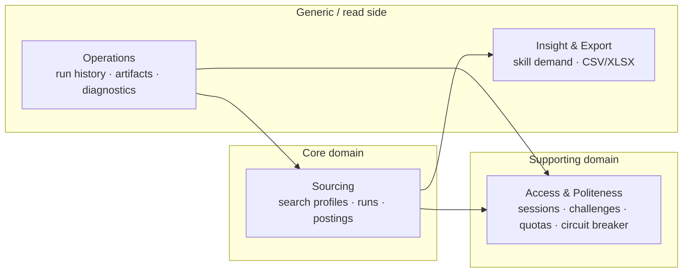
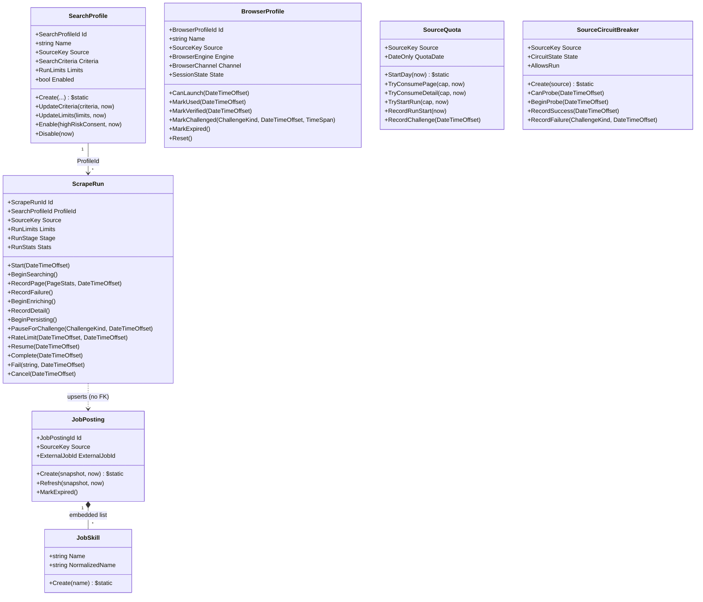
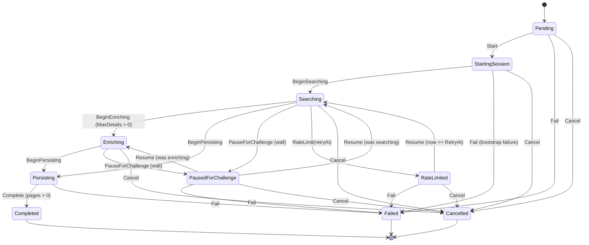
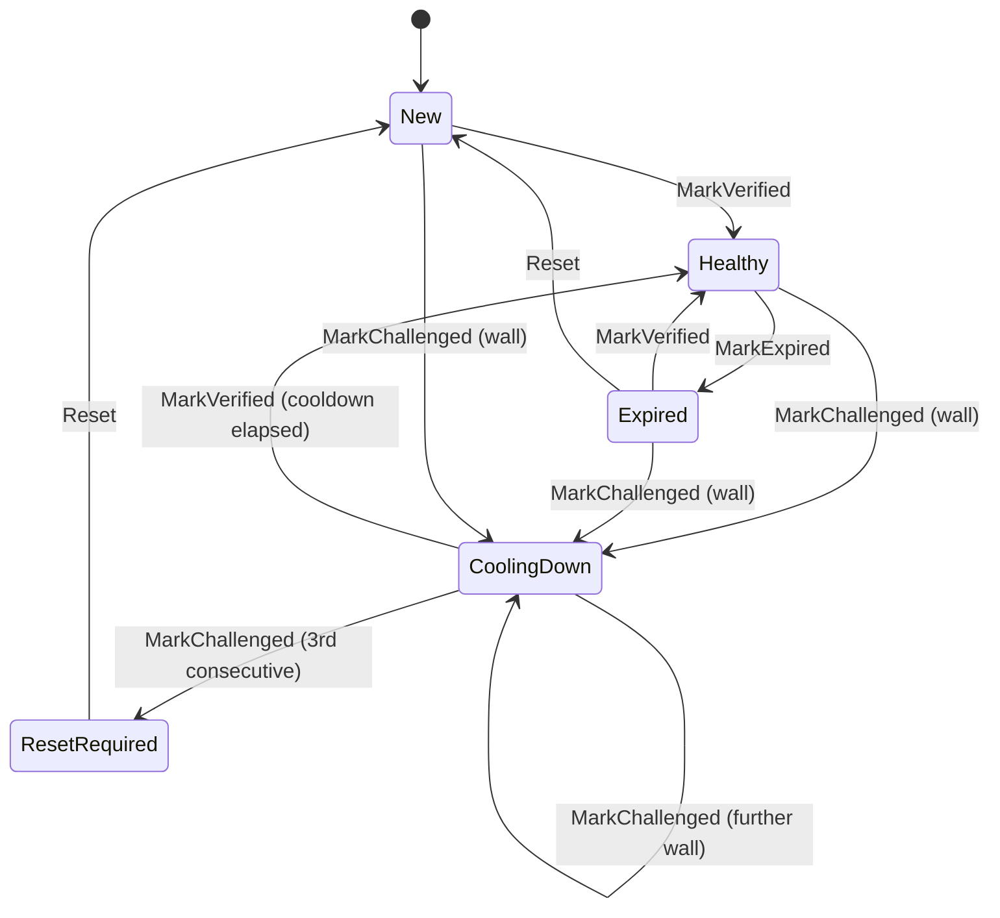
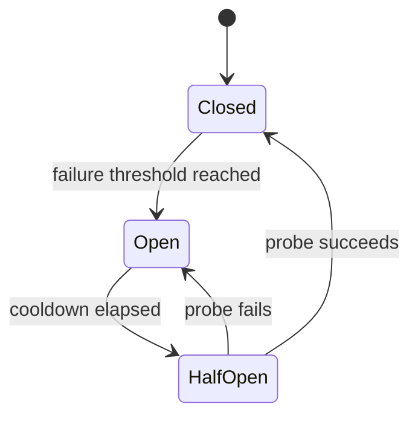
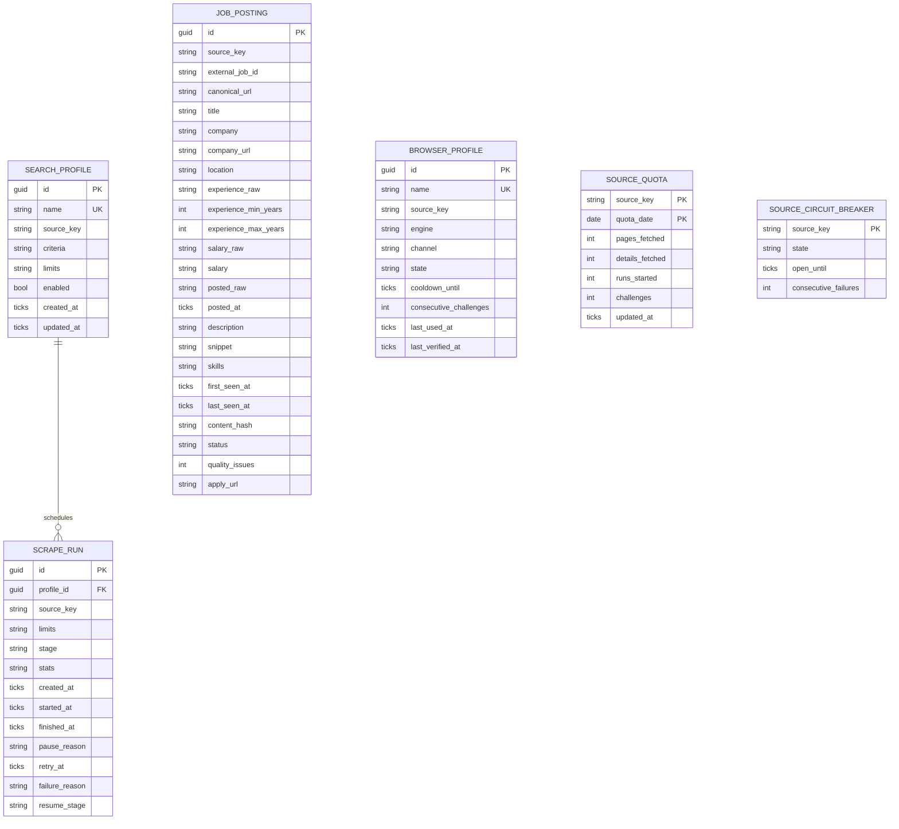

# Domain Model

> **Scope:** the DDD core of JobScrape — **Sourcing** and **Access**. Reporting/export is a read model and intentionally not modelled as aggregates.
>
> **Rule:** the domain is pure C#. No Playwright, EF Core, AngleSharp, HTTP, file system, or logging framework. Time and randomness are injected.

---

## 1. Why DDD here — and where not

DDD earns its place because the difficult behavior is not CRUD:

- A scrape run has a **lifecycle** with legal and illegal transitions.
- A browser session has **health states** and cooldowns.
- Challenges, rate limits, quotas, and circuit breakers are **policy decisions**.
- Job postings are **deduplicated**, refreshed, and enriched without duplication.
- A source has **capabilities and compliance constraints** that affect whether a run may start.

DDD does **not** earn its place for:

- Listing jobs for export.
- Counting skills.
- Writing CSV/Excel.
- Mapping configuration.

Those are query/read-model concerns. Forcing them into aggregates would add ceremony without protecting an invariant.

---

## 2. Bounded contexts



| Context | Responsibility | Why it is separate |
|---|---|---|
| **Sourcing** | What to search, how a run progresses, what a posting is, dedupe/enrichment. | Core business rules; changes with product requirements, not site markup. |
| **Access & Politeness** | Which browser profile, whether a session is healthy, how fast we may go, when to stop. | Anti-bot/compliance rules change independently of job data. |
| **Insight & Export** | Query postings, aggregate skills, write files. | Read-only; no invariants beyond query shape. |
| **Operations** | Run history, artifacts, diagnostics. | Cross-cutting observability; not part of the scrape transaction. |

Contexts communicate through IDs and application-level orchestration, not shared mutable entities. A `ScrapeRun` references a `BrowserProfileId`, not a `BrowserProfile` object.

---

## 3. Ubiquitous language

| Term | Meaning |
|---|---|
| **Source** | A job board: `naukri`, `indeed`, `linkedin`. Stable lowercase key. |
| **Search profile** | A saved, reusable search: source + keywords + locations + filters + limits. |
| **Search criteria** | The user-facing query: keywords, locations, experience, posted-within days, remote. |
| **Run limits** | Hard caps: pages, jobs, details, min/max delay, daily quota. |
| **Scrape run** | One execution of a search profile, with a lifecycle and stats. |
| **Page** | One result page fetched during a run. |
| **Posting** | A normalized job posting from a source. Identity is `(source, externalJobId)`. |
| **Snapshot** | Raw-but-typed fields extracted from a page before domain validation. |
| **Enrichment** | Visiting a detail page to add description/skills/apply URL. |
| **Session profile** | A persistent browser identity bound to one source: engine, channel, user-data directory, session health. |
| **Challenge** | A bot wall, CAPTCHA, JS challenge, login wall, rate limit, or access denial. |
| **Quota** | Per-source daily limits on pages/details/runs. |
| **Circuit breaker** | Per-source state that stops runs after repeated failures/challenges. |
| **Content hash** | Stable fingerprint of a posting's meaningful fields, used to detect changes. |
| **Canonical URL** | Tracking-free, absolute, source-host-allowlisted job URL. |
| **Compliance tier** | Standard / Restricted / HighRisk; controls whether a source may run and what consent is required. |

---

## 4. Aggregates and entities



### 4.1 `SearchProfile` (aggregate root)

**Purpose:** a reusable, validated search intent.

**State**

- `Id`, `Name` (non-empty; unique via database index).
- `Source` (`SourceKey` singleton: `naukri`, `indeed`, or `linkedin`).
- `SearchCriteria` (keywords, locations, experience, posted-within, remote).
- `RunLimits` (pages, jobs, details, delays).
- `Enabled` (disabled profiles cannot start runs).
- Audit timestamps (`CreatedAt`, `UpdatedAt`).

**Invariants**

- At least one keyword; total keyword length ≤ 500.
- At least one location **or** `RemoteOnly = true`.
- `experience` 0–50; `postedWithinDays` 1–30.
- `maxPages` 1–1000; `maxJobs` 1–20 000; `maxDetails` 0–1000.
- `startPage` 1–1000, default 1; the window ends at `startPage + maxPages - 1`, never past 1000. Consecutive runs split a listing into groups (1–30, then 31–60).
- `minDelay` 1–60s; `maxDelay` ≥ `minDelay`; `maxDelay` ≤ 120s.
- A profile cannot be enabled if its source is `HighRisk` and consent is not acknowledged (`Enable(highRiskConsentAcknowledged, now)`).

**Behavior**

- `UpdateCriteria(...)` / `UpdateLimits(...)` validate and replace, emitting `SearchProfileUpdated` only on real change.
- `Enable(bool, now)` / `Disable(now)`.

### 4.2 `ScrapeRun` (aggregate root)

**Purpose:** one execution with a lifecycle, stats, and outcome.

**State**

- `Id`, `ProfileId`, `Source`.
- `Stage` (`RunStage`), `Limits`, `Stats` (pages, postings found/new/updated, details, challenges, failures).
- `StartedAt`, `FinishedAt`, `PauseReason` (`ChallengeKind?`), `RetryAt`, `FailureReason`.

**Invariants**

- Cannot complete before at least one search stage.
- Stats are non-negative and monotonic except explicit reset (not allowed).
- A terminal run (`Completed`, `Failed`, `Cancelled`) cannot transition again.
- `PauseForChallenge` only from `Searching`/`Enriching`.
- `Resume` only from `PausedForChallenge`/`RateLimited`.
- `FinishedAt` ≥ `StartedAt`.
- A run cannot reference a profile from a different source.

**Behavior**

- `Start(now)`, `BeginSearching()`, `RecordPage(PageStats, now)`, `BeginEnriching()`, `RecordDetail()`, `PauseForChallenge(kind, now)`, `RateLimit(retryAt, now)`, `Resume(now)`, `Complete(now)`, `Fail(reason, now)`, `Cancel(now)`.
- Emits domain events for each meaningful transition.

### 4.3 `JobPosting` (aggregate root)

**Purpose:** a normalized, deduplicated job posting.

**Identity:** `(SourceKey, ExternalJobId)` — immutable.

**State**

- Title, company, company URL, location (raw text + parsed parts incl. best-effort `WorkMode`), experience raw/parsed, salary raw/parsed (`SalaryRange` with 3-letter ISO currency), posted raw/date.
- Description, snippet, skills (owned `JobSkill` list), apply URL (falls back to canonical URL).
- `FirstSeenAt`, `LastSeenAt`, `ContentHash`, `Status` (`Active`, `Expired`, `Unknown`).
- `DataQualityIssues` flags (e.g., missing company, salary unknown).

**Invariants**

- Title non-empty, ≤ 300 chars; company ≤ 200.
- Canonical URL is absolute `https`, host is allowed for the source, no `javascript:`/`data:`.
- `FirstSeenAt` ≤ `LastSeenAt`.
- Salary min ≤ max; currency is a 3-letter ISO code when present.
- Skills are trimmed, deduplicated case-insensitively, max 50.
- Description capped (default 20,000 chars) at mapping time; the domain stores the capped value.
- `Refresh` never changes identity or `FirstSeenAt`.

**Behavior**

- `Create(JobSnapshot, now)` validates and normalizes.
- `Refresh(JobSnapshot, now)` updates mutable fields, sets `LastSeenAt`, recomputes `ContentHash`, emits `JobPostingUpdated` only if the hash changed (unchanged re-sightings raise nothing).
- `MarkExpired()` when a source explicitly says so; absence from a search does **not** expire a posting.
- Skills dedupe case-insensitively via `NormalizedName` (max 50); invalid cards throw `DomainException` and are dropped by the handler.

> **Important:** a posting is not “owned” by a run. The same posting can appear in many runs; runs and postings are linked only in memory during upsert — no join table exists.

### 4.4 `BrowserProfile` (aggregate root)

**Purpose:** a persistent browser identity used for one source.

**State**

- `Id`, `Name`, `Source`.
- `Engine` (`Chromium`, `Firefox`, `WebKit`), `Channel` (`Bundled`, `Chrome`, `Edge`).
- `UserDataDirectory` (derived `$"{Source}/{Name}"`, never stored).
- `State` (`New`, `Healthy`, `CoolingDown`, `Expired`, `ResetRequired`; the enum also declares `Challenged` but no code path ever assigns it).
- `CooldownUntil`, `ConsecutiveChallenges`, `LastUsedAt`, `LastVerifiedAt`.

**Invariants**

- Name non-empty, unique (database unique index).
- `UserDataDirectory` is derived (`$"{Source}/{Name}"`), not stored.
- Cannot launch when `State` is `CoolingDown` and `now < CooldownUntil`.
- Cannot launch when `ResetRequired`.
- Challenge cooldown must be positive.
- `MarkVerified` resets consecutive challenges, and only runs after a successful verification.

**Behavior**

- `CanLaunch(now)`.
- `MarkUsed(now)`, `MarkVerified(now)`.
- `MarkChallenged(kind, now, cooldown)` → `CoolingDown`, increments consecutive challenges (or `ResetRequired` on the 3rd consecutive wall).
- `MarkExpired()` (healthy only), `Reset()` → `New`.

### 4.5 `SourceQuota` (aggregate root)

**Purpose:** enforce per-source daily limits.

**State**

- `SourceKey`, `QuotaDate` (UTC date), `PagesFetched`, `DetailsFetched`, `RunsStarted`, `Challenges`, `UpdatedAt`.

**Invariants**

- Counts non-negative; never decrease within a day.
- `QuotaDate` is a UTC date.
- Caps come from `SourceOptions` and are passed into policy methods; the entity stores counts, not policy.

**Behavior**

- `TryConsumePage(cap)`, `TryConsumeDetail(cap)`, `TryStartRun(cap)`, `RecordRunStart(now)`, `RecordChallenge()`.
- `RecordRunStart` counts a run without a cap. The handler calls it when the source has no daily run cap.
- `TryConsumePage`, `TryConsumeDetail`, and `TryStartRun` return a typed `QuotaDecision` (`Allowed`, `Exceeded`).

### 4.6 `RunEvent` (entity, not aggregate root)

- `Id`, `RunId`, `Sequence`, `Type`, `Message`, `DataJson`, `OccurredAt`.
- Sequence is monotonic per run.
- Events are append-only; used for audit and UI/progress.
- Payloads contain IDs and counts, not cookies/PII.

---

## 5. Value objects and invariants

| Value object | Fields | Invariants |
|---|---|---|
| `SourceKey` | `Value` | Known lowercase key; immutable; parse/format. |
| `ExternalJobId` | `Value` | Non-empty, ≤ 128, source-specific format validated by adapter. |
| `JobTitle` | `Value` | Trimmed, 1–300, no control chars. |
| `CompanyName` | `Value` | Trimmed, 1–200. |
| `CanonicalUrl` | `Value` (string) | Absolute `https`; host allowlisted per source; tracking params stripped. |
| `SearchCriteria` | Keywords, locations, experience, postedWithinDays, remote, companies | Non-empty keyword; locations ≤ 10; experience 0–50; days 1–30; companies ≤ 200. |
| `RunLimits` | Pages, jobs, details, min/max delay | Ranges as above; min ≤ max. |
| `SalaryRange` | Min, max, currency, period | Min ≤ max; ISO-4217 currency; period enum. |
| `JobLocation` | Raw, city, region, country, work mode | Raw non-empty; parsed parts optional; raw never discarded. |
| `ContentHash` | SHA-256 hex | Lowercase hex; computed from stable fields only. |
| `PageFingerprint` | First external ID, result-range text | Used to detect a repeated page; at least one component non-empty. |
| `RunStats` | Counters | Non-negative; monotonic within a run (no reset). |
| `ComplianceTier` | Standard/Restricted/HighRisk | Drives consent/run gates. |
| `ChallengeKind` | None/RateLimited/SoftChallenge/Captcha/LoginRequired/AccessDenied/SourceChanged/TransientError | Drives response policy. |

### 5.1 Strongly typed IDs

Use `readonly record struct` wrappers for `SearchProfileId`, `ScrapeRunId`, `JobPostingId`, `BrowserProfileId`. They prevent accidental argument swaps and make repository signatures readable.

### 5.2 `SourceKey` sketch

```csharp
public sealed record SourceKey
{
    public static readonly SourceKey Naukri = new("naukri", ComplianceTier.Standard);
    public static readonly SourceKey Indeed = new("indeed", ComplianceTier.Restricted);
    public static readonly SourceKey LinkedIn = new("linkedin", ComplianceTier.HighRisk);

    private SourceKey(string value, ComplianceTier tier) { ... }

    public string Value { get; }
    public ComplianceTier Tier { get; }

    public static SourceKey Parse(string? value) => ...; // singletons above; throws DomainException
    public static bool TryParse(string? value, out SourceKey? key) => ...;

    public override string ToString() => Value;
}
```

### 5.3 `RunLimits` sketch

```csharp
public sealed record RunLimits
{
    public RunLimits(
        int maxPages,
        int maxJobs,
        int maxDetails,
        TimeSpan minDelay,
        TimeSpan maxDelay,
        int startPage = 1)
    {
        if (startPage is < 1 or > 1000) throw new DomainException("startPage must be 1..1000.");
        if (maxPages is < 1 or > 1000) throw new DomainException("maxPages must be 1..1000.");
        if (startPage + maxPages - 1 > 1000) throw new DomainException("window must end by page 1000.");
        if (maxJobs is < 1 or > 20000) throw new DomainException("maxJobs must be 1..20000.");
        if (maxDetails is < 0 or > 1000) throw new DomainException("maxDetails must be 0..1000.");
        if (minDelay < TimeSpan.FromSeconds(1)) throw new DomainException("minDelay >= 1s.");
        if (maxDelay < minDelay) throw new DomainException("maxDelay >= minDelay.");
        if (maxDelay > TimeSpan.FromMinutes(2)) throw new DomainException("maxDelay <= 2m.");

        StartPage = startPage;
        MaxPages = maxPages;
        MaxJobs = maxJobs;
        MaxDetails = maxDetails;
        MinDelay = minDelay;
        MaxDelay = maxDelay;
    }

    public int StartPage { get; }
    public int MaxPages { get; }
    public int MaxJobs { get; }
    public int MaxDetails { get; }
    public TimeSpan MinDelay { get; }
    public TimeSpan MaxDelay { get; }
}
```

---

## 6. State machines

### 6.1 `ScrapeRun`

> Verified against `ScrapeRun.cs` guards (`EnsureStage`, `EnsureFetching`, `EnsureNotTerminal`). `Fail` and `Cancel` are allowed from **any non-terminal stage** (including `Pending` and `StartingSession`), not only the paths drawn for the common flow.



**Transition table**

| From | Event | To | Guard |
|---|---|---|---|
| `Pending` | `Start` | `StartingSession` | Stage is `Pending` (handler runs profile/quota/consent gates first). |
| `StartingSession` | `BeginSearching` | `Searching` | Stage is `StartingSession`. |
| `StartingSession` | `Fail` | `Failed` | Non-terminal; session/bootstrap failure. |
| `Searching` | `BeginEnriching` | `Enriching` | Stage is `Searching`, detail cap > 0. |
| `Searching`/`Enriching` | `BeginPersisting` | `Persisting` | Stage is searching or enriching. |
| `Searching`/`Enriching` | `PauseForChallenge` | `PausedForChallenge` | Kind is a wall (SoftChallenge, Captcha, LoginRequired, AccessDenied). |
| `Searching` | `RateLimit` | `RateLimited` | `retryAt` not in the past. |
| `PausedForChallenge` | `Resume` | saved `_resumeStage` | Was paused. |
| `RateLimited` | `Resume` | `Searching` | `now >= RetryAt`. |
| `Persisting` | `Complete` | `Completed` | `PagesFetched > 0`. |
| any non-terminal | `Fail` | `Failed` | Non-blank reason. |
| any non-terminal | `Cancel` | `Cancelled` | Cooperative cancellation; partial results kept. |

### 6.2 `BrowserProfile`

> Verified against `BrowserProfile.cs`. There is **no `Challenged` state** —
> it exists in the enum but no method ever assigns it; walls move the
> profile straight to `CoolingDown` (or `ResetRequired`).



**Rules**

- `CoolingDown` blocks launches until `CooldownUntil`; `ResetRequired` blocks everything until `Reset`.
- After **3 consecutive challenges** (`MaxConsecutiveChallenges`), `MarkChallenged` moves to `ResetRequired` instead of cooling down.
- `MarkVerified` is the only way back to `Healthy`: it requires `CanLaunch` and resets the challenge counter. It works from `New`, `CoolingDown` (once elapsed), and `Expired`.

### 6.3 Circuit breaker (per source)



**Thresholds (initial defaults)**

- Open after **3** challenge/block failures within **24 hours**, or **2** consecutive blocks.
- Cooldown: **60 minutes** for a rate limit, **24 hours** for a challenge, **7 days** for a repeated block.
- Half-open probe: one page, no enrichment, manual approval in interactive mode.
- State is persisted per source (not per profile) so a new profile cannot accidentally bypass a source-level block.

---

## 7. Domain events

| Event | When | Payload (minimal) |
|---|---|---|
| `SearchProfileCreated` | Profile validated and created | `ProfileId`, `Source` |
| `SearchProfileUpdated` | Criteria/limits changed (no-op updates raise nothing) | `ProfileId`, changed field |
| `ScrapeRunStarted` | Run leaves `Pending` | `RunId`, `ProfileId`, `Source` |
| `SearchPageFetched` | Page parsed and recorded | `RunId`, page number, job count |
| `JobPostingUpdated` | Refresh changed the content hash (unchanged re-sightings raise nothing) | `PostingId`, `Source`, old/new hash |
| `RunPausedForChallenge` | Run enters pause | `RunId`, `ChallengeKind` |
| `RunRateLimited` | 429/999 with retry window | `RunId`, `RetryAt` |
| `QuotaExceeded` | Daily/run cap reached | `SourceKey`, quota kind, limit |
| `SessionBootstrapped` | Manual login/verification complete | `ProfileId`, `SourceKey`, `State` |
| `CircuitOpened` | Source breaker opens | `SourceKey`, trigger kind, `OpenUntil` |
| `RunCompleted` | Successful terminal state | `RunId`, stats |
| `RunFailed` | Failure terminal state | `RunId`, reason, stats |
| `RunCancelled` | Cancellation terminal state | `RunId`, stats |

**Dispatch:** in-process, after `SaveChangesAsync`, so handlers never see uncommitted state. No outbox/message bus (YAGNI). No `JobPostingDiscovered` or `ChallengeDetected` events exist — creation and classification surface through `SearchPageFetched` (with `JobCount`) and the `Challenge` on each result.

---

## 8. Policies and domain services

### 8.1 `PolitenessPolicy`

- Computes the next delay between pages/details: uniform jitter in `[RunLimits.MinDelay, RunLimits.MaxDelay]`, clamped into the window even if the random source misbehaves.
- Decides only; `IDelay.WaitAsync` (infrastructure `TimeProviderDelay`) sleeps, and the handler skips the delay before page 1.
- Pure and fully unit-tested (deterministic `IRandomSource` fakes).

### 8.2 `RetryPolicy`

- `ShouldRetry(ChallengeKind kind, int attempt)`.
- Retries only `TransientError` with attempts left (hard ceiling `MaxAllowedAttempts = 3`; configured `RunOptions.RetryMaxAttempts = 2` by default).
- Backoff: 2s base, 4× growth, up to 1s jitter; honors source-stated `Retry-After`.
- Never retries `RateLimited`, `SoftChallenge`, `Captcha`, `LoginRequired`, `AccessDenied`, `SourceChanged`.
- Pure and fully unit-tested.

### 8.3 `ChallengePolicy`

Maps `ChallengeKind` to `ChallengeDecision` (verbatim from `ChallengePolicy.Decide`):

- `None` → `Continue`.
- `TransientError` → `Retry` (the only retried kind).
- `RateLimited` → `Pause` until `RetryAfter ?? 30m` (`DefaultRateLimitCooldown`).
- `SoftChallenge`/`Captcha` → `ManualPause` (1-day `RepeatedChallengeCooldown` once walls hit `MaxConsecutiveChallenges`, else the source's configured cooldown). Never auto-solved.
- `LoginRequired` → `Stop` ("Session login required.").
- `AccessDenied` → `OpenCircuit` ("Access denied.").
- `SourceChanged` → `StopAndInspect` ("Page structure changed.").
- Decides cooldown duration; the handler applies it (`StopOnWallAsync`). Pure: no I/O, no clock.

### 8.4 Quotas (`SourceQuota`)

- Checks per-source daily caps: pages, details, and optionally runs (`TryConsumePage/TryConsumeDetail/TryStartRun` with the configured cap). A null run cap records the run with `RecordRunStart` and does not limit it. Quota rows are per `(source, UTC day)`, so restarts never reset the day.
- Returns `QuotaDecision` (`IsAllowed`, kind, limit, used); when exceeded, nothing was consumed.
- The run handler checks quota **before** starting the run and **before each page/detail**.
- Quota is persisted; `RecordChallenge` counts walls against the day.

### 8.5 Deduplication (no `DeduplicationPolicy` type — the rules live in the handler + aggregate)

- Identity: `(SourceKey, ExternalJobId)` (unique index on `job_postings`).
- Content hash over stable fields (`ComputeHash`: title, company, location raw, salary raw, description, normalized skills); volatile fields are never hashed.
- `FirstSeenAt` preserved; `LastSeenAt` refreshed on every sighting; unchanged re-sightings raise no `JobPostingUpdated`.
- A posting seen in multiple runs keeps one row; skipped cards are dropped with a named warning, never stored.

### 8.6 `CompliancePolicy`

- `CanRun(SourceKey, ComplianceConsent)` (verbatim signature):
  - `Standard` → allowed.
  - `Restricted` → requires `AcknowledgeSourceRisk = true`.
  - `HighRisk` → requires `AcknowledgeSourceRisk` + `AllowHighRiskSources` + `InteractiveConfirmation`; otherwise blocked with guidance naming what is missing.
- No `RequiresManualSession` / `AllowedCapabilities` members exist; no separate consent types beyond the `ComplianceConsent` record.
- Pure; tested with a truth table.

---

## 9. Repository and unit-of-work contracts

> Verbatim from `JobScrape.Application/Abstractions` — no `UpdateAsync`, no `ListEnabledAsync`, no `FindByNameAsync`, no read-model ports exist.

```csharp
public interface ISearchProfileRepository
{
    Task<SearchProfile?> GetAsync(SearchProfileId id, CancellationToken ct);
    Task AddAsync(SearchProfile profile, CancellationToken ct);
}

public interface IScrapeRunRepository
{
    Task<ScrapeRun?> GetAsync(ScrapeRunId id, CancellationToken ct);
    Task AddAsync(ScrapeRun run, CancellationToken ct);
}

public interface IJobPostingRepository
{
    Task<JobPosting?> FindAsync(SourceKey source, ExternalJobId id, CancellationToken ct);
    Task AddAsync(JobPosting posting, CancellationToken ct);
}

public interface IBrowserProfileRepository
{
    Task<BrowserProfile?> GetAsync(BrowserProfileId id, CancellationToken ct);
}

public interface ISourceQuotaRepository
{
    Task<SourceQuota?> FindAsync(SourceKey source, DateOnly quotaDate, CancellationToken ct);
    Task AddAsync(SourceQuota quota, CancellationToken ct);
}

public interface ISourceCircuitBreakerRepository
{
    Task<SourceCircuitBreaker?> FindAsync(SourceKey source, CancellationToken ct);
    Task AddAsync(SourceCircuitBreaker breaker, CancellationToken ct);
}

public interface IUnitOfWork
{
    Task<int> SaveChangesAsync(CancellationToken ct);
}
```

Plus `ISessionManager.EnsureSessionAsync`, `IArtifactStore.CaptureAsync`, `IDelay.WaitAsync`, and the read port `ISearchProfileStore.GetAsync` — all declared, the first two without implementations.

**Rules**

- No generic repository.
- No `IQueryable` leakage (no read models exist yet, so no projections either).
- Identity lookups use repository methods.
- Invariant violations throw domain exceptions; expected operational failures return `Result<T>`. See [Application Patterns §3](14-application-patterns.md#3-result-pattern).
- Repository implementations live in Infrastructure; domain/application tests use in-memory fakes.
- Uniqueness (`profile name`, `source + external id`) is enforced by the database and handled as a conflict, not by a domain-wide lock.

---

## 10. Persistence model

> Verified against `JobScrapeDbContext`, the six `IEntityTypeConfiguration`
> classes, and migration `202611010743_InitialCreate`. Tables and columns are
> snake_case; every `DateTimeOffset` is stored as UTC ticks (`UtcTicksConverter`).



The only enforced foreign key is `scrape_runs.profile_id → search_profiles.id` (restrict on delete). `JobSkill` is an owned value list inside `JOB_POSTING.skills`, not a table. `RUN_EVENT`, `RUN_POSTING`, and any read-model tables do not exist; neither do `BROWSER_PROFILE.used_by`, `SOURCE_QUOTA.governs`, or posting↔run foreign keys.

**Indexes**

- `JOB_POSTING` unique `(source_key, external_job_id)`.
- `JOB_POSTING` index `(last_seen_at)`, `(company)`, `(posted_at)`.
- `SOURCE_QUOTA` primary key `(source_key, quota_date)`.
- `BROWSER_PROFILE` unique `(name)`.
- `SEARCH_PROFILE` unique `(name)`.
- `SCRAPE_RUN` index `(created_at)`.

---

## 11. Code sketches

### 11.1 `ScrapeRun` transition

> Abbreviated from `ScrapeRun.cs` — real guards, real signatures.

```csharp
public sealed class ScrapeRun
{
    private ScrapeRun(ScrapeRunId id, SearchProfileId profileId, SourceKey source, DateTimeOffset now)
    {
        Id = id;
        ProfileId = profileId;
        Source = source;
        Stage = RunStage.Pending;
        CreatedAt = now;
        Stats = RunStats.Empty;
    }

    public ScrapeRunId Id { get; }
    public SearchProfileId ProfileId { get; }
    public SourceKey Source { get; }
    public RunStage Stage { get; private set; }
    public RunStats Stats { get; private set; }
    public DateTimeOffset CreatedAt { get; }
    public DateTimeOffset? FinishedAt { get; private set; }
    public ChallengeKind? PauseReason { get; private set; }
    private RunStage? _resumeStage;

    public static ScrapeRun Create(SearchProfile profile, DateTimeOffset now) // disabled profiles throw
        => new(ScrapeRunId.New(), profile.Id, profile.Source, now);

    public void BeginSearching()
    {
        EnsureStage(RunStage.StartingSession);
        Stage = RunStage.Searching;
    }

    public void RecordPage(PageStats page, DateTimeOffset now)
    {
        EnsureStage(RunStage.Searching);
        if (Stats.PagesFetched >= Limits.MaxPages)
            throw new DomainException($"Page cap of {Limits.MaxPages} reached.");
        Stats = Stats.AddPage(page);
    }

    public void PauseForChallenge(ChallengeKind kind, DateTimeOffset now)
    {
        if (Stage is not (RunStage.Searching or RunStage.Enriching))
            throw new DomainException($"Expected Searching or Enriching, got {Stage}.");
        if (kind is not (ChallengeKind.SoftChallenge or ChallengeKind.Captcha
                or ChallengeKind.LoginRequired or ChallengeKind.AccessDenied))
            throw new DomainException($"Cannot pause for challenge kind {kind}.");
        _resumeStage = Stage;
        PauseReason = kind;
        Stage = RunStage.PausedForChallenge;
    }

    public void Resume(DateTimeOffset now)
    {
        if (Stage == RunStage.PausedForChallenge)
        {
            Stage = _resumeStage!.Value; // searching or enriching, whichever paused
            _resumeStage = null;
            PauseReason = null;
        }
        else if (Stage == RunStage.RateLimited)
        {
            if (now < RetryAt) throw new DomainException(...); // wait out the window
            Stage = RunStage.Searching;
        }
        else throw new DomainException($"Only a paused run can resume (stage {Stage}).");
    }

    public void Complete(DateTimeOffset now)
    {
        EnsureStage(RunStage.Persisting);
        if (Stats.PagesFetched == 0)
            throw new DomainException("A run cannot complete without fetching a page.");
        Finish(RunStage.Completed, now);
    }

    private void EnsureNotTerminal() // Fail/Cancel allowed from any non-terminal stage
    {
        if (IsTerminal) throw new DomainException($"Run is terminal ({Stage}).");
    }

    private void EnsureStage(RunStage expected)
    {
        if (Stage != expected)
            throw new DomainException($"Expected {expected}, got {Stage}.");
    }
}
```

### 11.2 `JobPosting.Refresh`

> Abbreviated from `JobPosting.cs` — the identity check, no-change early-out, and hash-gated event are the real shape.

```csharp
public void Refresh(JobSnapshot snapshot, DateTimeOffset now)
{
    if (snapshot.Source != Source || snapshot.ExternalJobId != ExternalJobId.Value)
        throw new DomainException("Snapshot identity does not match posting identity.");

    var before = ContentHash;
    // ... update mutable fields from the snapshot, set LastSeenAt = now ...
    var newHash = ComputeHash(); // title, company, location raw, salary raw, description, skills
    if (newHash == before)
        return; // seen again, unchanged: no event

    ContentHash = newHash;
    AddDomainEvent(new JobPostingUpdated(Id, Source, before, newHash, now));
}
```

### 11.3 `PolitenessPolicy`

> Abbreviated from `PolitenessPolicy.cs`.

```csharp
public sealed class PolitenessPolicy
{
    private readonly RunLimits _limits;
    private readonly IRandomSource _random;

    public PolitenessPolicy(RunLimits limits, IRandomSource random)
    {
        _limits = limits;
        _random = random;
    }

    public TimeSpan NextDelay()
    {
        var min = (int)_limits.MinDelay.TotalMilliseconds;
        var max = (int)_limits.MaxDelay.TotalMilliseconds;
        var jittered = Math.Clamp(_random.NextInt32(min, max + 1), min, max);
        return TimeSpan.FromMilliseconds(jittered);
    }
}
```

### 11.4 `ChallengePolicy`

> Abbreviated from `ChallengePolicy.Decide` (verbatim mapping; validation omitted).

```csharp
public static class ChallengePolicy
{
    public static ChallengeDecision Decide(ChallengeAssessment assessment, int consecutiveChallenges, TimeSpan challengeCooldown)
    {
        return assessment.Kind switch
        {
            ChallengeKind.None => new ChallengeDecision(ChallengeAction.Continue),
            ChallengeKind.TransientError => new ChallengeDecision(ChallengeAction.Retry),
            ChallengeKind.RateLimited => new ChallengeDecision(ChallengeAction.Pause,
                assessment.RetryAfter ?? TimeSpan.FromMinutes(30)),
            ChallengeKind.SoftChallenge or ChallengeKind.Captcha => new ChallengeDecision(ChallengeAction.ManualPause,
                consecutiveChallenges >= BrowserProfile.MaxConsecutiveChallenges ? TimeSpan.FromDays(1) : challengeCooldown),
            ChallengeKind.LoginRequired => new ChallengeDecision(ChallengeAction.Stop, Reason: "Session login required."),
            ChallengeKind.AccessDenied => new ChallengeDecision(ChallengeAction.OpenCircuit, Reason: "Access denied."),
            _ => new ChallengeDecision(ChallengeAction.StopAndInspect, Reason: "Page structure changed."),
        };
    }
}
```

---

## 12. Testing the domain (TDD examples)

```csharp
public sealed class ScrapeRunTests
{
    private static readonly DateTimeOffset Now = new(2026, 11, 2, 8, 0, 0, TimeSpan.Zero);

    private static ScrapeRun StartedRun()
    {
        var profile = SearchProfile.Create(
            "backend",
            SourceKey.Naukri,
            new SearchCriteria("backend", ["Bengaluru"], null, null, false),
            new RunLimits(3, 10, 0, TimeSpan.FromSeconds(1), TimeSpan.FromSeconds(5)),
            Now);
        var run = ScrapeRun.Create(profile, Now);
        run.Start(Now);
        return run;
    }

    [Fact]
    public void Cannot_complete_before_persisting()
    {
        var run = StartedRun();

        Assert.Throws<DomainException>(() => run.Complete(Now));
    }

    [Fact]
    public void Challenge_pause_requires_a_real_challenge()
    {
        var run = StartedRun();
        run.BeginSearching();

        Assert.Throws<DomainException>(() => run.PauseForChallenge(ChallengeKind.None, Now));
    }

    [Fact]
    public void Resume_returns_to_searching_and_clears_reason()
    {
        var run = StartedRun();
        run.BeginSearching();
        run.PauseForChallenge(ChallengeKind.Captcha, Now);

        run.Resume(Now.AddMinutes(5));

        Assert.Equal(RunStage.Searching, run.Stage);
        Assert.Null(run.PauseReason);
    }
}
```

Test catalog for the domain:

- Every value object rejects invalid input.
- Every aggregate enforces its invariants.
- Every state transition has a positive and negative test.
- Policies are pure truth tables.
- Domain events are emitted exactly once per transition.
- No test touches a browser, database, file system, or clock.

---

## 13. Evolution rules

1. Add fields as **nullable/optional** first; backfill; then tighten if needed.
2. Never change an existing enum value's meaning; add a new value and migrate.
3. Keep `JobPosting` identity immutable; if a source changes IDs, model a new source key/version.
4. Version parser outputs; a parser change that alters fields must update fixtures and content-hash inputs.
5. Domain events are additive; handlers tolerate unknown fields.
6. Migrations are reviewed and reversible where possible; destructive changes require a backup step.
7. Cross-context references stay as IDs; do not introduce navigation properties across aggregates.
8. If a “policy” starts needing I/O, it is an application service, not a domain policy.
