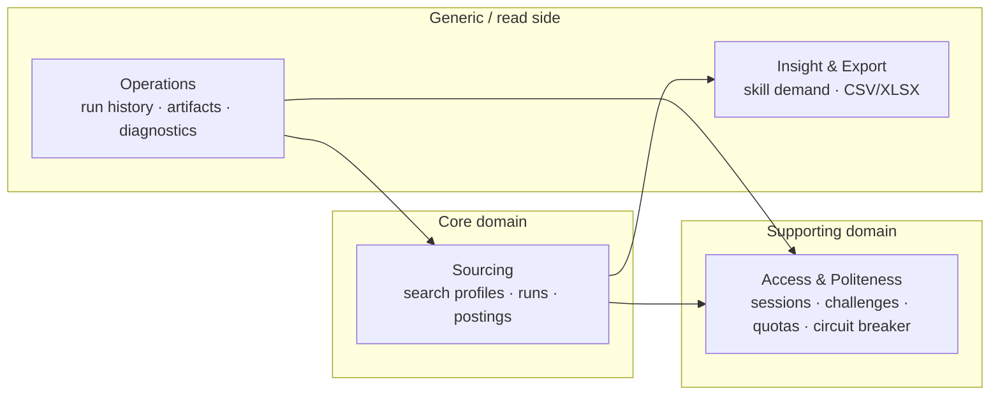
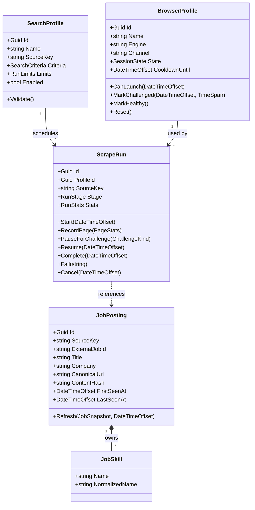
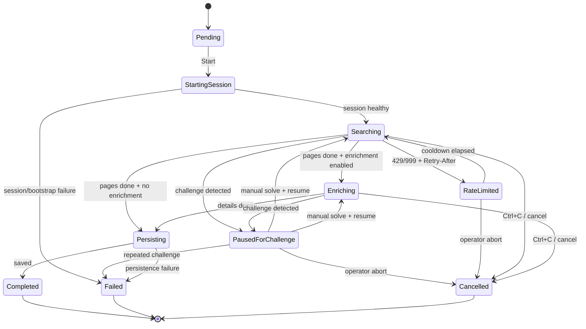
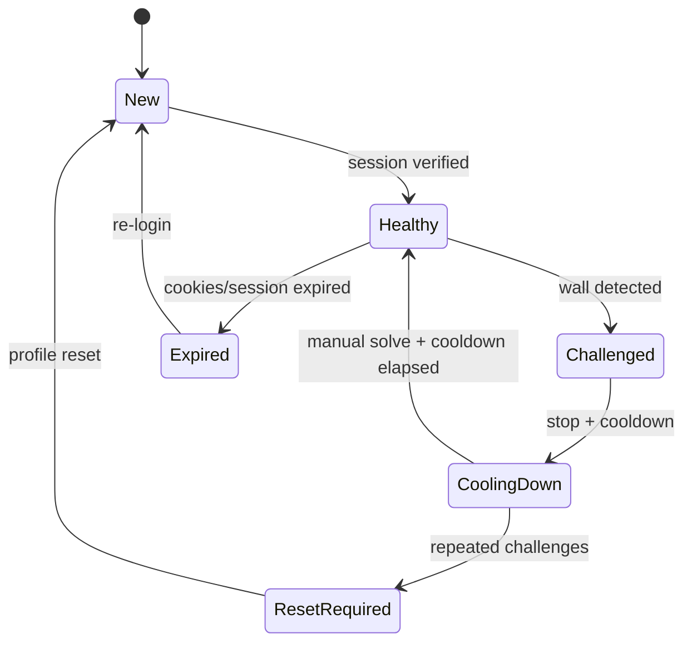
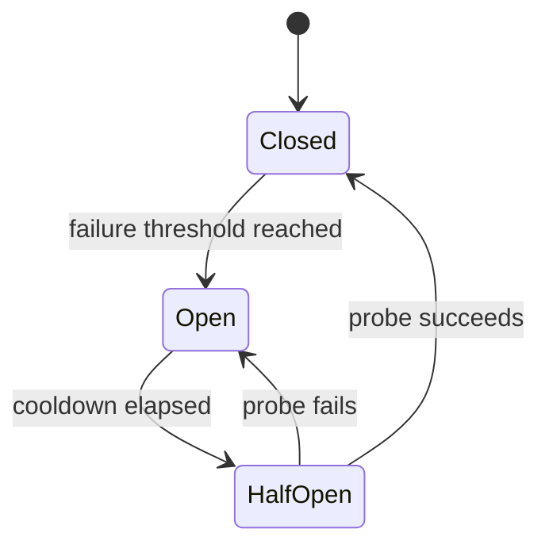
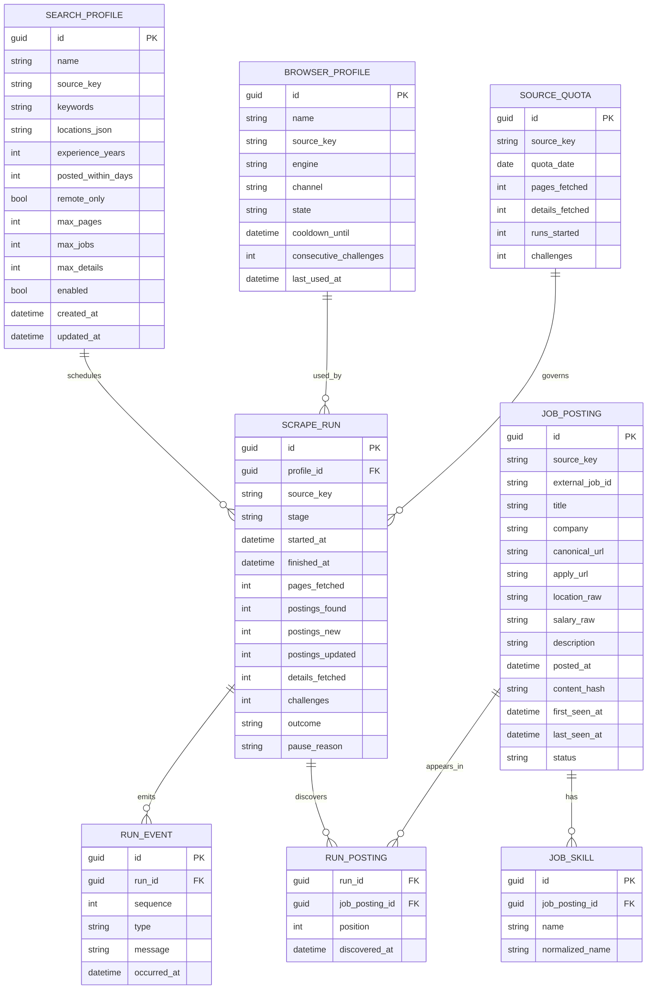

# Domain Model

> **Scope:** the DDD core of JobLens — **Sourcing** and **Access**. Reporting/export is a read model and intentionally not modelled as aggregates.
>
> **Rule:** the domain is pure C#. No Playwright, EF Core, AngleSharp, HTTP, file system, or logging framework. Time and randomness are injected.

---

## 1. Why DDD here — and where not

DDD earns its place because the difficult behavior is not CRUD:

- A scrape run has a **lifecycle** with legal and illegal transitions.
- A browser session has **health states** and cooldowns.
- Challenges, rate limits, quotas, and circuit breakers are **policy decisions**.
- Job postings are **deduplicated**, refreshed, and enriched without duplication.
- A source has **capabilities and compliance constraints** that affect whether a run may start.

DDD does **not** earn its place for:

- Listing jobs for export.
- Counting skills.
- Writing CSV/Excel.
- Mapping configuration.

Those are query/read-model concerns. Forcing them into aggregates would add ceremony without protecting an invariant.

---

## 2. Bounded contexts



| Context | Responsibility | Why it is separate |
|---|---|---|
| **Sourcing** | What to search, how a run progresses, what a posting is, dedupe/enrichment. | Core business rules; changes with product requirements, not site markup. |
| **Access & Politeness** | Which browser profile, whether a session is healthy, how fast we may go, when to stop. | Anti-bot/compliance rules change independently of job data. |
| **Insight & Export** | Query postings, aggregate skills, write files. | Read-only; no invariants beyond query shape. |
| **Operations** | Run history, artifacts, diagnostics. | Cross-cutting observability; not part of the scrape transaction. |

Contexts communicate through IDs and application-level orchestration, not shared mutable entities. A `ScrapeRun` references a `BrowserProfileId`, not a `BrowserProfile` object.

---

## 3. Ubiquitous language

| Term | Meaning |
|---|---|
| **Source** | A job board: `naukri`, `indeed`, `linkedin`. Stable lowercase key. |
| **Search profile** | A saved, reusable search: source + keywords + locations + filters + limits + schedule. |
| **Search criteria** | The user-facing query: keywords, locations, experience, posted-within days, remote. |
| **Run limits** | Hard caps: pages, jobs, details, min/max delay, daily quota. |
| **Scrape run** | One execution of a search profile, with a lifecycle and stats. |
| **Page** | One result page fetched during a run. |
| **Posting** | A normalized job posting from a source. Identity is `(source, externalJobId)`. |
| **Snapshot** | Raw-but-typed fields extracted from a page before domain validation. |
| **Enrichment** | Visiting a detail page to add description/skills/apply URL. |
| **Session profile** | A persistent browser user-data directory plus engine/channel/locale/timezone. |
| **Challenge** | A bot wall, CAPTCHA, JS challenge, login wall, rate limit, or access denial. |
| **Quota** | Per-source daily limits on pages/details/runs. |
| **Circuit breaker** | Per-source state that stops runs after repeated failures/challenges. |
| **Content hash** | Stable fingerprint of a posting's meaningful fields, used to detect changes. |
| **Canonical URL** | Tracking-free, absolute, source-host-allowlisted job URL. |
| **Compliance tier** | Standard / Restricted / HighRisk; controls whether a source may run and what consent is required. |

---

## 4. Aggregates and entities



### 4.1 `SearchProfile` (aggregate root)

**Purpose:** a reusable, validated search intent.

**State**

- `Id`, `Name` (non-empty, unique per user — uniqueness enforced by repository).
- `SourceKey` (known source; adapter must exist).
- `SearchCriteria` (keywords, locations, experience, posted-within, remote).
- `RunLimits` (pages, jobs, details, delays).
- `Enabled` (disabled profiles cannot start runs).
- Audit timestamps.

**Invariants**

- At least one keyword; total keyword length ≤ 500.
- At least one location **or** `RemoteOnly = true`.
- `experience` 0–50; `postedWithinDays` 1–30.
- `maxPages` 1–30; `maxJobs` 1–1000; `maxDetails` 0–1000.
- `minDelay` 1–60s; `maxDelay` ≥ `minDelay`; `maxDelay` ≤ 120s.
- A profile cannot be enabled if its source is `HighRisk` and consent is not acknowledged.

**Behavior**

- `UpdateCriteria(...)` validates and replaces criteria.
- `Disable()` / `Enable(compliance)`.
- `ToRunLimits()` returns a validated snapshot for the run.

### 4.2 `ScrapeRun` (aggregate root)

**Purpose:** one execution with a lifecycle, stats, and outcome.

**State**

- `Id`, `ProfileId`, `SourceKey`.
- `Stage` (`RunStage`).
- `Stats` (pages, postings found/new/updated, details, challenges, failures).
- `StartedAt`, `FinishedAt`, `PauseReason`, `FailureReason`.
- `ArtifactDirectory` (relative path, not a file handle).

**Invariants**

- Cannot complete before at least one search stage.
- Stats are non-negative and monotonic except explicit reset (not allowed).
- A terminal run (`Completed`, `Failed`, `Cancelled`) cannot transition again.
- `PauseForChallenge` only from `Searching`/`Enriching`.
- `Resume` only from `PausedForChallenge`/`RateLimited`.
- `FinishedAt` ≥ `StartedAt`.
- A run cannot reference a profile from a different source.

**Behavior**

- `Start(now)`, `BeginSearching(now)`, `RecordPage(PageStats)`, `BeginEnriching()`, `RecordDetail()`, `PauseForChallenge(kind, now)`, `RateLimit(retryAfter, now)`, `Resume(now)`, `Complete(now)`, `Fail(reason, now)`, `Cancel(now)`.
- Emits domain events for each meaningful transition.

### 4.3 `JobPosting` (aggregate root)

**Purpose:** a normalized, deduplicated job posting.

**Identity:** `(SourceKey, ExternalJobId)` — immutable.

**State**

- Title, company, company URL, locations, work mode, employment type.
- Experience raw/parsed, salary raw/parsed, posted raw/date.
- Description, snippet, skills (owned `JobSkill` collection), apply URL.
- `FirstSeenAt`, `LastSeenAt`, `ContentHash`, `Status` (`Active`, `Expired`, `Unknown`).
- `ParseConfidence` / data-quality flags (e.g., missing company, salary unknown).

**Invariants**

- Title non-empty, ≤ 300 chars; company ≤ 200.
- Canonical URL is absolute `https`, host is allowed for the source, no `javascript:`/`data:`.
- `FirstSeenAt` ≤ `LastSeenAt`.
- Salary min ≤ max; currency is a 3-letter ISO code when present.
- Skills are trimmed, deduplicated case-insensitively, max 50.
- Description capped (default 20,000 chars) at mapping time; the domain stores the capped value.
- `Refresh` never changes identity or `FirstSeenAt`.

**Behavior**

- `Create(JobSnapshot, now)` validates and normalizes.
- `Refresh(JobSnapshot, now)` updates mutable fields, sets `LastSeenAt`, recomputes `ContentHash`, emits `JobPostingUpdated` only if the hash changed.
- `MarkExpired(now)` when a source explicitly says so; absence from a search does **not** expire a posting in v1.
- `AddSkill` / `ReplaceSkills` enforce dedupe and caps.

> **Important:** a posting is not “owned” by a run. The same posting can appear in many runs; `RunPosting` is a join record in the run/reporting model.

### 4.4 `BrowserProfile` (aggregate root)

**Purpose:** a persistent browser identity used for one source.

**State**

- `Id`, `Name`, `SourceKey`.
- `Engine` (`Chromium`, `Firefox`, `WebKit`), `Channel` (`Bundled`, `Chrome`, `Edge`, ...).
- `Locale`, `Timezone`, `Viewport`, `UserDataDirectory` (relative path).
- `State` (`New`, `Healthy`, `Challenged`, `CoolingDown`, `Expired`, `ResetRequired`).
- `CooldownUntil`, `ConsecutiveChallenges`, `LastUsedAt`, `LastVerifiedAt`.
- `ProxyUrl` (optional, static; never a rotation pool).

**Invariants**

- Name non-empty; unique per user (repository).
- `UserDataDirectory` must be inside the configured profiles root.
- Cannot launch when `State` is `CoolingDown` and `now < CooldownUntil`.
- Cannot launch when `ResetRequired`.
- Challenge cooldown must be positive; consecutive challenges ≥ 0.
- `MarkHealthy` resets consecutive challenges only after a successful verification.

**Behavior**

- `CanLaunch(now)`.
- `MarkUsed(now)`, `MarkVerified(now)`.
- `MarkChallenged(kind, now, cooldown)` → `CoolingDown`, increments consecutive challenges.
- `MarkHealthy()` → `Healthy`, resets challenge counter.
- `MarkExpired()`, `Reset()` → `New`.

### 4.5 `SourceQuota` (aggregate root)

**Purpose:** enforce per-source daily limits.

**State**

- `SourceKey`, `QuotaDate` (UTC date), `PagesFetched`, `DetailsFetched`, `RunsStarted`, `Challenges`, `UpdatedAt`.

**Invariants**

- Counts non-negative; never decrease within a day.
- `QuotaDate` is a UTC date.
- Caps come from `SourceOptions` and are passed into policy methods; the entity stores counts, not policy.

**Behavior**

- `TryConsumePage(cap)`, `TryConsumeDetail(cap)`, `TryStartRun(cap)`, `RecordChallenge()`.
- Returns a typed `QuotaDecision` (`Allowed`, `Exceeded`).

### 4.6 `RunEvent` (entity, not aggregate root)

- `Id`, `RunId`, `Sequence`, `Type`, `Message`, `DataJson`, `OccurredAt`.
- Sequence is monotonic per run.
- Events are append-only; used for audit and UI/progress.
- Payloads contain IDs and counts, not cookies/PII.

---

## 5. Value objects and invariants

| Value object | Fields | Invariants |
|---|---|---|
| `SourceKey` | `Value` | Known lowercase key; immutable; parse/format. |
| `ExternalJobId` | `Value` | Non-empty, ≤ 128, source-specific format validated by adapter. |
| `JobTitle` | `Value` | Trimmed, 1–300, no control chars. |
| `CompanyName` | `Value` | Trimmed, 1–200. |
| `CanonicalUrl` | `Uri` | Absolute `https`; host allowlisted per source; no credentials/query tracking. |
| `SearchCriteria` | Keywords, locations, experience, postedWithinDays, remote | Non-empty keyword; locations 1–10; experience 0–50; days 1–30. |
| `RunLimits` | Pages, jobs, details, min/max delay | Ranges as above; min ≤ max. |
| `SalaryRange` | Min, max, currency, period | Min ≤ max; ISO-4217 currency; period enum. |
| `JobLocation` | Raw, city, region, country, work mode | Raw non-empty; parsed fields optional; remote flag consistent. |
| `ContentHash` | SHA-256 hex | Lowercase hex; computed from stable fields only. |
| `PageFingerprint` | First external ID, result-range text | Used to detect a repeated page; at least one component non-empty. |
| `RunStats` | Counters | Non-negative; monotonic within a run. |
| `ComplianceTier` | Standard/Restricted/HighRisk | Drives consent/run gates. |
| `ChallengeKind` | None/RateLimited/SoftChallenge/Captcha/LoginRequired/AccessDenied/SourceChanged/TransientError | Drives response policy. |

### 5.1 Strongly typed IDs

Use `readonly record struct` wrappers for `SearchProfileId`, `ScrapeRunId`, `JobPostingId`, `BrowserProfileId`. They prevent accidental argument swaps and make repository signatures readable.

### 5.2 `SourceKey` sketch

```csharp
public sealed record SourceKey
{
    public static readonly SourceKey Naukri = new("naukri");
    public static readonly SourceKey Indeed = new("indeed");
    public static readonly SourceKey LinkedIn = new("linkedin");

    private SourceKey(string value) => Value = value;

    public string Value { get; }

    public static SourceKey Parse(string? value) => value?.Trim().ToLowerInvariant() switch
    {
        "naukri" => Naukri,
        "indeed" => Indeed,
        "linkedin" => LinkedIn,
        _ => throw new DomainException($"Unknown source '{value}'.")
    };

    public override string ToString() => Value;
}
```

### 5.3 `RunLimits` sketch

```csharp
public sealed record RunLimits
{
    public RunLimits(
        int maxPages,
        int maxJobs,
        int maxDetails,
        TimeSpan minDelay,
        TimeSpan maxDelay)
    {
        if (maxPages is < 1 or > 30) throw new DomainException("maxPages must be 1..30.");
        if (maxJobs is < 1 or > 1000) throw new DomainException("maxJobs must be 1..1000.");
        if (maxDetails is < 0 or > 1000) throw new DomainException("maxDetails must be 0..1000.");
        if (minDelay < TimeSpan.FromSeconds(1)) throw new DomainException("minDelay >= 1s.");
        if (maxDelay < minDelay) throw new DomainException("maxDelay >= minDelay.");
        if (maxDelay > TimeSpan.FromMinutes(2)) throw new DomainException("maxDelay <= 2m.");

        MaxPages = maxPages;
        MaxJobs = maxJobs;
        MaxDetails = maxDetails;
        MinDelay = minDelay;
        MaxDelay = maxDelay;
    }

    public int MaxPages { get; }
    public int MaxJobs { get; }
    public int MaxDetails { get; }
    public TimeSpan MinDelay { get; }
    public TimeSpan MaxDelay { get; }
}
```

---

## 6. State machines

### 6.1 `ScrapeRun`



**Transition table**

| From | Event | To | Guard |
|---|---|---|---|
| `Pending` | `Start` | `StartingSession` | Profile enabled, consent OK, quota OK, circuit closed. |
| `StartingSession` | session healthy | `Searching` | Profile state healthy/verified. |
| `StartingSession` | bootstrap failure | `Failed` | No retry. |
| `Searching` | page recorded, more pages | `Searching` | Page cap not reached. |
| `Searching` | pages done, enrich | `Enriching` | Enrichment enabled and details remain. |
| `Searching` | pages done, no enrich | `Persisting` | — |
| `Searching`/`Enriching` | challenge | `PausedForChallenge` | Manual intervention required. |
| `Searching` | rate limit | `RateLimited` | `Retry-After`/cooldown known. |
| `PausedForChallenge` | resume | previous active stage | Operator confirms solve; cooldown elapsed. |
| `RateLimited` | cooldown elapsed | `Searching` | Retry policy allows. |
| `Persisting` | save complete | `Completed` | At least one page attempted. |
| any active | cancel | `Cancelled` | Cooperative cancellation. |
| any active | unrecoverable | `Failed` | Reason recorded. |

### 6.2 `BrowserProfile`



**Rules**

- `CoolingDown` blocks launches until `CooldownUntil`.
- After **3 consecutive challenges**, move to `ResetRequired` and require a manual reset/new profile.
- A successful `ProbeAsync` is the only way to return to `Healthy` after a challenge.

### 6.3 Circuit breaker (per source)



**Thresholds (initial defaults)**

- Open after **3** challenge/block failures within **24 hours**, or **2** consecutive blocks.
- Cooldown: **60 minutes** for a rate limit, **24 hours** for a challenge, **7 days** for a repeated block.
- Half-open probe: one page, no enrichment, manual approval in interactive mode.
- State is persisted per source (not per profile) so a new profile cannot accidentally bypass a source-level block.

---

## 7. Domain events

| Event | When | Payload (minimal) |
|---|---|---|
| `SearchProfileCreated` | Profile validated and saved | `ProfileId`, `SourceKey` |
| `SearchProfileUpdated` | Criteria/limits changed | `ProfileId`, changed fields |
| `ScrapeRunStarted` | Run leaves `Pending` | `RunId`, `ProfileId`, `SourceKey` |
| `SearchPageFetched` | Page parsed successfully | `RunId`, page number, job count, elapsed |
| `JobPostingDiscovered` | New posting inserted | `RunId`, `JobPostingId`, `SourceKey` |
| `JobPostingUpdated` | Existing posting content hash changed | `JobPostingId`, old/new hash |
| `ChallengeDetected` | Classifier returns non-`None` | `RunId`, `SourceKey`, `ChallengeKind`, evidence |
| `RunPausedForChallenge` | Run enters pause | `RunId`, `ChallengeKind`, `CooldownUntil` |
| `RunRateLimited` | 429/999 with retry window | `RunId`, `RetryAfter` |
| `QuotaExceeded` | Daily/run cap reached | `SourceKey`, quota kind, limit |
| `SessionBootstrapped` | Manual login/verification complete | `ProfileId`, `SourceKey`, `State` |
| `CircuitOpened` | Source breaker opens | `SourceKey`, reason, `OpenUntil` |
| `RunCompleted` | Successful terminal state | `RunId`, stats, duration |
| `RunFailed` | Failure terminal state | `RunId`, reason, stats |
| `RunCancelled` | Cancellation terminal state | `RunId`, stats |

**Dispatch:** in-process, after `SaveChangesAsync`, so handlers never see uncommitted state. v1 handlers are logging/metrics/progress. No outbox/message bus (YAGNI).

---

## 8. Policies and domain services

### 8.1 `PolitenessPolicy`

- Computes the next delay between pages/details.
- Uses `IRandomSource` for uniform jitter in `[minDelay, maxDelay]`.
- Enforces a **minimum interval** per source and a **global one-request-at-a-time** rule at the application level.
- Never returns a delay shorter than the configured minimum, even if a caller asks.
- `TimeProvider` is used for elapsed-time checks, not for sleeping; sleeping belongs to Infrastructure.

### 8.2 `RetryPolicy`

- `ShouldRetry(FailureKind kind, int attempt)`.
- Retries only `TransientError`; max 2 attempts.
- Backoff = exponential + jitter; honors `Retry-After`.
- Never retries `RateLimited`, `SoftChallenge`, `Captcha`, `LoginRequired`, `AccessDenied`, `SourceChanged`.
- Pure and fully unit-tested.

### 8.3 `ChallengePolicy`

- Maps `ChallengeKind` to `ChallengeDecision`:
  - `None` → continue.
  - `RateLimited` → pause until `RetryAfter`, reduce caps.
  - `SoftChallenge`/`Captcha` → pause for manual solve; never auto-solve.
  - `LoginRequired` → stop; require session bootstrap.
  - `AccessDenied` → open circuit; stop.
  - `SourceChanged` → capture artifact; mark degraded; stop or continue based on threshold.
  - `TransientError` → retry policy.
- Decides cooldown duration and whether the run may resume automatically.

### 8.4 `QuotaPolicy`

- Checks `SourceQuota` against configured per-source caps:
  - pages/day, details/day, runs/day.
- Returns `Allowed` or `Exceeded(kind, limit, used)`.
- The run handler checks quota **before** starting and **before each page/detail**.
- Quota is persisted so restarts do not reset the day.

### 8.5 `DeduplicationPolicy`

- Identity: `(SourceKey, ExternalJobId)`.
- Content hash over stable fields; volatile fields (view counts, “applicants”) are excluded.
- `FirstSeenAt` preserved; `LastSeenAt` refreshed.
- A posting seen in multiple searches keeps one row; run associations are recorded separately.

### 8.6 `CompliancePolicy`

- `CanRun(source, acknowledgment)`:
  - `Standard` → allowed.
  - `Restricted` → requires `AcknowledgeSourceRisk = true`.
  - `HighRisk` → requires explicit acknowledgment + config flag + manual confirmation; otherwise refuse with guidance.
- `RequiresManualSession(source)`.
- `AllowedCapabilities(source)` (guest search, detail, login).
- Pure; tested with a truth table.

---

## 9. Repository and unit-of-work contracts

```csharp
public interface ISearchProfileRepository
{
    Task<SearchProfile?> GetAsync(SearchProfileId id, CancellationToken ct);
    Task<IReadOnlyList<SearchProfile>> ListEnabledAsync(CancellationToken ct);
    Task AddAsync(SearchProfile profile, CancellationToken ct);
    Task UpdateAsync(SearchProfile profile, CancellationToken ct);
}

public interface IScrapeRunRepository
{
    Task<ScrapeRun?> GetAsync(ScrapeRunId id, CancellationToken ct);
    Task AddAsync(ScrapeRun run, CancellationToken ct);
    Task UpdateAsync(ScrapeRun run, CancellationToken ct);
}

public interface IJobPostingRepository
{
    Task<JobPosting?> FindAsync(SourceKey source, ExternalJobId id, CancellationToken ct);
    Task AddAsync(JobPosting posting, CancellationToken ct);
    Task UpdateAsync(JobPosting posting, CancellationToken ct);
}

public interface IBrowserProfileRepository
{
    Task<BrowserProfile?> GetAsync(BrowserProfileId id, CancellationToken ct);
    Task<BrowserProfile?> FindByNameAsync(string name, CancellationToken ct);
    Task AddAsync(BrowserProfile profile, CancellationToken ct);
    Task UpdateAsync(BrowserProfile profile, CancellationToken ct);
}

public interface IUnitOfWork
{
    Task<int> SaveChangesAsync(CancellationToken ct);
}
```

**Rules**

- No generic repository.
- No `IQueryable` leakage.
- Read models use separate ports (`IJobReadModel`, `ISkillDemandReadModel`) returning DTOs.
- Reusable query predicates use specifications; simple one-off filters stay inline. Identity lookups use repository methods. See [Application Patterns §5](14-application-patterns.md#5-specification-pattern).
- Invariant violations throw domain exceptions; expected operational failures return `Result<T>`. See [Application Patterns §3](14-application-patterns.md#3-result-pattern).
- Repository implementations live in Infrastructure; domain/application tests use in-memory fakes.
- Uniqueness (`profile name`, `source + external id`) is enforced by the database and handled as a conflict, not by a domain-wide lock.

---

## 10. Persistence model



**Indexes**

- `JOB_POSTING` unique `(source_key, external_job_id)`.
- `JOB_POSTING` index `(last_seen_at)`, `(company)`, `(posted_at)`.
- `RUN_POSTING` unique `(run_id, job_posting_id)`.
- `RUN_EVENT` unique `(run_id, sequence)`.
- `SOURCE_QUOTA` unique `(source_key, quota_date)`.
- `BROWSER_PROFILE` unique `(name)`.

---

## 11. Code sketches

### 11.1 `ScrapeRun` transition

```csharp
public sealed class ScrapeRun
{
    private ScrapeRun(ScrapeRunId id, SearchProfileId profileId, SourceKey source, DateTimeOffset now)
    {
        Id = id;
        ProfileId = profileId;
        Source = source;
        Stage = RunStage.Pending;
        StartedAt = now;
        Stats = RunStats.Empty;
    }

    public ScrapeRunId Id { get; }
    public SearchProfileId ProfileId { get; }
    public SourceKey Source { get; }
    public RunStage Stage { get; private set; }
    public RunStats Stats { get; private set; }
    public DateTimeOffset StartedAt { get; }
    public DateTimeOffset? FinishedAt { get; private set; }
    public ChallengeKind? PauseReason { get; private set; }
    private RunStage? _resumeStage;

    public static ScrapeRun Start(SearchProfileId profileId, SourceKey source, DateTimeOffset now)
        => new(ScrapeRunId.New(), profileId, source, now);

    public void BeginSearching(DateTimeOffset now)
    {
        EnsureStage(RunStage.StartingSession);
        Stage = RunStage.Searching;
    }

    public void RecordPage(PageStats page)
    {
        EnsureActive();
        Stats = Stats.AddPage(page);
    }

    public void PauseForChallenge(ChallengeKind kind, DateTimeOffset now)
    {
        if (Stage is not (RunStage.Searching or RunStage.Enriching))
            throw new DomainException($"Cannot pause from {Stage}.");
        if (kind == ChallengeKind.None)
            throw new DomainException("Cannot pause for ChallengeKind.None.");
        _resumeStage = Stage;
        PauseReason = kind;
        Stage = RunStage.PausedForChallenge;
    }

    public void Resume(DateTimeOffset now)
    {
        if (Stage != RunStage.PausedForChallenge)
            throw new DomainException("Only a paused run can resume.");
        Stage = _resumeStage ?? throw new DomainException("No resume stage recorded.");
        _resumeStage = null;
        PauseReason = null;
    }

    public void Complete(DateTimeOffset now)
    {
        EnsureStage(RunStage.Persisting);
        Stage = RunStage.Completed;
        FinishedAt = now;
    }

    private void EnsureActive()
    {
        if (Stage is RunStage.Completed or RunStage.Failed or RunStage.Cancelled)
            throw new DomainException($"Run is terminal ({Stage}).");
    }

    private void EnsureStage(RunStage expected)
    {
        if (Stage != expected)
            throw new DomainException($"Expected {expected}, got {Stage}.");
    }
}
```

### 11.2 `JobPosting.Refresh`

```csharp
public void Refresh(JobSnapshot snapshot, DateTimeOffset now)
{
    if (snapshot.Source != Source || snapshot.ExternalJobId != ExternalJobId.Value)
        throw new DomainException("Snapshot identity does not match posting identity.");

    var newHash = ContentHash.Compute(snapshot);
    if (newHash == ContentHash)
    {
        LastSeenAt = now; // seen again, unchanged
        return;
    }

    Title = JobTitle.Create(snapshot.Title);
    Company = CompanyName.Create(snapshot.Company);
    CanonicalUrl = CanonicalUrl.Create(snapshot.Url, Source);
    ReplaceSkills(snapshot.Skills);
    // ... update the remaining mutable fields ...

    ContentHash = newHash;
    LastSeenAt = now;
    AddDomainEvent(new JobPostingUpdated(Id, Source, newHash));
}
```

### 11.3 `PolitenessPolicy`

```csharp
public sealed class PolitenessPolicy
{
    private readonly RunLimits _limits;
    private readonly IRandomSource _random;

    public PolitenessPolicy(RunLimits limits, IRandomSource random)
    {
        _limits = limits;
        _random = random;
    }

    public TimeSpan NextDelay()
    {
        var min = (int)_limits.MinDelay.TotalMilliseconds;
        var max = (int)_limits.MaxDelay.TotalMilliseconds;
        return TimeSpan.FromMilliseconds(_random.Next(min, max + 1));
    }
}
```

### 11.4 `ChallengePolicy`

```csharp
public static class ChallengePolicy
{
    public static ChallengeDecision Decide(ChallengeAssessment assessment, int consecutiveChallenges)
    {
        return assessment.Kind switch
        {
            ChallengeKind.None => ChallengeDecision.Continue,
            ChallengeKind.TransientError => ChallengeDecision.Retry(attempt: 1),
            ChallengeKind.RateLimited => ChallengeDecision.Pause(
                assessment.RetryAfter ?? TimeSpan.FromMinutes(30)),
            ChallengeKind.SoftChallenge or ChallengeKind.Captcha => ChallengeDecision.ManualPause(
                assessment.Kind,
                consecutiveChallenges >= 3 ? TimeSpan.FromDays(1) : TimeSpan.FromHours(1)),
            ChallengeKind.LoginRequired => ChallengeDecision.Stop("Session login required."),
            ChallengeKind.AccessDenied => ChallengeDecision.OpenCircuit("Access denied."),
            ChallengeKind.SourceChanged => ChallengeDecision.StopAndInspect("Page structure changed."),
            _ => ChallengeDecision.Stop("Unclassified challenge.")
        };
    }
}
```

---

## 12. Testing the domain (TDD examples)

```csharp
public sealed class ScrapeRunTests
{
    private static readonly DateTimeOffset Now = new(2026, 11, 2, 8, 0, 0, TimeSpan.Zero);

    [Fact]
    public void Cannot_complete_before_persisting()
    {
        var run = ScrapeRun.Start(SearchProfileId.New(), SourceKey.Naukri, Now);

        Assert.Throws<DomainException>(() => run.Complete(Now));
    }

    [Fact]
    public void Challenge_pause_requires_a_real_challenge()
    {
        var run = ScrapeRun.Start(SearchProfileId.New(), SourceKey.Naukri, Now);
        run.BeginSearching(Now);

        Assert.Throws<DomainException>(() => run.PauseForChallenge(ChallengeKind.None, Now));
    }

    [Fact]
    public void Resume_returns_to_searching_and_clears_reason()
    {
        var run = ScrapeRun.Start(SearchProfileId.New(), SourceKey.Naukri, Now);
        run.BeginSearching(Now);
        run.PauseForChallenge(ChallengeKind.Captcha, Now);

        run.Resume(Now.AddMinutes(5));

        Assert.Equal(RunStage.Searching, run.Stage);
        Assert.Null(run.PauseReason);
    }
}
```

Test catalog for the domain:

- Every value object rejects invalid input.
- Every aggregate enforces its invariants.
- Every state transition has a positive and negative test.
- Policies are pure truth tables.
- Domain events are emitted exactly once per transition.
- No test touches a browser, database, file system, or clock.

---

## 13. Evolution rules

1. Add fields as **nullable/optional** first; backfill; then tighten if needed.
2. Never change an existing enum value's meaning; add a new value and migrate.
3. Keep `JobPosting` identity immutable; if a source changes IDs, model a new source key/version.
4. Version parser outputs; a parser change that alters fields must update fixtures and content-hash inputs.
5. Domain events are additive; handlers tolerate unknown fields.
6. Migrations are reviewed and reversible where possible; destructive changes require a backup step.
7. Cross-context references stay as IDs; do not introduce navigation properties across aggregates.
8. If a “policy” starts needing I/O, it is an application service, not a domain policy.
