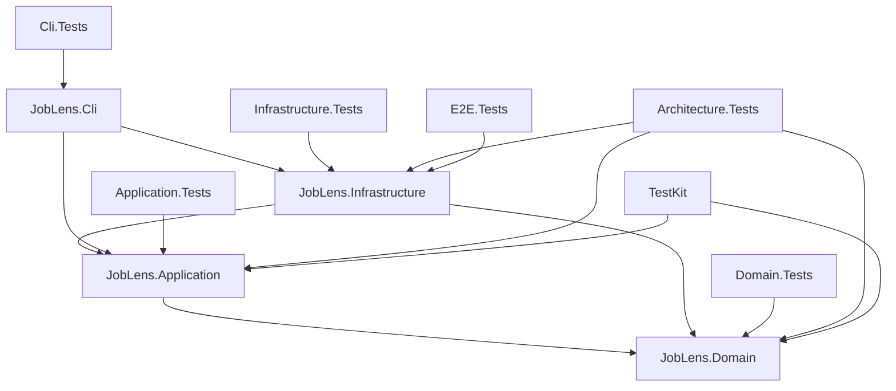
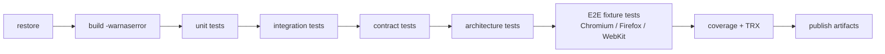

# Solution & Tooling

> **Purpose:** the exact project layout, package versions, SDK pin, configuration shape, commands, CI, and conventions for Phase 0.
>
> **Verified:** 2026-10-29 · .NET SDK `10.0.403` · xUnit `4.0.2` · Playwright `1.64.1`

---

## 1. Solution layout

```text
PlaywrightDotNet/
├── JobLens.slnx
├── global.json
├── Directory.Build.props
├── Directory.Packages.props
├── NuGet.config
├── .editorconfig
├── .gitignore
├── README.md
├── docs/
├── src/
│   ├── JobLens.Domain/
│   ├── JobLens.Application/
│   ├── JobLens.Infrastructure/
│   └── JobLens.Cli/
├── tests/
│   ├── JobLens.TestKit/
│   ├── JobLens.Domain.Tests/
│   ├── JobLens.Application.Tests/
│   ├── JobLens.Infrastructure.Tests/
│   ├── JobLens.Architecture.Tests/
│   ├── JobLens.Cli.Tests/
│   └── JobLens.E2E.Tests/
├── build/
│   ├── scripts/
│   └── docker/
└── artifacts/                 (gitignored)
```

Use `.slnx` (the modern XML solution format supported by .NET 10). If a tool in your chain does not understand `.slnx`, `dotnet sln migrate` / a classic `.sln` is an acceptable fallback; do not maintain both.

> **v2 note:** the web cockpit is a separate Bun package under `web/`, not a .NET project in this solution. See [Web Cockpit](12-web-cockpit.md).

---

## 2. Project responsibilities

| Project | Responsibility | References |
|---|---|---|
| `JobLens.Domain` | Aggregates, value objects, invariants, policies, domain events. Pure C#. | BCL only |
| `JobLens.Application` | Use cases, ports, orchestration, result types, read-model contracts. | Domain, `Microsoft.Extensions.Logging.Abstractions` |
| `JobLens.Infrastructure` | Playwright sessions, source adapters, parsers, EF Core, exporters, diagnostics. | Application, Domain, EF Core, Playwright, AngleSharp, ClosedXML |
| `JobLens.Cli` | Composition root: commands, DI, configuration, logging, exit codes. | Application, Infrastructure, Hosting, Serilog, System.CommandLine |
| `JobLens.TestKit` | Builders, fakes, fixture server helpers, test data. | Domain, Application |
| `JobLens.Domain.Tests` | Pure unit tests. | Domain, TestKit, xUnit |
| `JobLens.Application.Tests` | Use-case tests with fakes/NSubstitute. | Application, TestKit, xUnit, NSubstitute |
| `JobLens.Infrastructure.Tests` | Parser fixtures, SQLite integration, options, artifacts. | Infrastructure, TestKit, xUnit |
| `JobLens.Architecture.Tests` | Layer/dependency rules. | Domain, Application, Infrastructure, NetArchTest |
| `JobLens.Cli.Tests` | Command parsing, option validation, exit-code mapping, help text. | Cli, Application, TestKit, xUnit |
| `JobLens.E2E.Tests` | Local fixture server + Playwright browser tests. | Infrastructure, TestKit, `Microsoft.Playwright.Xunit.v3` |

**Dependency graph**



No production project may reference `JobLens.Cli` (only `JobLens.Cli.Tests` does). Domain/Application may not reference Infrastructure.

`JobLens.Cli` exposes a small `CliApp`/`CommandFactory` seam so tests can parse and invoke commands without spawning a process; `Program.cs` stays a thin entry point.

---

## 3. Package matrix

| Package | Version | Project(s) | Why |
|---|---|---|---|
| `Microsoft.Extensions.Hosting` | `10.0.14` | CLI | DI, configuration, logging, lifetime. |
| `Microsoft.Extensions.Logging.Abstractions` | `10.0.14` | Application, Infrastructure | `ILogger<T>` without a logging implementation. |
| `Microsoft.Extensions.Options.DataAnnotations` | `10.0.14` | CLI, Infrastructure | Strongly typed options validation. |
| `Microsoft.Extensions.Http` | `10.0.14` | Infrastructure (optional) | Future API fast path / health probes. |
| `Microsoft.Playwright` | `1.64.1` | Infrastructure | Browser automation, tracing, persistent contexts. |
| `Microsoft.EntityFrameworkCore.Sqlite` | `10.0.14` | Infrastructure | SQLite provider. |
| `Microsoft.EntityFrameworkCore.Design` | `10.0.14` | Infrastructure | Migrations (`PrivateAssets=all`). |
| `Microsoft.Data.Sqlite` | `10.0.14` | Infrastructure | Explicit provider dependency / pragmas. |
| `AngleSharp` | `1.8.6` | Infrastructure | HTML parsing with CSS selectors. |
| `ClosedXML` | `0.105.1` | Infrastructure | Excel export with hyperlinks. |
| `Serilog.AspNetCore` | `10.0.0` | CLI | Structured logging integration. |
| `Serilog.Sinks.File` | `7.0.0` | CLI | Rolling file logs. |
| `System.CommandLine` | `2.0.14` | CLI | Command parsing, help, validation. |
| `xunit.v3` | `4.0.2` | All test projects | Test framework + assertions. |
| `xunit.runner.visualstudio` | `4.0.1` | All test projects | `dotnet test` / VS Test Explorer. |
| `Microsoft.NET.Test.Sdk` | `18.11.0` | All test projects | VSTest host. |
| `Microsoft.Playwright.Xunit.v3` | `1.64.1` | E2E | Official `PageTest` base class. |
| `NSubstitute` | `6.2.0` | Application/Infrastructure tests | Interaction fakes; BSD-licensed. |
| `NetArchTest.Rules` | `1.3.2` | Architecture tests | Dependency rules. |
| `coverlet.collector` | `10.1.0` | Test projects | Cross-platform coverage. |
| `Microsoft.Extensions.TimeProvider.Testing` | `10.11.0` | Tests | `FakeTimeProvider`. |
| `Verify.XunitV3` | `33.3.4` | Infrastructure tests (optional) | Snapshot parser output. |
| `MinVer` | `8.0.0` | All projects (optional) | SemVer from git tags. |

**Deliberately absent**

- `MediatR` — explicit handlers are simpler at this size.
- `AutoMapper` — explicit mapping is clearer and faster.
- `FluentValidation` — domain guards + options validation are enough.
- `Polly` — a small, tested retry policy is enough; fewer dependencies.
- `Dapper` — EF Core handles both writes and read models.
- `Selenium` — only if real Safari becomes mandatory.
- `FluentAssertions` — xUnit assertions are sufficient; avoid the v8 license question.
- `Moq` — NSubstitute avoids sponsor/license ambiguity.
- Any “stealth”/“undetected” package — explicitly out of policy.

> **License note:** all listed packages are permissive (MIT/BSD/Apache-2.0). Verify in CI with `dotnet list package --include-transitive` and a license scan before release.

---

## 4. SDK and build configuration

### 4.1 `global.json`

```json
{
  "sdk": {
    "version": "10.0.403",
    "rollForward": "latestFeature",
    "allowPrerelease": false
  }
}
```

Install **10.0.403 or newer within the 10.0 feature band**. `latestFeature` allows a newer 10.0.4xx/10.0.5xx on other machines but will not fall back to an older SDK.

### 4.2 `Directory.Build.props`

```xml
<Project>
  <PropertyGroup>
    <TargetFramework>net10.0</TargetFramework>
    <LangVersion>latest</LangVersion>
    <Nullable>enable</Nullable>
    <ImplicitUsings>enable</ImplicitUsings>
    <TreatWarningsAsErrors>true</TreatWarningsAsErrors>
    <AnalysisLevel>latest-recommended</AnalysisLevel>
    <EnforceCodeStyleInBuild>true</EnforceCodeStyleInBuild>
    <Deterministic>true</Deterministic>
    <InvariantGlobalization>false</InvariantGlobalization>
    <GenerateDocumentationFile>false</GenerateDocumentationFile>
  </PropertyGroup>
</Project>
```

- `InvariantGlobalization=false` because locale/timezone handling matters (`en-IN`, `Asia/Kolkata`).
- `GenerateDocumentationFile` can be enabled for Domain/Application if XML docs are maintained; not required for the CLI.
- Warnings are errors from day one; suppress only with a documented justification.

### 4.3 `Directory.Packages.props` (central package management)

```xml
<Project>
  <PropertyGroup>
    <ManagePackageVersionsCentrally>true</ManagePackageVersionsCentrally>
    <CentralPackageTransitivePinningEnabled>true</CentralPackageTransitivePinningEnabled>
  </PropertyGroup>

  <ItemGroup>
    <PackageVersion Include="Microsoft.Extensions.Hosting" Version="10.0.14" />
    <PackageVersion Include="Microsoft.Extensions.Logging.Abstractions" Version="10.0.14" />
    <PackageVersion Include="Microsoft.Extensions.Options.DataAnnotations" Version="10.0.14" />
    <PackageVersion Include="Microsoft.Extensions.Http" Version="10.0.14" />
    <PackageVersion Include="Microsoft.Playwright" Version="1.64.1" />
    <PackageVersion Include="Microsoft.EntityFrameworkCore.Sqlite" Version="10.0.14" />
    <PackageVersion Include="Microsoft.EntityFrameworkCore.Design" Version="10.0.14" />
    <PackageVersion Include="Microsoft.Data.Sqlite" Version="10.0.14" />
    <PackageVersion Include="AngleSharp" Version="1.8.6" />
    <PackageVersion Include="ClosedXML" Version="0.105.1" />
    <PackageVersion Include="Serilog.AspNetCore" Version="10.0.0" />
    <PackageVersion Include="Serilog.Sinks.File" Version="7.0.0" />
    <PackageVersion Include="System.CommandLine" Version="2.0.14" />

    <PackageVersion Include="xunit.v3" Version="4.0.2" />
    <PackageVersion Include="xunit.runner.visualstudio" Version="4.0.1" />
    <PackageVersion Include="Microsoft.NET.Test.Sdk" Version="18.11.0" />
    <PackageVersion Include="Microsoft.Playwright.Xunit.v3" Version="1.64.1" />
    <PackageVersion Include="NSubstitute" Version="6.2.0" />
    <PackageVersion Include="NetArchTest.Rules" Version="1.3.2" />
    <PackageVersion Include="coverlet.collector" Version="10.1.0" />
    <PackageVersion Include="Microsoft.Extensions.TimeProvider.Testing" Version="10.11.0" />
    <PackageVersion Include="Verify.XunitV3" Version="33.3.4" />
    <PackageVersion Include="MinVer" Version="8.0.0" />
  </ItemGroup>
</Project>
```

### 4.4 `NuGet.config`

```xml
<?xml version="1.0" encoding="utf-8"?>
<configuration>
  <packageSources>
    <clear />
    <add key="nuget.org" value="https://api.nuget.org/v3/index.json" />
  </packageSources>
</configuration>
```

### 4.5 `xunit.runner.json`

Unit/integration tests:

```json
{
  "$schema": "https://xunit.net/schema/current/xunit.runner.schema.json",
  "parallelizeTestCollections": true,
  "maxParallelThreads": 0,
  "diagnosticMessages": false
}
```

E2E tests (separate file):

```json
{
  "$schema": "https://xunit.net/schema/current/xunit.runner.schema.json",
  "parallelizeTestCollections": false,
  "maxParallelThreads": 1,
  "diagnosticMessages": true
}
```

Set `<CopyToOutputDirectory>PreserveNewest</CopyToOutputDirectory>` for the relevant `xunit.runner.json` in each test project.

---

## 5. Configuration shape

### 5.1 `appsettings.json` (target)

```json
{
  "JobLens": {
    "Storage": {
      "DatabasePath": "artifacts/data/joblens.db",
      "ArtifactsRoot": "artifacts",
      "ProfilesRoot": "artifacts/profiles",
      "RetentionDays": 30,
      "PostingRetentionDays": 180
    },
    "Browser": {
      "DefaultEngine": "Chromium",
      "DefaultChannel": "Bundled",
      "Headless": false,
      "SlowMoMs": 40,
      "NavigationTimeoutSeconds": 45,
      "ActionTimeoutSeconds": 20,
      "Locale": "en-IN",
      "Timezone": "Asia/Kolkata",
      "ViewportWidth": 1366,
      "ViewportHeight": 768,
      "BlockTrackers": false
    },
    "Compliance": {
      "AcknowledgeSourceRisk": false,
      "AllowHighRiskSources": false
    },
    "Sources": {
      "naukri": {
        "Enabled": true,
        "BaseUrl": "https://www.naukri.com",
        "MaxPagesPerSearch": 3,
        "MaxJobsPerRun": 60,
        "MaxDetailsPerRun": 60,
        "MinDelayMs": 2500,
        "MaxDelayMs": 6000,
        "DailyPageCap": 25,
        "DailyDetailCap": 60,
        "DailyRunCap": 2,
        "ChallengeCooldownMinutes": 45,
        "RequiresConsent": false,
        "UseApiFastPath": false
      },
      "indeed": {
        "Enabled": false,
        "BaseUrl": "https://in.indeed.com",
        "MaxPagesPerSearch": 2,
        "MaxJobsPerRun": 40,
        "MaxDetailsPerRun": 30,
        "MinDelayMs": 12000,
        "MaxDelayMs": 25000,
        "DailyPageCap": 12,
        "DailyDetailCap": 30,
        "DailyRunCap": 1,
        "ChallengeCooldownMinutes": 60,
        "RequiresConsent": true
      },
      "linkedin": {
        "Enabled": false,
        "BaseUrl": "https://www.linkedin.com",
        "MaxPagesPerSearch": 1,
        "MaxJobsPerRun": 25,
        "MaxDetailsPerRun": 8,
        "MinDelayMs": 10000,
        "MaxDelayMs": 20000,
        "DailyPageCap": 4,
        "DailyDetailCap": 8,
        "DailyRunCap": 1,
        "ChallengeCooldownMinutes": 60,
        "RequiresConsent": true
      }
    },
    "Run": {
      "MaxConcurrentRuns": 1,
      "GlobalTimeoutMinutes": 30,
      "RetryMaxAttempts": 2
    },
    "Logging": {
      "MinimumLevel": "Information",
      "FilePath": "artifacts/logs/joblens-.log"
    }
  }
}
```

> The caps above are **starting defaults, not entitlements**. Lower them when a source challenges; never raise them without a review.

### 5.2 Precedence and secrets

```text
appsettings.json
  → appsettings.Local.json (gitignored)
  → environment variables (JOBLENS_*)
  → CLI options
```

- No credentials are stored. Login is manual.
- Browser profiles are secrets; the directory is created with owner-only permissions on Unix.
- Future API keys: user secrets in development, environment variables in production.

---

## 6. Target CLI surface

> These commands are the design target for v1. Names may be refined during Phase 0, but the verbs and behavior should remain.

| Command | Purpose |
|---|---|
| `joblens doctor [--install-browsers]` | Check SDK, OS, browsers, DB, paths, pending migrations, config, profile permissions. |
| `joblens db migrate` | Apply EF Core migrations. |
| `joblens search create` | Create a search profile (source, keywords, locations, experience, days, caps). |
| `joblens search list` | List search profiles and enabled state. |
| `joblens session login --source <key> --browser-profile <name>` | Launch a headed persistent browser for manual login/challenge solve. |
| `joblens session probe --source <key> --browser-profile <name>` | Verify the session and capture diagnostics. |
| `joblens scrape --search <name>` | Run a search profile. |
| `joblens scrape --search <name> --dry-run` | Parse and report without DB writes. |
| `joblens scrape --search <name> --no-enrich` | Skip detail pages. |
| `joblens runs list` | Recent runs with status/stats. |
| `joblens runs show <runId>` | Run details, events, artifacts. |
| `joblens export --format csv\|xlsx` | Export a snapshot. |
| `joblens source list` | Source capabilities, compliance tier, default caps. |
| `joblens version` | Version + build metadata. |

### 6.1 Exit codes

| Code | Meaning |
|---|---|
| `0` | Success. |
| `1` | Unexpected failure. |
| `2` | Configuration/validation error. |
| `3` | Paused for manual challenge / auth. |
| `4` | Rate limited; cooldown active. |
| `5` | Source unavailable / circuit open. |
| `6` | Data validation/parse failure (run may be partial). |
| `130` | Cancelled by Ctrl+C. |

Exit codes matter for schedulers: a challenge (`3`) should not be treated as a generic crash, and a rate limit (`4`) should not trigger an immediate retry.

---

## 7. Bootstrap commands

### 7.1 macOS / Linux

```bash
dotnet --info
dotnet restore
dotnet build -warnaserror
dotnet test --filter "Category!=Live&Category!=E2E"

# Builds the CLI and installs Playwright browsers via the CLI wrapper.
dotnet run --project src/JobLens.Cli -- doctor --install-browsers

# Apply migrations and create the first search profile.
dotnet run --project src/JobLens.Cli -- db migrate
dotnet run --project src/JobLens.Cli -- search create \
  --name naukri-dotnet-pune \
  --source naukri \
  --keywords "asp.net core c# .net" \
  --locations "pune,hyderabad" \
  --experience 6 \
  --days 7 \
  --max-pages 2 \
  --max-jobs 40

# First contact: headed, manual login/challenge if needed.
dotnet run --project src/JobLens.Cli -- session login \
  --source naukri --browser-profile naukri-main

# Dry run, then a real run, then export.
dotnet run --project src/JobLens.Cli -- scrape --search naukri-dotnet-pune --dry-run --max-pages 1
dotnet run --project src/JobLens.Cli -- scrape --search naukri-dotnet-pune --max-pages 1
dotnet run --project src/JobLens.Cli -- export --format xlsx
```

### 7.2 Windows (PowerShell 7)

```powershell
dotnet --info
dotnet restore
dotnet build -warnaserror
dotnet test --filter "Category!=Live&Category!=E2E"

dotnet run --project src/JobLens.Cli -- doctor --install-browsers
dotnet run --project src/JobLens.Cli -- db migrate
dotnet run --project src/JobLens.Cli -- search create `
  --name naukri-dotnet-pune `
  --source naukri `
  --keywords "asp.net core c# .net" `
  --locations "pune,hyderabad" `
  --experience 6 `
  --days 7 `
  --max-pages 2 `
  --max-jobs 40
```

### 7.3 Manual Playwright install (fallback)

If the CLI wrapper is unavailable:

```bash
# macOS/Linux with PowerShell 7
pwsh src/JobLens.Cli/bin/Debug/net10.0/playwright.ps1 install chromium firefox webkit

# Linux dependencies
pwsh src/JobLens.Cli/bin/Debug/net10.0/playwright.ps1 install --with-deps chromium
```

On Linux CI, prefer the official Playwright Docker image or `install --with-deps`.

---

## 8. EF Core migrations

```bash
# One-time tool install; pin the version in .config/dotnet-tools.json.
dotnet tool install --global dotnet-ef

dotnet ef migrations add InitialCreate \
  --project src/JobLens.Infrastructure \
  --startup-project src/JobLens.Cli \
  --output-dir Persistence/Migrations

dotnet ef database update \
  --project src/JobLens.Infrastructure \
  --startup-project src/JobLens.Cli
```

Rules:

- Migrations are reviewed like code.
- No automatic `EnsureCreated()` in production; tests may use migrations or a disposable SQLite file.
- Back up the database before applying a migration.
- Never edit an applied migration; add a new one.

---

## 9. CI outline



```yaml
name: ci
on:
  push:
  pull_request:

jobs:
  build-test:
    strategy:
      fail-fast: false
      matrix:
        os: [ubuntu-latest, windows-latest, macos-latest]
    runs-on: ${{ matrix.os }}
    steps:
      - uses: actions/checkout@v4
      - uses: actions/setup-dotnet@v4
        with:
          dotnet-version: "10.0.x"
      - run: dotnet restore
      - run: dotnet build --no-restore -warnaserror
      - run: dotnet test --no-build --filter "Category!=Live&Category!=E2E"

  e2e:
    runs-on: ubuntu-latest
    steps:
      - uses: actions/checkout@v4
      - uses: actions/setup-dotnet@v4
        with:
          dotnet-version: "10.0.x"
      - run: dotnet restore
      - run: dotnet build --no-restore -warnaserror
      # On Linux, doctor --install-browsers should pass --with-deps
      # (or install the Playwright OS dependencies in a prior step).
      - run: dotnet run --project src/JobLens.Cli -- doctor --install-browsers
      - run: dotnet test tests/JobLens.E2E.Tests --no-build
```

**CI rules**

- No live-site scraping in CI.
- Pin Playwright and cache its browser directory by version.
- Upload TRX, coverage, and failure traces/screenshots.
- Run E2E on Linux for speed; run a smaller matrix on Windows/macOS nightly or before release.
- Do not let a flaky E2E test block a merge indefinitely; quarantine with an owner and expiry.

---

## 10. Conventions

### 10.1 Naming

| Kind | Convention | Example |
|---|---|---|
| Namespace | `JobLens.<Layer>.<Feature>` | `JobLens.Domain.Sourcing` |
| Aggregate | Noun, sealed class | `ScrapeRun` |
| Value object | Noun, `record`/`readonly record struct` | `SourceKey`, `RunLimits` |
| Port | `I` + capability | `IJobSource`, `IJobPostingRepository` |
| Adapter | `<Source>Adapter` | `NaukriAdapter` |
| Parser | `<Source><Page>Parser` | `NaukriSearchPageParser` |
| Use case | `<Verb><Noun>Handler` | `RunScrapeHandler` |
| Policy | `<Concern>Policy` | `PolitenessPolicy` |
| Options | `<Area>Options` | `BrowserOptions` |
| Test | `<Type>Tests` | `ScrapeRunTests` |
| Test data | `<Type>Builder` | `JobPostingBuilder` |

### 10.2 Code rules

- One public type per file; file name matches the type.
- `sealed` by default for classes.
- `record` for immutable data; `readonly record struct` for small IDs.
- `CancellationToken cancellationToken` as the last parameter.
- Async methods end with `Async`.
- No `async void` except event handlers (none in libraries).
- No `.Result`/`.Wait()`; no blocking in async code.
- No `DateTime.Now`/`UtcNow` in Domain/Application; inject `TimeProvider`.
- No `new Random()` in Domain/Application; inject `IRandomSource`.
- No service locator; constructor injection only.
- No static mutable state.
- Exceptions for programmer/invariant errors; result types for expected operational outcomes.
- Structured logs with named properties; never interpolate secrets.
- Public ports get XML docs explaining invariants and failure semantics.
- Comments explain **why**, not **what**.

### 10.3 Git

- Trunk-based development; short-lived branches.
- [Conventional Commits v1.0.0](13-conventional-commits.md): `type(scope): description`; add `!` or a `BREAKING CHANGE:` footer for breaking changes. Types: `feat`, `fix`, `perf`, `refactor`, `test`, `docs`, `build`, `ci`, `style`, `chore`, `revert`.
- Enable the commit-message validator once per clone: `git config core.hooksPath .githooks`.
- One logical change per commit; tests in the same commit as the behavior.
- Tag releases `v1.0.0`; MinVer derives versions.
- Never commit `artifacts/`, profiles, databases, `.env`, `appsettings.Local.json`, or secrets.

### 10.4 `.gitignore` (minimum)

```gitignore
bin/
obj/
artifacts/
.vs/
.idea/
.vscode/
*.user
appsettings.Local.json
.env
*.db
*.db-shm
*.db-wal
TestResults/
coverage/
playwright-report/
*.trace.zip
```

---

## 11. Quality gates

Every pull request / phase exit:

```bash
dotnet build -warnaserror
dotnet format --verify-no-changes
dotnet test --filter "Category!=Live&Category!=E2E"
dotnet test tests/JobLens.E2E.Tests
dotnet list package --vulnerable --include-transitive
```

Plus:

- Architecture tests green.
- Coverage thresholds met (see [Testing Strategy](06-testing-strategy.md)).
- No new secrets or PII in fixtures/logs.
- Docs updated when a public behavior/selector/policy changes.
- A canary note for any source-specific change.

---

## 12. Cross-OS notes

| Concern | Rule |
|---|---|
| Paths | `Path.Combine`, `Environment.GetFolderPath`; never hardcode `/` or `\`. |
| File permissions | On Unix, set profile/data dirs to owner-only (`0700`) via `File.SetUnixFileMode`. |
| Shell scripts | Provide `bash` and `pwsh` variants; do not assume `bash` on Windows. |
| Browser install | `doctor --install-browsers` wraps Playwright's installer; `pwsh` is optional. |
| SQLite | Ensure the parent directory exists; enable WAL; one writer. |
| Scheduler | Linux `flock`/systemd timer; macOS `launchd`; Windows Task Scheduler “do not start a new instance”. |
| Case sensitivity | Treat source keys/paths as case-sensitive; use lowercase keys. |
| Line endings | `.gitattributes` with `* text=auto` and `*.ps1 text eol=crlf` if needed. |

---

## 13. Versioning and release

- SemVer: `MAJOR.MINOR.PATCH`.
- `0.x` during development; `1.0.0` only after the release checklist.
- MinVer reads git tags; CI builds without tags get a pre-release version.
- Publish per RID:

```bash
dotnet publish src/JobLens.Cli -c Release -r osx-arm64 --self-contained true
dotnet publish src/JobLens.Cli -c Release -r linux-x64 --self-contained true
dotnet publish src/JobLens.Cli -c Release -r win-x64 --self-contained true
```

> Do not enable `PublishSingleFile` for v1 without a spike. Playwright ships driver/browser assets that are easier to ship as a directory; single-file extraction can break the driver path.

- Browsers are **not** bundled; the release notes must state the Playwright install step and version.
- Keep a `CHANGELOG.md` from Phase 0; add entries per user-visible change.
