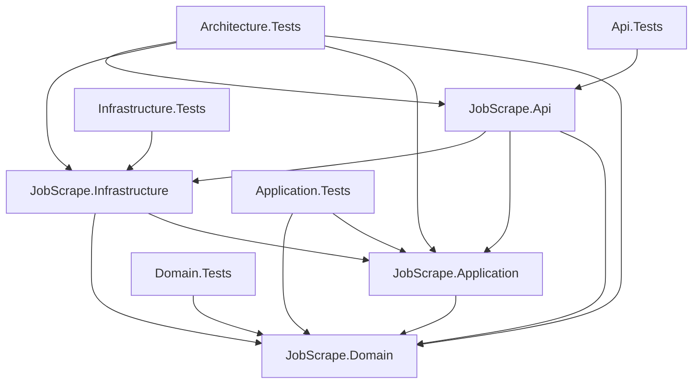
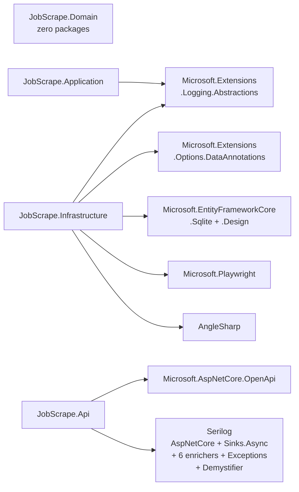
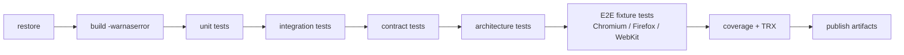

# Solution & Tooling

> **Purpose:** the exact project layout, package versions, SDK pin, configuration shape, commands, CI, and conventions for Phase 0.
>
> **Verified:** 2026-10-29 · .NET SDK `10.0.403` · xUnit `4.0.2` · Playwright/AngleSharp rows re-verified 2026-11-02 (`Microsoft.Playwright 1.64.1`, `AngleSharp 1.8.6`)

---

## 1. Solution layout

> **Implementation note (Feature 1, 2026-10-30):** the implemented scaffold
> uses the `JobScrape` naming and a backend-first split per
> [ADR-0015](10-adr/0015-jobscrape-naming-mtp-tests.md). `src/backend/` hosts
> `JobScrape.slnx` and all .NET projects; `src/frontend/` is a scoped
> placeholder for the React + Bun cockpit until the backend health slice is
> finalized. The `JobLens.*` / `web/` names below remain the design-doc
> target pending a repo-wide rename.
>
> ```text
> PlaywrightDotNet/
> ├── src/
> │   ├── backend/
> │   │   ├── JobScrape.slnx
> │   │   ├── global.json (+ "test": { "runner": "Microsoft.Testing.Platform" })
> │   │   ├── Directory.Build.props
> │   │   ├── Directory.Packages.props
> │   │   ├── NuGet.config
> │   │   ├── JobScrape.Domain/          (aggregates, value objects, policies, events; BCL only)
> │   │   ├── JobScrape.Application/     (use cases, ports, Result; refs Domain)
> │   │   ├── JobScrape.Infrastructure/  (EF Core SQLite, options, runtime, Playwright browser, Naukri adapter; refs Application, Domain)
> │   │   ├── JobScrape.Api/             (explicit Program.Main, 5 controllers, RunCoordinator)
> │   │   ├── JobScrape.Domain.Tests/
> │   │   ├── JobScrape.Application.Tests/
> │   │   ├── JobScrape.Api.Tests/       (WebApplicationFactory integration)
> │   │   ├── JobScrape.Infrastructure.Tests/
> │   │   └── JobScrape.Architecture.Tests/ (NetArchTest layer rules)
> │   └── frontend/                      (React 19 + Bun ops deck: BFF + routed pages)
> └── .config/dotnet-tools.json         (dotnet-coverage 18.12.0, repo-local)
> ```
>
> Design-doc target (pre-rename reference):
>
> ```text
PlaywrightDotNet/
├── JobLens.slnx
├── global.json
├── Directory.Build.props
├── Directory.Packages.props
├── NuGet.config
├── .editorconfig
├── .gitignore
├── README.md
├── docs/
├── src/
│   ├── JobLens.Domain/
│   ├── JobLens.Application/
│   ├── JobLens.Infrastructure/
│   ├── JobLens.Cli/
│   └── JobLens.Api/               (v2)
├── tests/
│   ├── JobLens.TestKit/
│   ├── JobLens.Domain.Tests/
│   ├── JobLens.Application.Tests/
│   ├── JobLens.Infrastructure.Tests/
│   ├── JobLens.Architecture.Tests/
│   ├── JobLens.Cli.Tests/
│   └── JobLens.E2E.Tests/
├── build/
│   ├── scripts/
│   └── docker/
└── artifacts/                 (gitignored)
```

Use `.slnx` (the modern XML solution format supported by .NET 10). If a tool in your chain does not understand `.slnx`, `dotnet sln migrate` / a classic `.sln` is an acceptable fallback; do not maintain both.

> **v2 note:** the web cockpit is a separate Bun package under `src/frontend/`, not a .NET project in this solution. See [Web Cockpit](12-web-cockpit.md).

---

## 2. Project responsibilities

> **As implemented** (verified against `src/backend/JobScrape.slnx` and every
> `.csproj`; the `JobLens.*` names below the table are the pre-rename
> design-doc target).

| Project | Responsibility | References |
|---|---|---|
| `JobScrape.Domain` | Aggregates (`SearchProfile`, `ScrapeRun`, `JobPosting`, `BrowserProfile`, `SourceQuota`, `SourceCircuitBreaker`), value objects, policies, domain events. Pure C#, zero packages. | BCL only |
| `JobScrape.Application` | Use cases (`GetHealth`, `Get/List/CreateSearchProfile`, `ListSources`, `List/Get/CreateSession`, `Start/List/Get/CancelRun`, `ListRunPostings`, `RunScrape`), ports (10 `Abstractions` + `ISearchProfileStore`, `ISessionStore`, `IRunStore`, `IRunLauncher`, `IJobSource`), Result pattern. | Domain, `Microsoft.Extensions.Logging.Abstractions` |
| `JobScrape.Infrastructure` | EF Core SQLite persistence (6 repositories, `JobScrapeDbContext`, migrations), read stores (`SearchProfileReadStore`, `SessionReadStore`, `RunReadStore`), options binding/validation, runtime (`TimeProvider` delay, `SystemRandomSource`), `Browser/` (`BrowserSessionPool`, `PlaywrightSessionManager`, `FileArtifactStore`), `Sources/Naukri/` (`NaukriJobSource`, URL builder, parsers, challenge classifier). | Application, Domain, `Microsoft.EntityFrameworkCore.Sqlite`, `Microsoft.EntityFrameworkCore.Design` (`PrivateAssets=all`), `Microsoft.Extensions.Options.DataAnnotations`, `Microsoft.Playwright`, `AngleSharp` |
| `JobScrape.Api` | Composition root (`Program.Main`): 5 controllers (Health, SearchProfiles, Sources, Sessions, Runs), `RunCoordinator` (background runs), `BrowserRegistration`, Problem Details + `traceId`, Serilog, validated options. | Domain, Application, Infrastructure, `Microsoft.AspNetCore.OpenApi`, Serilog (`AspNetCore`, `Sinks.Async`, enrichers, `Exceptions`, `Demystifier`) |
| `JobScrape.Domain.Tests` | Pure unit tests. | Domain, xUnit |
| `JobScrape.Application.Tests` | Use-case tests with fakes + `FakeTimeProvider`. | Application, Domain, xUnit |
| `JobScrape.Api.Tests` | `WebApplicationFactory` integration (endpoints, store). | Api, xUnit, `Serilog.Sinks.InMemory` |
| `JobScrape.Infrastructure.Tests` | SQLite integration, options validation, Naukri fixture tests (URL builder, parsers, challenge classifier). | Infrastructure, xUnit |
| `JobScrape.Architecture.Tests` | Layer/dependency rules (NetArchTest). | Domain, Application, Infrastructure, Api |

**Dependency graph** (every edge is a `ProjectReference` in the corresponding `.csproj`)



No production project may reference a test project. Domain references nothing. Application references only Domain (+ logging abstractions). Infrastructure references Application and Domain but is referenced by Api only (composition root wires the ports).

> Design-doc target (pre-rename reference): `JobLens.Domain`, `JobLens.Application`, `JobLens.Infrastructure`, `JobLens.Cli`, `JobLens.Api` (v2), `JobLens.TestKit`, `JobLens.*.Tests`, `JobLens.E2E.Tests` — see the tree in §1.

---

## 3. Package matrix

> **Installed today** — every row below is a `PackageReference` in at least
> one `.csproj`, versioned in `Directory.Packages.props` (central package
> management + transitive pinning on). Anything else in the pre-rename
> design matrix (`System.CommandLine`, Scalar, NSubstitute, ClosedXML, …)
> is approved for later slices but has **no reference in the tree yet** and
> must not appear in diagrams as installed.

| Package | Version | Project(s) | Why |
|---|---|---|---|
| `Microsoft.Extensions.Logging.Abstractions` | `10.0.14` | Application, Infrastructure | `ILogger<T>` without a logging implementation. |
| `Microsoft.Extensions.Options.DataAnnotations` | `10.0.14` | Infrastructure | Options binding + DataAnnotations validation. |
| `Microsoft.EntityFrameworkCore.Sqlite` | `10.0.14` | Infrastructure | SQLite provider. |
| `Microsoft.EntityFrameworkCore.Design` | `10.0.14` | Infrastructure | Migrations (`PrivateAssets=all`). |
| `Microsoft.Playwright` | `1.64.1` | Infrastructure | Headed browser automation: persistent contexts per browser profile, Naukri navigation. |
| `AngleSharp` | `1.8.6` | Infrastructure | Offline HTML parsing of captured Naukri search/detail pages. |
| `Microsoft.AspNetCore.OpenApi` | `10.0.14` | Api | OpenAPI document generation (Development only). |
| `Serilog.AspNetCore` | `10.0.0` | Api | Structured logging, request logging. |
| `Serilog.Sinks.Async` | `2.1.0` | Api | Keep file I/O off the request thread. |
| `Serilog.Enrichers.Environment` | `3.0.1` | Api | Machine and environment names. |
| `Serilog.Enrichers.Process` | `3.0.0` | Api | Process ID and name. |
| `Serilog.Enrichers.Thread` | `4.0.0` | Api | Thread ID for pool diagnostics. |
| `Serilog.Enrichers.Span` | `3.1.0` | Api | `TraceId` / `SpanId` correlation. |
| `Serilog.Enrichers.AssemblyName` | `2.0.0` | Api | Assembly name/version. |
| `Serilog.Exceptions` | `8.4.0` | Api | Detailed exception properties. |
| `Serilog.Enrichers.Demystifier` | `1.0.3` | Api | Readable async stack traces. |
| `xunit.v3` | `4.0.2` | All test projects | Test framework + assertions. |
| `xunit.runner.visualstudio` | `4.0.1` | All test projects | `dotnet test` / VS Test Explorer. |
| `Microsoft.NET.Test.Sdk` | `18.11.0` | All test projects | Test host. |
| `coverlet.collector` | `10.1.0` | Test projects | Cross-platform coverage (VSTest mode; inert under native MTP). |
| `Microsoft.Testing.Extensions.CodeCoverage` | `18.12.0` | Test projects | Native MTP `--coverage` provider (see ADR-0015). |
| `Microsoft.Extensions.TimeProvider.Testing` | `10.11.0` | Application/Infrastructure tests | `FakeTimeProvider`. |
| `Microsoft.AspNetCore.Mvc.Testing` | `10.0.14` | Api.Tests | `WebApplicationFactory` integration. |
| `Serilog.Sinks.InMemory` | `2.0.0` | Api.Tests | Assert structured log properties and redaction. |
| `NetArchTest.Rules` | `1.3.2` | Architecture tests | Dependency rules. |

**External dependency fan-in** (which production layer touches what — derived from the references above, not aspirational)



**Deliberately absent** (unchanged policy — none of these are referenced either, same as before)

- `MediatR` and CQRS command/query buses — explicit, constructor-injected use-case handlers are simpler and easier to debug. See [ADR-0011](10-adr/0011-no-cqrs-mediatr.md).
- `AutoMapper` — explicit mapping is clearer and faster.
- `FluentValidation` — domain guards, request validation, and options validation are enough.
- `Ardalis.Specification` and similar — no specification abstraction exists yet; add the smallest one only when the second real query need arrives.
- `System.CommandLine.NamingConventionBinder` — legacy handler binding; prefer the library-recommended `SetAction`/`SetHandler`.
- `Newtonsoft.Json` — `System.Text.Json` is the platform default; add Newtonsoft only for a concrete compatibility requirement.
- `Polly` as a direct package — no HTTP resilience infrastructure exists yet; add Polly (or `Microsoft.Extensions.Http.Resilience`) only with a measured non-HTTP pipeline need. Never retry a challenge/wall regardless of library.
- `Dapper` — EF Core handles both writes and read models.
- `Seq`/ELK/OpenTelemetry exporters — local JSON logs are the v1 baseline; add centralized telemetry only when a real requirement appears.
- `Selenium` — only if real Safari becomes mandatory.
- `FluentAssertions` — xUnit assertions are sufficient; avoid the v8 license question.
- `Moq` — no mocking library is referenced; xUnit assertions and hand-written fakes suffice. Add one only with a concrete need, preferring permissive licensing.
- Any “stealth”/“undetected” package — explicitly out of policy.

> **License note:** all listed packages are permissive (MIT/BSD/Apache-2.0). Verify in CI with `dotnet list package --include-transitive` and a license scan before release.

---

## 4. SDK and build configuration

### 4.1 `global.json`

```json
{
  "sdk": {
    "version": "10.0.403",
    "rollForward": "latestFeature",
    "allowPrerelease": false
  },
  "test": {
    "runner": "Microsoft.Testing.Platform"
  }
}
```

Install **10.0.403 or newer within the 10.0 feature band**. `latestFeature` allows a newer 10.0.4xx/10.0.5xx on other machines but will not fall back to an older SDK.

### 4.2 `Directory.Build.props`

```xml
<Project>
  <PropertyGroup>
    <TargetFramework>net10.0</TargetFramework>
    <LangVersion>latest</LangVersion>
    <Nullable>enable</Nullable>
    <ImplicitUsings>enable</ImplicitUsings>
    <TreatWarningsAsErrors>true</TreatWarningsAsErrors>
    <AnalysisLevel>latest-recommended</AnalysisLevel>
    <EnforceCodeStyleInBuild>true</EnforceCodeStyleInBuild>
    <Deterministic>true</Deterministic>
    <InvariantGlobalization>false</InvariantGlobalization>
    <GenerateDocumentationFile>true</GenerateDocumentationFile>
    <ContinuousIntegrationBuild Condition="'$(GITHUB_ACTIONS)' == 'true'"
      >true</ContinuousIntegrationBuild>
  </PropertyGroup>
</Project>
```

- `InvariantGlobalization=false` because locale/timezone handling matters (`en-IN`, `Asia/Kolkata`).
- `GenerateDocumentationFile=true` globally (ADR-0017): every public type/member carries XML docs; test projects opt out (`false` per test `.csproj`) because test names state the expectation.
- Warnings are errors from day one; suppress only with a documented justification.
- AOT/trimming is not a design constraint. Use libraries in their documented configuration; see [Library Usage Policy](16-library-usage-policy.md).

### 4.3 `Directory.Packages.props` (central package management)

```xml
<Project>
  <PropertyGroup>
    <ManagePackageVersionsCentrally>true</ManagePackageVersionsCentrally>
    <CentralPackageTransitivePinningEnabled>true</CentralPackageTransitivePinningEnabled>
  </PropertyGroup>

  <ItemGroup>
    <PackageVersion Include="Microsoft.Extensions.Logging.Abstractions" Version="10.0.14" />
    <PackageVersion Include="Microsoft.Extensions.Options.DataAnnotations" Version="10.0.14" />
    <PackageVersion Include="Microsoft.EntityFrameworkCore.Sqlite" Version="10.0.14" />
    <PackageVersion Include="Microsoft.EntityFrameworkCore.Design" Version="10.0.14" />
    <PackageVersion Include="Microsoft.AspNetCore.OpenApi" Version="10.0.14" />
    <PackageVersion Include="Microsoft.AspNetCore.Mvc.Testing" Version="10.0.14" />
    <PackageVersion Include="Serilog.AspNetCore" Version="10.0.0" />
    <PackageVersion Include="Serilog.Sinks.Async" Version="2.1.0" />
    <PackageVersion Include="Serilog.Enrichers.Environment" Version="3.0.1" />
    <PackageVersion Include="Serilog.Enrichers.Process" Version="3.0.0" />
    <PackageVersion Include="Serilog.Enrichers.Thread" Version="4.0.0" />
    <PackageVersion Include="Serilog.Enrichers.Span" Version="3.1.0" />
    <PackageVersion Include="Serilog.Enrichers.AssemblyName" Version="2.0.0" />
    <PackageVersion Include="Serilog.Exceptions" Version="8.4.0" />
    <PackageVersion Include="Serilog.Enrichers.Demystifier" Version="1.0.3" />
    <PackageVersion Include="Serilog.Sinks.InMemory" Version="2.0.0" />
    <PackageVersion Include="xunit.v3" Version="4.0.2" />
    <PackageVersion Include="xunit.runner.visualstudio" Version="4.0.1" />
    <PackageVersion Include="Microsoft.NET.Test.Sdk" Version="18.11.0" />
    <PackageVersion Include="coverlet.collector" Version="10.1.0" />
    <PackageVersion Include="Microsoft.Testing.Extensions.CodeCoverage" Version="18.12.0" />
    <PackageVersion Include="Microsoft.Extensions.TimeProvider.Testing" Version="10.11.0" />
    <PackageVersion Include="NetArchTest.Rules" Version="1.3.2" />
    <PackageVersion Include="Microsoft.Playwright" Version="1.64.1" />
    <PackageVersion Include="AngleSharp" Version="1.8.6" />
  </ItemGroup>
</Project>
```

> The real file also pins `Microsoft.Extensions.Hosting` and
> `Microsoft.Extensions.Http` (`10.0.14`), which no project references.
> Anything else (`System.CommandLine`, Scalar, `Http.Resilience`,
> `Microsoft.Data.Sqlite`, ClosedXML, `Microsoft.Playwright.Xunit.v3`,
> NSubstitute, Verify, MinVer) appears only in the pre-rename design matrix:
> no `PackageVersion` and no `PackageReference` exists for it today.

### 4.4 `NuGet.config`

```xml
<?xml version="1.0" encoding="utf-8"?>
<configuration>
  <packageSources>
    <clear />
    <add key="nuget.org" value="https://api.nuget.org/v3/index.json" />
  </packageSources>
</configuration>
```

### 4.5 `xunit.runner.json`

> Not present in the tree: no `xunit.runner.json` file exists in any test project today, so the runner defaults apply. The template below is the design target for when parallelization or diagnostics need explicit control.

```json
{
  "$schema": "https://xunit.net/schema/current/xunit.runner.schema.json",
  "parallelizeTestCollections": true,
  "maxParallelThreads": 0,
  "diagnosticMessages": false
}
```

E2E tests (separate file):

```json
{
  "$schema": "https://xunit.net/schema/current/xunit.runner.schema.json",
  "parallelizeTestCollections": false,
  "maxParallelThreads": 1,
  "diagnosticMessages": true
}
```

Set `<CopyToOutputDirectory>PreserveNewest</CopyToOutputDirectory>` for the relevant `xunit.runner.json` in each test project.

---

## 5. Configuration shape

### 5.1 `appsettings.json`

> Design target below (`JobLens:*` sections, Browser block) — **not implemented**. The implemented sections are `JobScrape:Storage` (defaults in code: `DatabasePath: artifacts/data/jobscrape.db`, `ArtifactsRoot: artifacts`, `ProfilesRoot: artifacts/profiles`, `RetentionDays: 30`, `PostingRetentionDays: 180`, `MinimumFreeDiskBytes: 1 GiB`), `JobScrape:Compliance` (`AcknowledgeSourceRisk`, `AllowHighRiskSources`), `JobScrape:Run` (`RetryMaxAttempts: 2`), `JobScrape:Browser` (`Headless: false` — Naukri blocks headless first contact — and `NavigationTimeoutSeconds: 45`, range 5–120; no engine/channel/viewport/locale keys: engine and channel are per browser profile, and viewport/UA are never overridden), `JobScrape:Logging` (`Directory: artifacts/logs`, `RetentionDays: 90`, `FileSizeLimitBytes: 100 MiB`), and `JobScrape` sources (dictionary keyed by source name). `InteractiveConfirmation` is per-run consent, not configuration.

```json
{
  "JobLens": {
    "Storage": {
      "DatabasePath": "artifacts/data/joblens.db",
      "ArtifactsRoot": "artifacts",
      "ProfilesRoot": "artifacts/profiles",
      "RetentionDays": 30,
      "PostingRetentionDays": 180,
      "MinimumFreeDiskBytes": 1073741824
    },
    "Browser": {
      "DefaultEngine": "Chromium",
      "DefaultChannel": "Bundled",
      "Headless": false,
      "SlowMoMs": 40,
      "NavigationTimeoutSeconds": 45,
      "ActionTimeoutSeconds": 20,
      "Locale": "en-IN",
      "Timezone": "Asia/Kolkata",
      "ViewportWidth": 1366,
      "ViewportHeight": 768,
      "BlockTrackers": false,
      "MaxHtmlBytes": 10485760,
      "MaxScreenshotBytes": 5242880,
      "MaxTraceBytes": 104857600
    },
    "Compliance": {
      "AcknowledgeSourceRisk": false,
      "AllowHighRiskSources": false
    },
    "Sources": {
      "naukri": {
        "Enabled": true,
        "BaseUrl": "https://www.naukri.com",
        "MaxPagesPerSearch": 3,
        "MaxJobsPerRun": 60,
        "MaxDetailsPerRun": 60,
        "MinDelayMs": 2500,
        "MaxDelayMs": 6000,
        "DailyPageCap": 25,
        "DailyDetailCap": 60,
        "ChallengeCooldownMinutes": 45,
        "RequiresConsent": false,
        "UseApiFastPath": false
      },
      "indeed": {
        "Enabled": false,
        "BaseUrl": "https://in.indeed.com",
        "MaxPagesPerSearch": 2,
        "MaxJobsPerRun": 40,
        "MaxDetailsPerRun": 30,
        "MinDelayMs": 12000,
        "MaxDelayMs": 25000,
        "DailyPageCap": 12,
        "DailyDetailCap": 30,
        "DailyRunCap": 1,
        "ChallengeCooldownMinutes": 60,
        "RequiresConsent": true
      },
      "linkedin": {
        "Enabled": false,
        "BaseUrl": "https://www.linkedin.com",
        "MaxPagesPerSearch": 1,
        "MaxJobsPerRun": 25,
        "MaxDetailsPerRun": 8,
        "MinDelayMs": 10000,
        "MaxDelayMs": 20000,
        "DailyPageCap": 4,
        "DailyDetailCap": 8,
        "DailyRunCap": 1,
        "ChallengeCooldownMinutes": 60,
        "RequiresConsent": true
      }
    },
    "Run": {
      "MaxConcurrentRuns": 1,
      "GlobalTimeoutMinutes": 30,
      "RetryMaxAttempts": 2
    },
    "Logging": {
      "MinimumLevel": "Information",
      "FilePath": "artifacts/logs/joblens-.jsonl",
      "RetentionDays": 90,
      "FileSizeLimitBytes": 104857600
    }
  }
}
```

> The caps above are **starting defaults, not entitlements**. Lower them when a source challenges; never raise them without a review. `DailyRunCap` is optional. Omit it for no daily run cap; the run count is still recorded for the Sources page.

### 5.2 Precedence and secrets

```text
appsettings.json
  → appsettings.Local.json (gitignored)
  → environment variables (`JOBSCRAPE_*` by convention)
```

- No credentials are stored. Login is manual.
- Browser profiles are secrets; they live in `{ProfilesRoot}/{source}/{name}` (default `artifacts/profiles`), created with default permissions, so make them owner-only yourself.
- Future API keys: user secrets in development, environment variables in production.

### 5.3 Options binding

Bind each section once at the composition root, validate it at startup, and inject immutable values (verified shape from `OptionsRegistration`):

```csharp
services
    .AddOptions<RunOptions>()
    .BindConfiguration(RunOptions.SectionName)
    .ValidateDataAnnotations()
    .ValidateOnStart();

services.AddSingleton(provider => new RetryPolicy(
    provider.GetRequiredService<IOptions<RunOptions>>().Value.RetryMaxAttempts,
    provider.GetRequiredService<IRandomSource>()));
```

- Use DataAnnotations for simple ranges and `IValidateOptions<T>` for cross-field rules (delays, caps, consent flags).
- JSON uses `System.Text.Json`; source generation is preferred for hot DTOs, but reflection-based serialization is allowed where it is simpler.
- Application code receives plain records such as `SourceSettingsCatalog` and `RunLimits`; it does not read `IConfiguration` or `IOptions<T>`.
- Prefer `IOptions<T>`; use `IOptionsSnapshot<T>` only for scoped API reloads and `IOptionsMonitor<T>` only in long-lived services that must observe changes.
- Safety-critical values never fall back to unsafe defaults. Invalid configuration fails startup.

Full rules and test cases: [Application Patterns §4](14-application-patterns.md#4-options-pattern).

---

## 6. Target CLI surface

> Design target — **no CLI exists in the tree**. The commands below define the intended surface; names may be refined, but the verbs and behavior should remain. Nothing here runs today.

| Command | Purpose |
|---|---|
| `joblens doctor [--install-browsers]` | Check SDK, OS, browsers, DB, paths, pending migrations, config, profile permissions. |
| `joblens db migrate` | Apply EF Core migrations. |
| `joblens search create` | Create a search profile (source, keywords, locations, experience, days, caps). |
| `joblens search list` | List search profiles and enabled state. |
| `joblens session login --source <key> --browser-profile <name>` | Launch a headed persistent browser for manual login/challenge solve. |
| `joblens session probe --source <key> --browser-profile <name>` | Verify the session and capture diagnostics. |
| `joblens scrape --search <name>` | Run a search profile. |
| `joblens scrape --search <name> --dry-run` | Parse and report without DB writes. |
| `joblens scrape --search <name> --no-enrich` | Skip detail pages. |
| `joblens runs list` | Recent runs with status/stats. |
| `joblens runs show <runId>` | Run details, events, artifacts. |
| `joblens export --format csv\|xlsx` | Export a snapshot. |
| `joblens source list` | Source capabilities, compliance tier, default caps. |
| `joblens version` | Version + build metadata. |

### 6.1 Exit codes

| Code | Meaning |
|---|---|
| `0` | Success. |
| `1` | Unexpected failure. |
| `2` | Configuration/validation error. |
| `3` | Paused for manual challenge / auth. |
| `4` | Rate limited; cooldown active. |
| `5` | Source unavailable / circuit open. |
| `6` | Data validation/parse failure (run may be partial). |
| `7` | Storage full / I/O failure (run may be partial). |
| `130` | Cancelled by Ctrl+C. |

Exit codes matter for schedulers: a challenge (`3`) should not be treated as a generic crash, and a rate limit (`4`) should not trigger an immediate retry.

---

## 7. Bootstrap commands

> Design target — the referenced `JobLens.Cli` project does not exist. Use the loopback stack instead: `dotnet run` the API, `bun run dev` the cockpit (see [Web Cockpit](12-web-cockpit.md)), and install a browser as in §7.3.

### 7.1 macOS / Linux

```bash
dotnet --info
dotnet restore
dotnet build -warnaserror
dotnet test --filter "Category!=Live&Category!=E2E"

# Builds the CLI and installs Playwright browsers via the CLI wrapper.
dotnet run --project src/JobLens.Cli -- doctor --install-browsers

# Apply migrations and create the first search profile.
dotnet run --project src/JobLens.Cli -- db migrate
dotnet run --project src/JobLens.Cli -- search create \
  --name naukri-dotnet-pune \
  --source naukri \
  --keywords "asp.net core c# .net" \
  --locations "pune,hyderabad" \
  --experience 6 \
  --days 7 \
  --max-pages 2 \
  --max-jobs 40

# First contact: headed, manual login/challenge if needed.
dotnet run --project src/JobLens.Cli -- session login \
  --source naukri --browser-profile naukri-main

# Dry run, then a real run, then export.
dotnet run --project src/JobLens.Cli -- scrape --search naukri-dotnet-pune --dry-run --max-pages 1
dotnet run --project src/JobLens.Cli -- scrape --search naukri-dotnet-pune --max-pages 1
dotnet run --project src/JobLens.Cli -- export --format xlsx
```

### 7.2 Windows (PowerShell 7)

```powershell
dotnet --info
dotnet restore
dotnet build -warnaserror
dotnet test --filter "Category!=Live&Category!=E2E"

dotnet run --project src/JobLens.Cli -- doctor --install-browsers
dotnet run --project src/JobLens.Cli -- db migrate
dotnet run --project src/JobLens.Cli -- search create `
  --name naukri-dotnet-pune `
  --source naukri `
  --keywords "asp.net core c# .net" `
  --locations "pune,hyderabad" `
  --experience 6 `
  --days 7 `
  --max-pages 2 `
  --max-jobs 40
```

### 7.3 Playwright browser install

> **As implemented:** `JobScrape.Infrastructure` references `Microsoft.Playwright 1.64.1`, so a build copies the Playwright driver into the API's output. On Linux, no PowerShell is needed:
>
> ```bash
> dotnet build src/backend/JobScrape.slnx
> src/backend/JobScrape.Api/bin/Debug/net10.0/.playwright/node/linux-x64/node \
>   src/backend/JobScrape.Api/bin/Debug/net10.0/.playwright/package/cli.js install chromium
> ```
>
> On other OSes the `node/<platform>` folder name differs (or use `pwsh src/backend/JobScrape.Api/bin/Debug/net10.0/playwright.ps1 install chromium`). Alternatively create the session with channel `Chrome` or `Edge` to use an installed browser instead of the bundled Chromium.

Design target (CLI wrapper unavailable):

```bash
# macOS/Linux with PowerShell 7
pwsh src/JobLens.Cli/bin/Debug/net10.0/playwright.ps1 install chromium firefox webkit

# Linux dependencies
pwsh src/JobLens.Cli/bin/Debug/net10.0/playwright.ps1 install --with-deps chromium
```

On Linux CI, prefer the official Playwright Docker image or `install --with-deps`.

### 7.4 HTTPS development loop (API + BFF over TLS)

> **As implemented:** `src/backend/JobScrape.Api/Properties/launchSettings.json`
> serves `http://localhost:5207;https://localhost:5208` on the `http` profile,
> the cockpit BFF defaults to the HTTPS upstream
> (`DOTNET_API_URL=https://localhost:5208` in `src/frontend/.env.example`)
> and serves the deck itself over `https://127.0.0.1:3000`
> (`BFF_TLS_CERT_FILE`/`BFF_TLS_KEY_FILE` in the same file, loaded by
> `loadTls` in `src/frontend/src/server/index.ts`; both-or-neither, missing
> files fail startup with the fix).

One-time setup per developer machine (repo root):

```bash
# 1. Trust the .NET HTTPS dev cert (may prompt for a keychain password).
dotnet dev-certs https --trust

# 2. Export its public cert (BFF -> API trust; gitignored, per machine).
mkdir -p src/frontend/.certs
dotnet dev-certs https --export-path src/frontend/.certs/devcert.pem \
  --format Pem --no-password

# 3. Export a cert/key pair so the BFF can serve HTTPS itself.
# Password is a throwaway: the files stay gitignored on this machine.
dotnet dev-certs https --export-path src/frontend/.certs/localhost.pfx \
  --format Pfx -p jobscrape-dev-only
openssl pkcs12 -in src/frontend/.certs/localhost.pfx -clcerts -nokeys \
  -out src/frontend/.certs/localhost-cert.pem -passin pass:jobscrape-dev-only
openssl pkcs12 -in src/frontend/.certs/localhost.pfx -nocerts -nodes \
  -out src/frontend/.certs/localhost-key.pem -passin pass:jobscrape-dev-only
rm src/frontend/.certs/localhost.pfx
chmod 600 src/frontend/.certs/localhost-key.pem

# 4. Copy env and start both servers.
cp src/frontend/.env.example src/frontend/.env
dotnet run --project src/backend/JobScrape.Api/JobScrape.Api.csproj --launch-profile http
cd src/frontend && bun run dev
```

`bun run dev` needs no manual export: `dev:server` and `api:types` bake in
`NODE_EXTRA_CA_CERTS=./.certs/devcert.pem` (Bun builds its CA store before
`.env` loads, so a `.env`-only value would leave the proxy at
`502 DOTNET_UNREACHABLE`).

Files involved:

| File | Change | Committed? |
|---|---|---|
| `src/backend/JobScrape.Api/Properties/launchSettings.json` | `applicationUrl` gains `https://localhost:5208` | Yes |
| `src/frontend/.env.example` | HTTPS default, CA path, `BFF_TLS_*` pair | Yes |
| `src/frontend/.gitignore` | Ignores `.certs/` | Yes |
| `src/frontend/package.json` | `dev:server`/`api:types` carry `NODE_EXTRA_CA_CERTS` | Yes |
| `src/frontend/src/server/config.ts` | `tlsCertFile`/`tlsKeyFile` + both-or-neither rule | Yes |
| `src/frontend/src/server/index.ts` | `loadTls` + scheme-aware `Bun.serve` | Yes |
| `src/frontend/.env` | Local overrides | No (gitignored) |
| `src/frontend/.certs/` | `devcert.pem`, `localhost-cert.pem`, `localhost-key.pem` | No (gitignored) |
| `src/frontend/README.md` (`HTTPS dev loop`) | Full per-machine steps | Yes |

Rules:

- Regenerate per machine with steps 1–3 above (never copy the cert or key
  between machines); if the cert expires or `fetch` fails with
  `UNABLE_TO_VERIFY_LEAF_SIGNATURE`, re-run the same steps.
- No-cert fallback stays available: `DOTNET_API_URL=http://127.0.0.1:5207`
  plus both `BFF_TLS_*` lines commented out for a plain-http BFF.
- Browsers: Chrome/Safari accept `https://127.0.0.1:3000` via the step-1
  keychain trust. Firefox uses its own store: import `localhost-cert.pem`
  or add a one-time exception.
- Verify with `curl https://localhost:5208/api/v1/health` (direct) and
  `curl -k https://127.0.0.1:3000/api/v1/health` (through the BFF proxy;
  `-k` only because curl on some platforms ignores the keychain trust —
  the BFF-to-API hop itself is fully verified).

---

## 8. EF Core migrations

```bash
# One-time tool install; pin the version in .config/dotnet-tools.json.
dotnet tool install --global dotnet-ef

dotnet ef migrations add <Name> \
  --project src/backend/JobScrape.Infrastructure \
  --startup-project src/backend/JobScrape.Api \
  --output-dir Persistence/Migrations

dotnet ef database update \
  --project src/backend/JobScrape.Infrastructure \
  --startup-project src/backend/JobScrape.Api
```

`JobScrapeDesignTimeFactory` exists for `dotnet ef` tooling only; runtime code registers the context through `AddJobScrapePersistence`. The current baseline is `202611010743_InitialCreate` (6 tables; see [Architecture §10.4](02-architecture.md#104-schema-overview)).

Rules:

- Migrations are reviewed like code.
- No automatic `EnsureCreated()` in production; tests may use migrations or a disposable SQLite file.
- Back up the database before applying a migration.
- Never edit an applied migration; add a new one.

---

## 9. CI outline

> No workflow file exists in the repo yet — this is the outline to implement, not a description of CI today. `Category` filters, E2E projects, `doctor`, and TRX artifacts below do not exist yet.



```yaml
name: ci
on:
  push:
  pull_request:

jobs:
  build-test:
    strategy:
      fail-fast: false
      matrix:
        os: [ubuntu-latest, windows-latest, macos-latest]
    runs-on: ${{ matrix.os }}
    steps:
      - uses: actions/checkout@v4
      - uses: actions/setup-dotnet@v4
        with:
          dotnet-version: "10.0.x"
      - run: dotnet restore
      - run: dotnet build --no-restore -warnaserror
      - run: dotnet test --no-build --filter "Category!=Live&Category!=E2E"

  e2e:
    runs-on: ubuntu-latest
    steps:
      - uses: actions/checkout@v4
      - uses: actions/setup-dotnet@v4
        with:
          dotnet-version: "10.0.x"
      - run: dotnet restore
      - run: dotnet build --no-restore -warnaserror
      # On Linux, doctor --install-browsers should pass --with-deps
      # (or install the Playwright OS dependencies in a prior step).
      - run: dotnet run --project src/JobLens.Cli -- doctor --install-browsers
      - run: dotnet test tests/JobLens.E2E.Tests --no-build
```

**CI rules**

- No live-site scraping in CI.
- Pin Playwright and cache its browser directory by version.
- Upload TRX, coverage, and failure traces/screenshots.
- Run E2E on Linux for speed; run a smaller matrix on Windows/macOS nightly or before release.
- Do not let a flaky E2E test block a merge indefinitely; quarantine with an owner and expiry.

---

## 10. Conventions

### 10.1 Naming

| Kind | Convention | Example |
|---|---|---|
| Namespace | `JobScrape.<Layer>.<Feature>` | `JobScrape.Domain.Sourcing` |
| Aggregate | Noun, sealed class | `ScrapeRun` |
| Value object | Noun, `record`/`readonly record struct` | `SourceKey`, `RunLimits` |
| Port | `I` + capability | `IJobSource`, `IJobPostingRepository` |
| Adapter | `<Source>Adapter` | *(none implemented yet — naming reserved)* |
| Parser | `<Source><Page>Parser` | *(none implemented yet — naming reserved)* |
| Use case | `<Verb><Noun>Handler` | `RunScrapeHandler` |
| Policy | `<Concern>Policy` | `PolitenessPolicy` |
| Options | `<Area>Options` | `RunOptions` |
| Test | `<Type>Tests` | `ScrapeRunTests` |
| Test data | inline fakes/builders in test projects | `FakeTimeProvider` (`Microsoft.Extensions.TimeProvider.Testing`) |

### 10.2 Code rules

Style authority: [ktaranov's C# standards](https://github.com/ktaranov/naming-convention/blob/master/C%23%20Coding%20Standards%20and%20Naming%20Conventions.md)
and the [Google C# style guide](https://google.github.io/styleguide/csharpguide.html)
for naming and organization; [csharpier](https://github.com/belav/csharpier)
owns formatting. Full decision: [ADR-0016](10-adr/0016-csharp-style-csharpier.md).

- One public type per file; file name matches the type.
- `PascalCase` types, methods, properties, namespaces, files; `camelCase` locals and parameters; `_camelCase` private fields; `I`-prefixed interfaces; no underscores elsewhere.
- `using` directives at the top, `System` first, then alphabetical.
- Run `dotnet tool run csharpier format .` from `src/backend/` before every commit; `csharpier check .` must pass.
- Every public type and member in production code carries XML documentation (`summary` + `param`/`returns`/`exception` as applicable); private logic that is not self-evident carries `//` why-comments. Missing docs fail the build globally (CS1591 + `TreatWarningsAsErrors`); test projects are explicitly exempt. See ADR-0017.
- `sealed` by default for classes.
- `record` for immutable data; `readonly record struct` for small IDs.
- `CancellationToken cancellationToken` as the last parameter.
- Async methods end with `Async`.
- No `async void` except event handlers (none in libraries).
- No `.Result`/`.Wait()`; no blocking in async code.
- No `DateTime.Now`/`UtcNow` in Domain/Application; inject `TimeProvider`.
- No `new Random()` in Domain/Application; inject `IRandomSource`.
- No service locator; constructor injection only.
- No static mutable state.
- No CQRS command/query bus, no MediatR, no mediator-shaped dispatcher. Call use-case handlers directly.
- Exceptions for programmer/invariant errors; `Result<T>` for expected operational outcomes.
- Query criteria use specifications when reusable; no `IQueryable` leakage.
- API errors use one RFC 9457 Problem Details mapper.
- No `new HttpClient()` per call; use `IHttpClientFactory` and typed clients. Polly owns HTTP retries; browser navigation keeps its explicit policy.
- Async all the way; `CancellationToken` on every I/O boundary; no `.Result`, `.Wait()`, or `Task.Run` for I/O.
- `using`/`await using` for owned resources; no unbounded channels, queues, or caches.
- Serilog message templates only; no interpolation, PII, cookies, auth headers, or full page bodies in logs.
- Check free disk before writes; enforce artifact/log retention; never call `GC.Collect()`.

Library usage: use each package’s documented, recommended configuration. Reflection, DataAnnotations, `ReadFrom.Configuration`, ClosedXML, Scalar, and standard DI are allowed; AOT is not a design constraint. See [Library Usage Policy](16-library-usage-policy.md).

Full runtime rules and code sketches: [Runtime Hardening](15-runtime-hardening.md).
- Structured logs with named properties; never interpolate secrets.
- Public ports get XML docs explaining invariants and failure semantics.
- Comments explain **why**, not **what**.

### 10.3 Git

- Trunk-based development; short-lived branches.
- [Conventional Commits v1.0.0](13-conventional-commits.md): `type(scope): description`; add `!` or a `BREAKING CHANGE:` footer for breaking changes. Types: `feat`, `fix`, `perf`, `refactor`, `test`, `docs`, `build`, `ci`, `style`, `chore`, `revert`.
- Enable the commit-message validator once per clone: `git config core.hooksPath .githooks`.
- One logical change per commit; tests in the same commit as the behavior.
- Tag releases `v1.0.0`; MinVer derives versions.
- Never commit `artifacts/`, profiles, databases, `.env`, `appsettings.Local.json`, or secrets.

### 10.4 `.gitignore` (minimum)

```gitignore
bin/
obj/
artifacts/
.vs/
.idea/
.vscode/
*.user
appsettings.Local.json
.env
*.db
*.db-shm
*.db-wal
TestResults/
coverage/
playwright-report/
*.trace.zip
```

---

## 11. Quality gates

Every pull request / phase exit (verified counts, 2026-11-01 — all green, zero failures):

| Suite | Command | Tests |
|---|---|---|
| `JobScrape.Domain.Tests` | `dotnet run --project src/backend/JobScrape.Domain.Tests` | 368 |
| `JobScrape.Application.Tests` | `dotnet run --project src/backend/JobScrape.Application.Tests` | 92 |
| `JobScrape.Infrastructure.Tests` | `dotnet run --project src/backend/JobScrape.Infrastructure.Tests` | 32 |
| `JobScrape.Api.Tests` | `dotnet run --project src/backend/JobScrape.Api.Tests` | 42 |
| `JobScrape.Architecture.Tests` | `dotnet run --project src/backend/JobScrape.Architecture.Tests` | 15 |
| Frontend (`bun test` + `bun check`) | `bun test`, `bun check` in `src/frontend/` | 47 |

549 backend + 47 frontend = **596 tests, 0 failed.**

> **Backend note (native MTP, `src/backend/`):** `global.json` opts into the
> Microsoft.Testing.Platform runner, so tests execute with
> `dotnet run --project <Tests>` (no `dotnet test` VSTest bridge on .NET 10).
> Coverage comes from the per-project
> `Microsoft.Testing.Extensions.CodeCoverage` extension, merged with the
> repo-local `dotnet-coverage` tool (`.config/dotnet-tools.json`).
> Format: `dotnet tool run csharpier format .` before commit,
> `dotnet tool run csharpier check .` in gates (see ADR-0016).
> 100% line + branch on production code (`Program` excluded as composition
> root, verified by boot + integration).

Plus:

- Architecture tests green.
- Coverage thresholds met (see [Testing Strategy](06-testing-strategy.md)).
- No new secrets or PII in fixtures/logs.
- Docs updated when a public behavior/selector/policy changes.
- A canary note for any source-specific change.

---

## 12. Cross-OS notes

| Concern | Rule |
|---|---|
| Paths | `Path.Combine`, `Environment.GetFolderPath`; never hardcode `/` or `\`. |
| File permissions | On Unix, profile/data dirs must be owner-only (`0700`); `BrowserSessionPool` creates profile directories with default permissions, so set them yourself. |
| Shell scripts | Provide `bash` and `pwsh` variants; do not assume `bash` on Windows. |
| Browser install | Run the Playwright driver's `cli.js install` from the API build output (§7.3); not yet wrapped behind an explicit command. |
| SQLite | Ensure the parent directory exists; enable WAL; one writer. |
| Scheduler | Linux `flock`/systemd timer; macOS `launchd`; Windows Task Scheduler “do not start a new instance”. |
| Case sensitivity | Treat source keys/paths as case-sensitive; use lowercase keys. |
| Line endings | `.gitattributes` with `* text=auto` and `*.ps1 text eol=crlf` if needed. |

---

## 13. Versioning and release

> No release flow exists (no MinVer, no CHANGELOG, no publish profiles). The shape below is the target for the first release.

- SemVer: `MAJOR.MINOR.PATCH`.
- `0.x` during development; `1.0.0` only after the release checklist.
- Publish per RID:

```bash
# Target shape for the first release (no CLI project exists yet):
dotnet publish src/JobScrape.Api -c Release -r osx-arm64 --self-contained true
dotnet publish src/JobScrape.Api -c Release -r linux-x64 --self-contained true
dotnet publish src/JobScrape.Api -c Release -r win-x64 --self-contained true
```

- Browsers are **not** bundled; the release notes must state the Playwright install step and version (`Microsoft.Playwright 1.64.1` today).
- Keep a `CHANGELOG.md` once user-visible changes ship; add entries per change.
