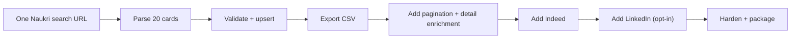
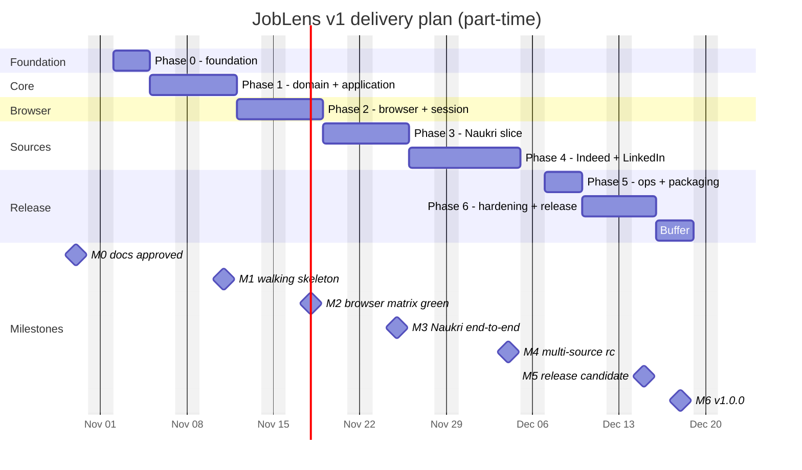

# Gameplan

> **Execution style:** walking skeleton → thin vertical slices → harden.
>
> **Assumption:** one developer (you), part-time, ~5 focused days per week. Full-time would compress this to roughly 3–4 weeks.
>
> **Start:** Monday 2026-11-02 · **v1.0 target:** 2026-12-18 (with a 3-day buffer).

---

## 1. Execution principles

1. **Walking skeleton first.** One real Naukri search page → validated posting → SQLite → CSV before adding a second source or a fancy CLI.
2. **TDD for the core.** Domain rules, URL builders, parsers, and policies are test-first. UI/CLI glue can be test-after.
3. **Vertical slices, not layer-by-layer waterfalls.** Each phase delivers something runnable.
4. **No live scraping in CI.** Fixtures are deterministic; live canaries are manual/nightly and low volume.
5. **Stop-on-wall is a feature.** A clean pause is better than a ban.
6. **One source at a time.** Naukri proves the pipeline; Indeed proves the conservative path; LinkedIn is opt-in.
7. **Demo every week.** If it cannot be demonstrated, it is not done.
8. **YAGNI gate.** Every new abstraction must remove a real duplication or protect a real invariant.

---

## 2. Phase plan

| Phase | Dates | Goal | Key deliverables | Exit criteria |
|---|---|---|---|---|
| **0 — Foundation** | Nov 2–4 (3d) | Make the repo buildable and the decisions explicit. | Solution/projects, SDK pin, CPM, `.editorconfig`, CI skeleton, ADRs 0001–0013, `doctor` stub, application-pattern contracts (Result/Error, options records, specification base), Serilog file logging + global exception skeleton, AOT/trim analyzers + `JobLens.AotSmoke` skeleton. | Clean clone builds + tests green on macOS; CI skeleton green; ADRs accepted; logs land in `artifacts/logs` with retention; AOT smoke publishes. |
| **1 — Domain + Application** | Nov 5–11 (5d) | Model the core without a browser. | Value objects, aggregates, state machines, policies, ports, Result/Error contracts, specification base, `RunScrapeHandler`, fakes. | Domain/application tests pass; architecture tests pass; no Playwright/EF references in Domain/Application. |
| **2 — Browser + Session** | Nov 12–18 (5d) | Make one real browser session safe and observable. | Playwright session factory, persistent profiles, `doctor`, `session login/probe`, challenge detector, artifact capture, E2E fixture server. | Browser matrix smoke green (Chromium/Firefox/WebKit); challenge fixture classified; profile lock handled. |
| **3 — Naukri slice** | Nov 19–25 (5d) | Prove the full pipeline on a real source. | URL builder, parser, native Next pagination, detail enrichment, SQLite repositories, CSV/Excel export, optional Polly HTTP fast-path client. | One page → DB → CSV; then multi-page run; fixture + live canary; caps/challenge handling; HTTP retries/circuit/fallback tested. |
| **4 — Indeed + LinkedIn** | Nov 26–Dec 4 (7d) | Add breadth behind compliance gates. | Indeed adapter, LinkedIn opt-in adapter, contract tests, quota/circuit breaker integration. | Indeed completes or stops gracefully on challenge; LinkedIn refuses without consent, stops on wall with consent. |
| **5 — Ops + packaging** | Dec 7–9 (3d) | Make it usable on all target OSes. | CLI polish, run history, log retention/cleanup, publish scripts, Dockerfile, scheduler examples, runbook. | Publish for osx-arm64/linux-x64/win-x64; fresh-machine setup < 15 min; scheduler example works; disk use bounded. |
| **6 — Hardening + release** | Dec 10–15 (4d) | Prove it survives failure and release it. | Failure injection, wall drills, soak test, security/dependency scan, backup/restore, release notes. | Release checklist complete; no critical vulnerabilities; 10 consecutive fixture runs green; canary documented. |
| **Buffer** | Dec 16–18 (3d) | Absorb slippage. | — | v1.0.0 tagged or a clear slip decision. |

**Total:** ~32 working days + 3-day buffer. The critical path is Phase 2 → Phase 3; domain work can overlap with browser spikes if needed.

> Phase 0 assumes the pre-phase spikes S1–S7 in [Research Analysis §9](01-research-analysis.md#9-spikes-required-before-or-during-phase-02) are scheduled. They are time-boxed and research-only; they do not authorize bypassing a wall.

---

## 3. Timeline

> Dates assume no multi-day blockers. If Phase 2 slips, protect Phase 3 by reducing Naukri scope to one page + no enrichment; do not cut tests or compliance controls.

---

## 4. Week-by-week plan

### Week 1 — Foundation + domain start (Nov 2–6)

| Day | Work | Output |
|---|---|---|
| Mon | Decide name, license, LinkedIn/Indeed policy; create solution/projects/references; `global.json`, CPM, props, editorconfig. | Repo skeleton builds. |
| Tue | CI skeleton; `doctor` stub; review ADRs 0001–0013; architecture test skeleton; AOT analyzer gate. | CI green; architecture rule fails on a deliberate violation (then passes); no reflection/AOT warnings in our code. |
| Wed | Domain value objects: IDs, `SourceKey`, `RunLimits`, `SearchCriteria`; tests first. | 15–25 unit tests. |
| Thu | `SearchProfile`, `JobPosting`, `ScrapeRun` invariants/state machine; tests. | 30–40 unit tests; no I/O. |
| Fri | Application ports + `RunScrapeHandler` skeleton with fakes; weekly demo. | Handler test: fake source → fake repo → run state. |

**Exit:** `dotnet test` green; Domain/Application have no Playwright/EF references; demo shows a run state machine and fake pipeline.

### Week 2 — Domain finish + browser start (Nov 9–13)

| Day | Work | Output |
|---|---|---|
| Mon | `BrowserProfile`, `SourceQuota`, policies (`Politeness`, `Retry`, `Challenge`, `Quota`, `Compliance`); tests. | Policy truth tables green. |
| Tue | Application use cases: bootstrap session, scrape orchestration, enrichment, export contracts; fakes. | Handler tests for success/challenge/cancel/dedupe. |
| Wed | Playwright session factory; persistent context; engine/channel options; profile lock. | Browser launches on macOS; profile persists cookies. |
| Thu | `doctor` + `session login/probe`; install-browsers wrapper; artifact capture. | `doctor` green; manual login flow works. |
| Fri | Challenge detector + fixture pages; E2E fixture server; browser matrix smoke. | Chromium/Firefox/WebKit smoke; challenge classified; demo. |

**Exit:** browser matrix smoke green; no live site needed; challenge fixture produces screenshot/HTML; profile lock error is actionable.

### Week 3 — Naukri walking skeleton (Nov 16–20)

| Day | Work | Output |
|---|---|---|
| Mon | Naukri URL builder + search-page parser with saved HTML fixtures; tests. | 20 synthetic cards parsed. |
| Tue | Browser fetch + wait + visibility/honeypot guards; canonicalization. | Real page (or fixture) parsed; bad cards dropped. |
| Wed | SQLite DbContext/migrations/repositories; upsert by source+external id. | One page → SQLite. |
| Thu | CSV export; run stats/events; `scrape --dry-run`. | One page → CSV; dry-run report. |
| Fri | Native Next pagination + caps; first live canary (1 page, manual). | 2–3 pages; no duplicate page; demo. |

**Exit:** Naukri one-page end-to-end; then 2–3 pages; all fixture tests green; live canary documented.

### Week 4 — Naukri complete + Indeed (Nov 23–27)

| Day | Work | Output |
|---|---|---|
| Mon | Detail enrichment + apply URL + skills; re-validation. | Detail data merged; caps enforced. |
| Tue | Excel export with hyperlinks; export filters; run history. | XLSX opens with clickable titles. |
| Wed | Naukri hardening: challenge flow, cooldowns, quota, circuit breaker. | Challenge drill: run pauses with artifact. |
| Thu | Indeed URL builder/parser/fixtures; Cloudflare challenge fixture. | Indeed fixture parsed; challenge classified. |
| Fri | Indeed live probe (opt-in, 1 page, manual); weekly demo. | Either a page or a clean stop with evidence. |

**Exit:** Naukri end-to-end complete; Indeed fixture + probe done; no retry storm.

### Week 5 — LinkedIn + multi-source (Nov 30–Dec 4)

| Day | Work | Output |
|---|---|---|
| Mon | LinkedIn compliance gate + refusal UX; guest URL builder/parser/fixtures. | Refuses without consent; fixture parsed with consent. |
| Tue | LinkedIn live probe (if approved), 1 page, stop on wall; artifact. | Documented result; adapter fails closed. |
| Wed | Contract tests across all sources; selector fallback logging; data normalization. | All adapters pass shared contract suite. |
| Thu | Quota/circuit breaker end-to-end; cross-source run orchestration. | Multi-source dry-run; quotas respected. |
| Fri | Bug bash, docs update, demo. | Release candidate scope locked. |

**Exit:** three adapters isolated behind contracts; LinkedIn safety proven; multi-source run works or stops correctly.

### Week 6 — Ops + hardening (Dec 7–11)

| Day | Work | Output |
|---|---|---|
| Mon | CLI polish: profiles, runs, export, help, exit codes. | Usable CLI surface. |
| Tue | Publish scripts (3 OS), Dockerfile, scheduler examples. | Self-contained artifacts. |
| Wed | Failure injection: timeouts, 5xx, 403, 429, CAPTCHA, DOM change, DB locked, profile lock. | Failure matrix documented; tests for policies. |
| Thu | Soak test (fixture server, 100 pages), memory/disk check, retention/cleanup. | No leaks; artifacts bounded. |
| Fri | Security/dependency scan, backup/restore drill, docs review. | No critical issues; restore verified. |

**Exit:** ops runbook executable; publish artifacts work on at least macOS + Linux CI; hardening checklist green.

### Week 7 — Release (Dec 14–18)

| Day | Work | Output |
|---|---|---|
| Mon | Release candidate; full regression; canary. | RC tagged. |
| Tue | Fix release blockers only; final docs/changelog. | Release notes. |
| Wed | Release checklist; tag `v1.0.0`; publish artifacts. | v1.0.0. |
| Thu–Fri | Buffer; retrospective; v1.1 backlog. | Retro notes; next plan. |

---

## 5. Backlog (epics and acceptance criteria)

### E0 — Foundation

- **E0-S1** As a developer, I can clone and build on macOS/Linux/Windows.
  - Given a clean machine with .NET 10, when I run `dotnet build`, then it succeeds with warnings as errors.
- **E0-S2** As a developer, I can run unit tests and see a clear result.
  - Given the repo, when I run `dotnet test --filter "Category!=Live&Category!=E2E"`, then all non-live tests pass.
- **E0-S3** As a maintainer, I can see why key decisions were made.
  - ADRs 0001–0013 exist and link from the docs index.
- **E0-S4** As a developer, I can add an application abstraction without reintroducing CQRS/MediatR.
  - The pattern guide and ADR-0011 are linked; the package matrix has no MediatR/CQRS package; the architecture test skeleton names the ban.
- **E0-S5** As a maintainer, I can diagnose a failed run from one structured log.
  - JSON logs rotate daily with 90-day retention; enrichers add process/thread/trace context; cookies and auth headers are absent; `Log.CloseAndFlush()` runs on exit.
- **E0-S6** As a maintainer, I can add code without introducing an AOT-hostile pattern.
  - AOT/trim analyzers are on; no `System.Reflection`, `Activator`, `dynamic`, assembly scanning, reflection JSON/config/validation, or production `Expression.Compile`; `JobLens.AotSmoke` publishes with `PublishAot=true`.

### E1 — Domain

- **E1-S1** As a developer, I can create a valid search profile and reject invalid limits.
- **E1-S2** As a developer, I can transition a run through its lifecycle and reject illegal transitions.
- **E1-S3** As a developer, I can create/refresh a posting without duplicating identity or losing `FirstSeenAt`.
- **E1-S4** As a developer, I can mark a browser profile challenged/healthy and enforce cooldown.
- **E1-S5** As a developer, I can compute pacing, retry, challenge, quota, and compliance decisions with pure policies.

### E2 — Application

- **E2-S1** As an operator, I can run a scrape with a fake source and see persisted postings/run stats.
- **E2-S2** As an operator, a challenge pauses the run and produces an artifact instead of retrying.
- **E2-S3** As an operator, cancellation keeps partial results and marks the run cancelled.
- **E2-S4** As an operator, re-running a page does not duplicate postings.
- **E2-S5** As an operator, quota exhaustion stops the run before the next page/detail.
- **E2-S6** As a developer, expected failures return typed `Result` errors; invariant violations still throw.
  - Given a missing profile or exceeded quota, when the handler runs, then it returns the documented `Error.Code` and does not throw.
- **E2-S7** As a developer, a reusable job filter composes from specifications.
  - Given active/date/source specifications, when the read model queries SQLite, then the expression translates to SQL and returns only matching DTOs.

### E3 — Access/Session

- **E3-S1** As an operator, I can launch a headed persistent browser and log in manually.
- **E3-S2** As an operator, `doctor` tells me if browsers/deps/paths/DB are ready.
- **E3-S3** As an operator, a challenge fixture is classified with evidence and a screenshot.
- **E3-S4** As an operator, two runs cannot use the same profile concurrently.
- **E3-S5** As an operator, I can probe a session without scraping.

### E4 — Naukri

- **E4-S1** As an operator, I can search a keyword/location/experience and get normalized cards.
- **E4-S2** As an operator, I can paginate via the native Next control without losing filters.
- **E4-S3** As an operator, I can enrich details within a cap.
- **E4-S4** As an operator, hidden/honeypot cards are ignored.
- **E4-S5** As an operator, a Naukri wall pauses the run and opens the circuit.

### E5 — Indeed

- **E5-S1** As an operator, I can opt in with an explicit risk acknowledgment.
- **E5-S2** As an operator, I can parse a fixture search page and view job.
- **E5-S3** As an operator, a Cloudflare challenge stops the run with evidence (no bypass).

### E6 — LinkedIn (opt-in)

- **E6-S1** As an operator, the adapter refuses to run without explicit consent and explains why.
- **E6-S2** As an operator, with consent, I can parse a guest search fixture.
- **E6-S3** As an operator, an auth wall/429/999 stops the run immediately; no retries.
- **E6-S4** As a maintainer, I can remove the LinkedIn adapter without touching the core.

### E7 — Persistence/Export

- **E7-S1** As an operator, postings are upserted idempotently in SQLite.
- **E7-S2** As an operator, I can filter/export CSV and Excel with clickable URLs.
- **E7-S3** As an operator, I can see skill-demand counts by company/postings.
- **E7-S4** As an operator, I can back up/restore the DB.

### E8 — CLI/Ops

- **E8-S1** As an operator, I can create/list profiles and run/show runs.
- **E8-S2** As an operator, exit codes distinguish success/challenge/rate-limit/failure.
- **E8-S3** As an operator, I can schedule a run with cron/launchd/Task Scheduler.
- **E8-S4** As an operator, logs/artifacts tell me what happened without reading code.
- **E8-S5** As an operator, I can publish/run self-contained binaries on three OSes.
- **E8-S6** As an operator, logs/artifacts/temp files stay within their retention and disk budget.
  - Cleanup is idempotent, skips the active run, and reports bytes/files freed.

### E9 — Quality/Release

- **E9-S1** As a maintainer, architecture tests enforce the dependency rule and the reflection ban.
- **E9-S2** As a maintainer, coverage gates and mutation spot-checks catch weak tests.
- **E9-S3** As a maintainer, failure drills cover timeout/403/429/CAPTCHA/DOM change/DB lock.
- **E9-S4** As a maintainer, no critical vulnerabilities or secrets are in the release.
- **E9-S5** As a maintainer, the AOT smoke app publishes on macOS/Linux/Windows CI with zero warnings.
  - `JobLens.AotSmoke` covers Domain/Application only; Playwright/EF Core are excluded and documented as vendor exceptions.
- **E9-S5** As a maintainer, v1.0.0 has release notes, runbook, and a rollback plan.

---

## 6. MoSCoW

| Priority | Items |
|---|---|
| **Must** | Foundation, domain, application, browser/session, Naukri, SQLite, CSV/Excel, CLI, caps/challenge handling, logs/artifacts, CI, architecture tests, runbook. |
| **Should** | Indeed opt-in, LinkedIn opt-in with hard gate, run history, diagnostics/doctor, scheduler examples, trace capture, skill analysis. |
| **Could** | Postgres provider, ASP.NET Core API, lightweight dashboard, MCP/agent integration, managed fallback adapter. |
| **Won't (v1)** | Auto-apply, recruiter/profile scraping, CAPTCHA solving, fingerprint spoofing, proxy rotation, account rotation, multi-tenant SaaS, ML ranking. |

---

## 7. Risk register

| ID | Risk | Probability | Impact | Mitigation | Trigger / early warning | Owner |
|---|---|---|---|---|---|---|
| R1 | LinkedIn ToS/legal exposure | High | High | Default disabled; explicit consent; guest-only; legal review; recommend official/manual | Auth wall/999 on first page; legal concern | You |
| R2 | Indeed Cloudflare blocks | High | Medium | Opt-in; very low volume; headed; stop on challenge | Challenge on homepage/first page | You |
| R3 | Naukri Akamai/headless block | Medium | Medium | Headed first; persistent profile; native pagination; optional API flag | Block page or empty results | You |
| R4 | Selector/DOM drift | High | Medium | JSON-LD first; fallback chains; fixtures; canary; adapter isolation | Parse failure rate rises; zero results | You |
| R5 | Browser/OS matrix breakage | Medium | Medium | Pin Playwright; CI matrix; monthly upgrade; Docker | CI E2E fails on one OS | You |
| R6 | Session/profile loss | Medium | Medium | Persistent profiles; backup; re-login flow; lock handling | Auth wall after healthy session | You |
| R7 | SQLite write contention | Low | Low | Single writer; WAL; busy timeout; one run | `database is locked` | You |
| R8 | Scope creep into auto-apply | Medium | High | Explicit non-goals; separate decision; no v1 code paths | New “just one more” feature | You |
| R9 | Flaky live tests | High | Low | Live tests manual/nightly; fixtures in CI | Intermittent CI failures | You |
| R10 | Over-engineering | Medium | Medium | YAGNI gate; vertical slices; no CQRS/MediatR/AutoMapper/microservices | Abstraction without a second use | You |
| R11 | Browser download/install friction | Medium | Medium | `doctor --install-browsers`; Docker fallback; docs per OS | New machine setup > 15 min | You |
| R12 | Data quality (missing fields) | High | Medium | Validation flags; drop bad cards; parse confidence; raw fields kept | High missing-company rate | You |
| R13 | Log/artifact growth fills disk | Medium | Medium | Daily rotation; 90/30-day retention; size caps; `MinimumFreeDiskBytes` | Disk usage rises run over run | You |
| R14 | Socket/handle/browser leaks | Medium | Medium | `IHttpClientFactory`, `await using`, bounded queues, soak test, `dotnet-counters` | Working set/handles grow over 10 runs | You |
| R15 | Vendor AOT incompatibility (Playwright/EF Core) | High | Low | Documented vendor exceptions; isolate; AOT smoke for our code; normal CLR release | AOT smoke or analyzer regression | You |

---

## 8. Decision gates

| Gate | When | Question | Go criteria |
|---|---|---|---|
| **G0** | Before Phase 0 | Is the stack/plan approved? | Open decisions answered; docs accepted. |
| **G1** | End of Phase 1 | Is the domain model sound? | All invariants/state transitions tested; architecture tests pass; no I/O in core. |
| **G2** | End of Phase 2 | Is the browser foundation safe? | Browser matrix smoke; challenge fixture; profile lock; `doctor` green. |
| **G3** | End of Phase 3 | Does Naukri work end-to-end? | One-page + multi-page + export; live canary documented; no retry storm. |
| **G4** | Mid Phase 4 | Are Indeed/LinkedIn safe to expose? | Compliance gate works; challenges stop; legal risk accepted in writing. |
| **G5** | Before release | Is v1.0 shippable? | Release checklist green; no critical vulns; docs/runbook complete. |

---

## 9. Metrics

Track these per run and per phase:

| Metric | Target | Why |
|---|---|---|
| Build/test time | Unit suite < 60s locally | Fast TDD loop. |
| Domain coverage | ≥ 95% line / 90% branch | Core invariants protected. |
| Application coverage | ≥ 90/85 | Orchestration protected. |
| Overall coverage | ≥ 85/80 | Guardrail, not vanity. |
| Flaky E2E rate | < 2% | Deterministic fixtures. |
| Challenge classification | 100% on fixtures | No accidental extraction of block pages. |
| Pages per Naukri run | ≤ 3 (default) | Politeness. |
| Postings per Naukri run | 20–60 | Useful yield without volume. |
| Time to first posting | < 5 min from clone (after install) | Onboarding. |
| Live canary block rate | 0 blocks in controlled runs; any block documented | Safety. |
| Setup time on a clean machine | < 15 min | Operability. |

---

## 10. First 15 commits

A concrete starting sequence for Phase 0–1:

1. `chore: add global.json, Directory.Build.props, Directory.Packages.props`
2. `chore: create solution and layer projects with references`
3. `chore: add editorconfig, gitignore, NuGet.config`
4. `chore: add CI build/test workflow`
5. `test(domain): reject invalid run limits`
6. `feat(domain): add RunLimits value object`
7. `test(domain): parse known source keys and reject unknown`
8. `feat(domain): add SourceKey value object`
9. `test(domain): search profile requires keywords and location-or-remote`
10. `feat(domain): add SearchCriteria and SearchProfile`
11. `test(domain): run cannot complete before persisting`
12. `feat(domain): add ScrapeRun lifecycle`
13. `test(domain): job posting identity is immutable and refresh preserves first-seen`
14. `feat(domain): add JobPosting and JobSkill`
15. `test(architecture): domain must not reference Playwright or EF Core`

Each commit should build and keep the test suite green.

---

## 11. Definition of Ready / Done

### Ready

- Clear user-visible outcome.
- Acceptance criteria (Given/When/Then).
- Test data/fixture or a plan to capture one safely.
- No unresolved compliance question.
- Dependencies available (package/browser/fixture).
- Small enough for ≤ 2 days.

### Done

- Code + tests (unit/contract/integration as applicable).
- `dotnet build -warnaserror` and all non-live tests green.
- Coverage gates met; architecture tests green.
- Docs updated (selector/policy/config/runbook).
- No secrets/PII; structured logs redacted; retention verified.
- No leaked browser/process/file handles; bounded queues and disk checks verified for runtime-sensitive changes.
- Demoed or exercised end-to-end.
- Changelog entry if user-visible.

---

## 12. What would change the plan

| Event | Response |
|---|---|
| LinkedIn legal review says “no” | Ship Naukri + Indeed only; keep the adapter behind a disabled flag or remove it. |
| Indeed challenges on the first page | Keep Indeed opt-in with a documented “not usable from this network” result; do not add bypass. |
| Naukri API fast path is unstable | Drop it; browser-only. |
| Playwright/WebKit breaks on a target OS | Chromium-only production; WebKit diagnostics; document. |
| Phase 2 slips > 3 days | Cut Naukri enrichment from v1.0; ship search+store+export first. |
| A ban occurs in canary | Stop all runs; review caps/session; wait; reduce volume; no workaround. |
| You need an API/dashboard earlier | Add read-only endpoints after Phase 3; do not move scraping into controllers. |

---

## 13. Cadence

- **Daily:** 15-minute plan/review; update the board; note blockers.
- **Weekly:** demo a runnable slice; review metrics; adjust next week.
- **Per phase:** gate review against exit criteria; update ADRs if a decision changes.
- **Post-release:** retrospective; v1.1 backlog; monthly dependency/browser review.

---

## 14. v2 track — Web cockpit

The v1 CLI plan above is unchanged. The first v2.0 deliverable is the **local web cockpit**: a React 19 + Bun 1.4 control plane that commands the .NET API, watches live runs, browses jobs, manages search profiles and sessions, and triggers exports.

| Step | Deliverable | Dependency |
|---|---|---|
| **W0** | Bun/React/Tailwind/shadcn spike; OpenAPI stub incl. Problem Details schemas; SSE proxy; single binary | Can start during Phase 3 |
| **W1** | Shell, dashboard, read-only runs/jobs, health, Problem Details error states, correlation ID display | .NET API contract |
| **W2** | Profiles CRUD, start/cancel/resume, live SSE timeline | API command endpoints |
| **W3** | Sessions, challenge artifacts, exports, diagnostics | API artifacts/exports |
| **W4** | Auth/CSRF/CSP, tests, budgets, packaging | W1–W3 |

Rules:

- The browser never scrapes and never calls a source site; all policy and Playwright work stays in .NET.
- The cockpit is local-first and loopback-only; remote access requires an explicit tunnel/TLS decision.
- No Node.js: Bun owns install, runtime, bundling, tests, formatting, type checking, and compilation.
- v1.0 ships from the CLI regardless of cockpit progress.

Full specification: [Web Cockpit](12-web-cockpit.md) · decision: [ADR-0010](10-adr/0010-react-bun-cockpit.md).
