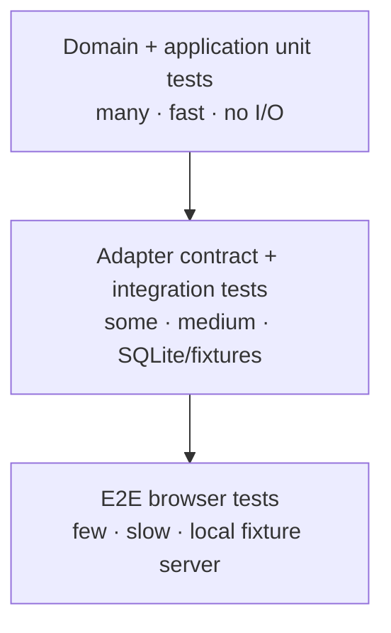
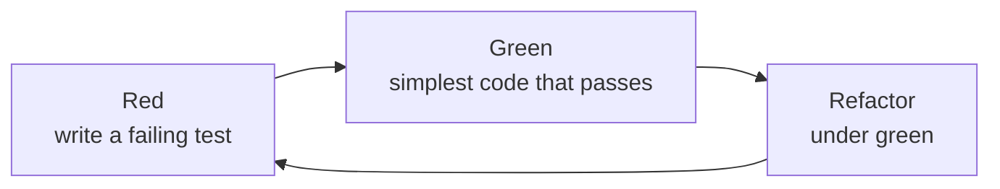
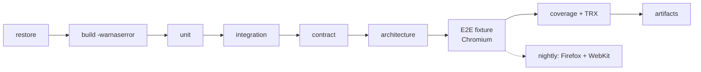

# Testing Strategy

> **Goal:** a fast, trustworthy feedback loop for a browser-heavy system, without making CI depend on live websites.
>
> **Stack:** xUnit.net v3 `4.0.2` · `Microsoft.Playwright.Xunit.v3` `1.64.1` · NSubstitute `6.2.0` · SQLite/EF Core 10 · NetArchTest.

---

## 1. Philosophy

- **TDD for the core.** Domain rules, URL builders, parsers, and policies are written test-first.
- **Test behavior, not implementation.** Assert observable outcomes and invariants, not private method calls.
- **Fast tests by default.** The unit suite should run in under a minute; browser tests are a small, deliberate layer.
- **Deterministic fixtures, not live sites.** CI never scrapes Naukri/LinkedIn/Indeed.
- **Coverage is a guardrail, not a goal.** 100% coverage with weak assertions is worse than 85% with meaningful ones.
- **A flaky test is a bug.** Quarantine, diagnose, fix; do not hide it with blind retries.
- **No secrets/PII in tests.** Fixtures are synthetic or aggressively scrubbed.

---

## 2. The test pyramid



| Level | Scope | Tools | Network | Browser | Target count |
|---|---|---|---|---|---|
| **Domain unit** | Value objects, aggregates, policies, state machines | xUnit, TestKit | No | No | 150–250 |
| **Application unit** | Use-case orchestration, cancellation, quota/challenge decisions | xUnit, NSubstitute, fakes | No | No | 80–120 |
| **CLI contract** | Command/option parsing, validation, exit codes, help | xUnit, System.CommandLine | No | No | 5–10 |
| **Parser/fixture** | URL builders, HTML/JSON-LD parsing, normalization | xUnit, AngleSharp, saved HTML | No | No | 60–100 |
| **Persistence integration** | EF Core mappings, migrations, upsert, indexes | xUnit, SQLite file | No | No | 40–60 |
| **Adapter contract** | Every `IJobSource` behaves consistently | xUnit shared base | No | No | 20–30 |
| **Browser E2E** | Navigation, waits, selectors, pagination, challenge page | `Microsoft.Playwright.Xunit.v3`, local fixture server | Localhost | Yes | 10–20 |
| **Live canary** | Real site sanity, manual/nightly, opt-in | Playwright + real profile | Yes | Yes | 3–5 |

**Rule:** if a test can be written one level lower, do it there.

---

## 3. TDD workflow



### 3.1 Example: `RunLimits`

1. **Red:** write a test that `maxPages = 0` throws.
2. **Green:** add the guard.
3. **Refactor:** extract a helper/constant if the guard repeats.
4. Add tests for upper bounds, `minDelay > maxDelay`, etc.
5. Only then use `RunLimits` in `SearchProfile`.

```csharp
public sealed class RunLimitsTests
{
    [Fact]
    public void Rejects_zero_pages()
    {
        Assert.Throws<DomainException>(() => new RunLimits(
            maxPages: 0,
            maxJobs: 60,
            maxDetails: 60,
            minDelay: TimeSpan.FromSeconds(2),
            maxDelay: TimeSpan.FromSeconds(6)));
    }

    [Fact]
    public void Rejects_min_delay_greater_than_max_delay()
    {
        Assert.Throws<DomainException>(() => new RunLimits(
            maxPages: 3,
            maxJobs: 60,
            maxDetails: 60,
            minDelay: TimeSpan.FromSeconds(10),
            maxDelay: TimeSpan.FromSeconds(5)));
    }
}
```

### 3.2 What to test first

- A pure function with a clear contract.
- A state transition with a guard.
- A parser branch with a real fixture.
- A failure mode that would otherwise be discovered in production (challenge, 429, empty page).
- A bug fix (regression test before the fix).

### 3.3 What not to TDD

- DI registration and `Program.cs` wiring — verify with a smoke test.
- Serilog configuration — verify with a log-capture test if it matters.
- Trivial property getters/setters.
- Third-party library behavior (xUnit, EF Core, Playwright) — test our integration, not theirs.

---

## 4. xUnit.net v3 from zero

### 4.1 Project shape

An xUnit v3 test project is an executable:

```xml
<Project Sdk="Microsoft.NET.Sdk">
  <PropertyGroup>
    <TargetFramework>net10.0</TargetFramework>
    <OutputType>Exe</OutputType>
    <IsPackable>false</IsPackable>
    <IsTestProject>true</IsTestProject>
  </PropertyGroup>

  <ItemGroup>
    <PackageReference Include="xunit.v3" />
    <PackageReference Include="xunit.runner.visualstudio" />
    <PackageReference Include="Microsoft.NET.Test.Sdk" />
  </ItemGroup>
</Project>
```

Versions come from `Directory.Packages.props` (`xunit.v3` 4.0.2, adapter 4.0.1, test SDK 18.11.0).

### 4.2 First test

```csharp
namespace JobLens.Domain.Tests;

public sealed class SourceKeyTests
{
    [Fact]
    public void Parses_known_source_case_insensitively()
    {
        var key = SourceKey.Parse(" NAUKRI ");

        Assert.Equal(SourceKey.Naukri, key);
        Assert.Equal("naukri", key.Value);
    }

    [Fact]
    public void Rejects_unknown_source()
    {
        Assert.Throws<DomainException>(() => SourceKey.Parse("monster"));
    }
}
```

### 4.3 Theories

```csharp
[Theory]
[InlineData("https://www.naukri.com/job-listings-x-123?utm_source=a", "https://www.naukri.com/job-listings-x-123")]
[InlineData("https://www.naukri.com/job-listings-x-123#fragment", "https://www.naukri.com/job-listings-x-123")]
public void Canonicalizer_strips_tracking(string input, string expected)
{
    var actual = UrlCanonicalizer.Canonicalize(input, SourceKey.Naukri);
    Assert.Equal(expected, actual);
}

public static TheoryData<string, SourceKey> BadUrls => new()
{
    { "javascript:alert(1)", SourceKey.Naukri },
    { "https://evil.example/job-listings-x-1", SourceKey.Naukri },
    { "/relative/path", SourceKey.Naukri }
};

[Theory]
[MemberData(nameof(BadUrls))]
public void Canonicalizer_rejects_unsafe_urls(string input, SourceKey source)
{
    Assert.Throws<DomainException>(() => UrlCanonicalizer.Canonicalize(input, source));
}
```

### 4.4 Async tests and cancellation

```csharp
[Fact]
public async Task Run_persists_a_page_before_completing()
{
    var ct = TestContext.Current.CancellationToken;
    var handler = TestKit.CreateRunHandler();

    var result = await handler.HandleAsync(TestKit.Command(), ct);

    Assert.Equal(RunStage.Completed, result.Stage);
    Assert.Equal(20, result.Stats.PostingsFound);
}
```

- Return `Task`/`ValueTask`; **never `async void`** (v3 fast-fails).
- Pass `TestContext.Current.CancellationToken` to downstream calls; xUnit can cancel on timeout/runner shutdown.
- Prefer `Assert.ThrowsAsync<T>` for async exceptions.

### 4.5 Fixtures and lifetimes

| Fixture | Lifetime | Use |
|---|---|---|
| Constructor / `IDisposable` | Per test class instance | Cheap setup. |
| `IAsyncLifetime` | Per test class instance | Async DB/file/browser setup. |
| `IClassFixture<T>` | Shared by one test class | Expensive shared dependency. |
| `ICollectionFixture<T>` | Shared by a collection | Shared browser/server across classes. |
| `[AssemblyFixture]` | Once per test assembly | Browser binary/server started once. |

```csharp
public sealed class DatabaseFixture : IAsyncLifetime
{
    public string DatabasePath { get; } = Path.Combine(
        Path.GetTempPath(), $"joblens-tests-{Guid.NewGuid():N}.db");

    public ValueTask InitializeAsync()
    {
        // create schema/migrations
        return ValueTask.CompletedTask;
    }

    public ValueTask DisposeAsync()
    {
        // dispose connection pool, delete file
        return ValueTask.CompletedTask;
    }
}

[CollectionDefinition("database")]
public sealed class DatabaseCollection : ICollectionFixture<DatabaseFixture>;
```

> In xUnit v3, `IAsyncLifetime.InitializeAsync` and `DisposeAsync` return `ValueTask` and `IAsyncLifetime` inherits `IAsyncDisposable`.

### 4.6 Parallelism

- xUnit runs **test collections** in parallel by default.
- Tests in the same class/collection run sequentially.
- **Disable parallelization for E2E** (`xunit.runner.json`: `parallelizeTestCollections: false`, `maxParallelThreads: 1`).
- Do not share a mutable browser/profile/database across parallel tests.
- Use unique temp paths per test class.

### 4.7 Assertions and skip

```csharp
Assert.Equal(expected, actual);
Assert.Contains("naukri", url, StringComparison.OrdinalIgnoreCase);
Assert.Throws<DomainException>(() => ...);
Assert.Skip("Live browser not configured."); // dynamic skip
```

- Use `[Trait("Category", "Unit")]`, `"Integration"`, `"E2E"`, `"Live"`.
- Use `Assert.SkipWhen(condition, reason)` / `Assert.SkipUnless(...)` for environment-gated tests.
- Avoid custom assertion libraries unless they add real clarity; xUnit's assertions are enough.

### 4.8 Running tests

```bash
# All tests in a project (xUnit v3 executable)
dotnet run --project tests/JobLens.Domain.Tests

# Through VSTest / VS Test Explorer
dotnet test tests/JobLens.Domain.Tests

# Filter by trait/category
dotnet test --filter "Category=Unit"
dotnet test --filter "Category!=Live&Category!=E2E"

# Filter by fully qualified name
dotnet test --filter "FullyQualifiedName~Naukri"

# xUnit v3 native query filter
dotnet run --project tests/JobLens.Domain.Tests -- -filter "class=JobLens.Domain.Tests.RunLimitsTests"
```

> `dotnet test` uses the VSTest adapter; `dotnet run` uses xUnit's in-process runner. Both are supported. Pick one mode for CI and document it.

### 4.9 xUnit v3 gotchas

| Gotcha | Fix |
|---|---|
| Test project is a library | Set `<OutputType>Exe</OutputType>`. |
| Tests not discovered by `dotnet test` | Add `xunit.runner.visualstudio` + `Microsoft.NET.Test.Sdk`. |
| `async void` test | Return `Task`/`ValueTask`; v3 rejects `async void`. |
| `IAsyncLifetime` signature wrong | Use `ValueTask InitializeAsync()` / `ValueTask DisposeAsync()` (v3). |
| Shared browser fails under parallel tests | Disable collection parallelization for E2E; isolate contexts. |
| `DateTime.Now` makes tests flaky | Inject `TimeProvider`; use `FakeTimeProvider`. |
| Random delays make tests slow/flaky | Inject `IRandomSource`; assert bounds, not exact values. |

---

## 5. Playwright from zero

### 5.1 Install

```bash
dotnet build
pwsh src/JobLens.Cli/bin/Debug/net10.0/playwright.ps1 install chromium firefox webkit
```

Or use `joblens doctor --install-browsers` (the CLI wrapper calls `Microsoft.Playwright.Program.Main(["install", ...])`).

### 5.2 Library mode

```csharp
using Microsoft.Playwright;

using var playwright = await Playwright.CreateAsync();

await using var context = await playwright.Chromium.LaunchPersistentContextAsync(
    userDataDir: "artifacts/profiles/naukri/chromium-bundled",
    options: new()
    {
        Headless = false,
        Locale = "en-IN",
        TimezoneId = "Asia/Kolkata",
        ViewportSize = new() { Width = 1366, Height = 768 },
        SlowMo = 40
    });

var page = context.Pages.Count > 0 ? context.Pages[0] : await context.NewPageAsync();
await page.GotoAsync("https://example.com");
await page.GetByRole(AriaRole.Heading, new() { Name = "Example Domain" })
    .WaitForAsync();
```

- `LaunchPersistentContextAsync` keeps cookies/localStorage/IndexedDB in `userDataDir`.
- Only one process may use a user-data dir at a time; enforce a profile lock.
- Use a **separate profile per source** (and per browser/channel if needed).

### 5.3 Locators and auto-wait

```csharp
// Prefer user-visible semantics.
await page.GetByRole(AriaRole.Button, new() { Name = "Next" }).ClickAsync();

// Then test ids / stable attributes.
await page.GetByTestId("job-card").First.WaitForAsync();

// CSS fallback only when the site gives no semantics.
var cards = page.Locator("a[href*='/job-listings-']");
await Expect(cards.First).ToBeVisibleAsync();
```

- Playwright auto-waits for actionability; avoid `WaitForTimeout` except deliberate human pacing.
- Use `Expect(...)` web-first assertions; they retry until the condition or timeout.
- Use `.Filter(new() { Visible = true })` / `.Visible` to avoid hidden honeypots where appropriate.
- Record which selector matched; log it for drift detection.

### 5.4 Tracing and artifacts

```csharp
await context.Tracing.StartAsync(new()
{
    Screenshots = true,
    Snapshots = true,
    Sources = true
});

try
{
    // test/run actions
}
catch
{
    await context.Tracing.StopAsync(new() { Path = "artifacts/runs/.../trace.zip" });
    throw;
}
```

- Capture a screenshot + HTML on challenge/failure.
- Trace files are large; retain on failure, expire with the run.
- Never log cookies/auth headers.

### 5.5 `PageTest` with xUnit v3

```csharp
using Microsoft.Playwright;
using Microsoft.Playwright.Xunit.v3;

namespace JobLens.E2E.Tests;

public sealed class FixtureSmokeTests : PageTest
{
    [Fact]
    public async Task Naukri_like_fixture_renders_cards()
    {
        await Page.GotoAsync("http://127.0.0.1:5099/naukri/search.html");

        await Expect(Page.GetByTestId("job-card")).ToHaveCountAsync(20);
        await Expect(Page.GetByRole(AriaRole.Heading, new() { Name = "Jobs" }))
            .ToBeVisibleAsync();
    }
}
```

- `PageTest` provides `Page`, `Context`, `Browser`, and browser configuration.
- Use `PageTest` for small fixture tests; use a custom `BrowserFixture` when you need a shared persistent context or a specific profile.
- Browser selection can be driven by `BROWSER`/runsettings; for our E2E, use a fixture that launches the requested engine.

### 5.6 Headed vs headless in tests

- CI: headless Chromium for fixture E2E (fast, no display).
- Local debugging: headed (`HEADED=1`) to watch actions.
- Live canary: headed, real profile, manual challenge solve.
- Do not assert that a target site “works headless”; that is not a product requirement and is often false.

### 5.7 Playwright gotchas

| Gotcha | Fix |
|---|---|
| Browser binaries missing | Run `doctor --install-browsers`; pin Playwright version. |
| `WaitForTimeout` everywhere | Use locators/`Expect` with auto-wait; reserve timeouts for pacing. |
| Sharing a context across parallel tests | One context per test; disable parallelization for browser tests. |
| Profile lock | Never run two contexts on the same user-data dir; use a lock + clear error. |
| Flaky selectors | Prefer role/test-id/JSON-LD; fallback chains; fixtures. |
| Trace missing on failure | Start tracing before navigation; stop in `catch`/`finally`. |
| Headless works locally, fails live | Expected; use headed for first contact and stop on challenge. |

---

## 6. Test project layout

```text
tests/
├── JobLens.TestKit/
│   ├── Builders/                 (JobPostingBuilder, SearchProfileBuilder)
│   ├── Fakes/                    (FakeJobSource, FakeClock, FakeRandom)
│   ├── Fixtures/                 (DatabaseFixture, BrowserFixture)
│   └── FixtureServer/            (local static/ASP.NET Core server)
├── JobLens.Domain.Tests/
│   ├── Sourcing/
│   ├── Access/
│   └── Policies/
├── JobLens.Application.Tests/
│   ├── Sourcing/
│   ├── Sessions/
│   └── Reporting/
├── JobLens.Infrastructure.Tests/
│   ├── Parsing/{Naukri,Indeed,LinkedIn}/
│   ├── Persistence/
│   ├── Export/
│   └── Fixtures/{naukri,indeed,linkedin}/
├── JobLens.Architecture.Tests/
├── JobLens.Cli.Tests/
│   ├── Commands/
│   └── ExitCodes/
├── JobLens.AotSmoke/              (Domain/Application only; PublishAot=true)
└── JobLens.E2E.Tests/
    ├── Fixtures/                 (localhost pages)
    └── Browser/
```

### 6.1 Fixtures

- `tests/JobLens.Infrastructure.Tests/Fixtures/{source}/{page}.html`
- Minimal, synthetic HTML that reproduces the structure needed for parsing.
- Do not commit full copyrighted pages; keep the smallest DOM that exercises the parser.
- Scrub names/emails/phones; freeze dates; remove analytics/scripts.
- Store a `README.md` per fixture folder: source, capture date, selector version, known quirks.

### 6.2 Builders

```csharp
var posting = new JobPostingBuilder()
    .WithSource(SourceKey.Naukri)
    .WithExternalId("123456")
    .WithTitle(".NET Developer")
    .WithCompany("Contoso")
    .Build();
```

Builders keep tests readable and make new required fields cheap to add.

### 6.3 Fakes

- **Hand-written fakes** for stateful ports (`IJobSource`, repositories, session).
- **NSubstitute** for interaction assertions (e.g., “artifact store was called once on challenge”).
- Do not mock `DbContext`; use a real SQLite file.
- Do not mock `TimeProvider`; use `FakeTimeProvider`.
- Do not mock `HttpClient` internals; use a fake handler if needed.

---

## 7. Unit test catalog

### 7.1 Domain

- Every value object accepts valid input and rejects invalid input.
- Every aggregate invariant has a test.
- Every state transition has positive + negative tests.
- Every policy has a truth table (including “never retry 403/429/CAPTCHA”).
- Domain events are emitted exactly once per transition.
- `Refresh` preserves identity/`FirstSeenAt`, updates `LastSeenAt`, and only emits when content changes.

### 7.2 Application

- `RunScrapeHandler` with a fake source:
  - happy path persists postings and completes;
  - challenge pauses and captures artifact;
  - rate limit pauses with `RetryAfter`;
  - cancellation keeps partial results;
  - quota exhaustion stops before the next page;
  - duplicate page fingerprint stops pagination;
  - re-run is idempotent.
- `ExportJobsHandler` maps filters and writes the requested format.
- `BootstrapSessionHandler` calls the session port once and records status.
- No handler catches `OperationCanceledException` and continues.

### 7.3 Infrastructure (without browser)

- URL builders for each source.
- JSON-LD parser, DOM parser, normalization, salary/location parsing.
- Challenge classifier with fixture pages.
- EF Core mappings/indexes/upsert.
- CSV/Excel writers (open with ClosedXML and assert cells/hyperlinks).
- Options validation.

### 7.4 CLI

- Required options are enforced with actionable errors.
- Invalid values (bad source, zero pages, unsafe caps) exit with code `2`.
- `scrape` maps run outcomes to the documented exit codes (`0/3/4/5/6/7`).
- `--dry-run` never writes to the database (verify with a fake/spy).
- `--help` lists commands and examples.
- Cancellation maps to `130`.

### 7.5 Application patterns

- **Result:** every handler branch returns `IsSuccess` or the expected `Error.Code`; cancellation still throws; no expected failure is tested through an exception.
- **Options:** invalid caps, `minDelay > maxDelay`, LinkedIn enabled without consent, non-writable paths, zero log retention, and non-positive file-size limits fail validation; `ValidateOnStart` prevents the host from starting.
- **Specifications:** expression boundary cases (compile only in tests); `And`/`Or`/`Not` composition; SQLite integration asserts rows; `ToQueryString()` proves server translation.
- **Problem Details:** each `ErrorKind` maps to the documented status and `application/problem+json`; `code` and `traceId` are present; `500` bodies never contain stack traces, SQL, cookies, or paths; validation errors use request field names.
- **No CQRS/MediatR:** an architecture test (Phase 0) fails if `MediatR` or a banned namespace appears.

### 7.6 Runtime hardening

- **Serilog:** assert structured properties, `CorrelationId`, `TraceId`, and redaction; assert no cookie/authorization value appears in the sink.
- **Global exceptions:** `OperationCanceledException` is not logged as an error; API `500` carries `traceId` and no stack trace; CLI exit codes match the contract.
- **Polly:** fake `HttpMessageHandler`; assert retry counts, `Retry-After`, no retry for POST/4xx, circuit opening, timeout mapping, and fallback flags.
- **Cancellation:** `OperationCanceledException` propagates; no partial artifact remains; partial results are kept where specified.
- **Disposal:** count `DisposeAsync` calls; temp files are gone; SQLite/log/profile handles are released; artifact directory can be deleted on Windows.
- **Disk:** `IDiskSpace` fake returns low space; handler returns `STORAGE_LOW_DISK` before writing.
- **Soak:** 10 fixture runs; bounded file count, stable memory, no orphan browser processes, bounded WAL.
- **Static analysis:** `CA1848`, `CA2000`, `CA2007`, `CA2016`, and `CA1031` are enforced in `.editorconfig`.
- **AOT:** architecture tests ban `System.Reflection`/`Activator`/`dynamic` in Domain/Application; `JobLens.AotSmoke` publishes with `PublishAot=true`; JSON uses `JobLensJsonContext`; options use generated binding; production code never calls `Expression.Compile()`.

---

## 8. Parser tests

### 8.1 Fixture-driven

```csharp
public sealed class NaukriSearchParserTests
{
    [Fact]
    public void Parses_twenty_cards_and_ignores_hidden_honeypot()
    {
        var html = Fixture.Read("naukri/search-2026-10.html");
        var parser = new NaukriSearchPageParser();

        var result = parser.Parse(html, "https://www.naukri.com/jobs?k=c%23");

        Assert.Equal(20, result.Jobs.Count);
        Assert.DoesNotContain(result.Jobs, j => j.Title.Contains("Honeypot"));
        Assert.All(result.Jobs, j => Assert.StartsWith("https://www.naukri.com/", j.Url));
    }
}
```

### 8.2 Cases to cover per source

- Normal page with 20 cards.
- Promoted/sponsored cards with different markup.
- Hidden/aria-hidden/zero-size/off-screen honeypot card.
- Missing company/location/salary.
- Relative URLs, tracking params, fragments.
- Duplicate cards.
- Empty results page (legit vs block page).
- Challenge page (Cloudflare/Akamai/auth wall/429).
- Malformed/truncated HTML.
- Detail page with/without JSON-LD, external apply link.

### 8.3 Snapshot tests (optional)

Use `Verify.XunitV3` for normalized parser output:

- Scrub timestamps, IDs, URLs with random tokens.
- Assert the full DTO shape, not just one field.
- Review snapshot diffs like code.

---

## 9. Adapter contract tests

Define a shared abstract test class; every adapter derives from it.

```csharp
public abstract class JobSourceContractTests
{
    protected abstract IJobSource CreateSource();

    [Fact]
    public void Key_is_lowercase_and_stable()
    {
        var source = CreateSource();
        Assert.Equal(source.Key.Value, source.Key.Value.ToLowerInvariant());
    }

    [Fact]
    public async Task Challenge_fixture_is_never_extracted_as_jobs()
    {
        var source = CreateSource();
        var result = await source.SearchPageAsync(
            TestKit.Context(), TestKit.ChallengeRequest(), CancellationToken.None);

        Assert.Equal(ChallengeKind.SoftChallenge, result.Challenge.Kind);
        Assert.Empty(result.Jobs);
    }

    [Fact]
    public void Capabilities_declare_compliance_and_detail_support()
    {
        var capabilities = CreateSource().Capabilities;
        Assert.NotEqual(ComplianceTier.Unknown, capabilities.Compliance);
    }
}
```

Contract tests must not require a browser or network. Adapters should expose a parser/URL-builder seam that can be tested offline.

---

## 10. Persistence integration tests

- Use a **real SQLite file** per test class (not EF in-memory).
- Apply migrations once; clean tables between tests or use a unique file.
- Test the unique index `(source_key, external_job_id)`.
- Test upsert: insert, refresh, assert one row and updated `last_seen`.
- Test `FirstSeenAt` preservation.
- Test transaction rollback on failure.
- Test `busy_timeout`/WAL behavior with a second connection.
- Test query models (filters, ordering, pagination).
- Test Excel/CSV export reads back correctly (hyperlinks, encoding, columns).

```csharp
[Fact]
public async Task Upsert_is_idempotent_by_source_and_external_id()
{
    await using var db = await TestDatabase.CreateAsync();
    var repo = db.GetRepository<IJobPostingRepository>();
    var posting = JobPostingBuilder.Default().Build();

    await repo.AddAsync(posting, CancellationToken.None);
    await db.UnitOfWork.SaveChangesAsync(CancellationToken.None);

    var again = await repo.FindAsync(posting.Source, posting.ExternalJobId, CancellationToken.None);
    Assert.NotNull(again);
    Assert.Equal(posting.FirstSeenAt, again!.FirstSeenAt);
}
```

---

## 11. Browser E2E with a local fixture server

### 11.1 Why a local server

- Deterministic HTML/CSS/JS.
- No live-site dependency, rate limits, or legal exposure.
- Can simulate pagination, lazy loading, challenge pages, redirects, and slow responses.
- Runs in CI on Linux headless.

### 11.2 Fixture server

- A minimal ASP.NET Core app in `JobLens.E2E.Tests` (preferred, so `JobLens.TestKit` stays dependency-light) serving static pages:
  - `/naukri/search.html`, `/naukri/detail.html`, `/naukri/challenge.html`
  - `/indeed/search.html`, `/indeed/challenge.html`
  - `/linkedin/search.html`, `/linkedin/authwall.html`
- Start once per test assembly on a random port; expose the base URL via a fixture.
- No external network access.

### 11.3 Browser fixture

```csharp
public sealed class BrowserFixture : IAsyncLifetime
{
    private IPlaywright _playwright = null!;
    public IBrowser Browser { get; private set; } = null!;
    public string Engine { get; } = Environment.GetEnvironmentVariable("BROWSER") ?? "chromium";

    public async ValueTask InitializeAsync()
    {
        _playwright = await Playwright.CreateAsync();
        Browser = Engine switch
        {
            "firefox" => await _playwright.Firefox.LaunchAsync(new() { Headless = true }),
            "webkit" => await _playwright.Webkit.LaunchAsync(new() { Headless = true }),
            _ => await _playwright.Chromium.LaunchAsync(new() { Headless = true })
        };
    }

    public async ValueTask DisposeAsync()
    {
        await Browser.DisposeAsync();
        _playwright.Dispose();
    }
}
```

Use `[CollectionDefinition("browser")]` with `ICollectionFixture<BrowserFixture>` and disable parallelization.

### 11.4 E2E cases

- Search page renders 20 cards.
- Pagination click loads the next 20 and updates the range.
- Hidden honeypot card is ignored.
- Detail page extracts description/skills/apply URL.
- Challenge page is classified and no jobs are extracted.
- Slow response/timeout is retried only for transient errors.
- Screenshot/trace captured on failure.
- Cross-browser smoke: Chromium, Firefox, WebKit.

### 11.5 Browser matrix command

```bash
BROWSER=chromium dotnet test tests/JobLens.E2E.Tests
BROWSER=firefox  dotnet test tests/JobLens.E2E.Tests
BROWSER=webkit   dotnet test tests/JobLens.E2E.Tests
```

On Windows/macOS, the same commands work; CI may run only Chromium on every commit and the full matrix nightly.

---

## 12. Live canary tests

- Trait: `[Trait("Category", "Live")]`.
- Explicit opt-in: `JOBLENS_LIVE=1` and a real profile.
- One search page, no persistence, no enrichment.
- Assert only that the page is reachable and at least one card/challenge is classified.
- Stop on challenge; record screenshot/HTML.
- Never run on every commit; run manually or nightly with a human available.
- Live tests are excluded from coverage and release gates.

```csharp
[Fact]
[Trait("Category", "Live")]
public async Task Naukri_public_search_is_reachable_or_reports_a_wall()
{
    Assert.SkipUnless(
        Environment.GetEnvironmentVariable("JOBLENS_LIVE") == "1",
        "Set JOBLENS_LIVE=1 to run live canaries.");

    // launch headed persistent profile, one page, classify, stop.
}
```

---

## 13. Coverage and quality gates

| Scope | Line | Branch | Rationale |
|---|---|---|---|
| Domain | ≥ 95% | ≥ 90% | Invariants/state machines are cheap to test and expensive to get wrong. |
| Application | ≥ 90% | ≥ 85% | Orchestration and failure paths. |
| Infrastructure | ≥ 70% | ≥ 60% | Parsers/repositories; browser glue excluded where appropriate. |
| CLI | ≥ 70% | ≥ 60% | Command parsing, validation, exit-code mapping. |
| Overall | ≥ 85% | ≥ 80% | Guardrail, not a target. |
| E2E | Not counted | Not counted | Browser tests are behavioral, not line coverage. |

```bash
dotnet test --collect:"XPlat Code Coverage" \
  --results-directory artifacts/coverage
```

- Exclude generated migrations, `Program.cs`, and trivial DTOs from coverage with documented filters.
- Mutation testing (Stryker.NET) is optional for Domain; run on a schedule, not every commit.
- A coverage drop > 2% requires a justification in the PR.

---

## 14. CI pipeline



- Linux job: all non-live tests + E2E Chromium.
- Windows/macOS job: build + unit/integration/architecture; E2E smoke.
- Nightly: full browser matrix + optional live canary (manual approval).
- Upload TRX, coverage, screenshots/traces on failure.
- Cache NuGet and Playwright browsers by version.
- No secrets in CI logs.

---

## 15. Flaky test policy

1. **Do not add blind retries.** A retry hides a race or a bad selector.
2. Reproduce locally with the same browser/version.
3. Capture a trace/screenshot; inspect the DOM snapshot.
4. Fix the root cause (locator, wait, fixture, isolation).
5. If it cannot be fixed immediately, quarantine with `[Trait("Quarantined", "true")]`, an owner, and an expiry date.
6. A quarantined test cannot count toward release gates.
7. Review flaky tests weekly; delete tests that no longer protect a behavior.

---

## 16. Test data and privacy

- No real LinkedIn/Naukri profiles, emails, phone numbers, or cookies.
- Fixtures are synthetic/minimal; do not commit full copyrighted pages.
- Scrub timestamps/IDs in snapshots.
- Use fake names like “Contoso” and synthetic job IDs.
- Keep browser profiles out of git and out of test artifacts shared in CI.
- If a real page is needed for debugging, store it locally and delete after extracting the minimal fixture.

---

## 17. Commands cheat sheet

```bash
# Build
dotnet build -warnaserror

# All non-live tests
dotnet test --filter "Category!=Live&Category!=E2E"

# Unit only
dotnet test --filter "Category=Unit"

# One project / one class
dotnet test tests/JobLens.Domain.Tests
dotnet test tests/JobLens.Cli.Tests
dotnet test --filter "FullyQualifiedName~RunLimitsTests"

# xUnit v3 native runner
dotnet run --project tests/JobLens.Domain.Tests

# E2E (headless Chromium)
dotnet test tests/JobLens.E2E.Tests

# E2E Firefox / WebKit
BROWSER=firefox dotnet test tests/JobLens.E2E.Tests
BROWSER=webkit dotnet test tests/JobLens.E2E.Tests

# Coverage
dotnet test --collect:"XPlat Code Coverage" --results-directory artifacts/coverage

# Vulnerable packages
dotnet list package --vulnerable --include-transitive

# Format
dotnet format --verify-no-changes
```

---

## 18. Definition of a good test

- **Fast** — unit tests run in milliseconds; no sleeps.
- **Isolated** — no shared mutable state, no order dependency.
- **Repeatable** — same result every run, every machine.
- **Self-validating** — clear pass/fail; no manual inspection.
- **Timely** — written with (or before) the behavior.
- **Behavioral** — asserts what the user/system observes, not private details.
- **Diagnostic** — failure message tells you what was expected and actual.

---

## 19. Common mistakes to avoid

| Mistake | Why it hurts | Do instead |
|---|---|---|
| `async void` tests | xUnit v3 fast-fails; exceptions are lost. | Return `Task`/`ValueTask`. |
| `Thread.Sleep`/`WaitForTimeout` everywhere | Slow and flaky. | Use `Expect`/locators; reserve delays for pacing. |
| Shared browser across parallel tests | Cross-test interference. | One context per test; disable parallelization for E2E. |
| Mocking `DbContext` | Tests a fake, not SQLite behavior. | Real SQLite file per test class. |
| `DateTime.Now` | Non-deterministic. | `TimeProvider`/`FakeTimeProvider`. |
| `new Random()` | Non-deterministic. | `IRandomSource` fake. |
| Live sites in CI | Flaky, rate-limited, legal risk. | Local fixture server. |
| 100% coverage obsession | Slow, brittle, low-value tests. | Risk-based gates + mutation spot checks. |
| Asserting exact HTML | Breaks on every markup change. | Assert typed DTO fields and invariants. |
| No challenge tests | The worst failure mode is untested. | Fixture for each wall type; assert no extraction. |
| Retrying 403/429 in tests | Hides the policy bug. | Assert “no retry” explicitly. |
