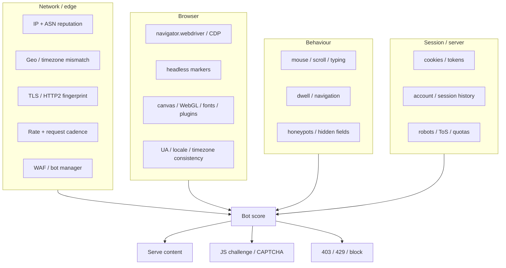
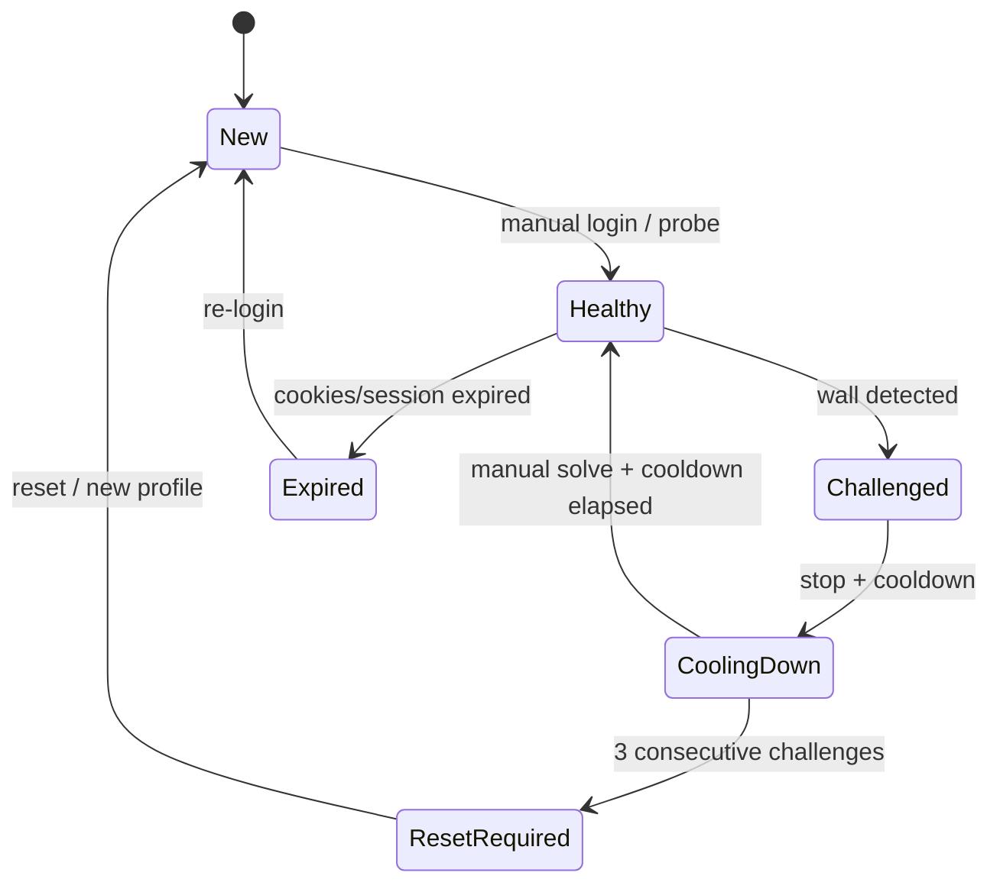
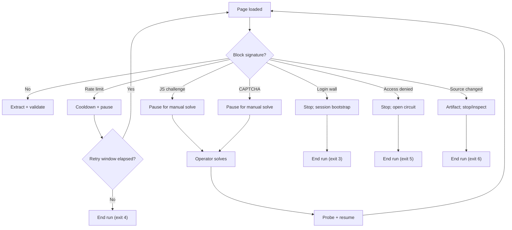
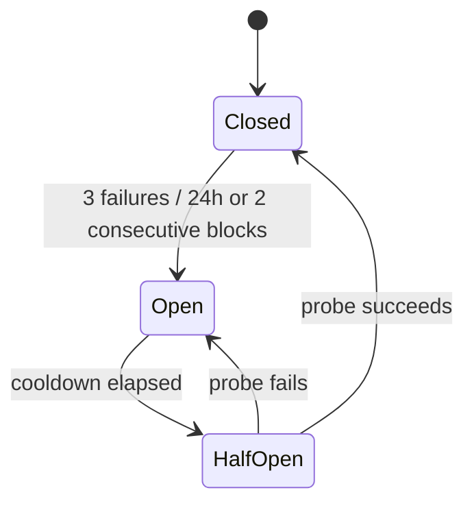

# Anti-Bot & Compliance

> **The honest goal:** stay **low-signal, consistent, polite, and willing to stop**. Do not chase an “undetectable” or “100% human” verdict.
>
> **Hard rule:** if a site presents a CAPTCHA, JS challenge, auth wall, 403, or 429, we **stop, capture evidence, cool down, and require a human**. We do not defeat access controls.

---

## 1. Why this document exists

The old Python project's anti-bot work is the most valuable thing to carry forward — not its code, but its **measurements and discipline**:

- Headed, persistent Chromium is materially lower-signal than headless.
- Consistency (genuine UA, locale, timezone, plugins) beats spoofing.
- CDP, TLS, IP reputation, and behaviour remain detectable.
- A wall is a stop signal, not a retry signal.

JobLens turns those lessons into **policy, tests, and guardrails** rather than a collection of ad-hoc sleeps.

---

## 2. What “anti-bot” means here

| We do | We do not do |
|---|---|
| Use a real headed browser and persistent profile. | Spoof `navigator`, plugins, WebGL, canvas, or languages. |
| Keep locale/timezone/viewport consistent with the network. | Pin a stale user agent or fake a browser version. |
| Pace requests and cap volume. | Rotate proxies/accounts to evade a ban. |
| Detect walls and stop. | Solve CAPTCHAs or use CAPTCHA farms. |
| Capture evidence and measure. | Retry 403/429/challenge responses. |
| Prefer official APIs/manual export where available. | Bypass auth/paywalls or scrape private data. |

**Terminology:** “anti-bot” in this project means **anti-ban by being a good citizen**, not “anti-detection” by deception.

---

## 3. Threat model: what the site can see



### 3.1 Detection surface matrix

| Layer | Signals | Can we influence it legitimately? | JobLens posture |
|---|---|---|---|
| **IP/ASN** | Residential vs datacenter, reputation, geo, rate | Partially: use a normal network; optional static egress | Default: user's normal network. No rotation pools. |
| **TLS/HTTP2** | JA3/JA4, header order, HTTP/2 settings | No, if using a real browser | Use the real browser's stack; no HTTP impersonation on the browser path. |
| **Browser** | `navigator.webdriver`, CDP artifacts, headless markers, plugins, WebGL, canvas, fonts, permissions | Partially: use a genuine headed browser; keep consistency | Headed first; no UA/JS spoofing; persistent profile. |
| **Behaviour** | Mouse, scroll, typing, dwell, navigation order | Yes | Human pacing, scrolling, one tab, low volume. |
| **Session** | Cookies, login history, challenge tokens | Yes | Persistent profile, warm-up, manual solve, cooldown. |
| **Server** | WAF rules, rate limits, robots/ToS, honeypots | Partially | Caps, robots review, stop-on-wall, no hidden-element clicks. |
| **Content** | Honeypot links/fields/forms | Yes | Visibility/size/aria/off-screen guards; never click hidden traps. |

The detection surface above feeds `ChallengeDetector` (§9.3); its output is a `ChallengeAssessment` with evidence, never an evasion action.

**Residual risk:** CDP is inherent to any automation driver; commercial bot systems can still score the browser. TLS/network/behaviour remain. That is accepted — the goal is not a perfect score, it is not getting banned.

---

## 4. What the old project measured

The Python project ran public diagnostics against headed and headless Playwright Chromium on this Mac (2026-09/10). The results are the evidence base for JobLens policy:

| Diagnostic | Headed result | Headless result | What it means |
|---|---|---|---|
| FingerprintJS BotD | `{"bot": false}` | `{"bot": true, "botKind": "headless_chrome"}` | Headed is low-signal; headless is explicitly flagged. |
| BrowserScan | **100** after removing UA/language stubs | Lower | Consistency fixes worked better than spoofing. |
| CreepJS | Trust **93/100**, “no automation indicator” | — | CDP remains; not invisible. |
| Iphey | MX 90; one tripwire **`hasCDP: true`** | — | CDP is inherent. |
| Sannysoft | All rows green | Headless markers fire | Genuine headed browser is better. |
| DeviceAndBrowserInfo | Bot on CDP/timing/worker only | — | No classic flags; CDP/timing remain. |
| Naukri | Works headed | Blocked | Headed first contact is required. |

### 4.1 The most important legacy finding

A previous “stealth” init script was **inert**: it was a bare arrow-function string passed to `add_init_script`, so Playwright never called it. The headed run proved it — plugins were the genuine 5, not the script's stubbed 3. The fix was **deletion**, not “fixing” the stubs.

Had the script run, it would have made the browser **more** detectable:

- `navigator.webdriver` would be `undefined` instead of `false`.
- `navigator.plugins` would be a plain `Array`, failing `instanceof PluginArray`.
- Permissions API values would be inconsistent (`default` vs `prompt`).

**Policy:** no fingerprint spoofing, no stealth init scripts, no patched navigator objects. Use the real browser and keep it consistent.

---

## 5. Keep / change / drop from the legacy project

| Legacy choice | Keep? | JobLens design |
|---|---|---|
| Persistent Chromium profile | **Yes** | Persistent context per source/profile; owner-only permissions; profile lock. |
| Headed first contact | **Yes** | Default headed for live collection; headless is for fixture E2E/diagnostics only. |
| Genuine UA (no override) | **Yes** | Enforced by design: no UA option in config. |
| Locale/timezone consistency | **Yes** | Validated against config; `en-IN` / `Asia/Kolkata` defaults. |
| Human pauses/scrolls/mouse | **Yes** | `HumanPacing` with injected randomness; bounded and testable. |
| Honeypot-safe extraction | **Yes** | Visibility/size/aria/off-screen guards; never click hidden elements. |
| Manual solve on wall | **Yes** | Pause + prompt + artifact; unattended runs exit with code 3. |
| Transient-only retries | **Yes** | Retry only timeouts/5xx; never 403/429/CAPTCHA. |
| One pass at a time | **Yes** | Global semaphore + per-profile lock. |
| No proxy rotation | **Yes** | Optional static egress only; no pools. |
| No CAPTCHA solving | **Yes** | Hard rule, no code path. |
| uBlock Origin Lite | **Optional** | Cuts tracker weight but adds an installed-extension signal. Default off; headed Chromium only, opt-in and measure (§5.1). |
| Chrome-only stack | **No** | Chromium default; Firefox/WebKit compatibility. |
| UA pinning / language stubs | **No** | Never. |

### 5.1 uBlock Origin Lite (opt-in, headed only)

The blocker trims ad and tracker weight from scrapes. It also adds an
installed-extension signal, so it stays off unless measurement says it
earns its place.

Measure before keeping it. Run the same pages with and without the
blocker and compare `time_to_first_posting`, `parse_failure_rate`, and
`challenge_rate`. Keep it only when scrapes get faster with no worse
challenge rate.

Install steps:

1. Run `./vendor/download-ubol.sh`. It fetches the pinned uBOLite
   release and builds `vendor/ubol-chrome-max` with maximum filtering.
2. Keep the committed `appsettings.json` at `AdblockMode: null`. Add a
   gitignored `src/backend/JobScrape.Api/appsettings.Local.json` with
   `"Browser": {"AdblockMode": "ubol-max",
   "ExtensionDir": "../../../vendor/ubol-chrome-max"}`. The API loads
   that file when present, so a fresh clone starts without the blocker
   and a developer can opt in locally. `ExtensionDir` resolves against the API
   content root (`src/backend/JobScrape.Api`); `../../../` is the repo
   root. An absolute path also works.
3. Launch headed Chromium with the bundled channel. Headless, Firefox,
   and WebKit launches ignore the setting. A set mode with a missing
   directory fails startup and names the script; a directory lost
   mid-run logs once and launches without the blocker.
| Inert stealth init script | **No** | Removed permanently. |

---

## 6. Browser hygiene standard

### 6.1 Launch defaults

| Setting | Default | Rule |
|---|---|---|
| Engine | Chromium | Firefox/WebKit for compatibility/diagnostics. |
| Channel | Bundled Chromium | `chrome`/`msedge` only when installed and verified. |
| Headless | `false` | Headless is for fixture E2E/diagnostics; do not use it for live collection. |
| User agent | Browser's genuine UA | **No override.** |
| Locale | `en-IN` | Match the network/region; one value across context. |
| Timezone | `Asia/Kolkata` | Match locale/egress; one value across context. |
| Viewport | `1366x768` or `1440x900` | Realistic desktop; consistent within a profile. |
| SlowMo | `40ms` | Helps human pacing/debugging; not a stealth feature. |
| Extensions | None | Optional tracker blocker only after measurement. |
| Proxy | `null` | Optional user-supplied static egress; no rotation. |
| Downloads | Disabled/controlled | Do not auto-open files. |
| Permissions | Deny by default | Grant only what a page needs; never blanket-allow. |

### 6.2 What never changes per request

- User agent, platform, locale, timezone, viewport, device scale factor.
- Browser engine/channel and profile directory.
- Network egress (unless the operator deliberately changes it between runs).

**Consistency is the point.** A stable identity is less suspicious than a browser that changes its story every page.

### 6.3 Profile isolation

```text
artifacts/profiles/
  naukri/
    chromium-bundled/
    chrome-stable/          (optional)
  indeed/
    chromium-bundled/
  linkedin/
    chromium-bundled/       (only if explicitly enabled)
```

- One profile per source (per engine/channel if needed).
- Never share a profile between sources.
- Never commit profiles; they contain cookies/session tokens.
- On Unix, set `0700` on profile directories.
- Backups are encrypted; profile restore is a manual operation.

---

## 7. Session lifecycle



### 7.1 First contact

1. Run `joblens session login --source <key> --browser-profile <name>`.
2. Browser opens **headed** with the persistent profile.
3. Operator logs in / solves a challenge manually if required.
4. CLI verifies a known-good page (no wall, expected content).
5. Profile is marked `Healthy`; live runs reuse it **headed**.

### 7.2 Warm-up

- Navigate to the site's home page, pause, scroll once, then go to search.
- This is not a trick; it is how a normal user arrives and it establishes cookies.
- Do not warm up with a deep link only.

### 7.3 Cooldowns

| Event | Cooldown | Next step |
|---|---|---|
| 429 with `Retry-After` | At least the stated delay; default 30–60 min | Retry one page after cooldown. |
| JS challenge / CAPTCHA | 45–60 min | Manual solve, then probe. |
| Repeated challenge (2nd) | 24 hours | Reduce caps; review session. |
| 3rd consecutive challenge | 7 days / disable source | Reset profile or stop using the source. |
| 403/access denied | 24 hours minimum | Do not retry; review IP/session. |

### 7.4 Profile reset

- `ResetRequired` cannot launch.
- Operator creates a new profile or explicitly resets the old one.
- Do not delete a profile to “get around” a block; that is evasion with extra steps.

---

## 8. Pacing and quotas

### 8.1 Starting defaults

| Source | Min/max delay | Pages/run | Jobs/run | Details/run | Pages/day | Details/day | Runs/day | First contact |
|---|---:|---:|---:|---:|---:|---:|---:|---|
| **Naukri** | 2.5–6.0s | 3 (ceiling 1000) | 60 (ceiling 20000) | 60 | 1000 | 60 | no cap | Headed |
| **Indeed** | 12–25s | 2 | 40 | 30 | 12 | 30 | 1 | Headed |
| **LinkedIn** | 10–20s | 1 | 25 | 8 | 4 | 8 | 1 | Headed + consent |

The Naukri ceilings are the highest a profile may request, not the recommended run size. Keep the starting volume unless a larger export is worth the extra risk.

**Global rules**

- One request at a time per source.
- One run at a time globally.
- No parallel tabs against the same source.
- No retry of 403/429/challenge.
- Jitter every delay; do not use a fixed cadence.
- These are **ceilings**, not targets. Lower them when a site pushes back.

### 8.2 Why these numbers

- Naukri's old project used 2–5s and 3 pages/60 jobs successfully; the new default is slightly more conservative.
- Indeed's Cloudflare layer is sensitive; 12–25s and 1–2 pages is a cautious starting point.
- LinkedIn's auth wall/rate limits appear quickly; one page and a handful of details is the maximum responsible default.

### 8.3 Human behaviour

- Scroll before extracting (lazy loading and natural reading).
- Move the mouse occasionally; do not teleport/click in a perfect grid.
- Type with a small delay; do not paste huge strings into search boxes.
- Dwell briefly on detail pages.
- Stop when the run has enough data; do not “just one more page”.

> These behaviours improve reliability and reduce load; they are not a promise of humanity.

---

## 9. Challenge classification and response

### 9.1 Kinds

| Kind | Typical signals | Automatic action | Retry? | Operator action |
|---|---|---|---|---|
| `None` | Expected content, no block text | Continue | — | — |
| `RateLimited` | 429, LinkedIn 999, `Retry-After` | Pause until delay; record quota | Only after delay | Wait; lower caps |
| `SoftChallenge` | Cloudflare “Just a moment”, Akamai JS challenge, “checking your browser” | Pause; capture screenshot/HTML/trace | **No** | Open headed browser, solve, resume |
| `Captcha` | reCAPTCHA/hCaptcha/Turnstile/visible CAPTCHA | Pause; capture | **No** | Manual solve or abort |
| `LoginRequired` | `authwall`, `checkpoint`, login modal | Stop | **No** | `session login` |
| `AccessDenied` | 403, “Access Denied”, block page | Open circuit; stop | **No** | Review IP/session; wait |
| `SourceChanged` | Empty results, missing known markers, parse failure | Capture; mark degraded | **No** | Update parser/fixtures; canary |
| `TransientError` | Timeout, reset, 5xx | Retry max 2 with backoff | **Yes** | None |

### 9.2 Response flow



### 9.3 Classification rules

- Check **HTTP status** first (429/403/5xx).
- Check **URL** for `authwall`, `checkpoint`, `captcha`, `challenge`, `errors.edgesuite.net`.
- Check **title/body** for known wall text (“verify you are human”, “unusual traffic”, “access denied”, “just a moment”).
- Check **DOM** for CAPTCHA iframes/widgets and challenge scripts.
- Confirm it is a wall: visible block text **and** absence of expected job anchors.
- Never classify a normal empty result as a challenge without evidence; use `SourceChanged` instead.
- Every classification includes `Evidence` (status/URL/snippet) and a confidence score.

---

## 10. Backoff and circuit breaker

### 10.1 Backoff

```text
delay = min(base * 2^attempt, max) + jitter
base  = 2 seconds
max   = 60 seconds
jitter = 0..20% of delay
```

- Honor `Retry-After` when larger.
- Max 2 attempts for transient errors.
- Never apply backoff as a way to “wait out” a CAPTCHA/challenge; those require a human.
- Log the delay and reason.

### 10.2 Circuit breaker (per source)



- **Closed:** normal runs.
- **Open:** refuse runs for the source; `scrape` exits with code 5 and explains why.
- **Half-open:** one probe page, no enrichment, manual approval in interactive mode.
- Cooldowns: 60 min (rate limit), 24 h (challenge), 7 days (repeated block).
- State is persisted per source, not per profile, so a new profile cannot bypass a source-level block.
- A successful probe closes the breaker; a failed probe reopens it.

---

## 11. Diagnostics and measurement

### 11.1 `doctor`

Checks:

- .NET SDK/runtime version.
- OS/browser support.
- Playwright browsers installed and versions.
- Linux dependencies (if applicable).
- Profile/data/log directories writable and permissions.
- SQLite open/migrate/backup readiness.
- Pending migrations.
- Config validity and compliance gates.
- Optional: network reachability (HEAD request only, no scraping).

### 11.2 `session probe`

- Launch the configured profile **headed** for live sources; headless is only for fixture/diagnostic profiles.
- Navigate to the source home page, not a deep search.
- Classify the page; capture screenshot/HTML if challenged.
- Record session state; never extract job data during a probe.

### 11.3 Public diagnostic sites (optional)

The old project used FingerprintJS BotD, BrowserScan, Sannysoft, CreepJS, Iphey, Pixelscan, and similar tools. They are useful for **measuring exposure**, not for “passing” a test.

Rules:

- Compare headed vs headless, and normal browser vs automated browser.
- Record the delta; do not tune to a “human” verdict.
- Do not add scripts/packages to make a diagnostic green.
- Re-run after Playwright/browser upgrades; results drift.
- Do not run diagnostics during a production scrape.

### 11.4 Metrics

| Metric | Definition | Alert |
|---|---|---|
| `challenge_rate` | challenged pages / total pages | > 20% over 10 runs |
| `block_rate` | 403/429/authwall / total pages | any 2 consecutive blocks |
| `parse_failure_rate` | pages with zero/partial parses / total | > 10% |
| `retry_rate` | retries / requests | > 10% |
| `pages_per_run` | fetched pages / run | near cap repeatedly |
| `postings_per_run` | valid postings / run | sudden 0 for 3 runs |
| `session_age_days` | days since profile verified | > 30 days, probe |
| `time_to_first_posting` | start → first valid posting | > 5 min |
| `zero_result_streak` | consecutive runs with 0 postings | 3 |

- Log metrics with `RunId`/`Source`.
- Keep a weekly summary; review before raising caps.
- Any block/challenge is a **stop-and-review** event, not just a metric.

---

## 12. Compliance and legal findings

> **Not legal advice.** Review with counsel before enabling LinkedIn/Indeed beyond personal, low-volume use. Terms change; re-check quarterly.

### 12.1 robots.txt summary (fetched 2026-10-29)

| Site | What the file says | Engineering interpretation |
|---|---|---|
| **Naukri** | Blocks AI crawlers (GPTBot, Claude, Perplexity, etc.); disallows specific paths (`/advertiser/`, `/preview/`, `/photo/`, etc.); `/jobs` is not blanket-disallowed for `*`. | Public search pages are technically crawlable per robots, but the **Terms of Service still apply**. Low-volume personal use only. |
| **LinkedIn** | Opens with: *“The use of robots or other automated means to access LinkedIn without the express permission of LinkedIn is strictly prohibited.”* Disallows many paths; crawling permission is a separate process. | **Automated access is prohibited without permission.** Highest risk. Default disabled. |
| **Indeed** | Allows many `/jobs` and `/viewjob` paths; disallows `/graphql`, `/job/`, `/api/fetch/mc-anon`, `/api/getrecjobs`, etc. | Many public pages are robots-allowed, but Cloudflare/ToS still restrict. Very low volume; no private GraphQL. |

### 12.2 LinkedIn

- User Agreement prohibits scraping, crawling, and automated data collection without permission.
- There is no general public jobs API for this use case; partner APIs require an agreement.
- Login automation and account rotation increase account risk and are explicitly out of policy.
- **Decision:** LinkedIn is `HighRisk`, disabled by default. The adapter requires an explicit acknowledgment and remains guest-only, one page, stop-on-wall. The recommended alternative is official/manual export.

### 12.3 Naukri

- Public search/detail pages are the access path.
- Akamai may challenge unknown/headless sessions; a persistent headed profile is the best case.
- Do not use the private search API as a way around a wall; it is an optional fast path only if it is stable and compliant.
- Low volume, personal use, no resale.

### 12.4 Indeed

- Cloudflare/anti-bot is an access control; do not bypass it.
- Do not call private GraphQL/mobile endpoints; robots disallows `/graphql` and several `/api/` paths.
- If the homepage challenges, stop; try later from a normal network; do not rotate proxies.

### 12.5 Data minimization and privacy

- v1 collects **job postings only**: title, company, location, salary, description, skills, URLs.
- Do **not** extract recruiter names, emails, phone numbers, profiles, or application answers.
- Job descriptions may contain personal data; treat the database as personal data:
  - Store only what is needed.
  - Restrict access to the local user.
  - Retain artifacts 30 days, logs 90 days, postings 180 days by default (configurable).
  - Support deletion/export of local data.
- If you later add recruiter/contact data, do a DPDP Act 2023 / GDPR assessment first.
- No resale, redistribution, or public posting of scraped data.

### 12.6 Fair use checklist

Before enabling a source:

- [ ] I have read the current Terms of Service and robots.txt.
- [ ] I am collecting public job postings for personal use.
- [ ] I will not resell or redistribute the data.
- [ ] I will not bypass a CAPTCHA/login/paywall.
- [ ] I will keep the configured caps and stop on a wall.
- [ ] I will not run parallel workers or multiple accounts.
- [ ] I understand the account/IP risk and accept it.
- [ ] For LinkedIn: I have explicit approval/acknowledgment and a fallback plan.

---

## 13. Source risk tiers and gates

| Tier | Sources | Default | Gate |
|---|---|---|---|
| **Standard** | Naukri | Enabled | Normal config + caps. |
| **Restricted** | Indeed | Disabled | `AcknowledgeSourceRisk=true`; very low caps; stop-on-wall. |
| **HighRisk** | LinkedIn | Disabled | `AcknowledgeSourceRisk=true` + `AllowHighRiskSources=true` + interactive confirmation; guest-only; legal review recommended. |

The gate is enforced in `CompliancePolicy` **and** at CLI startup. A config flag alone is not enough; the operator must confirm interactively for HighRisk sources.

---

## 14. What we will not build (hard exclusions)

- CAPTCHA solving, CAPTCHA farms, or paid solving services.
- Fingerprint spoofing / “undetected” browser patches / stealth plugins that lie.
- Account rotation, fake accounts, or profile farming.
- Proxy rotation, datacenter proxy pools, or IP evasion.
- Auth-wall, paywall, login, or rate-limit bypass.
- TLS/JA3 impersonation on the browser path.
- Retry loops against 403/429/CAPTCHA.
- Auto-apply, mass messaging, recruiter/profile harvesting.
- Resale/redistribution of scraped data.

If a requirement needs any of these, the answer is **no** or **re-scope with an official API/partner**.

---

## 15. Incident runbook

### 15.1 Challenge / CAPTCHA

1. **Stop.** Do not reload or retry.
2. Confirm the artifact exists (screenshot, HTML, trace, URL, title).
3. Classify (`SoftChallenge`, `Captcha`, `LoginRequired`, etc.).
4. If interactive: open the headed browser, solve manually, run `session probe`, resume.
5. If unattended: mark `PausedForChallenge`, exit code 3; do not auto-retry.
6. Cooldown 45–60 min; if repeated, 24 h; if 3rd, 7 days/disable.
7. Reduce caps before the next run.
8. Review the classifier/fixture if it was a false negative/positive.

### 15.2 429 / rate limit

1. Stop the run; honor `Retry-After`.
2. Record the source/page/endpoint.
3. Wait at least the delay; default 30–60 min.
4. Reduce pages and details per day. If the source has no run cap, set `DailyRunCap` and remove `UnlimitedRunCap` before resuming.
5. Resume with one page; if 429 again, open the circuit for 24 h.

### 15.3 Account restriction / login wall

1. Stop all runs for that source.
2. Do not create another account or use a different profile to bypass.
3. Review the account/session; follow the site's appeal process if applicable.
4. Wait; resume only after a manual login and probe.
5. Document the event; consider disabling the source.

### 15.4 IP block / access denied

1. Stop; do not rotate proxies.
2. Wait 24 h; use a normal network later.
3. If it persists, disable the source; do not build a bypass.
4. Review whether the volume/cadence was too high.

### 15.5 Source changed / parse failure

1. Stop after the threshold (e.g., 3 consecutive parse failures).
2. Save the HTML/screenshot.
3. Build a minimal fixture; update the parser/selector chain.
4. Add/adjust contract tests.
5. Run a one-page canary; update the fixture README.
6. Do not “fix” by scraping harder.

---

## 16. Review cadence

| Cadence | Review |
|---|---|
| **Every run** | Challenge metrics, parse failures, quota, run duration. |
| **Weekly** | Caps, block/challenge rate, zero-result streak, artifact size. |
| **Monthly** | Playwright/browser updates, dependency updates, selector health, session age. |
| **Quarterly** | Terms/robots re-check, legal review, source risk tiers, data retention. |
| **After any wall/ban** | Incident runbook, caps, session, selectors, docs. |

---

## 17. References

- Legacy measurements: `/Users/aslamshaikh/Projects/PythonWebScraping/docs/BOT_DETECTION.md`
- Legacy launcher: `/Users/aslamshaikh/Projects/PythonWebScraping/src/stealth_browser.py`
- Naukri robots: <https://www.naukri.com/robots.txt>
- LinkedIn robots: <https://www.linkedin.com/robots.txt>
- LinkedIn User Agreement: <https://www.linkedin.com/legal/user-agreement>
- LinkedIn Crawling Terms: <https://www.linkedin.com/legal/crawling-terms>
- Indeed India robots: <https://in.indeed.com/robots.txt>
- FingerprintJS BotD: <https://github.com/fingerprintjs/BotD>
- CrowdSec: <https://github.com/crowdsecurity/crowdsec>
- Scrapfly Antibot-Detector: <https://github.com/scrapfly/Antibot-Detector>
- Playwright browsers: <https://playwright.dev/dotnet/docs/browsers>

> **Final rule:** if you are unsure whether an action is evasion, it is. Stop and use an official path.
