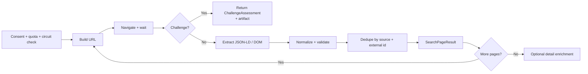
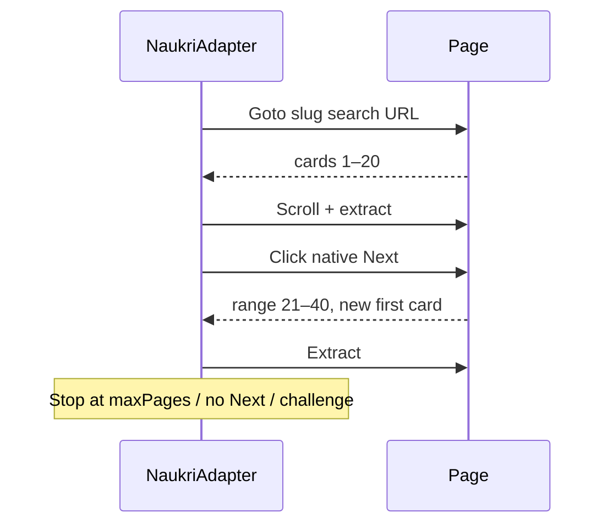
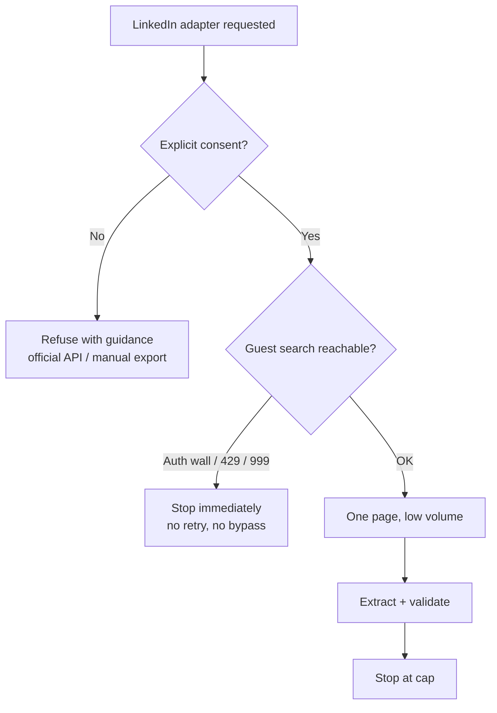

# Site Playbooks

> **Purpose:** implementation notes for each source: URLs, page flow, selectors, pagination, caps, challenge signatures, fixtures, and acceptance tests.
>
> **Rule:** selectors are starting points, not contracts. Prefer JSON-LD and semantic locators; verify live; keep fixtures current. A parser change without a fixture/canary is incomplete.

All source adapters implement the `IJobSource` contract from [Architecture §8.1](02-architecture.md#81-application-ports): `NaukriAdapter`, `IndeedAdapter`, and `LinkedInAdapter`. This playbook covers source-specific behavior only; the contract, ports, and failure semantics stay in the architecture.

---

## 1. Common adapter blueprint



### 1.1 Every adapter must provide

| Piece | Responsibility |
|---|---|
| `UrlBuilder` | Search/detail URL construction, query encoding, canonicalization. |
| `SearchPageParser` | JSON-LD + DOM extraction, visibility guards, raw card DTOs. |
| `DetailParser` | Description, skills, apply URL, posted date; partial success allowed. |
| `ChallengeClassifier` | Status/URL/title/body/DOM wall detection, no false positives. |
| `Capabilities` | Compliance tier, consent requirement, detail support, pagination kind. |
| `Normalizer` | Trim/cap, salary/location parsing, source-specific ID, URL allowlist. |
| `Fixture set` | Normal, promoted/variant, empty, honeypot, challenge, detail. |
| `Contract tests` | Shared `JobSourceContractTests` + source-specific cases. |

### 1.2 Extraction priority

1. **JSON-LD** `script[type="application/ld+json"]` with `@type: JobPosting`.
2. **Semantic DOM** (`article`, headings, `data-testid`, `href` patterns).
3. **Stable class substrings** (`[class*="job-card"]`) — fallback, logged.
4. **Text/regex** — only for salary/posted date, never identity.

### 1.3 Honeypot and visibility guards

A card/link is rejected when any of these is true:

- `display:none`, `visibility:hidden/collapse`, `opacity < 0.15`.
- `aria-hidden="true"`.
- Bounding box width/height ≤ 1 px.
- Off-screen far away (e.g., `x < -2000` or `y < -2000`).
- `href` is `#`, `javascript:`, empty, or outside the source host.
- The card is inside a hidden container or an iframe that is not visible.
- The link requires a click on a hidden overlay.

Playwright 1.64 treats elements in hidden iframes as hidden; still verify with computed styles where needed.

---

## 2. URL, ID, and normalization map

| Source | Search URL | Detail URL | External ID | Notes |
|---|---|---|---|---|
| Naukri | `/jobs?k=&l=&experience=&jobPostDate=&page=` and `/{slug}-jobs-in-{city}?k=&l=&experience=&jobAge=` | `/job-listings-<slug>-<id>` | numeric suffix | SPA; native Next for pagination. |
| LinkedIn | `/jobs/search?keywords=&location=&f_TPR=r604800&start=` | `/jobs/view/<id>` | numeric id | Guest search; auth wall risk. |
| Indeed | `/jobs?q=&l=&fromage=7&start=` | `/viewjob?jk=<id>` | `jk` query value | Cloudflare risk; `start` increments 10. |

### 2.1 Canonicalization

- Absolute `https` only.
- Source host allowlist (`www.naukri.com`, `www.linkedin.com`, `in.indeed.com`).
- Strip `utm_*`, `ref`, `src`, `trk`, `trackingId`, fragments.
- Keep source-significant query params (e.g., Indeed `jk`).
- Reject `javascript:`, `data:`, credentials, and non-allowlisted hosts.
- Cap URL length (e.g., 2,048 chars) and log/drop anomalies.

### 2.2 Canonical URL examples

```text
https://www.naukri.com/job-listings-senior-dot-net-developer-contoso-pune-123456789?utm_source=feed
  → https://www.naukri.com/job-listings-senior-dot-net-developer-contoso-pune-123456789

https://www.linkedin.com/jobs/view/4012345678/?refId=abc&trackingId=xyz
  → https://www.linkedin.com/jobs/view/4012345678

https://in.indeed.com/viewjob?jk=abcdef123456&from=serp&vjs=3
  → https://in.indeed.com/viewjob?jk=abcdef123456
```

---

## 3. Naukri playbook

### 3.1 Access posture

| Item | Value |
|---|---|
| Compliance tier | **Standard** |
| Default | Enabled |
| Login required? | No for public search/detail |
| Primary anti-bot | Akamai (observed: `errors.edgesuite.net`) |
| Headless | Blocked in the old project's measurements; use headed first contact |
| Pagination | SPA; click native **Next** |
| Recommended volume | 2–3 pages/run, 60 jobs/run, 2 runs/day |

### 3.2 Search flow

1. Optional warm-up: home page, pause, scroll once.
2. Navigate to the slug search URL for page 1 (carries `k`, `l`, `experience`, `jobAge`).
3. Wait for `a[href*="/job-listings-"]`; scroll to trigger lazy cards.
4. Classify challenge; extract visible cards.
5. Click native **Next**; wait for the result range/first-card fingerprint to change.
6. Repeat until cap/no next.
7. Optional detail enrichment with polite delays.



### 3.3 URL builders

```text
Search (query form, page 1; later pages via native Next):
https://www.naukri.com/jobs?k={keywords}&l={location}&experience={years}&jobPostDate={days}&page=1

Search (slug form, page 1):
https://www.naukri.com/{slug(keywords)}-jobs-in-{slug(firstCity)}?k={keywords}&l={allCities}&experience={years}&jobAge={days}

Detail:
https://www.naukri.com/job-listings-{slug}-{id}
```

**Slug rules (from the old project, verified):**

- lowercase.
- `#` → `sharp`; `.` → `dot`; commas removed.
- non-alphanumerics removed; whitespace → `-`; collapse dashes.
- Multi-city: path uses **first city**; full comma list stays in `l`.
- Do **not** navigate to `-2` slug URLs for pagination; the SPA loses filters. Click Next.

### 3.4 Selectors (starting points)

| Field | Primary / fallback |
|---|---|
| Card anchor | `a[href*="/job-listings-"]` |
| Card container | `article`, `div[class*="jobTuple"]`, `div[class*="srp-job"]`, `div[class*="cust-job"]`, `li[class*="job"]` |
| Title | anchor text, `a.title`, `h2 a`, `a[class*="title"]` |
| Company | `a[class*="comp"]`, `a[class*="Comp"]`, `div[class*="comp"] a`, `span[class*="comp"]` |
| Location | `span[class*="loc"]`, `div[class*="loc"] span`, `li[class*="location"]` |
| Experience | `span[class*="exp"]`, `li[class*="experience"]`, `span[class*="experience"]` |
| Salary | `span[class*="sal"]`, `li[class*="salary"]`, `span[class*="salary"]` |
| Posted | `span.job-post-day`, `span[class*="job-post"]`, `span[class*="date"]`, `div[class*="posted"]` |
| Skills | `ul.tags-gt li`, `li.tag-li`, `.keyskill > span`, `div[class*="key-skill"] a`, `a[class*="skill"]`, `span[class*="skill"]` |
| Detail description | `section[class*="job-desc"]`, `div[class*="job-desc"]`, `div.dtl-section`, `section.dtl-section` |
| Apply link | visible `a`/`button` whose text/aria matches `apply|company site|career site|apply on`; external host only |

**Do not** rely on one class name; selectors are served variants. Log which fallback matched.

### 3.5 Pagination invariants

- Capture a page fingerprint before clicking Next: first card href + visible range text (e.g., `21–40 of 442`).
- After clicking, poll until the fingerprint changes; timeout ~20s.
- If the fingerprint does not change, stop (do not loop).
- If Next is disabled/absent, stop.
- Never navigate directly to a `-N` URL for pages 2+.

### 3.6 Optional private API fast path (feature-flagged)

The old project and third-party scrapers use Naukri's private search API:

- `GET https://www.naukri.com/jobapi/v3/search` with `noOfResults=20`, keyword/location/experience/jobAge params.
- Headers include `appid`, `systemid`, and an RSA-signed `nkparam` token.
- Response includes `tagsAndSkills` (same key skills as the cards).

**Policy:**

- Feature flag `Sources:Naukri:UseApiFastPath=false` by default.
- Only after a time-boxed spike proves it stable, compliant, and no-auth.
- 403/406 → disable the fast path; fall back to browser.
- Do not use the API to bypass a wall, login, or rate limit.
- Do not implement token generation in v1 unless the spike is explicitly approved; browser-first is the product.

### 3.7 Caps and challenge signatures

| Cap | Default |
|---|---|
| Pages/search | 3 |
| Jobs/run | 60 |
| Details/run | 60 |
| Delay | 2.5–6.0s |
| Pages/day | 25 |
| Details/day | 60 |
| Runs/day | 2 |

Challenge signals:

- Redirect to `errors.edgesuite.net` / Akamai block page.
- Visible text: “Access Denied”, “verify you are human”, “unusual traffic”, “pardon the interruption”.
- No job anchors + visible block text.
- Empty results with a login/challenge modal.

Response: stop, screenshot/HTML/trace, cooldown 45–60 min, manual solve, circuit open.

### 3.8 Fixtures

- `search-normal.html` — 20 cards, standard markup.
- `search-promoted.html` — promoted/sponsored cards with different classes.
- `search-honeypot.html` — hidden/aria-hidden/zero-size/off-screen trap card.
- `search-empty.html` — legitimate zero results.
- `search-challenge.html` — Akamai-style block page.
- `detail-normal.html` — description/skills/apply.
- `detail-minimal.html` — missing fields.
- `pagination-range.html` — range text + first-card fingerprint.

Fixture README must include capture date, URL shape, and selector version.

### 3.9 Acceptance tests

- [ ] Parses 20 cards from `search-normal.html`.
- [ ] Ignores the honeypot card in `search-honeypot.html`.
- [ ] Extracts key skills without visiting detail pages.
- [ ] Pagination clicks Next and detects the range/first-card change.
- [ ] Direct `-2` navigation is never used.
- [ ] Challenge fixture yields `ChallengeKind.SoftChallenge` and zero jobs.
- [ ] Detail parser handles missing salary/company without throwing.
- [ ] Canonical URLs strip tracking params and keep the numeric ID.
- [ ] Live canary (1 page, headed) either yields cards or a documented wall.

### 3.10 Known pitfalls (from the old project)

| Pitfall | Fix |
|---|---|
| Direct `-2` slug loses SPA filters | Click native Next; wait for range change. |
| `location` variable shadows `window.location` in injected JS | Use `window.location` explicitly. |
| Stale UA vs engine version | Never override UA. |
| Headless blocked | Headed first contact; persistent profile. |
| Class names vary by visit | Multi-selector fallback + text/semantic matching. |
| Inert stealth script | Removed; no JS spoofing. |
| Promoted cards differ | Separate selector branch; still validate. |

---

## 4. LinkedIn playbook

> ⚠️ **High-risk source. Disabled by default.**
>
> LinkedIn's robots.txt states that automated access without express permission is strictly prohibited, and the User Agreement prohibits scraping/crawling/automated collection. There is no general public jobs API for this use case.
>
> **Recommended:** use LinkedIn's official/manual export or a licensed partner API. If you still opt in for personal, low-volume use, the adapter is **guest-only**, requires explicit acknowledgment, and stops on the first auth wall/429/999. It does not automate login or bypass any access control.

### 4.1 Access posture

| Item | Value |
|---|---|
| Compliance tier | **HighRisk** |
| Default | Disabled |
| Consent | `AcknowledgeSourceRisk=true` + `AllowHighRiskSources=true` + interactive confirmation |
| Login | Manual only; guest-first; no credential automation |
| Primary anti-bot | Internal auth wall + 429/999 |
| Recommended volume | 1 page/run, 25 jobs/run, 1 run/day (maximum) |

### 4.2 Consent gate



### 4.3 URLs

```text
Guest search:
https://www.linkedin.com/jobs/search?keywords={keywords}&location={location}&f_TPR=r604800&start={offset}

Detail:
https://www.linkedin.com/jobs/view/{id}
```

- `start` typically increments by 25.
- `f_TPR` is a relative time filter in seconds (`r604800` = 7 days; `r86400` = 24 hours).
- Guest pages may redirect to `/authwall` or show a login modal after a few requests.
- `jobs-guest/jobs/api/seeMoreJobPostings` exists but is fragile and not recommended; do not build the core on it.

### 4.4 Selectors (starting points)

| Field | Primary / fallback |
|---|---|
| Card | `li.jobs-search-results__list-item`, `div.job-card-container` |
| Card link | `a.job-card-container__link`, `a[href*="/jobs/view/"]` |
| Title | link text, `strong`, `[class*="job-card-list__title"]` |
| Company | `span.job-card-container__company-name`, `[class*="artdeco-entity-lockup__subtitle"]` |
| Location | `span.job-card-container__metadata-item`, `[class*="job-card-container__metadata"]` |
| Detail description | `div.jobs-description-content__text`, `div.jobs-box__html-content`, `div.show-more-less-html__markup` |
| JSON-LD | `script[type="application/ld+json"]` with `@type: JobPosting` |

**Prefer JSON-LD** where present; guest markup changes frequently.

### 4.5 Caps and challenge signatures

| Cap | Default |
|---|---|
| Pages/run | 1 |
| Jobs/run | 25 |
| Details/run | 8 |
| Delay | 10–20s |
| Pages/day | 4 |
| Details/day | 8 |
| Runs/day | 1 |

Challenge signals:

- Redirect to `/authwall`, `/checkpoint`, `/login`.
- Login modal/“Sign in to view more”.
- HTTP 429 or 999.
- Empty list with a login call-to-action.

Response: stop immediately; no retry; cooldown 60 min; circuit open 24h; require manual session bootstrap if the operator wants to continue.

### 4.6 Fixtures

- `search-guest.html` — public guest cards.
- `search-authwall.html` — auth wall/empty modal.
- `search-429.html` — rate-limit page.
- `detail-public.html` — JSON-LD + description.
- `detail-login.html` — login wall.

### 4.7 Acceptance tests

- [ ] Adapter refuses without explicit consent and prints the official/manual alternatives.
- [ ] Guest fixture parses expected cards and canonical URLs.
- [ ] Auth-wall fixture yields `LoginRequired` and zero jobs.
- [ ] 429/999 fixture yields `RateLimited`; no retry is attempted.
- [ ] With consent, a live canary is one page, headed, and stops on a wall.
- [ ] Removing the adapter does not affect Naukri/Indeed or the core.

### 4.8 Recommendation

If your goal is **job discovery**, Naukri + Indeed may be enough. LinkedIn's risk/benefit is poor for automation. Use the official product/manual export unless you have written permission or a licensed data partner.

---

## 5. Indeed playbook

> **Restricted source.** Disabled by default; requires explicit risk acknowledgment. Cloudflare is an access control; do not bypass it.

### 5.1 Access posture

| Item | Value |
|---|---|
| Compliance tier | **Restricted** |
| Default | Disabled |
| Consent | `AcknowledgeSourceRisk=true` |
| Primary anti-bot | Cloudflare managed challenge + proprietary layer |
| Recommended volume | 1–2 pages/run, 40 jobs/run, 1 run/day |

### 5.2 URLs

```text
Search:
https://in.indeed.com/jobs?q={keywords}&l={location}&fromage={days}&start={offset}

Detail:
https://in.indeed.com/viewjob?jk={jobKey}
```

- `start` increments by 10.
- `fromage` is the posted-within-days filter.
- Do not use `/graphql`, `/job/`, or private `/api/` endpoints; robots disallows them and they are fragile.

### 5.3 Selectors (starting points)

| Field | Primary / fallback |
|---|---|
| Card | `div.job_seen_beacon`, `li.css-5lfssm`, `div[data-testid="slider_item"]` |
| Title | `h2.jobTitle a`, `a[data-testid="job-title"]` |
| Company | `span[data-testid="company-name"]`, `[data-testid="company-name"]` |
| Location | `div[data-testid="text-location"]`, `[data-testid="text-location"]` |
| Salary | `div[data-testid="attribute_snippet_testid"]`, `.salary-snippet-container` |
| Detail description | `div#jobDescriptionText`, `div.jobsearch-JobComponent-description` |
| JSON-LD | `script[type="application/ld+json"]` with `@type: JobPosting` |

Indeed changes classes frequently; `data-testid` and JSON-LD are more stable.

### 5.4 Caps and challenge signatures

| Cap | Default |
|---|---|
| Pages/run | 2 |
| Jobs/run | 40 |
| Details/run | 30 |
| Delay | 12–25s |
| Pages/day | 12 |
| Details/day | 30 |
| Runs/day | 1 |

Challenge signals:

- Cloudflare “Just a moment…”, “Checking your browser”.
- “Additional Verification Required”.
- HTTP 403/429.
- Homepage challenge before search.
- Empty page with Cloudflare scripts.

Response: stop; screenshot/HTML/trace; cooldown 60 min; circuit open 24h; do not retry/rotate proxies.

### 5.5 Fixtures

- `search-normal.html` — 15 cards.
- `search-empty.html` — legitimate no results.
- `search-cloudflare.html` — managed challenge.
- `detail-normal.html` — description/skills.
- `detail-minimal.html` — missing fields.

### 5.6 Acceptance tests

- [ ] Opt-in gate works; no run without acknowledgment.
- [ ] Search fixture parses expected cards and `jk` IDs.
- [ ] Detail fixture extracts description and canonical `viewjob` URL.
- [ ] Cloudflare fixture yields `SoftChallenge` and zero jobs.
- [ ] No call to `/graphql`, `/job/`, or private `/api/`.
- [ ] Live canary is one page, headed, and either yields cards or stops with evidence.

### 5.7 Known pitfalls

| Pitfall | Fix |
|---|---|
| Cloudflare challenge on homepage | Stop; try later from a normal network; no bypass. |
| Class names churn | Prefer `data-testid`/JSON-LD; fixture refresh. |
| Relative/redirected viewjob URLs | Canonicalize `jk`; allowlist host. |
| “Easy apply” vs external apply | Capture the public apply URL; do not automate application. |
| Headless blocked | Headed first contact. |

---

## 6. Cross-site normalization

### 6.1 External ID

- **Naukri:** numeric suffix after the last `-` in `/job-listings-...-(\d+)`.
- **LinkedIn:** numeric path segment in `/jobs/view/(\d+)`.
- **Indeed:** `jk` query parameter (alphanumeric).
- Reject missing/duplicate IDs; log the raw URL.

### 6.2 Salary

- Keep `salary_raw`.
- Parse `min`, `max`, `currency`, `period` only when unambiguous.
- Handle `₹`, `INR`, `LPA`, `per annum`, `per month`, `monthly`, `yearly`.
- Do not invent values; unknown stays `null`.
- Validate `min <= max`; drop parsed values that violate it.

### 6.3 Location and work mode

- Keep `location_raw`.
- Normalize city/region/country when possible.
- Detect `remote`, `hybrid`, `work from home`, `onsite`.
- Do not discard multi-city strings; store raw and a best-effort normalized list.

### 6.4 Skills

- Split comma/semicolon lists; trim; dedupe case-insensitively.
- Cap 50; keep display casing from the most common raw form.
- Ignore generic noise (“communication”, “teamwork”) only if the user configures a blocklist; v1 stores all.

### 6.5 Posted date

- Prefer JSON-LD `datePosted` (ISO 8601).
- Parse relative text (“3 days ago”, “just now”, “30+ days ago”) against the run time.
- Unknown stays `null`; never guess a date.
- Store UTC; render in `Asia/Kolkata`.

### 6.6 Description

- Prefer JSON-LD `description` or the detail container.
- Strip scripts/styles; cap 20,000 chars.
- Do not extract emails/phones in v1; if present in text, leave them in the description but do not create contact records.

### 6.7 Apply URL

- Use a visible external apply link when present.
- Otherwise canonical job URL.
- Allowlist `http`/`https`; reject `javascript:`/`data:`.
- Do not follow external ATS chains in v1; store the first external URL.

### 6.8 Data-quality flags

Set flags instead of dropping a posting when non-critical fields are missing:

- `missing_company`
- `missing_location`
- `salary_unknown`
- `posted_date_unknown`
- `description_missing`
- `parse_low_confidence`

Critical fields (source, external ID, title, canonical URL) must be present, or the card is dropped with a named-field warning.

---

## 7. Selector maintenance

| Practice | Detail |
|---|---|
| JSON-LD first | Least likely to change; often contains all fields. |
| Semantic locators | Roles, headings, `data-testid`. |
| Fallback chains | 2–4 candidates per field; log the winner. |
| Fixture per variant | Normal, promoted, empty, honeypot, challenge, detail. |
| Capture date | In fixture README and parser version. |
| Canary | One page/run detects zero-result drift. |
| Quarterly review | Re-capture fixtures; remove dead selectors. |
| No brittle XPath | Prefer CSS/semantic; avoid generated class hashes. |

### 7.1 Selector hit logging

```text
SelectorHit { Source=naukri, Field=title, Selector="a.title", FallbackIndex=0, Page=1 }
```

A sudden shift to fallback index 2+ is an early warning of DOM drift.

---

## 8. Live canary checklist

Before running:

- [ ] Source is enabled and consent (if required) is recorded.
- [ ] Profile is healthy; `session probe` passed.
- [ ] Caps set to the minimum: 1 page, no enrichment.
- [ ] Headed browser available; operator present.
- [ ] Circuit breaker closed; quota available.
- [ ] You are on a normal network (no VPN/proxy rotation).

During:

- [ ] Navigate to the search page.
- [ ] If challenge: stop, capture, classify; do not retry.
- [ ] Otherwise extract one page; validate a few cards.
- [ ] Do not persist to the production DB; use `--dry-run`.
- [ ] Close the browser cleanly.

After:

- [ ] Record result (cards/wall) in the source playbook or a canary note.
- [ ] If wall: cooldown, open circuit if repeated, reduce caps.
- [ ] If parse failure: capture fixture, update parser/tests.
- [ ] Do not run again immediately.

---

## 9. Acceptance matrix

| Capability | Naukri | Indeed | LinkedIn |
|---|---|---|---|
| Fixture parse | Required | Required | Required |
| JSON-LD support | Preferred | Preferred | Preferred |
| Native pagination test | Required (Next click) | Required (`start`) | Required (`start`) |
| Detail enrichment | Required | Required | Optional (cap 8) |
| Challenge fixture | Akamai | Cloudflare | Auth wall/429/999 |
| Consent gate | No | Yes | Yes + interactive |
| Live canary | 1 page headed | 1 page headed | 1 page headed, only if approved |
| Default enabled | Yes | No | No |
| Removal isolation | Adapter only | Adapter only | Adapter only |

---

## 10. What “done” means for a source adapter

- URL builder with unit tests.
- Search parser with normal/promoted/honeypot/empty/challenge fixtures.
- Detail parser with normal/minimal fixtures.
- Challenge classifier with evidence and no false positives on empty results.
- Contract tests pass.
- Caps/quota/circuit breaker wired.
- CLI can run it with `--dry-run` and show a clear summary.
- Live canary documented (success or wall).
- Playbook updated with capture date/selector notes.
- No bypass, no retry storm, no hidden-element clicks.
