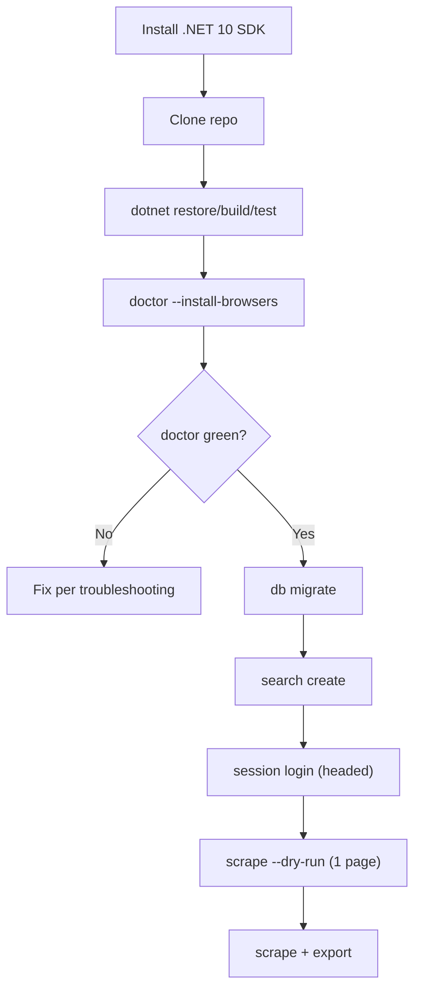

# Operations Runbook

> **Audience:** the operator (you) running JobLens on a laptop or desktop.
>
> **Promise:** a clean machine can install, build, install browsers, and run `joblens doctor` in under 15 minutes. If it takes longer, the runbook or the doctor is wrong — fix it.

---

## 0. As implemented: API + cockpit

> This runbook's `JobLens.Cli` references describe the design target; no CLI, `doctor`, scheduler, or export exists. The implemented operator path is the loopback API plus the cockpit, and only Naukri has an adapter.

```bash
# 1. Build (copies the Playwright 1.64.1 driver into the API output).
dotnet build src/backend/JobScrape.slnx

# 2. Install Chromium once per Playwright version (only the bundled
#    Chromium is supported). Linux, no PowerShell needed:
src/backend/JobScrape.Api/bin/Debug/net10.0/.playwright/node/linux-x64/node \
  src/backend/JobScrape.Api/bin/Debug/net10.0/.playwright/package/cli.js install chromium
# macOS (Apple Silicon):
src/backend/JobScrape.Api/bin/Debug/net10.0/.playwright/node/darwin-arm64/node \
  src/backend/JobScrape.Api/bin/Debug/net10.0/.playwright/package/cli.js install chromium
```

```powershell
# Windows:
src\backend\JobScrape.Api\bin\Debug\net10.0\.playwright\node\win64\node.exe `
  src\backend\JobScrape.Api\bin\Debug\net10.0\.playwright\package\cli.js install chromium
```

```bash
# 3. API on :5207 (Development: applies migrations on start).
dotnet run --project src/backend/JobScrape.Api/JobScrape.Api.csproj

# 4. Cockpit on :3000, in another terminal.
cd src/frontend && bun run dev
```

Then, in the cockpit:

1. `#/sessions` — create a session for `naukri` (engine `Chromium`, channel `Bundled`). Its persistent profile lives in `{ProfilesRoot}/naukri/{name}`; treat it as a secret.
2. `#/profiles` — create a search profile (keywords, cities, caps).
3. `#/runs` — pick an enabled profile and a launchable session of the same source, then **Start**. A **visible browser window opens** (`JobScrape:Browser:Headless=false`, because Naukri blocks headless first contact): it loads the Naukri home page, pauses, scrolls, then searches. Do not close it mid-run; the API closes it when the run ends.
4. The run detail polls every 2 s (stage track, page/posting/detail meters, postings table). **Cancel** stops the run cooperatively and keeps partial results.

Rules the API enforces:

- One run at a time: a second start returns `409 RUN_IN_PROGRESS` until the first ends or is cancelled.
- If the API stops mid-run, the run is cancelled; a run still in an executing stage at the next start (e.g. after a crash) is marked `Failed` with `Interrupted: the API stopped while the run was executing.`
- Walls are never retried. A challenge pauses the run, a rate limit waits out its window, a changed page or a wall at session start fails it. Challenge and changed-page evidence is written to `{ArtifactsRoot}/runs/{runId}/{yyyyMMddTHHmmss}-{kind}/` (`assessment.json`, `screenshot.png`, `page.html`); a challenged session cools down (a login wall marks it expired). There is no resume, login, or probe endpoint yet: cancel the paused run and start a new one.
- Relative `JobScrape:Storage` paths (`artifacts/...`) resolve against the API's content root (the project directory under `dotnet run --project`).

Verified live on 2026-11-01: headed Chromium (`Bundled`), profile "dot net developer" in Pune, caps 2 pages / 40 jobs / 3 details → `Completed` in ~30 s with 40 new postings, 3 details enriched, 0 walls, session `Healthy`.

---

## 1. Supported matrix

| OS | Minimum | Notes |
|---|---|---|
| macOS | 14 (Sonoma)+ | Apple Silicon or Intel; WebKit closest to Safari. |
| Windows | 11+, Server 2019+, or WSL2 | Playwright does not support Windows 10. |
| Linux | Debian 12/13, Ubuntu 22.04/24.04/26.04 | x64/arm64; install browser deps. |

| Browser | Role |
|---|---|
| Chromium (bundled) | Default and only production engine. |
| Firefox (Playwright build) | Compatibility/diagnostic. |
| WebKit (Playwright build) | Safari-like compatibility/diagnostic; **not** real Safari. |

**Not supported:** Windows 10, macOS 13 or older, Alpine/musl, 32-bit Linux.

---

## 2. Prerequisites

| Requirement | Why |
|---|---|
| .NET 10 SDK **10.0.403+** | Build/run. |
| Git | Clone/versioning. |
| PowerShell 7 (`pwsh`) | Optional; `doctor --install-browsers` avoids it. |
| ~2 GB free disk | Browser binaries + profiles + DB. |
| 4 GB RAM | One browser context + .NET. |
| Desktop session for first contact | Headed login/challenge solve. |
| Normal network | No datacenter proxy/VPN farm. |

Verify:

```bash
dotnet --info
# SDK 10.0.403+ and runtime 10.0.14+ expected
```

---

## 3. First-time setup



### 3.1 macOS

```bash
# Install .NET 10 SDK via the official installer or Homebrew, then:
dotnet --info

git clone <your-repo-url> PlaywrightDotNet
cd PlaywrightDotNet
dotnet restore
dotnet build -warnaserror
dotnet test --filter "Category!=Live&Category!=E2E"

dotnet run --project src/JobLens.Cli -- doctor --install-browsers
dotnet run --project src/JobLens.Cli -- db migrate
```

If `doctor` reports missing browser dependencies, run the Playwright installer with deps:

```bash
pwsh src/JobLens.Cli/bin/Debug/net10.0/playwright.ps1 install --with-deps chromium
```

### 3.2 Linux (Ubuntu/Debian)

```bash
# Install .NET 10 SDK from Microsoft's package feed or dotnet-install.sh.
dotnet --info

sudo apt-get update
# Playwright's installer can add the required libraries:
dotnet build
pwsh src/JobLens.Cli/bin/Debug/net10.0/playwright.ps1 install --with-deps chromium firefox webkit
```

For servers without a desktop, start from a **.NET 10 SDK** base image, install Playwright's Linux dependencies, and use Xvfb for headed first contact. The official Playwright image is convenient, but verify it ships a .NET 10 SDK (`dotnet --version`) before relying on it.

```bash
sudo apt-get install -y xvfb
xvfb-run -a dotnet run --project src/JobLens.Cli -- session login --source naukri --browser-profile naukri-main
```

### 3.3 Windows 11

```powershell
# Install .NET 10 SDK via the official installer or winget, then:
dotnet --info

git clone <your-repo-url> PlaywrightDotNet
cd PlaywrightDotNet
dotnet restore
dotnet build -warnaserror
dotnet test --filter "Category!=Live&Category!=E2E"

dotnet run --project src/JobLens.Cli -- doctor --install-browsers
dotnet run --project src/JobLens.Cli -- db migrate
```

Use PowerShell 7 for `playwright.ps1` if the CLI wrapper is unavailable:

```powershell
pwsh src/JobLens.Cli/bin/Debug/net10.0/playwright.ps1 install chromium firefox webkit
```

### 3.4 Docker (Linux CI/E2E)

A typical image build (conceptual) is:

```dockerfile
FROM mcr.microsoft.com/dotnet/sdk:10.0
# Install Playwright OS dependencies and browsers for the pinned version.
# Prefer a checked-in script that runs the CLI's doctor --install-browsers
# plus the Playwright Linux dependency step.
COPY . /work
WORKDIR /work
RUN dotnet restore && dotnet build -warnaserror
# RUN ./build/scripts/install-playwright-linux.sh
```

- Use Docker for deterministic Linux E2E, not for live first contact.
- Headed runs need Xvfb or a desktop-forwarded display.
- Do not bake browser profiles into the image.
- CI can skip Docker and use `actions/setup-dotnet` + `doctor --install-browsers` on Ubuntu.

---

## 4. First browser session

```bash
# Create a profile (search intent).
dotnet run --project src/JobLens.Cli -- search create \
  --name naukri-dotnet-pune \
  --source naukri \
  --keywords "asp.net core c# .net" \
  --locations "pune,hyderabad" \
  --experience 6 \
  --days 7 \
  --max-pages 2 \
  --max-jobs 40

# Create/attach the browser profile on demand and log in manually if needed.
dotnet run --project src/JobLens.Cli -- session login \
  --source naukri \
  --browser-profile naukri-main

# Verify without scraping.
dotnet run --project src/JobLens.Cli -- session probe \
  --source naukri \
  --browser-profile naukri-main
```

**What happens:**

- A headed browser opens with the persistent profile.
- You log in / solve a challenge manually if the site asks.
- The CLI verifies a known-good page and closes the context.
- The profile is marked `Healthy`.

> Never share a browser profile between sources. Never commit it. It contains cookies/session tokens.

---

## 5. Daily workflow

```bash
# 1. Dry run: parse only, no DB writes.
dotnet run --project src/JobLens.Cli -- scrape \
  --search naukri-dotnet-pune --max-pages 1 --dry-run

# 2. Real run (respects caps/quota).
dotnet run --project src/JobLens.Cli -- scrape \
  --search naukri-dotnet-pune

# 3. Review run history and artifacts.
dotnet run --project src/JobLens.Cli -- runs list --limit 10
dotnet run --project src/JobLens.Cli -- runs show <runId>

# 4. Export.
dotnet run --project src/JobLens.Cli -- export --format xlsx
dotnet run --project src/JobLens.Cli -- export --format csv --out artifacts/exports
```

### 5.1 If a run exits with a challenge (`3`)

1. Open `runs show <runId>`; read the challenge kind/evidence.
2. Open the artifact screenshot/HTML.
3. If interactive, run `session login`, solve manually, `session probe`, then resume.
4. If unattended, leave the circuit open; wait for the cooldown.
5. Reduce caps before the next run.

### 5.2 If a run exits with a rate limit (`4`)

1. Check `Retry-After` and the cooldown.
2. Wait; do not retry immediately.
3. Reduce pages/details/day.
4. Resume with one page; if it repeats, open the circuit for 24h.

### 5.3 If a run exits with a parse/source change (`6`)

1. Inspect the saved HTML/artifact.
2. Create/update a fixture.
3. Update the parser/selector chain and contract tests.
4. Run a one-page canary; update the site playbook.

### 5.4 If a run exits with a storage/I/O failure (`7`)

1. Check free disk; compare with `Storage:MinimumFreeDiskBytes`.
2. Review log retention/artifact retention; delete expired data only.
3. Fix permissions or the locked file; do not delete the active run.
4. Re-run after the free-space check passes.

---

## 6. Scheduling

Use the OS scheduler; do not run a daemon in v1. Always enforce **one run at a time**.

### 6.1 Linux (cron + flock)

```cron
# Daily at 08:15 and 20:15; flock prevents overlap.
15 8,20 * * * cd /home/you/PlaywrightDotNet && flock -n /tmp/joblens.lock \
  dotnet run --project src/JobLens.Cli -- scrape --search naukri-dotnet-pune \
  >> artifacts/logs/cron.log 2>&1
```

- `flock -n` exits immediately if another run holds the lock.
- Do not schedule a retry every 5 minutes; honor the cooldown.
- Check `artifacts/logs/cron.log` and run history weekly.

### 6.2 macOS (launchd)

`~/Library/LaunchAgents/com.joblens.naukri.plist`:

```xml
<?xml version="1.0" encoding="UTF-8"?>
<!DOCTYPE plist PUBLIC "-//Apple//DTD PLIST 1.0//EN"
  "http://www.apple.com/DTDs/PropertyList-1.0.dtd">
<plist version="1.0">
<dict>
  <key>Label</key><string>com.joblens.naukri</string>
  <key>ProgramArguments</key>
  <array>
    <string>/usr/local/share/dotnet/dotnet</string>
    <string>run</string>
    <string>--project</string>
    <string>/Users/you/PlaywrightDotNet/src/JobLens.Cli</string>
    <string>--</string>
    <string>scrape</string>
    <string>--search</string>
    <string>naukri-dotnet-pune</string>
  </array>
  <key>WorkingDirectory</key><string>/Users/you/PlaywrightDotNet</string>
  <key>StartCalendarInterval</key>
  <dict><key>Hour</key><integer>8</integer><key>Minute</key><integer>15</integer></dict>
  <key>StandardOutPath</key><string>/Users/you/PlaywrightDotNet/artifacts/logs/launchd.out.log</string>
  <key>StandardErrorPath</key><string>/Users/you/PlaywrightDotNet/artifacts/logs/launchd.err.log</string>
</dict>
</plist>
```

Load with `launchctl load ~/Library/LaunchAgents/com.joblens.naukri.plist`. Verify the dotnet path with `which dotnet`.

### 6.3 Windows (Task Scheduler)

```powershell
schtasks /Create /TN "JobLens Naukri" /SC DAILY /ST 08:15 /TR "dotnet run --project C:\src\PlaywrightDotNet\src\JobLens.Cli -- scrape --search naukri-dotnet-pune" /F
```

- Set “If the task is already running, do not start a new instance.”
- Run only when the user is logged on for **headed** live runs; do not use non-interactive mode for first contact.
- If you must run unattended, prefer a dedicated interactive session with a display (or Xvfb) rather than switching live collection to headless.

> Scheduling a run does not bypass compliance. A scheduled run that hits a wall exits with a code and waits; it does not auto-retry.

---

## 7. Storage layout

```text
artifacts/
├── data/
│   └── joblens.db          SQLite source of truth (+ -wal/-shm)
├── profiles/
│   └── naukri/
│       └── chromium-bundled/   persistent browser profile (secret)
├── runs/
│   └── {runId}/
│       ├── run.json
│       ├── page-001.html
│       ├── screenshot-001.png
│       └── trace.zip
├── exports/
│   └── joblens_2026-11-25.xlsx
├── logs/
│   └── joblens-cli-20261125.jsonl
└── backups/
    └── joblens-2026-11-25.db
```

- `artifacts/` is gitignored.
- Profile directories are owner-only on Unix (`chmod 700`).
- Artifacts may contain personal data; keep local and expire.

### 7.1 Retention

| Data | Default | Config |
|---|---|---|
| Run artifacts (HTML/screenshots/traces) | 30 days | `Storage:RetentionDays` |
| Logs | 90 days | `Logging:RetentionDays` + Serilog rolling |
| Postings | 180 days inactive | `Storage:PostingRetentionDays` |
| Exports | Manual | User-managed |
| Browser profiles | Until reset | Manual |

Cleanup runs at startup and daily: it deletes expired artifacts/temp files, skips the active run, and logs `BytesFreed`/`FilesDeleted`/`SkippedActive`. Serilog owns log retention; do not delete an open log file manually. Low disk fails the next write with `STORAGE_LOW_DISK` rather than filling the volume.

---

## 8. Backup and restore

### 8.1 SQLite backup (safe with WAL)

```bash
mkdir -p artifacts/backups
sqlite3 artifacts/data/joblens.db \
  ".backup 'artifacts/backups/joblens-$(date +%F).db'"
```

Windows (with `sqlite3.exe` on PATH):

```powershell
sqlite3 artifacts/data/joblens.db ".backup 'artifacts/backups/joblens-2026-11-25.db'"
```

- Prefer `.backup` over copying a live DB with WAL.
- Verify the backup opens: `sqlite3 <backup> "PRAGMA integrity_check;"`.
- Store backups encrypted if the DB contains personal data.

### 8.2 Restore

1. Stop all runs.
2. Move the current DB aside.
3. Copy the backup into place.
4. Open it with `sqlite3` and run `PRAGMA integrity_check;`.
5. Run `doctor` (pending migrations) and a dry-run.
6. Do not restore a profile and DB from different dates unless you understand the session state.

### 8.3 Profile backup

- Profiles are secrets; back them up encrypted and only if you need to move machines.
- Do not restore a profile on a different source/engine/channel.
- If a profile is challenged, prefer re-login over restoring an old cookie jar.

---

## 9. Logs and artifacts

> **As implemented:** wall evidence lives in `{ArtifactsRoot}/runs/{runId}/{yyyyMMddTHHmmss}-{kind}/` as `assessment.json` (kind, confidence, evidence, URL), `screenshot.png` (full page), and `page.html` (capped at 2,000,000 chars); capture is best effort. No `run.json` or `trace.zip` is written — run state is in SQLite and readable through `GET /api/v1/runs/{id}`. API logs go to `artifacts/logs/jobscrape-api-*.jsonl`. The table below is the design target.

| Log/artifact | What it tells you |
|---|---|
| `runs/{id}/run.json` | Stage, stats, outcome, challenge kind, timings. |
| `page-001.html` | Exact DOM at the time of failure. |
| `screenshot-001.png` | Visual wall/state. |
| `trace.zip` | Playwright timeline (DOM snapshots, network, actions). |
| `logs/joblens-cli-*.jsonl` | Structured JSON events with `RunId`/`Source`/`TraceId`. |
| `runs show <id>` | Human-readable summary + artifact paths. |

Each line is one compact JSON event. Standard enrichers add `MachineName`, `EnvironmentName`, `ProcessId`, `ProcessName`, `ThreadId`, `TraceId`, and `SpanId`; startup properties add `Application` and compile-time `Version`; run scopes add `RunId`, `Source`, and `JobId`.

```bash
# Follow one run across pages and HTTP calls
jq -c 'select(.RunId == "01J...")' artifacts/logs/joblens-cli-*.jsonl

# Find challenge and retry events
jq -c 'select(.Level == "Warning" and (.ChallengeKind or .Attempt))' artifacts/logs/joblens-cli-*.jsonl

# Correlate an API problem trace ID with the file log
jq -c 'select(.TraceId == "00-...-01")' artifacts/logs/joblens-api-*.jsonl
```

**Redaction:** cookies, authorization headers, form values, request/response bodies, and HTML are never logged. HTML artifacts may contain page data; treat them as sensitive. Logs rotate daily and at 100 MB, retain 90 days / 200 files, and use an async sink with backpressure so events are not silently dropped.

---

## 10. Troubleshooting

| Symptom | Likely cause | Fix |
|---|---|---|
| `dotnet: command not found` | SDK not installed/PATH | Install .NET 10 SDK; reopen shell. |
| `The current .NET SDK does not support targeting .NET 10` | Older SDK | Install 10.0.403+; check `global.json`. |
| `Executable doesn't exist ... chromium` | Browsers not installed | Run the driver's `cli.js install chromium` from the API build output (§0). |
| Linux: `Host system is missing dependencies` | Missing libs | `playwright.ps1 install --with-deps chromium` (sudo may be required). |
| Browser closes immediately | Headless/display issue | Use headed on desktop; `xvfb-run` on server. |
| `Target page, context or browser has been closed` | Crash/profile lock | Check logs; ensure no other process uses the profile. |
| `ProcessSingleton`/profile lock | Two processes share a user-data dir (the API itself runs one at a time) | Close any browser you opened on the profile directory; remove a stale lock only after the process exits. |
| Naukri blocked/empty | Akamai challenge or headless | Keep `JobScrape:Browser:Headless=false`; check the run's `assessment.json`/`screenshot.png`; wait out the cooldown. |
| Indeed Cloudflare “Just a moment” | Managed challenge | Stop; wait; normal network; no bypass. |
| LinkedIn auth wall/999 | Rate limit/auth wall | Stop; wait; manual session; consider disabling. |
| `database is locked` | Concurrent writer/long transaction | One writer; WAL; `busy_timeout`; retry the operation. |
| `No space left on device` / `STORAGE_LOW_DISK` | Disk full or retention too loose | Free space; lower artifact/log retention; check `MinimumFreeDiskBytes`; do not delete the active run. |
| `The process cannot access the file` / log locked | Two processes writing the same log role, or a file handle leaked | Use separate `cli`/`api` log prefixes; dispose streams; find the owning process. |
| `Socket exhaustion` / `An operation on a socket could not be performed` | `new HttpClient()` per call or unbounded connections | Use `IHttpClientFactory`; reuse typed clients; cap `MaxConnectionsPerServer`. |
| `TaskCanceledException` but no user cancel | Per-attempt or overall timeout | Check `CorrelationId`/`TraceId`; distinguish timeout from Ctrl+C; tune Polly timeout, not retries. |
| `circuit open` / repeated 429/5xx | Upstream API unstable or rate limited | Honor `Retry-After`; reduce concurrency; check `joblens.http.circuit_open`; do not bypass the breaker. |
| Working set grows across runs | Unbounded queue/cache, large HTML in memory, or leaked browser process | `dotnet-counters`/`dotnet-gcdump`; bound channels; stream artifacts; dispose page/context/browser. |
| Cannot delete artifacts on Windows | File handle still open | Dispose browser/streams/traces; stop the owning run; retry cleanup after exit. |
| `joblens.log.async_buffer_used` high or missing final logs | Log flood or shutdown without flush | Keep `blockWhenFull: true`; call `Log.CloseAndFlush()`; reduce Debug logging. |
| `joblens.db-wal` keeps growing | Long read transaction or no checkpoint | Keep transactions short; `PRAGMA wal_checkpoint(TRUNCATE)` on shutdown/backup; one writer. |
| `no such table` | Migrations not applied | `joblens db migrate`. |
| xUnit tests not discovered | Missing adapter/test SDK or library project | Add `xunit.runner.visualstudio` + `Microsoft.NET.Test.Sdk`; set `OutputType=Exe`. |
| `dotnet test` hangs | Browser test waiting forever | Add timeouts; check fixture server; run with `--blame-hang`. |
| WebKit fails on Linux | Missing deps/unsupported distro | Install deps; use supported Ubuntu/Debian; Chromium fallback. |
| Excel file locked | Open in Excel/LibreOffice | Close the file; re-export. |
| Timezone/locale wrong | OS ICU or config | Check `Browser:Locale`/`Timezone`; ensure `InvariantGlobalization=false`. |
| Cookies lost | Profile reset/wrong dir | Check profile path; re-login; don't share profiles. |
| `401/403` on a source | Session expired/blocked | `session login`; do not retry blindly. |

### 10.1 Diagnostic commands

```bash
dotnet --info
dotnet run --project src/JobLens.Cli -- doctor
dotnet run --project src/JobLens.Cli -- source list
dotnet run --project src/JobLens.Cli -- runs list --limit 20
dotnet run --project src/JobLens.Cli -- runs show <runId>

# v2 API local reference (Development only; bind 127.0.0.1)
dotnet run --project src/JobLens.Api
# open http://127.0.0.1:5080/scalar
```

Scalar is a local development tool. Do not proxy `/scalar` through the BFF, expose it on a tunnel, or enable it in production.

### 10.2 Collecting a support bundle

- App version + OS + .NET/Playwright versions.
- `doctor` output.
- Run JSON + structured log excerpt.
- Screenshot/HTML/trace (redact cookies/PII).
- Exact command + timestamp.
- Do not include browser profiles or the database.

---

## 11. Upgrade procedure

### 11.1 Monthly (or before a release)

1. **Back up** the database.
2. Review release notes for .NET, Playwright, xUnit, EF Core.
3. Update `Directory.Packages.props` and `global.json` intentionally.
4. `dotnet restore`, `dotnet build -warnaserror`, `dotnet test`.
5. Reinstall Playwright browsers for the new version:
   ```bash
   dotnet run --project src/JobLens.Cli -- doctor --install-browsers
   ```
6. Run the E2E fixture matrix (Chromium/Firefox/WebKit).
7. Run a one-page live canary per enabled source (headed, manual).
8. Update docs/CHANGELOG and tag.

### 11.2 Playwright/browser upgrades

- Upgrade `Microsoft.Playwright` and `Microsoft.Playwright.Xunit.v3` together.
- Reinstall browsers; old binaries are garbage-collected when unused.
- Re-run the browser matrix; selectors can change with a browser version.
- Pin the Playwright version in CI and docs.

### 11.3 .NET patch upgrades

- .NET 10 patches are monthly; stay current for support.
- Update SDK pin only after CI + local build pass.
- Re-run database migrations on a backup copy first.

### 11.4 Rollback

- Keep the previous release artifact and database backup.
- If a new version corrupts data/schema, stop, restore the backup, and roll back the binary.
- Never roll back a migration by editing it; use a new migration or restore.

---

## 12. Security checklist

- [ ] `artifacts/profiles` is owner-only (`0700` on Unix).
- [ ] No cookies/auth headers in logs or support bundles.
- [ ] No secrets in git; `appsettings.Local.json`/`.env` ignored.
- [ ] Database/backups encrypted if the disk is shared.
- [ ] Dependencies scanned (`dotnet list package --vulnerable`).
- [ ] CI does not run live scraping or store profiles.
- [ ] Exports are stored locally and shared deliberately.
- [ ] Retention/cleanup runs (artifacts/logs).
- [ ] Browser profiles are not copied to cloud drives.

---

## 13. Release checklist

- [ ] `dotnet build -warnaserror` green on macOS/Linux/Windows CI.
- [ ] Unit/integration/contract/architecture tests green.
- [ ] E2E Chromium/Firefox/WebKit fixture matrix green.
- [ ] Coverage gates met.
- [ ] No critical vulnerabilities; license scan clean.
- [ ] No secrets/PII in repo or artifacts.
- [ ] `doctor` works on a clean macOS and Linux environment.
- [ ] Self-contained publishes for `osx-arm64`, `linux-x64`, `win-x64`.
- [ ] Naukri canary documented; Indeed/LinkedIn gates verified.
- [ ] Runbook, site playbooks, changelog updated.
- [ ] Database backup/restore drill passed.
- [ ] Tag `v1.0.0`; attach artifacts + checksums.

---

## 14. Uninstall / cleanup

```bash
# Remove build outputs and local data (irreversible).
rm -rf artifacts bin obj

# Remove Playwright browser cache (optional; shared with other projects).
# macOS: ~/Library/Caches/ms-playwright
# Linux: ~/.cache/ms-playwright
# Windows: %LOCALAPPDATA%\ms-playwright
```

- Export anything you want to keep before deleting `artifacts/`.
- Remove scheduled jobs (cron/launchd/Task Scheduler) before deleting the repo.
- Profile directories contain cookies; delete them deliberately.

---

## 15. Quick reference

```text
doctor                 check environment/browsers/DB/paths
db migrate             apply EF Core migrations
search create/list     manage search profiles
session login/probe    manual browser session
scrape                 run a search profile
runs list/show         inspect history/artifacts
export                 CSV/XLSX snapshot
source list            capabilities + compliance tier
```

**Golden rules**

1. One run at a time.
2. Headed first contact.
3. Stop on a wall.
4. Lower caps, never raise them casually.
5. Back up before upgrades.
6. No profile/DB/secrets in git.
