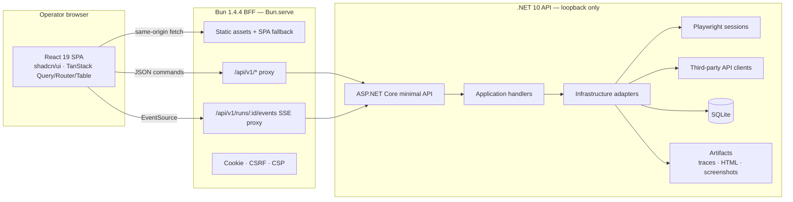
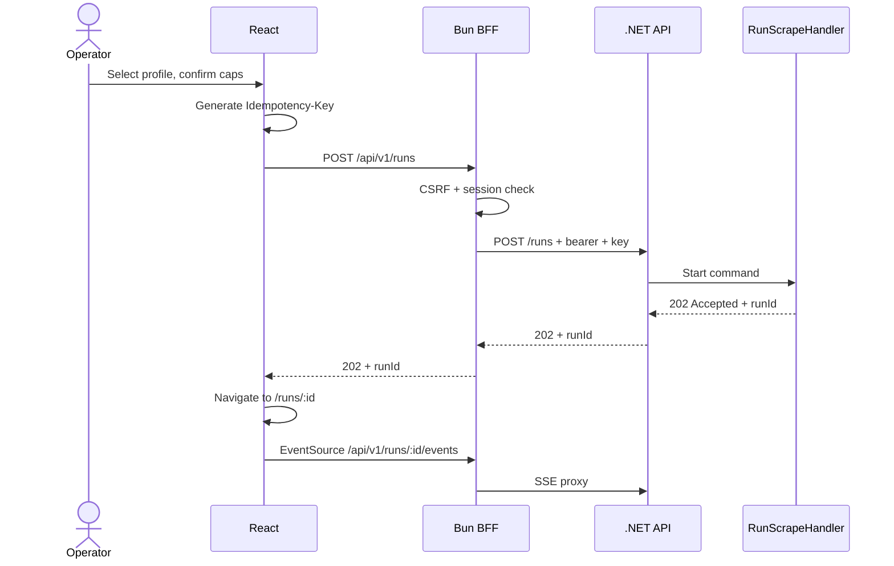
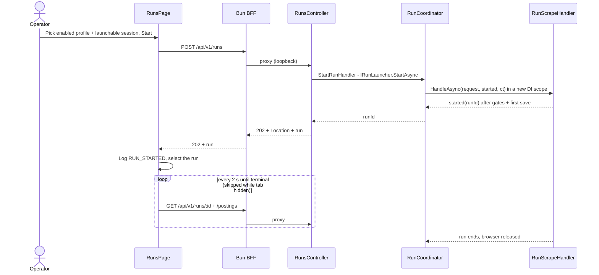

# Web Cockpit (v2) — React + Bun Control Plane

> **Purpose:** specify the central control system — the “cockpit” — that commands the .NET API to run scraping, monitoring, exports, and diagnostics.
>
> **Status:** Ops deck live in `src/frontend/`: BFF + seven hash-routed pages
> (overview, health, profiles, sources, sessions, runs, topology) over the
> tested API. Runs can be started, followed, and cancelled from `#/runs`
> against the live Naukri adapter. Full v2 scope per §2 below; what is not
> built yet is called out per section.
>
> **Verified:** 2026-10-29 · Bun `1.4.4` · React `19.3.1` · TypeScript `7.0.2` · Tailwind CSS `4.3.3` · shadcn CLI `4.23.0`
>
> **Related:** [Architecture](02-architecture.md) · [CLI-first ADR](10-adr/0008-cli-first-api-later.md) · [Cockpit ADR](10-adr/0010-react-bun-cockpit.md) · [Testing Strategy](06-testing-strategy.md) · [Operations Runbook](09-operations-runbook.md)

---

## 1. Why this exists

The .NET side is the **data plane**: it owns Playwright sessions, source adapters, third-party API clients, parsing, persistence, quotas, and compliance policy.

The cockpit is the **control plane**: a local web application where the operator can:

- see the health of the engine and every source;
- create and manage search profiles;
- start, pause, resume, and cancel runs;
- watch live progress, pages, postings, challenges, and artifacts;
- browse, filter, and export collected jobs;
- inspect browser sessions and trigger manual login/probe;
- review quotas, circuit breakers, logs, and diagnostics.

It sends **commands** to the .NET API; it never scrapes, never launches a browser, and never talks to Naukri/Indeed/LinkedIn directly.

```text
Operator → React cockpit → Bun BFF → .NET API → Application handlers
                                                 ├── Playwright sessions
                                                 ├── third-party API clients
                                                 └── SQLite + artifacts
```

---

## 2. Scope and non-goals

### In scope (v2.0)

| Capability | Cockpit responsibility |
|---|---|
| Dashboard | Active runs, quotas, challenge alerts, success rate, postings today, engine health |
| Sources | Capabilities, compliance tier, enabled state, caps, circuit status |
| Search profiles | Create, edit, duplicate, enable/disable, delete |
| Runs | Start, cancel, resume, live timeline, stats, artifacts, logs |
| Jobs | Search, filter, sort, paginate, detail drawer, CSV/XLSX export |
| Sessions | Browser profiles, state, cooldown, probe, manual-login instructions |
| Diagnostics | `doctor` results, pending migrations, dependency versions, retention |
| Command palette | Keyboard-first access to runs, jobs, profiles, and actions |

### Out of scope

- Scraping logic, selectors, browser automation, CAPTCHA handling, or compliance decisions in the browser.
- Solving challenges, spoofing fingerprints, rotating proxies, or bypassing access controls.
- Auto-apply, recruiter harvesting, messaging, or profile scraping.
- Multi-tenant auth, RBAC, billing, or public internet exposure.
- A second source of truth: SQLite in .NET remains authoritative; the cockpit is a view and command surface.

> **Hard rule:** every policy, cap, consent gate, and stop-on-wall decision is enforced by the .NET API. The UI may explain and visualize them; it cannot override them.

---

## 3. Decisions at a glance

| Area | Decision |
|---|---|
| UI | React `19.3.1` single-page application, client-rendered |
| Language | TypeScript `7.0.2`; type-checked with `bun check` |
| Styling | Tailwind CSS `4.3.3` (CSS-first, no `tailwind.config.js`) |
| Components | shadcn CLI `4.23.0`; components copied into the repo |
| Runtime / server | Bun `1.4.4`; `Bun.serve` as same-origin BFF |
| Package manager | Bun's native package manager only; `bun install`/`bun ci`, `bun.lock`; no npm/yarn/pnpm |
| Bundler / dev server | Bun bundler + HTML imports + HMR; no Vite/webpack |
| Tests | `bun test` + happy-dom + Testing Library; .NET Playwright for E2E |
| Formatting | `bun fmt` (built into Bun 1.4.4); no Prettier/Biome |
| Linting | `bun check` for types; optional `oxlint` |
| Compiler | `bun build --compile` for a single-file BFF executable |
| API transport | HTTP/JSON + Server-Sent Events (SSE) |
| Auth | Loopback bind, HttpOnly cookie, CSRF double-submit, bearer token BFF→API |
| Deployment | Local-first; optional single binary; no Node runtime anywhere |

---

## 4. Architecture



### 4.1 Why a Bun BFF instead of browser → .NET directly

- **No CORS surface.** The browser only talks to its own origin.
- **No API token in the browser.** The BFF injects the bearer token server-side.
- **One cookie model.** HttpOnly session cookie and CSRF checks live in one place.
- **SSE normalization.** The BFF can heartbeat, reconnect, and replay from `Last-Event-ID`.
- **Static hosting.** Bun serves the built SPA and the API proxy from one process.
- **Future flexibility.** If the .NET API moves or adds TLS, only the BFF changes.

### 4.2 Runtime topology

| Mode | Process | Port | Notes |
|---|---|---|---|
| Development | `bun --hot src/server/dev.ts` + Tailwind watch | `5173` | HMR, source maps, detailed errors |
| Development | .NET API (`dotnet run --project src/JobLens.Api`) | `5080` | Loopback only |
| Production | `bun dist/server/index.js` or compiled binary | `5173` | Prebuilt assets, minified, no HMR |
| Production | .NET API | `5080` | Loopback only; bearer token required |

The cockpit and API are separate processes. The cockpit must not host the scraping engine in-process.

---

## 5. Technology stack and versions

### 5.1 Core

| Package | Version | Role |
|---|---:|---|
| `bun` | `1.4.4` | Runtime, package manager, bundler, dev server, test runner, compiler, formatter, type checker |
| `react` / `react-dom` | `19.3.1` | UI runtime |
| `typescript` | `7.0.2` | Editor parity with `bun check` (checking itself needs no `typescript` package) |
| `tailwindcss` | `4.3.3` | Utility CSS, CSS-first configuration |
| `@tailwindcss/cli` | `4.3.3` | Official Tailwind build/watch CLI (runs under Bun) |
| `shadcn` | `4.23.0` | CLI + `shadcn/tailwind.css` theme import; components are copied in |
| `@types/react` / `@types/react-dom` | `19.3.0` | React types |
| `@types/bun` | `1.4.4` | Bun globals and `bun:test` types |

### 5.2 Application libraries

| Package | Version | Role |
|---|---:|---|
| `@tanstack/react-query` | `5.105.0` | Server-state cache, retries, invalidation |
| `@tanstack/react-router` | `1.170.46` | Type-safe routing (code-based route tree) |
| `@tanstack/react-table` | `9.3.1` | Jobs/runs tables |
| `@tanstack/react-virtual` | `3.14.24` | Virtualized rows for large result sets |
| `react-hook-form` | `7.91.0` | Forms |
| `zod` | `4.6.7` | Runtime validation for forms and SSE payloads |
| `recharts` | `3.10.1` | shadcn charts |
| `lucide-react` | `1.64.0` | Icons |
| `sonner` | `2.0.8` | Toasts |
| `class-variance-authority` | `0.7.1` | shadcn variants |
| `cn` | `0.5.0` | shadcn `cn()` helper package |
| `tw-animate-css` | `1.4.0` | shadcn animation utilities |
| `date-fns` | `4.4.0` | Local date/time formatting |
| `openapi-typescript` | `7.13.0` | Generate types from the .NET OpenAPI document |
| `openapi-fetch` | `0.17.0` | Typed fetch client |

### 5.3 Test and tooling

| Package | Version | Role |
|---|---:|---|
| `happy-dom` | `21.0.4` | DOM implementation for `bun test` |
| `@happy-dom/global-registrator` | `21.0.4` | Register DOM globals before tests |
| `@testing-library/react` | `16.3.3` | Component tests |
| `@testing-library/jest-dom` | `7.0.1` | DOM matchers |
| `oxlint` | `1.90.0` | Optional lint rules (Rust binary; runs under Bun) |

### 5.4 Version policy

- Versions above were the latest stable releases on **2026-10-29**.
- Pin **exact** versions for the core stack; commit `bun.lock`.
- Upgrade monthly with one PR: `bun update --latest`, then `bun check`, `bun test`, `bun run build`, and a manual smoke test.
- Do not use `@latest` in code or scripts except for one-off discovery.
- `bun check` matches TypeScript **7.0.2**; install the same `typescript` version for editor agreement:
  ```sh
  bun add -d typescript@$(bun -p process.versions.typescript)
  ```

---

## 6. No Node.js policy

The machine runs **no Node.js**. Bun executes TypeScript, JSX, CSS, tests, and Node-targeted CLIs.

| Do not use | Use instead |
|---|---|
| `node`, `npm`, `npx`, `yarn`, `pnpm` | `bun`, `bunx --bun` |
| `package-lock.json`, `yarn.lock`, `pnpm-lock.yaml` | `bun.lock` |
| `ts-node`, `tsx` | `bun run` |
| `nodemon` | `bun --hot` |
| `dotenv` | Bun auto-loads `.env`; use `Bun.env` |
| `express`, `fastify` | `Bun.serve` |
| Vite, webpack, Rollup, esbuild CLI | Bun bundler + HTML imports |
| Jest, Vitest | `bun test` |
| Prettier, Biome formatter | `bun fmt` |
| `tsc --noEmit` | `bun check` |
| Next.js / Remix / SSR framework | React SPA + Bun BFF (no SSR) |
| Playwright JS test runner | Existing .NET Playwright E2E suite |
| `node:fs`, `node:path` (when avoidable) | `Bun.file`, `Bun.write`, `Bun.Glob`, `import.meta.dir` |

### 6.1 The one nuance

Some ecosystem CLIs (Tailwind, shadcn, `openapi-typescript`) are published as Node-targeted packages. Running them with `bunx --bun` uses **Bun** as the runtime; Node is never installed. This is allowed.

### 6.2 Forbidden in frontend code

- No `process.env` in client code; use `PUBLIC_*` inlining only for non-secret values, or same-origin endpoints.
- No secrets, API tokens, cookies, or profile paths in `localStorage`, `sessionStorage`, URLs, or client bundles.
- No direct calls from the browser to Naukri/Indeed/LinkedIn or the .NET API.
- No scraping, challenge solving, or browser automation in the cockpit.

---

## 7. Project layout

```text
PlaywrightDotNet/
├── src/                                (.NET, unchanged)
├── tests/                              (.NET, unchanged)
├── docs/
└── web/                                (new, Bun package)
    ├── package.json
    ├── bun.lock
    ├── bunfig.toml
    ├── tsconfig.json
    ├── components.json
    ├── .env.example
    ├── src/
    │   ├── server/
    │   │   ├── index.ts                # Bun.serve entry
    │   │   ├── config.ts               # Bun.env parsing and validation
    │   │   ├── auth.ts                 # token file, cookie, CSRF
    │   │   ├── proxy.ts                # /api/v1/* → .NET
    │   │   ├── sse.ts                  # /api/v1/runs/:id/events → .NET
    │   │   ├── security.ts             # CSP and headers
    │   │   └── logging.ts              # structured JSON logs
    │   ├── client/
    │   │   ├── index.html
    │   │   ├── main.tsx
    │   │   ├── app.tsx
    │   │   ├── router.tsx
    │   │   ├── routes/
    │   │   │   ├── dashboard.tsx
    │   │   │   ├── sources.tsx
    │   │   │   ├── profiles.tsx
    │   │   │   ├── runs.tsx
    │   │   │   ├── run-detail.tsx
    │   │   │   ├── jobs.tsx
    │   │   │   ├── sessions.tsx
    │   │   │   ├── exports.tsx
    │   │   │   ├── diagnostics.tsx
    │   │   │   └── settings.tsx
    │   │   ├── components/
    │   │   │   ├── ui/                 # shadcn-generated
    │   │   │   └── app/                # shell, status, tables, timeline
    │   │   ├── features/               # runs, jobs, sources, sessions, exports
    │   │   ├── hooks/
    │   │   ├── lib/
    │   │   │   ├── api.ts              # openapi-fetch client + middleware
    │   │   │   ├── query.ts            # TanStack Query client/keys
    │   │   │   ├── sse.ts              # EventSource + cache reducer
    │   │   │   └── format.ts
    │   │   └── styles/
    │   │       ├── globals.css         # Tailwind v4 + shadcn theme
    │   │       └── generated.css       # Tailwind output (gitignored)
    │   ├── shared/
    │   │   ├── contracts.ts            # generated OpenAPI types
    │   │   ├── events.ts               # SSE event types
    │   │   └── schemas.ts              # zod schemas for forms/events
    │   └── tests/
    │       ├── setup.ts                # happy-dom + jest-dom
    │       ├── server/                 # BFF, auth, proxy, SSE tests
    │       └── client/                 # component and reducer tests
    ├── public/                         # favicon, static files
    └── dist/                           # build output (gitignored)
```

`web/` is a standalone Bun package, not a Bun workspace. The .NET solution remains the root project.

---

## 8. Toolchain and scripts

### 8.1 `package.json`

```json
{
  "name": "joblens-cockpit",
  "private": true,
  "type": "module",
  "packageManager": "bun@1.4.4",
  "trustedDependencies": [],
  "scripts": {
    "dev": "bun run --parallel dev:server dev:css",
    "dev:server": "bun --hot src/server/dev.ts",
    "dev:css": "bunx --bun tailwindcss -i ./src/client/styles/globals.css -o ./src/client/styles/generated.css --watch=always",
    "build": "bun run build:css && bun run build:client && bun run build:server",
    "build:css": "bunx --bun tailwindcss -i ./src/client/styles/globals.css -o ./src/client/styles/generated.css --minify",
    "build:client": "bun build ./src/client/index.html --outdir ./dist/client --minify --splitting --sourcemap=linked",
    "build:server": "bun build ./src/server/index.ts --target=bun --outdir ./dist/server --minify",
    "start": "NODE_ENV=production bun ./dist/server/index.js",
    "typecheck": "bun check",
    "format": "bun fmt",
    "format:check": "bun fmt --check",
    "test": "bun test",
    "test:watch": "bun test --watch",
    "compile": "bun build --compile --target=bun ./src/server/index.ts --outfile ./dist/joblens-cockpit",
    "api:types": "bunx --bun openapi-typescript@7.13.0 http://127.0.0.1:5080/openapi/v1.json -o ./src/shared/contracts.ts",
    "audit": "bun audit"
  }
}
```

Notes:

- `bun run --parallel` requires Bun `1.3.9+`; `1.4.4` is fine.
- `bun tailwindcss` resolves the local `@tailwindcss/cli` binary.
- `bun fmt` is built in; do not add Prettier or Biome.
- `bun check` is built in; do not add `ts-node` or a `tsc` script.
- The build order is strict: CSS → client bundle → server bundle.

### 8.2 Native Bun package manager

The cockpit uses **Bun's native package manager exclusively**. Do not install or invoke npm, npx, yarn, pnpm, or Corepack — locally, in scripts, in CI, or in Dockerfiles.

```sh
cd web

bun install                   # resolve, install, write bun.lock
bun add react@19.3.1          # exact dependency
bun add -d @types/bun@1.4.4   # dev dependency
bun remove <pkg>
bun update --latest           # only in a deliberate upgrade PR
bun ci                        # CI: frozen lockfile, fail on drift
```

Rules:

- **Commit `bun.lock`.** It is Bun's text lockfile. Never commit `bun.lockb`, `package-lock.json`, `yarn.lock`, or `pnpm-lock.yaml`.
- **CI and release builds use `bun ci`**, which is `bun install --frozen-lockfile`. It fails if `package.json` and `bun.lock` disagree.
- **Local installs use `bun install`.** It installs `dependencies`, `devDependencies`, `optionalDependencies`, and peer dependencies by default.
- **Lifecycle scripts are blocked by default.** Allowlist only packages that genuinely need `postinstall` in `package.json`:
  ```json
  { "trustedDependencies": ["package-that-needs-postinstall"] }
  ```
  Every addition needs a reason in the PR. Do not allowlist a package just to silence a warning.
- **Supply-chain delay:** `minimumReleaseAge = "3d"` skips versions published less than three days ago. Use `--minimum-release-age-excludes` only for a vetted security fix.
- **Native management commands:**
  - `bun pm ls`, `bun pm why <pkg>`, `bun pm view <pkg>` — inspect the tree.
  - `bun pm fetch` — warm the cache without creating `node_modules` (Docker/CI).
  - `bun pm cache prune`, `bun pm cache pack/unpack` — cache maintenance.
  - `bun pm trust <pkg>` — allow a lifecycle script intentionally.
  - `bun pm migrate` — only when importing an existing npm/yarn/pnpm project; not used here.
- **Diagnostics:** `bun install --dry-run`, `--verbose`, `--offline`, `--prefer-offline`.
- **One-off CLIs:** `bunx --bun <tool>`; it prefers the locked local version when present.
- **Configuration:** `bunfig.toml` is the native install config. `.npmrc` is only for registry/auth compatibility, never for install policy.
- **`node_modules` still exists.** “No Node.js” means no Node runtime, not the absence of `node_modules`.
- **No package-manager translation layer.** Do not document or rely on npm/yarn/pnpm flags; use Bun's own commands.

`bunfig.toml` install policy:

```toml
[install]
# Single-package app. Use "isolated" if strict dependency isolation is preferred.
linker = "hoisted"
# Supply-chain guard: skip versions published less than 3 days ago.
minimumReleaseAge = "3d"
```

Why native Bun install:

- One lockfile (`bun.lock`) and one resolver for dev, CI, and release.
- Faster installs and a smaller toolchain footprint.
- No Node/Corepack requirement on any machine.
- Lifecycle-script blocking and `minimumReleaseAge` are first-class supply-chain controls.
- `bun ci` makes release builds reproducible.

### 8.3 `bunfig.toml`

```toml
[install]
# Single-package app. Use "isolated" if strict dependency isolation is preferred.
linker = "hoisted"
# Supply-chain guard: skip versions published less than 3 days ago.
minimumReleaseAge = "3d"

[fmt]
printWidth = 100
sortImports = true
sortTailwindcss = true
sortPackageJson = true

[test]
preload = ["./src/tests/setup.ts"]
```

Optional public build-time values (never secrets):

```toml
[serve.static]
env = "PUBLIC_*"
```

### 8.4 `tsconfig.json`

```json
{
  "compilerOptions": {
    "target": "ESNext",
    "lib": ["ESNext", "DOM", "DOM.Iterable"],
    "module": "Preserve",
    "moduleDetection": "force",
    "moduleResolution": "bundler",
    "jsx": "react-jsx",
    "allowJs": true,
    "types": ["bun", "react"],
    "allowImportingTsExtensions": true,
    "verbatimModuleSyntax": true,
    "noEmit": true,
    "strict": true,
    "skipLibCheck": true,
    "noFallthroughCasesInSwitch": true,
    "noUncheckedIndexedAccess": true,
    "noImplicitOverride": true,
    "resolveJsonModule": true,
    "isolatedModules": true,
    "paths": {
      "@/*": ["./src/client/*"]
    }
  },
  "include": ["src/**/*.ts", "src/**/*.tsx", "src/**/*.d.ts"]
}
```

TypeScript 6.0 changed `types` to default to an empty array, so every global `@types` package must be listed. `"bun"` provides `Bun`, `bun:test`, and runtime globals; `"react"` provides React’s global/JSX types. The rest follows Bun’s recommended TS 6/7 setup: `module: Preserve`, `moduleDetection: force`, `moduleResolution: bundler`, `allowImportingTsExtensions`, `verbatimModuleSyntax`, `noEmit`, `strict`, `noFallthroughCasesInSwitch`, `noUncheckedIndexedAccess`, `noImplicitOverride`. DOM libs are kept because the client is a browser app. `bun check` behaves like TypeScript 7 regardless of the installed `typescript` version.

### 8.5 Install

```sh
cd web

bun init --react

bun add react@19.3.1 react-dom@19.3.1
bun add @tanstack/react-query@5.105.0 @tanstack/react-router@1.170.46 \
  @tanstack/react-table@9.3.1 @tanstack/react-virtual@3.14.24
bun add react-hook-form@7.91.0 zod@4.6.7 recharts@3.10.1 \
  lucide-react@1.64.0 sonner@2.0.8 date-fns@4.4.0
bun add openapi-fetch@0.17.0
bun add shadcn@4.23.0 class-variance-authority@0.7.1 cn@0.5.0 tw-animate-css@1.4.0

bun add -d @types/bun@1.4.4 @types/react@19.3.0 @types/react-dom@19.3.0 \
  typescript@7.0.2 tailwindcss@4.3.3 @tailwindcss/cli@4.3.3 \
  @happy-dom/global-registrator@21.0.4 happy-dom@21.0.4 \
  @testing-library/react@16.3.3 @testing-library/jest-dom@7.0.1 \
  openapi-typescript@7.13.0 oxlint@1.90.0
```

`bun init --react` creates the full-stack React template (`Bun.serve` + HTML imports + HMR). Keep its server/frontend split and replace the demo files.

---

## 9. Tailwind CSS v4

Tailwind v4 is **CSS-first**. There is no `tailwind.config.js`.

```css
/* src/client/styles/globals.css */
@import "tailwindcss";
@import "tw-animate-css";
@import "shadcn/tailwind.css";

@custom-variant dark (&:is(.dark *));

@theme inline {
  /* shadcn semantic tokens: background, foreground, card, primary, ... */
}

:root {
  --radius: 0.625rem;
  /* light theme tokens */
}

.dark {
  /* dark theme tokens */
}
```

- `shadcn init` writes the full token block and `.dark` values; do not hand-maintain a parallel theme.
- `generated.css` is the Tailwind CLI output and is gitignored.
- `src/client/index.html` links `./styles/generated.css`.
- Tailwind v4 scans source files automatically. If it scans build output, add explicit `@source` / `@source not` rules.

### 9.1 Why the official Tailwind CLI

Bun's bundler has a native `bun-plugin-tailwind` path, but it is not an official Tailwind release and can lag the Tailwind version. Use `@tailwindcss/cli@4.3.3` so the CSS version matches `tailwindcss@4.3.3` exactly. The CLI runs under Bun; no Node is installed.

If the project later standardizes on `bun-plugin-tailwind`, treat it as a bundled dependency upgrade and re-test the shadcn theme.

---

## 10. shadcn/ui

### 10.1 Initialization

```sh
cd web
bunx --bun shadcn@4.23.0 init
```

Accept the CLI defaults. It creates:

- `components.json`
- `src/client/lib/utils.ts` re-exporting `cn` from the `cn` package
- Tailwind v4 theme tokens in `globals.css`
- `@/*` alias wiring (verify against `tsconfig.json`)

### 10.2 `components.json`

```json
{
  "$schema": "https://ui.shadcn.com/schema.json",
  "style": "base-nova",
  "rsc": false,
  "tsx": true,
  "tailwind": {
    "config": "",
    "css": "src/client/styles/globals.css",
    "baseColor": "neutral",
    "cssVariables": true,
    "prefix": ""
  },
  "aliases": {
    "components": "@/components",
    "utils": "@/lib/utils",
    "ui": "@/components/ui",
    "lib": "@/lib",
    "hooks": "@/hooks"
  },
  "iconLibrary": "lucide"
}
```

`"config": ""` is correct for Tailwind v4. `"rsc": false` because the cockpit is a client-rendered SPA.

### 10.3 Components to add

```sh
bunx --bun shadcn@4.23.0 add \
  sidebar breadcrumb navigation-menu command \
  button button-group card badge empty spinner kbd \
  input input-group textarea label field form select combobox checkbox switch slider \
  table pagination tabs dialog alert-dialog sheet drawer \
  dropdown-menu context-menu popover hover-card tooltip menubar \
  progress skeleton separator scroll-area resizable collapsible accordion \
  alert sonner chart calendar date-picker
```

Optional, if the registry provides them in the pinned CLI: `code-block`, `trace`, `message`, `attachment`.

`Data Table` is a **recipe**, not a single component: compose `table` with `@tanstack/react-table` and `@tanstack/react-virtual`.

### 10.4 Rules

- Components are **copied into the repo**; review every generated diff.
- Pin the CLI version in the command (`shadcn@4.23.0`), not `@latest`.
- Keep `components/ui` close to upstream; put product-specific composition in `components/app`.
- Use `bun fmt` to sort Tailwind classes after adding components.

---

## 11. Bun bundler, dev server, and compiler

### 11.1 Development

```ts
// src/server/index.ts
import homepage from "../client/index.html";

Bun.serve({
  hostname: "127.0.0.1",
  port: Number(Bun.env.PORT ?? 5173),
  development: {
    hmr: true,
    console: true,
  },
  routes: {
    // Specific SSE route must precede the API wildcard.
    "/api/v1/runs/:id/events": sse,
    "/api/*": proxy,
    "/healthz": () => Response.json({ status: "ok" }),
    "/*": homepage,
  },
});
```

- HTML imports bundle `<script>` and `<link>` tags automatically.
- `development: true` enables HMR, source maps, and detailed errors.
- `bun --hot` restarts the server on change; HMR handles the client.
- Tailwind runs in parallel via `bun run --parallel`.

### 11.2 Production build

```sh
bun run build
```

This produces:

```text
dist/
├── client/            # hashed JS/CSS assets + index.html
└── server/index.js    # Bun server bundle with the HTML manifest
```

Run with `bun run start`. Bun serves the prebuilt assets without rebundling.

### 11.3 Single-file executable

```sh
bun run compile
./dist/joblens-cockpit
```

`bun build --compile` embeds the server bundle. **W0 must verify** whether the HTML-import manifest and `dist/client` assets are embedded; if not, ship `dist/client` beside the binary and resolve it from `import.meta.dir`. Do not assume embedding without a spike.

### 11.4 Code splitting

- `bun build --splitting` creates route-level chunks.
- Lazy-load charts, the command palette, the job detail drawer, and diagnostics.
- Initial bundle budget: **≤ 250 KB gzip** excluding chart code.

---

## 12. .NET API contract — the command surface

The cockpit requires an HTTP API. This refines ADR-0008: the CLI remains the v1 interface; the API becomes the **v2.0** interface and the cockpit’s only backend.

### 12.1 Principles

- Base path: `/api/v1`.
- JSON only; UTF-8; ISO 8601 UTC timestamps.
- IDs are opaque strings (GUID or ULID).
- Errors use RFC 9457 Problem Details; `X-Correlation-Id` is returned on every response and `traceId` is included in problems.
- The API binds `127.0.0.1` and requires a bearer token from the BFF.
- No CORS: the browser never calls the API directly.
- Long-running work returns `202 Accepted` + a run/resource ID.
- Commands are idempotent where retries are possible.

### 12.2 Endpoints

| Method | Path | Purpose |
|---|---|---|
| `GET` | `/api/v1/health` | Liveness and version |
| `GET` | `/api/v1/features` | Anonymous capability report: the five `JobScrape:Features` booleans as camelCase JSON |
| `GET` | `/api/v1/doctor` | Environment checks, SDK, browsers, DB, migrations |
| `GET` | `/api/v1/sources` | Source capabilities, compliance tier, enabled state |
| `PATCH` | `/api/v1/sources/{key}` | Enable/disable within policy (guarded) |
| `GET` | `/api/v1/search-profiles` | List profiles |
| `POST` | `/api/v1/search-profiles` | Create profile |
| `GET` | `/api/v1/search-profiles/{id}` | Profile detail |
| `PUT` | `/api/v1/search-profiles/{id}` | Replace the editable profile fields, including the page window (`startPage`, `maxPages`) |
| `DELETE` | `/api/v1/search-profiles/{id}` | Delete profile |
| `POST` | `/api/v1/runs` | Start a run; `Idempotency-Key` required |
| `GET` | `/api/v1/runs` | List runs (filter/sort/page) |
| `GET` | `/api/v1/runs/{id}` | Run detail, stats, artifacts |
| `POST` | `/api/v1/runs/{id}/cancel` | Cooperative cancel |
| `GET` | `/api/v1/runs/{id}/events` | SSE stream |
| `GET` | `/api/v1/runs/{id}/artifacts` | Artifact list |
| `GET` | `/api/v1/artifacts/{id}` | Authenticated download |
| `GET` | `/api/v1/jobs` | Query jobs (filters, sort, page) |
| `GET` | `/api/v1/jobs/{id}` | Job detail |
| `POST` | `/api/v1/exports` | Create CSV/XLSX export |
| `GET` | `/api/v1/exports` | Export history |
| `GET` | `/api/v1/exports/{id}` | Status + download |
| `GET` | `/api/v1/sessions` | Browser profiles and states |
| `POST` | `/api/v1/sessions` | Create a browser profile |
| `PATCH` | `/api/v1/sessions/{id}` | Update name, engine, or channel |
| `POST` | `/api/v1/sessions/{id}/probe` | Probe a session |
| `POST` | `/api/v1/sessions/{id}/login` | Launch headed manual login on the host |
| `GET` | `/api/v1/quotas` | Per-source quota and circuit state |
| `GET` | `/api/v1/metrics/summary` | Dashboard aggregates |
| `GET` | `/openapi/v1.json` | OpenAPI 3.1 document |

> **As implemented (runs):** `RunsController` serves
> `POST /api/v1/runs` (body `{ profileId, browserProfileId, enrich = true }` →
> `202` + `Location` with the recorded run), `GET /api/v1/runs` (newest 50,
> `{ items, total }`), `GET /api/v1/runs/{id}`, `POST /api/v1/runs/{id}/cancel`
> (idempotent), and `GET /api/v1/runs/{id}/postings` (not in the table above:
> postings of the run's source whose `LastSeenAt` falls in the run's
> `[StartedAt, FinishedAt ?? now]` window, max 200 — valid because runs execute
> one at a time), and `GET /api/v1/runs/{id}/postings/export?format=csv|xlsx`
> (`text/csv` with BOM, or a `Jobs`-sheet workbook with posting-URL
> hyperlinks; max 20 000 rows; `400 EXPORT_FORMAT_UNSUPPORTED` for anything
> else). Add `group=only` or `group=exclude` to split the file by the
> run's company snapshot; `400 EXPORT_GROUP_UNSUPPORTED` for anything else
> and `400 EXPORT_COMPANIES_MISSING` when the run has no company list. New codes: `404 RUN_NOT_FOUND`, `409 RUN_IN_PROGRESS` (one
> run at a time; carries `activeRunId`), `503 RUN_NOT_STARTED` (the API stopped
> before the run was recorded); gate refusals keep their own codes
> (`PROFILE_DISABLED`, `QUOTA_EXCEEDED`, …). Feature flags change route
> behavior: `Health=false` turns `GET /api/v1/health` into the
> `FEATURE_DISABLED` 404 problem, `CsvExport`/`ExcelExport=false`
> unregisters that export writer (the export default falls through to the
> remaining format, or to the same `FEATURE_DISABLED` 404 when both are
> off), and `Logging=false` registers Serilog with no sinks.
> `GET /api/v1/features` itself stays anonymous in every flag combination.
> **Not implemented:** `Idempotency-Key` on `POST /runs`, `/runs/{id}/events`
> (SSE), `/runs/{id}/resume`, `/runs/{id}/artifacts`, `/artifacts/{id}`, and
> BFF auth (§13.4). Sources are read-only. Sessions support create and
> `PATCH` for name, engine, and channel; probe and login are not implemented.
> Search profiles and sessions both have edit forms in the cockpit.

### 12.3 Run lifecycle

Use the domain stages from [Domain Model §6.1](03-domain-model.md):

```text
Pending → StartingSession → Searching → Enriching → Persisting → Completed
                │              │            │
                │              ├── PausedForChallenge ──→ Searching / Enriching
                │              └── RateLimited ─────────→ Searching
                └── Failed
Any non-terminal → Cancelling → Cancelled
```

The UI must render the domain stages verbatim; do not invent a parallel status model. `RunStage` is the contract.

### 12.4 SSE events

> **Not implemented.** No SSE endpoint or BFF SSE proxy exists. The cockpit
> uses this section's documented fallback: it polls `GET /api/v1/runs/{id}`
> (and the run's postings) every 2 s while the selected run executes.

Wire format:

```text
id: 01JBC...
event: run.page
retry: 3000
data: {"runId":"01JBC...","sequence":42,"at":"2026-10-29T12:00:00Z","page":2,"postingsFound":20,"newPostings":18}

```

Envelope:

```json
{
  "id": "01JBC...",
  "type": "run.page",
  "runId": "01JBC...",
  "sequence": 42,
  "at": "2026-10-29T12:00:00Z",
  "data": {}
}
```

| Event | Meaning |
|---|---|
| `run.queued` | Accepted, not started |
| `run.started` | Session bootstrap began |
| `run.stage` | Stage transition |
| `run.page` | Page captured and persisted |
| `run.posting` | New or updated posting (batched) |
| `run.challenge` | Challenge classified; artifact pending |
| `run.paused` | Paused for challenge or rate limit |
| `run.resumed` | Operator resumed |
| `run.completed` | Terminal success |
| `run.failed` | Terminal failure |
| `run.cancelled` | Terminal cancellation |
| `session.updated` | Browser profile state change |
| `quota.updated` | Quota or circuit-breaker change |
| `export.ready` | Export file available |
| `heartbeat` | Keepalive; no state change |

Rules:

- **Server-authoritative.** The UI never guesses a terminal state.
- `sequence` is monotonic per run; the client ignores duplicates and out-of-order events.
- `Last-Event-ID` resumes after a disconnect; the API keeps a bounded replay buffer per run.
- Heartbeat every **15 s**; client reconnect with exponential backoff and jitter.
- Fallback to polling `/runs/{id}` every 2–5 s if SSE fails twice.
- Batched `run.posting` events at most once per page to avoid render storms.

### 12.5 Errors

Every error uses **RFC 9457 Problem Details** with content type `application/problem+json`. The standard members are `type`, `title`, `status`, `detail`, and `instance`; JobLens adds stable `code`, `traceId`, optional `retryAfter`, and field-level `errors` for validation.

```json
{
  "type": "https://joblens.local/problems/run-already-active",
  "title": "A run is already active for this source",
  "status": 409,
  "detail": "Source 'naukri' has an active run.",
  "instance": "/api/v1/runs",
  "code": "RUN_ALREADY_ACTIVE",
  "traceId": "00-4bf92f3577b34da6a3ce929d0e0e4736-00f067aa0ba902b7-01"
}
```

| Status | Stable codes |
|---|---|
| `400` | `VALIDATION_FAILED` (with `errors` keyed by request field) |
| `403` | `COMPLIANCE_BLOCKED` |
| `404` | `PROFILE_NOT_FOUND`, `RUN_NOT_FOUND`, `JOB_NOT_FOUND` |
| `409` | `RUN_ALREADY_ACTIVE`, `SOURCE_CHALLENGE` |
| `423` | `SOURCE_COOLING_DOWN` |
| `429` | `RATE_LIMITED`, `QUOTA_EXCEEDED` |
| `502` | `SOURCE_CHANGED` |
| `503` | `SOURCE_UNAVAILABLE`, `SOURCE_CIRCUIT_OPEN` |
| `507` | `STORAGE_LOW_DISK` |
| `500` | `INTERNAL_ERROR` |

- `code` is the UI contract; `title` and `detail` are human-readable and may change.
- `detail` is safe for the operator. Never expose stack traces, SQL, cookies, HTML, authorization headers, or filesystem paths.
- `traceId` is always present on `5xx`; log it server-side.
- A failed SSE stream emits a typed `run.failed` event, not a Problem Details body.
- The BFF forwards the problem body and content type unchanged.
- Use `AddProblemDetails()`, `UseExceptionHandler()`, and one Result-to-Problem mapper. Endpoints do not hand-build error JSON.

Full contract, mapping table, and tests: [Application Patterns §6](14-application-patterns.md#6-problem-details-pattern). Log correlation, retention, and redaction: [Runtime Hardening §2](15-runtime-hardening.md#2-structured-logging-with-serilog).

### 12.6 Pagination, sorting, idempotency

```text
GET /api/v1/jobs?source=naukri&q=dotnet&page=1&pageSize=25&sort=-lastSeenAt
```

```json
{
  "items": [],
  "page": 1,
  "pageSize": 25,
  "total": 1234
}
```

- `pageSize` max 100; jobs table uses 25/50/100.
- `sort` uses `field` or `-field` for descending.
- `POST /runs` and `POST /exports` require `Idempotency-Key`; replay returns the original response. *(Not implemented: `POST /runs` ignores the header; one-run-at-a-time (`409 RUN_IN_PROGRESS`) is the only duplicate guard today.)*
- `POST /runs/{id}/cancel` is idempotent: cancelling a terminal run returns `200` with the current state. *(Implemented: an executing run is signalled and cancels cooperatively; a paused run that is not executing is cancelled directly.)*

### 12.7 Generated types

```sh
bun run api:types
```

`openapi-typescript` writes `src/shared/contracts.ts`. CI regenerates and fails on drift. Use `openapi-fetch` with a middleware that adds the CSRF header and maps Problem Details.

### 12.8 Local API reference and testing (Scalar)

Use **Scalar.AspNetCore** as the local, interactive API reference. It is a development tool, not part of the production API or the cockpit bundle.

```csharp
using Scalar.AspNetCore;

builder.Services.AddOpenApi(); // OpenAPI document v1

if (app.Environment.IsDevelopment())
{
    app.MapOpenApi().AllowAnonymous(); // /openapi/v1.json

    app.MapScalarApiReference("/scalar", options =>
    {
        options
            .WithTitle("JobLens API v1")
            .WithDefaultHttpClient(ScalarTarget.CSharp, ScalarClient.HttpClient)
            .AddPreferredSecuritySchemes("Bearer");
    }).AllowAnonymous();
}
```

- **OpenAPI:** `AddOpenApi()` generates the document; `MapOpenApi()` serves `/openapi/v1.json`. The same document feeds `bun run api:types`.
- **Scalar:** open `http://127.0.0.1:<port>/scalar` while the API runs. Use `/scalar/v1` if multiple documents are registered.
- **Placement:** Development-only is Scalar’s recommended and security-appropriate placement. `Microsoft.AspNetCore.OpenApi` and `Scalar.AspNetCore` are used as documented.
- **Security:** the Scalar and OpenAPI endpoints are anonymous only inside the Development block. The API endpoints still require the bearer token. Add a `Bearer` HTTP security scheme to the OpenAPI document (via a document transformer) so Scalar can supply the header; see [Microsoft OpenAPI docs](https://learn.microsoft.com/aspnet/core/fundamentals/openapi/aspnetcore-openapi).
- **No secrets:** never prefill a real token with `AddHttpAuthentication` or enable persistent authentication. Paste a short-lived dev token into the UI, or read it from a local secret.
- **Privacy:** `.DisableAgent()` and `.DisableDefaultFonts()` are optional privacy hardening. Scalar assets are local by default.
- **Exposure:** bind the API to `127.0.0.1`; never proxy `/scalar` through the BFF, expose it on a tunnel, or add its origins to the production CSP.
- **Testing flow:** start `JobLens.Api`, open `/scalar`, authorize with the dev token, then exercise `GET /api/v1/health`, `GET /api/v1/runs`, and `POST /api/v1/runs` with an `Idempotency-Key`.
- **Contract check:** compare the Scalar view with `/openapi/v1.json`; generated TypeScript must come from the same document, not a hand-maintained copy.

Packages: `Microsoft.AspNetCore.OpenApi` `10.0.14` and `Scalar.AspNetCore` `2.18.5` (Development only).

---

## 13. Bun BFF

### 13.1 Responsibilities

| Concern | BFF behavior |
|---|---|
| Static hosting | Serve `dist/client`, hashed immutable assets, SPA fallback |
| API proxy | `/api/v1/*` → `JOBLENS_API_URL`, inject bearer token |
| SSE proxy | Stream `text/event-stream`, disable buffering, pass `Last-Event-ID` |
| Auth | Login, HttpOnly cookie, session expiry |
| CSRF | Double-submit cookie + `Origin` check on mutations |
| Security headers | CSP, `X-Content-Type-Options`, `Referrer-Policy`, `Permissions-Policy` |
| Request IDs | Generate `X-Request-Id`, log, propagate |
| Limits | Body size cap, timeouts, login rate limit |
| Health | `/healthz` (BFF), `/readyz` (API reachable) |

### 13.2 Proxy sketch

```ts
async function proxy(req: Request): Promise<Response> {
  const incoming = new URL(req.url);
  const target = new URL(incoming.pathname + incoming.search, Bun.env.JOBLENS_API_URL);

  const headers = new Headers(req.headers);
  headers.delete("cookie");
  headers.delete("host");
  headers.set("authorization", `Bearer ${Bun.env.JOBLENS_API_TOKEN}`);
  headers.set("x-request-id", crypto.randomUUID());

  const hasBody = req.method !== "GET" && req.method !== "HEAD";
  const upstream = await fetch(target, {
    method: req.method,
    headers,
    body: hasBody ? req.body : undefined,
    redirect: "manual",
    signal: AbortSignal.timeout(30_000),
  });

  const responseHeaders = new Headers(upstream.headers);
  responseHeaders.delete("set-cookie");
  responseHeaders.delete("content-encoding");
  return new Response(upstream.body, {
    status: upstream.status,
    headers: responseHeaders,
  });
}
```

### 13.3 SSE proxy sketch

```ts
async function sse(req: Request): Promise<Response> {
  const incoming = new URL(req.url);
  const target = new URL(incoming.pathname + incoming.search, Bun.env.JOBLENS_API_URL);

  const headers = new Headers({ accept: "text/event-stream" });
  headers.set("authorization", `Bearer ${Bun.env.JOBLENS_API_TOKEN}`);
  const lastEventId = req.headers.get("last-event-id");
  if (lastEventId) headers.set("last-event-id", lastEventId);

  const upstream = await fetch(target, { headers, signal: req.signal });
  if (!upstream.ok || !upstream.body) {
    return Response.json({ title: "Event stream unavailable" }, { status: 502 });
  }

  return new Response(upstream.body, {
    headers: {
      "content-type": "text/event-stream; charset=utf-8",
      "cache-control": "no-cache, no-transform",
      "x-accel-buffering": "no",
      connection: "keep-alive",
    },
  });
}
```

### 13.4 Auth and CSRF

> **Not implemented.** The BFF proxies `/api/*` without a session, CSRF
> check, or bearer token; both processes bind loopback only.

- **Bootstrap:** on first run, generate a 32-byte token, print it once, and store only an Argon2id hash in `~/.config/joblens/cockpit.token` (mode `0600`). For automation, `JOBLENS_COCKPIT_TOKEN` may supply the plaintext; the BFF hashes it in memory at startup.
- **Login:** the operator pastes the token; `Bun.password.verify` checks it against the stored hash, then sets:
  - `joblens_session` — `HttpOnly; SameSite=Strict; Path=/; Secure` (Secure only with TLS)
  - `joblens_csrf` — readable, random, same lifetime
- **Mutations:** require `X-CSRF-Token` to equal the `joblens_csrf` cookie and validate `Origin`/`Sec-Fetch-Site`.
- **Expiry:** 12 h idle, 7 days absolute; “Sign out” clears both cookies.
- **BFF→API:** `JOBLENS_API_TOKEN` is server-only, never inlined, never logged.
- **Remote access:** disabled by default. LAN access requires explicit `JOBLENS_ALLOW_REMOTE=1`, TLS, and a trusted network (Tailscale/SSH tunnel preferred).

### 13.5 Security headers

```text
Content-Security-Policy:
  default-src 'self';
  script-src 'self';
  style-src 'self' 'unsafe-inline';
  img-src 'self' data: blob:;
  connect-src 'self';
  font-src 'self';
  frame-ancestors 'none';
  base-uri 'none';
  form-action 'self'
X-Content-Type-Options: nosniff
Referrer-Policy: no-referrer
Permissions-Policy: camera=(), microphone=(), geolocation=()
Cross-Origin-Opener-Policy: same-origin
Cross-Origin-Resource-Policy: same-origin
```

`style-src 'unsafe-inline'` is a pragmatic allowance for React/shadcn runtime styles. Do not add `script-src 'unsafe-inline'`.

### 13.6 Environment

| Variable | Example | Scope |
|---|---|---|
| `PORT` | `5173` | BFF |
| `HOST` | `127.0.0.1` | BFF |
| `JOBLENS_API_URL` | `http://127.0.0.1:5080` | BFF only |
| `JOBLENS_API_TOKEN` | random 32+ bytes | BFF only, secret |
| `JOBLENS_COCKPIT_TOKEN` | random 32+ bytes | BFF only, secret; optional (dev/automation) |
| `JOBLENS_COCKPIT_TOKEN_FILE` | `~/.config/joblens/cockpit.token` | BFF; Argon2id hash file |
| `NODE_ENV` | `production` | BFF |
| `PUBLIC_*` | non-secret UI flags | may be inlined at build |

Bun auto-loads `.env`, `.env.local`, and `.env.production`; do not add `dotenv`.

### 13.7 Failure behavior

| Failure | Behavior |
|---|---|
| API unreachable | `/readyz` 503, UI banner, commands disabled |
| SSE disconnected | Auto-reconnect with backoff; fallback polling; “Live updates paused” |
| API 409/423/429 | Inline explanation, countdown, no retry storm |
| Invalid CSRF | `403`, force sign-in; never retry automatically |
| Upstream timeout | `504` with request ID; safe to retry GET only |
| Client navigation during run | Run continues; state rehydrates from API |

---

## 14. React application

### 14.1 Routes

| Route | Page |
|---|---|
| `/` | Dashboard |
| `/sources` | Source cards, compliance gates, circuit state |
| `/profiles` | Search profile table + create/edit |
| `/runs` | Run history |
| `/runs/:runId` | Live run detail and timeline |
| `/jobs` | Job explorer |
| `/jobs/:jobId` | Job detail (drawer route) |
| `/sessions` | Browser profiles and session states |
| `/exports` | Export history and downloads |
| `/diagnostics` | `doctor`, logs, artifacts, retention |
| `/settings` | Local preferences; no secrets |

> **As implemented:** a pure hash router (`src/client/lib/router.ts`, no
> TanStack Router) with seven stops: `#/overview` (01), `#/health` (02),
> `#/profiles` (03), `#/sources` (04), `#/sessions` (05), `#/runs` (06), and
> `#/topology` (07). `#/runs` holds the start form, run history, run detail,
> and postings on one page; selecting a run is page state, not a
> `/runs/:runId` route. No jobs, exports, diagnostics, or settings pages.

Use TanStack Router with a code-based route tree. The shadcn TanStack Router guide is the reference; do not add a Vite plugin.

### 14.2 State model

| State | Owner |
|---|---|
| Server data (runs, jobs, profiles, quotas) | TanStack Query |
| Live run events | SSE reducer → Query cache |
| Filters, sort, page, selected tab | URL search params |
| Theme, sidebar, command palette | Small UI store/context |
| Form draft | `react-hook-form` |
| Auth/session | HttpOnly cookie; `/api/v1/auth/me` for identity |

Rules:

- URL is the source of truth for shareable views.
- Do not mirror server data in Zustand/Redux.
- SSE updates call `queryClient.setQueryData` or `invalidateQueries`; never maintain a second run store.
- Optimistic updates only for UI-only toggles; run state is server-authoritative.

Query key sketch:

```ts
export const qk = {
  health: ["health"] as const,
  sources: ["sources"] as const,
  profiles: ["profiles"] as const,
  profile: (id: string) => ["profiles", id] as const,
  runs: (filters: RunFilters) => ["runs", filters] as const,
  run: (id: string) => ["runs", id] as const,
  runEvents: (id: string) => ["runs", id, "events"] as const,
  jobs: (filters: JobFilters) => ["jobs", filters] as const,
  job: (id: string) => ["jobs", id] as const,
  quotas: ["quotas"] as const,
  sessions: ["sessions"] as const,
};
```

### 14.3 Component map

| Cockpit need | shadcn components |
|---|---|
| App shell | `sidebar`, `breadcrumb`, `navigation-menu`, `separator` |
| Command palette | `command`, `dialog`, `kbd` |
| Dashboard tiles | `card`, `badge`, `progress`, `chart`, `skeleton`, `spinner`, `empty` |
| Runs table | `table` + TanStack Table, `pagination`, `dropdown-menu`, `badge` |
| Run timeline | `scroll-area`, `tabs`, `collapsible`, `alert`, `tooltip` |
| Start-run form | `dialog`/`sheet`, `form`, `field`, `input`, `select`, `switch`, `slider`, `button` |
| Job explorer | `table` + TanStack Table/Virtual, `input-group`, `combobox`, `popover`, `calendar` |
| Job detail | `sheet`/`drawer`, `tabs`, `badge`, `separator`, `scroll-area` |
| Challenge/artifacts | `alert`, `card`, `tabs`, `code-block` (optional), `button` |
| Sessions | `card`, `badge`, `alert-dialog`, `tooltip`, `progress` |
| Exports | `table`, `sonner`, `progress`, `button` |
| Diagnostics | `tabs`, `accordion`, `code-block`, `scroll-area`, `kbd` |
| Confirmations | `alert-dialog` |
| Feedback | `sonner`, `skeleton`, `spinner`, `empty` |

### 14.4 Live updates

> **Not implemented as specified.** No `EventSource`: `RunsPage` polls
> `GET /api/v1/runs/{id}` and `/postings` every 2 s through a `setTimeout`
> chain (the next poll starts after the last answer, so requests never
> overlap), skips polls while the tab is hidden, and stops once the run is
> terminal. The sketch below is the SSE target.

```ts
const source = new EventSource(`/api/v1/runs/${runId}/events`);

source.addEventListener("run.page", (event) => {
  const payload = runPageSchema.parse(JSON.parse(event.data));
  queryClient.setQueryData(qk.run(runId), (current) =>
    reduceRunEvent(current, payload),
  );
});

source.onerror = () => {
  // EventSource reconnects automatically with Last-Event-ID.
  setConnection("reconnecting");
};
```

- Validate every event with zod before touching the cache.
- Ignore events with `sequence <= lastSequence`.
- Close the stream when the route unmounts or the run reaches a terminal stage.
- Cap the in-memory timeline at 500 events; older events come from the API on demand.

### 14.5 Forms

- `react-hook-form` + `zod` resolver.
- Validate on blur and submit; never hide server-side validation.
- Show field errors inline; show command errors in the form, not only as a toast.
- Disable submit while a command is in flight; generate one `Idempotency-Key` per logical attempt.
- Never allow the UI to raise caps above policy defaults; show the server’s guardrail message.

---

## 15. Cockpit workflows

### 15.1 Start a run



> **As implemented:** no `Idempotency-Key`, CSRF/session check, bearer token,
> or SSE; the run starts in the background and the page polls.



### 15.2 Challenge handling

> **As implemented:** no `run.challenge` event, artifact IDs, or resume. A
> paused run shows its stage in `#/runs` and can be cancelled; evidence is on
> disk under `{ArtifactsRoot}/runs/{runId}/` (see
> [Operations Runbook §0](09-operations-runbook.md#0-as-implemented-api--cockpit)).

1. API emits `run.challenge` with `kind`, `evidence`, `cooldown`, and artifact IDs.
2. UI shows a blocking alert: “Paused for challenge — manual action required.”
3. The operator solves it in the **headed browser on the host**, not in the cockpit.
4. Operator clicks **Probe session** or **Resume** when the API allows it.
5. UI never retries, never solves, never bypasses; 403/429/challenge retries are forbidden.

### 15.3 Jobs and exports

- Server-side filtering/pagination; no “load all jobs” request.
- Save filter views in the URL; optional named views later.
- Export creates a job (`POST /exports`), returns `202`, then `export.ready` via SSE.
- Downloads go through the BFF with the session cookie; no public file paths.

### 15.4 Session login

- `POST /sessions/{id}/login` asks the API to launch a headed browser on the host.
- The UI shows host-level instructions and the profile state.
- The cockpit cannot render or control the headed browser; it only observes state changes.
- A successful `probe` transitions the profile back to `Healthy`.

---

## 16. Security and privacy

| Threat | Control |
|---|---|
| Another local user opens the cockpit | Loopback bind, login token, HttpOnly cookie, 12 h idle expiry |
| CSRF from a malicious page | `SameSite=Strict`, CSRF double-submit, `Origin` check |
| Token theft from the browser | API token never reaches the browser; only the BFF holds it |
| XSS via scraped HTML/artifacts | Download-only artifacts; no inline HTML preview by default; strict CSP |
| Path traversal in artifact downloads | API resolves opaque IDs; BFF never accepts filesystem paths |
| Secrets in bundles | Only `PUBLIC_*` may be inlined; no secrets in client code |
| Supply-chain attack | `bun ci`, `minimumReleaseAge`, `trustedDependencies` allowlist, `bun audit`, monthly review |
| Accidental public exposure | Remote mode off by default; require explicit flag + TLS |
| Log leakage | Redact cookies, authorization headers, tokens, profile paths |
| PII in snapshots/logs | Local-only artifacts, retention policy, no external telemetry |

Artifact handling:

- Serve with `Content-Disposition: attachment` and `X-Content-Type-Options: nosniff`.
- Never render scraped HTML in the app origin.
- If a preview is added, use a sandboxed iframe with `sandbox=""` and a separate origin.

---

## 17. Performance budgets

| Metric | Budget |
|---|---|
| Initial JS (gzip, excluding charts) | ≤ 250 KB |
| Route chunk (gzip) | ≤ 120 KB |
| Dashboard LCP (local) | ≤ 2.0 s |
| Command round-trip (local API) | ≤ 150 ms p95 |
| SSE event → UI update | ≤ 50 ms p95 |
| Jobs table | 10,000 rows via server pagination + virtualization |
| Memory (idle tab) | ≤ 150 MB |

Techniques: route-level code splitting, lazy charts/diagnostics, virtualized tables, debounced filters (250 ms), prefetch on row hover, `staleTime` 5–30 s, SSE-driven invalidation instead of polling.

---

## 18. Testing

| Layer | Tool | Scope |
|---|---|---|
| Unit | `bun test` | Reducers, formatters, zod schemas, SSE parser, auth helpers |
| BFF | `bun test` + `Bun.serve` on an ephemeral port | Proxy, token injection, CSRF, SSE streaming, timeouts |
| Component | `bun test` + happy-dom + Testing Library | Forms, tables, status badges, timeline, command palette |
| Contract | Generated OpenAPI types + zod fixtures | API drift and event schema drift |
| API errors | Generated types + fixtures | Problem Details status/`code`/`traceId` mapping |
| API exploration | Scalar.AspNetCore (Development only) | `/scalar` against `/openapi/v1.json`; bearer auth flow |
| Observability | .NET tests + BFF logs | Correlation ID propagation, redaction, no stack traces |
| E2E | Existing .NET Playwright suite | Critical flows against a real API + built cockpit |
| Accessibility | Keyboard checks + `@axe-core/react` in dev | Focus order, labels, contrast, reduced motion |

`src/tests/setup.ts`:

```ts
import { GlobalRegistrator } from "@happy-dom/global-registrator";
import "@testing-library/jest-dom";

GlobalRegistrator.register();

globalThis.ResizeObserver = class {
  observe() {}
  unobserve() {}
  disconnect() {}
};
```

Commands:

```sh
bun check
bun fmt --check
bun test
bun test --coverage
bun run build
```

E2E stays in .NET (`tests/JobLens.E2E.Tests`) so the frontend adds no Node-based Playwright runner. The E2E suite starts the built cockpit and a stub API, or the real API with fixture data.

---

## 19. CI/CD

```yaml
name: cockpit
on:
  push:
  pull_request:

jobs:
  web:
    runs-on: ubuntu-latest
    defaults:
      run:
        working-directory: web
    steps:
      - uses: actions/checkout@v4
      - uses: oven-sh/setup-bun@v2
        with:
          bun-version: "1.4.4"
      - uses: actions/cache@v4
        with:
          path: ~/.bun/install/cache
          key: bun-${{ runner.os }}-${{ hashFiles('web/bun.lock') }}
      - run: bun ci
      - run: bun check
      - run: bun fmt --check
      - run: bun test
      - run: bun run build
      - run: bun audit
```

Rules:

- No `actions/setup-node`.
- Commit `bun.lock`; `bun ci` is the only install command in CI.
- Regenerate API types and fail on drift.
- Upload the built `dist/` as an artifact.
- Cache Bun’s install cache, not `node_modules`.

---

## 20. Deployment and packaging

### 20.1 Local processes

```sh
# Terminal 1 — .NET API (loopback)
dotnet run --project src/JobLens.Api --urls http://127.0.0.1:5080

# Terminal 2 — cockpit
cd web
bun install
bun run dev
```

Open `http://127.0.0.1:5173`.

### 20.2 Production

```sh
cd web
bun ci
bun check
bun test
bun run build
bun run start
```

### 20.3 Single binary

```sh
bun run compile
./dist/joblens-cockpit
```

If static assets are not embedded, ship `dist/client` beside the binary:

```text
dist/
├── joblens-cockpit
└── client/
```

W0 verifies embedding; the fallback is supported and documented.

### 20.4 Service examples

- macOS: `launchd` user agent, `KeepAlive`, log to `~/Library/Logs/joblens-cockpit.log`.
- Linux: `systemd --user` unit, `Restart=on-failure`, `EnvironmentFile=`.
- Windows: Task Scheduler “at logon” or a service wrapper.

The cockpit is interactive; the OS scheduler still runs the CLI for unattended collection. Do not turn the cockpit into a daemon that scrapes on its own.

---

## 21. Delivery plan (v2 track)

**Precondition:** the .NET API contract and loopback auth exist. W0 can start in parallel with Phase 3 using a stub API.

| Step | Duration | Deliverable | Exit criteria |
|---|---:|---|---|
| **W0 — Spike & contract** | 2 days | Bun/React/Tailwind/shadcn skeleton; OpenAPI stub; Scalar local reference; SSE proxy; single binary | `bun ci`, `bun check`, `bun fmt --check`, `bun test`, `bun run build`, `bun run compile` green; no Node installed |
| **W1 — Shell & read-only** | 3–4 days | App shell, dashboard, runs list, jobs table, health, Problem Details error states, correlation ID display | Read-only cockpit works against a stub or real API; a11y keyboard pass |
| **W2 — Commands & live runs** | 4–5 days | Profiles CRUD, start/cancel/resume, SSE timeline, idempotency | Start → live events → terminal state; duplicate command is safe |
| **W3 — Sessions, exports, diagnostics** | 4–5 days | Session states, challenge artifacts, exports, quotas, logs | Challenge drill shows artifact and manual instructions; export downloads |
| **W4 — Hardening** | 3–4 days | Auth/CSRF/CSP, tests, budgets, packaging, docs | Security checklist; budgets met; release notes |

**Total:** ~16–20 working days after the API contract. This is a v2.0 track; it does not change the v1.0 CLI date.

### 21.1 Definition of done

- `bun ci`, `bun check`, `bun fmt --check`, `bun test`, `bun run build` green.
- No Node.js on the machine; no `package-lock.json`, `yarn.lock`, or `pnpm-lock.yaml`.
- All commands go through the BFF; no token in the browser.
- SSE reconnect and polling fallback verified.
- Challenge path: stop, artifact, manual handoff; no retry.
- Accessibility: keyboard-only run start/cancel, visible focus, status not color-only.
- Bundle budgets met; no chart/diagnostics code in the initial chunk.
- Docs updated: API contract, env vars, runbook.

---

## 22. Risks

| Risk | Impact | Mitigation |
|---|---|---|
| Bun ecosystem package assumes Node internals | Build/test failures | W0 spike; prefer Web/Bun APIs; `bunx --bun`; avoid native Node addons |
| Tailwind v4 + shadcn CLI churn | Broken components/theme | Pin CLI `4.23.0`, Tailwind `4.3.3`; review generated diffs |
| .NET API not ready | Cockpit blocked | Contract-first stub in W0; generate types from OpenAPI |
| SSE buffering through proxies | Stale live view | `no-transform`, `X-Accel-Buffering: no`, heartbeat, fallback polling |
| Local token leakage | Unauthorized control | Loopback, HttpOnly cookie, no token in client, 12 h expiry |
| Scope creep into scraping | Policy violation | Cockpit is control plane only; all policy in .NET |
| Large job tables | UI jank | Server pagination + virtualization; no load-all |
| Single-binary asset embedding | Packaging surprise | W0 spike; ship `dist/client` fallback |
| Windows signal/path differences | Runtime issues | Test W4 on Windows; use `Bun.file`/`import.meta.dir` |
| Version drift | Breakage | Exact pins, monthly upgrade PR, `bun.lock` committed |

---

## 23. Open decisions

| # | Decision | Recommendation |
|---|---|---|
| W1 | API host/port and TLS | `127.0.0.1:5080`, HTTP loopback; TLS only for remote mode |
| W2 | Token bootstrap UX | Token file + paste-once login; optional `--print-token` CLI |
| W3 | Remote access | Tailscale/SSH tunnel only; no public bind in v2.0 |
| W4 | Single-binary assets | Verify embedding in W0; fallback `dist/client` |
| W5 | WebSocket | Not in v2.0; SSE + HTTP commands are enough |
| W6 | Lint | `bun check` + `bun fmt`; add `oxlint` only if a real rule gap appears |
| W7 | E2E ownership | Keep in .NET Playwright; no JS test runner |
| W8 | Chart scope | Recharts via shadcn; lazy-load; no custom chart engine |

---

## 24. References

- [React 19](https://react.dev)
- [Bun 1.4.4 release notes](https://bun.com/blog/bun-v1.4.4)
- [Bun React guide](https://bun.com/guides/ecosystem/react)
- [Bun fullstack dev server](https://bun.com/docs/bundler/fullstack)
- [Bun compiler](https://bun.com/docs/compiler)
- [Bun install — native package manager](https://bun.com/docs/pm/cli/install)
- [Bun type checking](https://bun.com/docs/runtime/check)
- [Bun TypeScript 6/7 type configuration](https://bun.com/docs/typescript-6)
- [Bun formatter](https://bun.com/docs/format)
- [Bun DOM testing](https://bun.com/docs/test/dom)
- [Tailwind CSS v4](https://tailwindcss.com/docs)
- [shadcn/ui components](https://ui.shadcn.com/docs/components)
- [shadcn/ui manual installation](https://ui.shadcn.com/docs/installation/manual)
- [shadcn/ui `components.json`](https://ui.shadcn.com/docs/components-json)
- [TanStack Query](https://tanstack.com/query/latest) · [TanStack Router](https://tanstack.com/router/latest) · [TanStack Table](https://tanstack.com/table/latest)
- [OpenAPI TypeScript](https://openapi-ts.dev)
