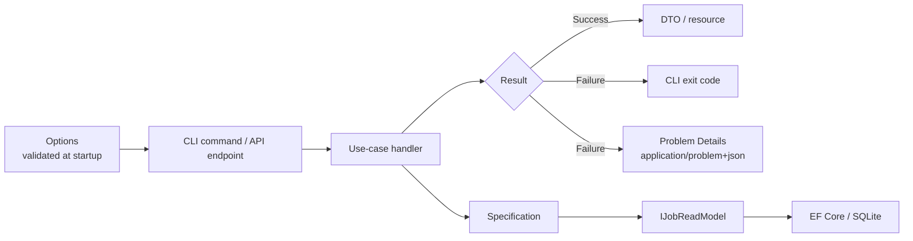
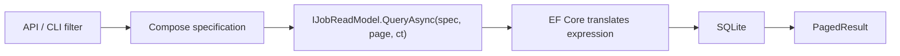

# Application Patterns

> **Purpose:** define the four patterns that shape JobLens application code — **Result**, **Options**, **Specification**, and **Problem Details** — and the explicit decision **not** to use CQRS or MediatR.
>
> **Scope:** `JobLens.Application`, the CLI edge, and the v2 .NET API edge. Infrastructure implements the ports; Domain stays pure.
>
> **Rule:** these are small, hand-rolled patterns. No pattern library is added until a second use case proves it needs one.

---

## 1. Pattern map

| Pattern | Lives in | Solves | Does not solve |
|---|---|---|---|
| **Result** | `JobLens.Application/Results` | Expected failures without exceptions; typed errors at the use-case boundary | Programmer errors or invariant violations |
| **Options** | Composition root (`Cli`, later `Api`) | Strongly typed, validated configuration | Per-request data or secrets storage |
| **Specification** | `JobLens.Application/Queries` | Reusable, composable query criteria | Domain behavior or authorization |
| **Problem Details** | API edge (`JobLens.Api`, v2) | One HTTP error contract for the cockpit | CLI output or SSE event payloads |

The intended flow:



---

## 2. No CQRS, no MediatR

### 2.1 Decision

Use **explicit use-case handlers** and **typed read-model ports**. Do not add CQRS command/query buses, MediatR, or a mediator.

A handler here is an ordinary class with a constructor and a method:

```csharp
public sealed class RunScrapeHandler(
    ISearchProfileRepository profiles,
    JobSourceRegistry sources,
    CompliancePolicy compliance,
    TimeProvider clock)
{
    public Task<Result<ScrapeRunSummary>> HandleAsync(
        RunScrapeRequest request,
        CancellationToken cancellationToken)
    {
        // explicit orchestration
    }
}
```

`RunScrapeHandler` is not an `IRequestHandler<,>`. It is resolved by constructor injection and called directly by the CLI command or API endpoint.

### 2.2 Banned

Do not add or introduce:

- `MediatR`, `IRequest<T>`, `IRequestHandler<,>`, `INotification`, `INotificationHandler<>`
- `IMediator`, `ISender`, `IPublisher`, `ICommand`, `IQuery`, `ICommandHandler`, `IQueryHandler`
- command/query buses, handler discovery by assembly scanning, or pipeline behaviors
- a mediator-shaped “dispatcher” with a different name
- CQRS frameworks such as Wolverine, MassTransit, or Brighter for in-process work

### 2.3 Replacements

| Mediator/CQRS concept | Use instead |
|---|---|
| `IRequest<T>` | A request record passed as a method parameter |
| `IRequestHandler<,>` | A sealed use-case handler with `HandleAsync` |
| `IMediator.Send` | Constructor-injected handler, called directly |
| `PipelineBehavior` | ASP.NET Core middleware/endpoint filter, DI decorator, or an explicit call |
| `INotification` / `IPublisher` | Explicit domain-event handling after persistence |
| `IQuery` / query handler | A filter object plus `IJobReadModel` method |
| `ICommand` / command handler | A request record plus a write-side use-case handler |

### 2.4 Why

- **Compile-time navigation:** “Find usages” finds the caller; there is no runtime dispatch.
- **Fewer moving parts:** no assembly scanning, no handler registration, no pipeline ordering.
- **Debuggable:** a stack trace names the handler; it does not pass through a mediator.
- **Testable:** instantiate the handler with fakes; no mediator test harness.
- **Small surface:** two entry points (CLI, API) do not justify a bus.
- **Honest boundaries:** a method call is clearer than a message that happens to be in-process.

### 2.5 Allowed read/write separation

The project still separates **shapes** where it helps:

- Write-side aggregates protect invariants (`JobPosting`, `ScrapeRun`, `BrowserProfile`).
- Read-side ports return DTOs (`IJobReadModel`, `ISkillDemandReadModel`) and never expose `IQueryable`.
- The API may use different request/response models for reads and writes.

That is **not** CQRS in the command/query bus sense. There is no separate command store, no event sourcing, no event-driven read-model projection pipeline, and no mediator.

### 2.6 Enforcement

- The package matrix does not include MediatR or a CQRS framework.
- Architecture tests (Phase 0) fail if `MediatR` or a banned namespace appears.
- Code review rejects `IRequest`/`IMediator`-shaped abstractions, even when hand-rolled.
- A handler is registered explicitly in DI; there is no assembly-scanning registration.

See [ADR-0011](10-adr/0011-no-cqrs-mediatr.md) for the decision record.

---

## 3. Result pattern

### 3.1 When to use it

Return a `Result` when failure is an **expected operational outcome**:

- a profile, run, or posting does not exist;
- a quota or compliance gate blocks the run;
- a source returns a challenge, rate limit, or changed page;
- a request fails validation;
- an upstream dependency is temporarily unavailable.

Do **not** use `Result` for:

- programmer errors (null argument, impossible state);
- broken invariants (invalid value object, negative counter);
- cancellation (`OperationCanceledException` must propagate);
- every method by default; simple calculations return their value.

### 3.2 Shape

`Error` is a small immutable record. `Code` is the stable, machine-readable contract; `Title` and `Detail` are human-readable.

```csharp
public enum ErrorKind
{
    Validation,
    NotFound,
    Conflict,
    Forbidden,
    RateLimited,
    QuotaExceeded,
    Challenge,
    CoolingDown,
    SourceChanged,
    Unavailable,
    Unexpected
}

public sealed record Error(
    string Code,
    string Title,
    string Detail,
    ErrorKind Kind,
    IReadOnlyDictionary<string, object?>? Metadata = null);
```

`Result<T>` exposes success or one error, never both:

```csharp
public sealed class Result<T>
{
    private readonly T? _value;
    private readonly Error? _error;

    private Result(T value) { IsSuccess = true; _value = value; }
    private Result(Error error) { IsSuccess = false; _error = error; }

    public bool IsSuccess { get; }
    public bool IsFailure => !IsSuccess;

    public T Value => IsSuccess
        ? _value!
        : throw new InvalidOperationException("Value is only available on success.");

    public Error Error => IsFailure
        ? _error!
        : throw new InvalidOperationException("Error is only available on failure.");

    public static Result<T> Ok(T value) => new(value);
    public static Result<T> Fail(Error error) => new(error);
}
```

A non-generic `Result` covers operations with no return value. Keep both in `JobLens.Application/Results`; do not add a third-party result library for this.

### 3.3 Error codes

Codes use uppercase snake case and are stable across releases. The cockpit maps codes to messages and actions; it must not parse `Detail`.

| `ErrorKind` | Example `Code` | HTTP status (API) |
|---|---|---|
| `Validation` | `VALIDATION_FAILED` | `400` |
| `NotFound` | `PROFILE_NOT_FOUND` | `404` |
| `Conflict` | `RUN_ALREADY_ACTIVE` | `409` |
| `Forbidden` | `COMPLIANCE_BLOCKED` | `403` |
| `RateLimited` | `RATE_LIMITED` | `429` |
| `QuotaExceeded` | `QUOTA_EXCEEDED` | `429` |
| `Challenge` | `SOURCE_CHALLENGE` | `409` |
| `CoolingDown` | `SOURCE_COOLING_DOWN` | `423` |
| `SourceChanged` | `SOURCE_CHANGED` | `502` |
| `Unavailable` | `SOURCE_UNAVAILABLE` | `503` |
| `Unexpected` | `INTERNAL_ERROR` | `500` |

`ErrorKind` is an application concept, not an HTTP status. The API edge performs the mapping; the CLI maps the same kinds to exit codes and stderr messages.

### 3.4 Handler example

```csharp
public async Task<Result<ScrapeRunSummary>> HandleAsync(
    RunScrapeRequest request,
    CancellationToken cancellationToken)
{
    var profile = await _profiles.GetAsync(request.ProfileId, cancellationToken);
    if (profile is null)
        return Result<ScrapeRunSummary>.Fail(Errors.ProfileNotFound(request.ProfileId));

    var compliance = _compliance.CanRun(profile.Source, request.Acknowledgment);
    if (compliance.IsBlocked)
        return Result<ScrapeRunSummary>.Fail(
            Errors.ComplianceBlocked(compliance.Reason));

    var source = _sources.Get(profile.Source);
    if (source is null)
        return Result<ScrapeRunSummary>.Fail(Errors.SourceUnavailable(profile.Source));

    // ... orchestration ...

    return Result<ScrapeRunSummary>.Ok(summary);
}
```

### 3.5 Rules

- Domain invariant violations throw `DomainException`; they are not `Result` failures.
- Adapters classify expected page outcomes (`SearchPageResult`, `ChallengeAssessment`) and do not throw for a wall.
- `OperationCanceledException` is never converted to a `Result`; it cancels the run.
- Do not return `Result<T?>` for “not found”. Use `T?` for optional lookups that are not errors, and `Result<T>` when absence blocks the use case.
- Do not put HTTP status codes, `HttpContext`, or user-facing localization inside `Error`.
- `Metadata` may contain IDs, counts, and retry hints. Never put cookies, HTML, tokens, or PII in it.
- Log at the edge or in the handler, not inside `Result` construction.
- Only one error is returned per operation. Aggregate validation errors at the request-validation boundary.
- A result failure must be handled: return it, map it, or log and convert it deliberately. Never ignore it.

### 3.6 Testing

- Assert `IsSuccess`, the value, or the error code — not an exception.
- Cover each error branch of a handler; a `Result` branch without a test is an untested failure mode.
- Verify that cancellation still throws and does not become a failure.
- Verify that `Value` on a failure and `Error` on a success throw (guard tests).
- Snapshot the API mapping separately; handler tests should not assert HTTP status codes.

---

## 4. Options pattern

### 4.1 Boundary

Options are bound **once at the composition root** and validated at startup. Configuration is not read deep inside the application.

- `JobLens.Cli` (v1) and `JobLens.Api` (v2) own binding, validation, and lifetimes.
- `JobLens.Infrastructure` may inject `IOptions<BrowserOptions>` when it owns the resource (for example, Playwright).
- `JobLens.Application` receives plain records/value objects (`ScrapeLimits`, `ComplianceSettings`), not `IConfiguration` or `IOptions<T>`.
- `JobLens.Domain` never sees configuration.

### 4.2 Bind and validate

Options classes are grouped by section. Use `init` properties, DataAnnotations for simple ranges, and `IValidateOptions<T>` for cross-field rules.

```csharp
public sealed class BrowserOptions
{
    public const string SectionName = "JobLens:Browser";

    [Required]
    public string DefaultEngine { get; init; } = "Chromium";

    [Range(1, 300)]
    public int NavigationTimeoutSeconds { get; init; } = 45;

    [Range(0, 60_000)]
    public int SlowMoMs { get; init; } = 40;

    public bool Headless { get; init; }
}
```

```csharp
builder.Services
    .AddOptions<BrowserOptions>()
    .Bind(builder.Configuration.GetSection(BrowserOptions.SectionName))
    .ValidateDataAnnotations()
    .ValidateOnStart();

builder.Services.AddSingleton<IValidateOptions<BrowserOptions>, BrowserOptionsValidator>();
```

Cross-field validation belongs in a validator, not in the handler:

```csharp
public sealed class BrowserOptionsValidator : IValidateOptions<BrowserOptions>
{
    public ValidateOptionsResult Validate(string? name, BrowserOptions options)
    {
        if (options.NavigationTimeoutSeconds <= 0)
            return ValidateOptionsResult.Fail("NavigationTimeoutSeconds must be positive.");

        return ValidateOptionsResult.Success;
    }
}
```

The existing validation set in [Architecture §11.2](02-architecture.md#112-options-pattern) still applies: caps, delays, LinkedIn consent, writable directories, and valid browser channels.

### 4.3 Lifetimes

| Interface | Lifetime | Use when |
|---|---|---|
| `IOptions<T>` | Singleton | Default. Values do not change while the process runs. |
| `IOptionsSnapshot<T>` | Scoped | API request needs a consistent snapshot of reloadable values. |
| `IOptionsMonitor<T>` | Singleton | A long-lived service must observe reloads. |

Rules:

- CLI uses `IOptions<T>`; there is no configuration reload during a run.
- Never inject `IOptionsSnapshot<T>` into a singleton.
- Prefer `IOptions<T>` unless a real reload requirement exists.
- Options are immutable after binding; do not mutate `Options.Value`.
- Do not use `serviceProvider.GetRequiredService<IOptions<T>>()`; inject the interface or the bound record.
- Safety-critical values (caps, compliance gates) must never silently fall back to unsafe defaults.

### 4.4 Secrets

- No credentials are stored by JobLens; login is manual.
- Future API keys use user secrets in development and environment variables in production.
- Never bind secrets into options that are logged or serialized.
- Browser profiles are secrets even though they are not options.

### 4.5 Testing

- Test invalid values fail validation: non-positive caps, `minDelay > maxDelay`, LinkedIn enabled without consent, non-writable profile root.
- Test `ValidateOnStart` fails the host instead of starting with bad configuration.
- Test defaults are safe and documented.
- Keep options tests in `JobLens.Infrastructure.Tests` (validation) or `JobLens.Cli.Tests` (binding and startup).

---

## 5. Specification pattern

### 5.1 When to use it

Use a specification when a **named, reusable business predicate** appears in more than one query, or when composition makes a query readable:

- active postings within the retention window;
- postings posted within the last N days;
- postings matching structured profile filters (source, remote, experience);
- postings from enabled, compliant sources.

Do not create a specification for:

- a single `Where(x => x.Id == id)` lookup;
- authorization or compliance decisions (those are policies);
- write-side invariants (those belong in aggregates/value objects);
- ad-hoc reporting that reads a dedicated read model.

### 5.2 Shape

Specifications live in `JobLens.Application/Queries` and expose an expression tree, not an `IQueryable`.

```csharp
public interface ISpecification<T>
{
    Expression<Func<T, bool>> ToExpression();
    bool IsSatisfiedBy(T candidate);
}

public abstract class Specification<T> : ISpecification<T>
{
    private readonly Lazy<Func<T, bool>> _compiled;

    protected Specification() => _compiled = new(() => ToExpression().Compile());

    public abstract Expression<Func<T, bool>> ToExpression();

    public bool IsSatisfiedBy(T candidate) => _compiled.Value(candidate);

    public Specification<T> And(Specification<T> other) => new AndSpecification<T>(this, other);
    public Specification<T> Or(Specification<T> other) => new OrSpecification<T>(this, other);
    public Specification<T> Not() => new NotSpecification<T>(this);
}

public sealed class ActivePostingSpecification(
    DateTimeOffset now,
    int retentionDays) : Specification<JobPosting>
{
    public override Expression<Func<JobPosting, bool>> ToExpression() =>
        job => job.Status == JobPostingStatus.Active
            && job.LastSeenAt >= now.AddDays(-retentionDays);
}
```

`Specification<T>` is a small in-repo base class that caches the compiled predicate for `IsSatisfiedBy` and implements `And`, `Or`, and `Not` by replacing the parameter in the expression tree. The helper specification types are private nested classes in the same file. Do not use `Expression.Invoke` for EF Core queries; it is not reliably translatable. A parameter-replacing `ExpressionVisitor` is the supported composition mechanism.

Example specifications:

```csharp
public sealed class PostedWithinSpecification(
    DateTimeOffset now,
    int days) : Specification<JobPosting>
{
    public override Expression<Func<JobPosting, bool>> ToExpression() =>
        job => job.PostedAt >= now.AddDays(-days);
}

public sealed class EnabledSourceSpecification(
    IReadOnlyCollection<SourceKey> enabledSources) : Specification<JobPosting>
{
    public override Expression<Func<JobPosting, bool>> ToExpression() =>
        job => enabledSources.Contains(job.Source);
}
```

Composition:

```csharp
var specification = new ActivePostingSpecification(now, retentionDays)
    .And(new PostedWithinSpecification(now, criteria.PostedWithinDays))
    .And(new EnabledSourceSpecification(enabledSources));
```

Keyword matching is deliberately not shown here: it depends on tokenization and ranking, so it belongs in a named read-model query rather than a naive `Contains` expression.

### 5.3 Query flow



The read-model port accepts the specification; it never returns `IQueryable`:

```csharp
public interface IJobReadModel
{
    Task<PagedResult<JobListItem>> QueryAsync(
        ISpecification<JobPosting> specification,
        JobSort sort,
        PageRequest page,
        CancellationToken cancellationToken);
}
```

### 5.4 Rules

- One specification = one business predicate; compose rather than inherit deep hierarchies.
- The expression must be EF Core translatable: no custom methods, no client-side evaluation, no `Compile()` inside the expression.
- Normalize missing values before filtering. If `PostedAt` is absent, the read model applies the documented `FirstSeenAt` fallback once; specifications assume a normalized value.
- `IsSatisfiedBy` is for domain tests and in-memory checks, not for filtering database rows.
- Specifications filter; they do not authorize, mutate, or persist.
- Do not put `Include`, tracking, or projection into a specification. The read model owns projection.
- No generic repository with `Find(ISpecification<T>)`. The read model exposes named query methods.
- Keep the generated SQL observable: log slow queries and verify the specification translates in integration tests.
- If a predicate is used once, write the LINQ inline; a specification is not a ceremony requirement.

### 5.5 Testing

- Unit test `IsSatisfiedBy` with boundary values (inclusive/exclusive dates, empty keywords).
- Integration test each specification against SQLite and assert the row count, not just the SQL string.
- Test `And`/`Or`/`Not` composition, especially overlapping parameters.
- Use `ToQueryString()` in tests to catch client evaluation.
- Add an index when a specification becomes a hot path; measure before adding one.

---

## 6. Problem Details pattern

### 6.1 Contract

The v2 API returns errors as **RFC 9457 Problem Details** with content type `application/problem+json`. The standard members are `type`, `title`, `status`, `detail`, and `instance`. JobLens adds:

| Extension | Purpose |
|---|---|
| `code` | Stable machine-readable code (`QUOTA_EXCEEDED`) |
| `traceId` | Correlation ID for logs and support |
| `errors` | Field-level validation errors (only for `400`) |
| `retryAfter` | ISO 8601 UTC timestamp when retry is safe (optional) |

### 6.2 Example

```json
{
  "type": "https://joblens.local/problems/quota-exceeded",
  "title": "Source quota exceeded",
  "status": 429,
  "detail": "The daily detail cap for source 'naukri' has been reached.",
  "instance": "/api/v1/runs",
  "code": "QUOTA_EXCEEDED",
  "traceId": "00-4bf92f3577b34da6a3ce929d0e0e4736-00f067aa0ba902b7-01",
  "retryAfter": "2026-10-30T00:00:00Z"
}
```

Validation uses `ValidationProblemDetails`:

```json
{
  "type": "https://joblens.local/problems/validation-failed",
  "title": "One or more validation errors occurred.",
  "status": 400,
  "detail": "The request contains invalid fields.",
  "instance": "/api/v1/search-profiles",
  "code": "VALIDATION_FAILED",
  "errors": {
    "keywords": ["At least one keyword is required."],
    "experienceYears": ["Must be between 0 and 50."]
  }
}
```

### 6.3 Result → HTTP mapping

One mapper owns the translation. Endpoints do not hand-build problem objects.

```csharp
public static IResult ToProblem(this Error error)
{
    if (error.Kind == ErrorKind.Validation)
    {
        var errors = error.Metadata?["errors"] as IDictionary<string, string[]>
            ?? new Dictionary<string, string[]>();
        return Results.ValidationProblem(errors, title: error.Title, detail: error.Detail);
    }

    var status = error.Kind switch
    {
        ErrorKind.Validation => StatusCodes.Status400BadRequest,
        ErrorKind.NotFound => StatusCodes.Status404NotFound,
        ErrorKind.Conflict => StatusCodes.Status409Conflict,
        ErrorKind.Forbidden => StatusCodes.Status403Forbidden,
        ErrorKind.RateLimited => StatusCodes.Status429TooManyRequests,
        ErrorKind.QuotaExceeded => StatusCodes.Status429TooManyRequests,
        ErrorKind.Challenge => StatusCodes.Status409Conflict,
        ErrorKind.CoolingDown => StatusCodes.Status423Locked,
        ErrorKind.SourceChanged => StatusCodes.Status502BadGateway,
        ErrorKind.Unavailable => StatusCodes.Status503ServiceUnavailable,
        _ => StatusCodes.Status500InternalServerError
    };

    return Results.Problem(
        type: $"https://joblens.local/problems/{error.Code.ToLowerInvariant().Replace('_', '-')}",
        title: error.Title,
        detail: error.Detail,
        statusCode: status,
        extensions: new Dictionary<string, object?>
        {
            ["code"] = error.Code,
            ["traceId"] = Activity.Current?.Id ?? "unknown"
        });
}
```

The validation branch uses `Results.ValidationProblem` so the `errors` dictionary is generated correctly; the switch maps the remaining kinds.

### 6.4 Registration

```csharp
builder.Services.AddProblemDetails(options =>
{
    options.CustomizeProblemDetails = context =>
    {
        context.ProblemDetails.Instance ??= context.HttpContext.Request.Path;
        context.ProblemDetails.Extensions["traceId"] =
            Activity.Current?.Id ?? context.HttpContext.TraceIdentifier;
    };
});

app.UseExceptionHandler();
app.UseStatusCodePages();
```

- `UseExceptionHandler` catches unhandled exceptions and produces a safe `500`.
- `IExceptionHandler` maps known infrastructure exceptions when a safe public message exists.
- Do not catch `OperationCanceledException` and turn it into a problem response; let the request abort.
- The BFF proxies the API response unchanged and preserves `Content-Type`.

### 6.5 Rules

- `type` is a stable URI; changing it is a breaking API change.
- `title` is stable and human-readable; `detail` is specific and safe.
- `code` is the UI contract; never localize it and never change its meaning.
- `instance` is the request path. Do not include query strings if they contain sensitive values.
- `traceId` is always present on `5xx`; include it on `4xx` when useful.
- `errors` keys match the JSON request field names.
- Never expose stack traces, SQL, cookies, HTML, authorization headers, or internal paths.
- Do not use `Problem Details` for success responses, SSE events, or CLI output.
- Log `5xx` at error level with `traceId`; log `4xx` at information/debug level.
- Add every documented problem response to OpenAPI and regenerate the cockpit types.

### 6.6 CLI and SSE

- **CLI:** `Result.Error` maps to a documented exit code and a stderr message. There is no HTTP envelope.
- **SSE:** a failed run emits a typed event (`run.failed`) with `code`, `message`, and `runId`. Do not send a Problem Details document mid-stream.
- **BFF:** forwards Problem Details from the .NET API; it does not re-wrap the body.

### 6.7 Testing

- Integration-test every `ErrorKind` → status, content type, `code`, and `traceId`.
- Assert a `500` never contains `detail` with a stack trace, SQL, or file path.
- Assert validation errors use the request field names.
- Snapshot the problem body for stable contracts; update the snapshot intentionally.
- Verify OpenAPI lists `application/problem+json` for every error response.
- Verify the cockpit handles unknown `code` values without crashing.

---

## 7. How the patterns compose

```text
Options (validated at startup)
        │
        ▼
CLI command / API endpoint
        │  binds request
        ▼
Use-case handler ──► Specification ──► IJobReadModel ──► EF Core/DTO
        │
        ▼
Result<T> ──► CLI exit code
        └────► Problem Details (API)
```

- Options never flow into Domain.
- Specifications never leak `IQueryable`.
- Handlers return `Result`, not HTTP responses.
- Only the API edge knows HTTP status codes.
- Only the CLI edge knows process exit codes.
- The BFF and React cockpit consume the stable `code` and `type`, not error prose.

---

## 8. Anti-patterns

| Anti-pattern | Why it hurts | Do instead |
|---|---|---|
| `IMediator.Send` for every use case | Runtime indirection, hidden handlers, noisy debugging | Inject and call the handler |
| `PipelineBehavior` for validation/logging | Ordering is hidden; failures are hard to trace | Endpoint filter, middleware, or explicit call |
| `Result` on every method | Noise; obscures real failure boundaries | Result only at use-case/contract boundaries |
| Throwing for expected walls/quota | Exceptions become control flow; easy to swallow | Typed `Error` and `Result` |
| `IConfiguration` in Domain/Application | Couples core code to hosting; hard to test | Bind options at the edge; pass records |
| Mutable options | Race conditions; unclear lifetime | Immutable `init` options; no mutation |
| Specification for a single ID lookup | Ceremony without reuse | Inline LINQ |
| Specification with `Compile()` in the expression | EF Core cannot translate; client evaluation | Expression tree + parameter replacement |
| `IQueryable` returned from a repository | Query logic leaks into callers; unbounded queries | Read-model methods + specifications |
| Hand-built error JSON | Drift between endpoints; leaks internals | One `ToProblem` mapper |
| Stack traces in `detail` | Security and UX failure | Log internally; return `traceId` |
| Localized `code` | Breaks the cockpit contract | Stable uppercase codes; localize in UI |

---

## 9. References

- [Microsoft: Options pattern in .NET](https://learn.microsoft.com/dotnet/core/extensions/options)
- [Microsoft: Options validation](https://learn.microsoft.com/dotnet/core/extensions/options#options-validation)
- [Martin Fowler: Specification](https://martinfowler.com/apsupp/spec.pdf)
- [RFC 9457: Problem Details for HTTP APIs](https://www.rfc-editor.org/rfc/rfc9457)
- [Microsoft: Handle errors in ASP.NET Core APIs](https://learn.microsoft.com/aspnet/core/fundamentals/error-handling-api)
- [ADR-0011: No CQRS or MediatR](10-adr/0011-no-cqrs-mediatr.md)
