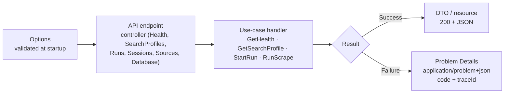

# Application Patterns

> **Purpose:** define the patterns that shape JobScrape application code — **Result**, **Options**, and **Problem Details** — and the explicit decision **not** to use CQRS or MediatR. Specifications and read models are deferred (no `Queries/` folder, no read-model ports exist yet).
>
> **Scope:** `JobScrape.Application` and the `JobScrape.Api` edge. Infrastructure implements the ports; Domain stays pure.
>
> **Rule:** these are small, hand-rolled patterns. No pattern library is added until a second use case proves it needs one.

---

## 1. Pattern map

| Pattern | Lives in | Solves | Does not solve |
|---|---|---|---|
| **Result** | `JobScrape.Application/Results` | Expected failures without exceptions; typed errors at the use-case boundary | Programmer errors or invariant violations |
| **Options** | Composition root (`JobScrape.Api`) | Strongly typed, validated configuration | Per-request data or secrets storage |
| **Problem Details** | API edge (`JobScrape.Api`) | One HTTP error contract for the cockpit | Anything but HTTP errors |

The intended flow (as implemented — six controllers, one mapper):



---

## 2. No CQRS, no MediatR

### 2.1 Decision

Use **explicit use-case handlers** and **typed ports**. Do not add CQRS command/query buses, MediatR, or a mediator.

A handler here is an ordinary class with a constructor and a method (shape of the real `GetSearchProfileHandler`; `RunScrapeHandler` follows the same shape with ten constructor ports):

```csharp
public sealed class GetSearchProfileHandler
{
    public GetSearchProfileHandler(ISearchProfileStore store) { ... }

    public Task<Result<SearchProfileResponse>> HandleAsync(
        Guid id,
        CancellationToken cancellationToken)
    {
        // explicit orchestration
    }
}
```

`GetSearchProfileHandler` is not an `IRequestHandler<,>`. It is resolved by constructor injection and called directly by the API controller (`SearchProfilesController.GetAsync`), which maps success to 200 and failure through `ErrorMapper.ToProblem`.

**Scope note:** the scrape slice (`RunScrapeHandler` + its ten ports, split across gate/paginator/enricher/retry partials) is registered (`AddScoped`) and invoked from `RunCoordinator`; `SearchPageDriver` in `Infrastructure.Sources` holds the shared pagination mechanics. Start validation lives in `StartRunHandler` with route-id checks shared through `RunIds`. See [Design Pattern Decisions](20-design-pattern-decisions.md) for the kept/rejected pattern verdicts.

### 2.2 Banned

Do not add or introduce:

- `MediatR`, `IRequest<T>`, `IRequestHandler<,>`, `INotification`, `INotificationHandler<>`
- `IMediator`, `ISender`, `IPublisher`, `ICommand`, `IQuery`, `ICommandHandler`, `IQueryHandler`
- command/query buses, handler discovery by assembly scanning, or pipeline behaviors
- a mediator-shaped “dispatcher” with a different name
- CQRS frameworks such as Wolverine, MassTransit, or Brighter for in-process work

### 2.3 Replacements

| Mediator/CQRS concept | Use instead |
|---|---|
| `IRequest<T>` | A request record passed as a method parameter |
| `IRequestHandler<,>` | A sealed use-case handler with `HandleAsync` |
| `IMediator.Send` | Constructor-injected handler, called directly |
| `PipelineBehavior` | ASP.NET Core middleware/endpoint filter, DI decorator, or an explicit call |
| `INotification` / `IPublisher` | Explicit domain-event handling after persistence |
| `IQuery` / query handler | A request record plus a repository query method |
| `ICommand` / command handler | A request record plus a write-side use-case handler |

### 2.4 Why

- **Compile-time navigation:** “Find usages” finds the caller; there is no runtime dispatch.
- **Fewer moving parts:** no assembly scanning, no handler registration, no pipeline ordering.
- **Debuggable:** a stack trace names the handler; it does not pass through a mediator.
- **Testable:** instantiate the handler with fakes; no mediator test harness.
- **Small surface:** two endpoints do not justify a bus.
- **Honest boundaries:** a method call is clearer than a message that happens to be in-process.

### 2.5 Allowed read/write separation

The project still separates **shapes** where it helps:

- Write-side aggregates protect invariants (`JobPosting`, `ScrapeRun`, `BrowserProfile`, `SourceQuota`, `SourceCircuitBreaker`, `SearchProfile`).
- Read paths return DTOs (today: `GetHealthResponse`, `SearchProfileResponse`, `ScrapeRunSummary`); repositories never expose `IQueryable`.
- The API may use different request/response models for reads and writes.

That is **not** CQRS in the command/query bus sense. There is no separate command store, no event sourcing, no event-driven read-model projection pipeline, no read-model ports, and no mediator.

### 2.6 Enforcement

- The package matrix does not include MediatR or a CQRS framework.
- Architecture tests (Phase 0) fail if `MediatR` or a banned namespace appears.
- Code review rejects `IRequest`/`IMediator`-shaped abstractions, even when hand-rolled.
- A handler is registered explicitly in DI; there is no assembly-scanning registration.

See [ADR-0011](10-adr/0011-no-cqrs-mediatr.md) for the decision record.

---

## 3. Result pattern

### 3.1 When to use it

Return a `Result` when failure is an **expected operational outcome**:

- a profile, run, or posting does not exist;
- a quota or compliance gate blocks the run;
- a source returns a challenge, rate limit, or changed page;
- a request fails validation;
- an upstream dependency is temporarily unavailable.

Do **not** use `Result` for:

- programmer errors (null argument, impossible state);
- broken invariants (invalid value object, negative counter);
- cancellation (`OperationCanceledException` must propagate);
- every method by default; simple calculations return their value.

### 3.2 Shape

`ErrorInfo` is a small immutable record. `Code` is the stable, machine-readable contract; `Title` and `Detail` are human-readable.

```csharp
public enum ErrorKind
{
    Validation,
    NotFound,
    Conflict,
    Forbidden,
    RateLimited,
    QuotaExceeded,
    Challenge,
    CoolingDown,
    SourceChanged,
    Unavailable,
    Storage,
    Unexpected
}

public sealed record ErrorInfo(
    string Code,
    string Title,
    string Detail,
    ErrorKind Kind,
    IReadOnlyDictionary<string, object?>? Metadata = null);
```

The name is `ErrorInfo` rather than `Error` because `Error` collides with a
reserved keyword in another .NET language (CA1716), and warnings are errors
in this repository — no suppression markers are used.

`Result<T>` exposes success or one error, never both. It carries no static
members: all factories live on the non-generic `Result` hub so no statics sit
on a generic type (CA1000):

```csharp
public sealed class Result<T>
{
    private readonly T? _value;
    private readonly ErrorInfo? _error;

    internal Result(T? value, ErrorInfo? error, bool isSuccess)
    {
        _value = value;
        _error = error;
        IsSuccess = isSuccess;
    }

    public bool IsSuccess { get; }
    public bool IsFailure => !IsSuccess;

    public T Value => IsFailure
        ? throw new InvalidOperationException("Value is only available on success.")
        : _value!;

    public ErrorInfo Error => IsSuccess
        ? throw new InvalidOperationException("Error is only available on failure.")
        : _error!;
}

public sealed class Result
{
    // ... IsSuccess / IsFailure / Error as above ...

    public static Result Ok() => new(true, null);
    public static Result Fail(ErrorInfo error) => new(false, error);

    public static Result<T> Ok<T>(T value) => new(value, null, true);
    public static Result<T> Fail<T>(ErrorInfo error) => new(default, error, false);
}
```

A non-generic `Result` covers operations with no return value. Keep both in `JobScrape.Application/Results`; do not add a third-party result library for this.

### 3.3 Error codes

Codes use uppercase snake case and are stable across releases. The cockpit maps codes to messages and actions; it must not parse `Detail`. Every code below exists in `Errors` today (verified exhaustively):

| `ErrorKind` | Actual `Code`(s) | HTTP status (API) |
|---|---|---|
| `Validation` | `VALIDATION_FAILED` | `400` |
| `NotFound` | `PROFILE_NOT_FOUND`, `BROWSER_PROFILE_NOT_FOUND` | `404` |
| `Conflict` | `PROFILE_DISABLED`, `SOURCE_DISABLED` | `409` |
| `Forbidden` | `COMPLIANCE_BLOCKED` | `403` |
| `RateLimited` | *(no code defined yet)* | `429` |
| `QuotaExceeded` | `QUOTA_EXCEEDED` | `429` |
| `Challenge` | *(no code defined yet)* | `409` |
| `CoolingDown` | `SOURCE_COOLING_DOWN`, `SESSION_COOLING_DOWN`, `SESSION_RESET_REQUIRED` | `423` |
| `SourceChanged` | *(no code defined yet)* | `502` |
| `Unavailable` | `SOURCE_UNAVAILABLE` | `503` |
| `Storage` | *(no code defined yet)* | `507` |
| `Unexpected` | `INTERNAL_ERROR` | `500` |

(All `SESSION_*` codes surface as `CoolingDown`/`423`, including resets — see `Errors.SessionUnavailable`.)

`ErrorKind` is an application concept, not an HTTP status. Only the API edge performs the mapping; there is no CLI mapping today.

### 3.4 Handler example

```csharp
public async Task<Result<ScrapeRunSummary>> HandleAsync(
    RunScrapeRequest request,
    CancellationToken cancellationToken)
{
    var profile = await _stores.Profiles.GetAsync(request.ProfileId, cancellationToken);
    if (profile is null)
        return Result.Fail<ScrapeRunSummary>(Errors.ProfileNotFound(request.ProfileId.Value));

    var compliance = CompliancePolicy.CanRun(profile.Source, request.Consent);
    if (!compliance.IsAllowed)
        return Result.Fail<ScrapeRunSummary>(
            Errors.ComplianceBlocked(profile.Source, compliance.Reason!));

    var source = _sources.Find(profile.Source);
    if (source is null)
        return Result.Fail<ScrapeRunSummary>(Errors.SourceUnavailable(profile.Source));

    // ... orchestration ...

    return Result.Ok(summary);
}
```

### 3.5 Rules

- Domain invariant violations throw `DomainException`; they are not `Result` failures.
- Adapters classify expected page outcomes (`SearchPageResult`, `ChallengeAssessment`) and do not throw for a wall.
- `OperationCanceledException` is never converted to a `Result`; it cancels the run.
- Do not return `Result<T?>` for “not found”. Use `T?` for optional lookups that are not errors, and `Result<T>` when absence blocks the use case.
- Do not put HTTP status codes, `HttpContext`, or user-facing localization inside `ErrorInfo`.
- `Metadata` may contain IDs, counts, and retry hints. Never put cookies, HTML, tokens, or PII in it.
- Log at the edge or in the handler, not inside `Result` construction.
- Only one error is returned per operation. Aggregate validation errors at the request-validation boundary.
- A result failure must be handled: return it, map it, or log and convert it deliberately. Never ignore it.

### 3.6 Testing

- Assert `IsSuccess`, the value, or the error code — not an exception.
- Cover each error branch of a handler; a `Result` branch without a test is an untested failure mode.
- Verify that cancellation still throws and does not become a failure.
- Verify that `Value` on a failure and `Error` on a success throw (guard tests).
- Snapshot the API mapping separately; handler tests should not assert HTTP status codes.

---

## 4. Options pattern

### 4.1 Boundary

Options are bound **once at the composition root** and validated at startup. Configuration is not read deep inside the application.

- `JobScrape.Api` owns binding, validation, and lifetimes (the only composition root).
- `JobScrape.Infrastructure` binds the six option sections; cross-field rules live in `IValidateOptions<T>` validators.
- `JobScrape.Application` receives plain records/value objects (`SourceSettingsCatalog`, `RetryPolicy`, `RunLimits`), not `IConfiguration` or `IOptions<T>`.
- `JobScrape.Domain` never sees configuration.

### 4.2 Bind and validate

Options classes are grouped by section (`JobScrape:*`). Use `init` properties, DataAnnotations for simple ranges, and `IValidateOptions<T>` for cross-field rules. Example from the tree (`StorageOptions`; the same shape holds for `Run`, `Logging`, and `Sources` sections):

```csharp
public sealed class StorageOptions
{
    public const string SectionName = "JobScrape:Storage";

    public string DatabasePath { get; init; } = "artifacts/data/jobscrape.db";

    public string ArtifactsRoot { get; init; } = "artifacts";

    public long MinimumFreeDiskBytes { get; init; } = 1L << 30;
}
```

```csharp
services
    .AddOptions<StorageOptions>()
    .BindConfiguration(StorageOptions.SectionName)
    .ValidateDataAnnotations()
    .ValidateOnStart();

services.AddSingleton<IValidateOptions<SourcesOptions>, SourcesOptionsValidator>();
```

Cross-field validation belongs in a validator, not in the handler. `SourcesOptionsValidator` is registered the same way; handler code then receives derived values (`SourceSettingsCatalog` built once by `SourceSettingsMapper`, `RetryPolicy` built from `RunOptions.RetryMaxAttempts`), never `IOptions<T>`.

```csharp
public sealed class SourcesOptionsValidator : IValidateOptions<SourcesOptions>
{
    public ValidateOptionsResult Validate(string? name, SourcesOptions options)
    {
        // Per source key: must parse to a known SourceKey; DataAnnotations
        // must pass; caps/delays must satisfy the RunLimits domain ranges;
        // enabling a non-Standard tier requires the matching
        // Compliance:AcknowledgeSourceRisk / AllowHighRiskSources flags.
        // Failure text names the offending Sources:<key> section.
    }
}
```

The validation set in [Architecture §11.2](02-architecture.md#112-options-pattern) still applies: caps, delays, consent flags.

### 4.3 Lifetimes

| Interface | Lifetime | Use when |
|---|---|---|
| `IOptions<T>` | Singleton | Default. Values do not change while the process runs. |
| `IOptionsSnapshot<T>` | Scoped | API request needs a consistent snapshot of reloadable values. |
| `IOptionsMonitor<T>` | Singleton | A long-lived service must observe reloads. |

Rules:

- The API uses `IOptions<T>`; there is no configuration reload during a run.
- Never inject `IOptionsSnapshot<T>` into a singleton.
- Prefer `IOptions<T>` unless a real reload requirement exists.
- Options are immutable after binding; do not mutate `Options.Value`.
- Do not use `serviceProvider.GetRequiredService<IOptions<T>>()` outside composition; inject the interface or the bound record.
- Safety-critical values (caps, compliance gates) must never silently fall back to unsafe defaults.

### 4.4 Secrets

- No credentials are stored by JobScrape; login is manual.
- Future API keys use user secrets in development and environment variables in production.
- Never bind secrets into options that are logged or serialized.
- Browser profiles are secrets even though they are not options.

### 4.5 Testing

- Test invalid values fail validation: non-positive caps, `minDelay > maxDelay`, unknown source keys, high-risk sources without consent flags.
- Test `ValidateOnStart` fails the host instead of starting with bad configuration.
- Test defaults are safe and documented.
- Keep options tests in `JobScrape.Infrastructure.Tests` (validation).

---

## 5. Specification pattern

> **Deferred — not implemented.** There is no `Queries/` folder, no `ISpecification<T>`, and no read-model ports. Identity lookups (`GetAsync`/`FindAsync` by id) are repository methods and stay that way. When the **second** real filter need arrives (the first being a plain id lookup), add the smallest composable specification type that EF Core can translate — and only then. The rules below are the design to follow at that point, kept brief until it exists:

- One specification = one business predicate; compose (`And`/`Or`/`Not`) rather than inherit deep hierarchies.
- The expression must be EF Core translatable: no custom methods, no client-side evaluation, no `Compile()` inside the expression; a parameter-replacing `ExpressionVisitor` is the composition mechanism (never `Expression.Invoke`).
- Normalize missing values before filtering.
- `IsSatisfiedBy` is for domain tests and in-memory checks, not for database rows.
- Specifications filter; they do not authorize, mutate, persist, or project (`Include`/tracking/projection belong to the read model).
- No generic repository with `Find(ISpecification<T>)`; read models expose named query methods.
- If a predicate is used once, write the LINQ inline; a specification is not a ceremony requirement.
- Integration-test each specification against SQLite (row counts, `ToQueryString()` for client evaluation); add an index when one becomes a hot path.

---

## 6. Problem Details pattern

### 6.1 Contract

The API returns errors as **RFC 9457 Problem Details** with content type `application/problem+json`. The standard members are `type`, `title`, `status`, `detail`, and `instance`. JobScrape adds (verified in `ErrorMapper` + `GlobalExceptionHandler`):

| Extension | Purpose |
|---|---|
| `code` | Stable machine-readable code (`PROFILE_NOT_FOUND`, `INTERNAL_ERROR`) |
| `traceId` | Correlation ID for logs and support (Activity id or trace identifier) |

> **Known defect (verified live 2026-11-01):** `ErrorMapper` passes the field-error map to `Results.ValidationProblem`, but the rendered 400 body carries NO `errors` member today (only `code` + `traceId` alongside the standard members), and its `type` is the framework default `https://tools.ietf.org/html/rfc9110#section-15.5.1`, not a `jobscrape.local` URI. Do not build cockpit or test expectations on an `errors` member or a stable 400 `type` until this is fixed. The intended contract keeps both; see the `errors` row the mapper code already prepares.

### 6.2 Example

A real miss, exactly as the edge renders it (`GET /api/v1/search-profiles/{id:guid}` for an unknown id):

```json
{
  "type": "https://jobscrape.local/problems/profile-not-found",
  "title": "Search profile not found.",
  "status": 404,
  "detail": "Search profile '00000000-0000-0000-0000-000000000000' does not exist.",
  "instance": "/api/v1/search-profiles/00000000-0000-0000-0000-000000000000",
  "code": "PROFILE_NOT_FOUND",
  "traceId": "00-4bf92f3577b34da6a3ce929d0e0e4736-00f067aa0ba902b7-01"
}
```

Validation uses `ValidationProblemDetails`:

```json
{
  "type": "https://tools.ietf.org/html/rfc9110#section-15.5.1",
  "title": "One or more validation errors occurred.",
  "status": 400,
  "detail": "The request contains invalid fields.",
  "instance": "/api/v1/search-profiles/00000000-0000-0000-0000-000000000000",
  "code": "VALIDATION_FAILED",
  "traceId": "00-456cd528b1864c160a9f34b77529329-f5be82b9ca1f23e8-00"
}
```

(Verified live: the field map (`{"id": [...]}`) does not appear on the wire today — see the defect note in §6.1.)

### 6.3 Result → HTTP mapping

One mapper owns the translation (`JobScrape.Api/Http/ErrorMapper.cs`). Endpoints do not hand-build problem objects. Abbreviated — see the file for the XML docs:

```csharp
public static IResult ToProblem(this ErrorInfo error)
{
    if (error.Kind == ErrorKind.Validation)
    {
        var errors = error.Metadata?.TryGetValue("errors", out var raw) == true
            && raw is IReadOnlyDictionary<string, string[]> typed
                ? typed
                : new Dictionary<string, string[]>();
        return Results.ValidationProblem(
            (IDictionary<string, string[]>)errors,
            title: error.Title,
            detail: error.Detail,
            extensions: new Dictionary<string, object?>
            {
                ["code"] = error.Code,
                ["traceId"] = Activity.Current?.Id ?? "unknown",
            });
    }

    var status = error.Kind switch
    {
        ErrorKind.NotFound => 404,
        ErrorKind.Conflict => 409,
        ErrorKind.Forbidden => 403,
        ErrorKind.RateLimited => 429,
        ErrorKind.QuotaExceeded => 429,
        ErrorKind.Challenge => 409,
        ErrorKind.CoolingDown => 423,
        ErrorKind.SourceChanged => 502,
        ErrorKind.Unavailable => 503,
        ErrorKind.Storage => 507,
        _ => 500,
    };

    return Results.Problem(
        type: $"https://jobscrape.local/problems/{error.Code.ToLowerInvariant().Replace('_', '-')}",
        title: error.Title,
        detail: error.Detail,
        statusCode: status,
        extensions: new Dictionary<string, object?>
        {
            ["code"] = error.Code,
            ["traceId"] = Activity.Current?.Id ?? "unknown",
        });
}
```

The validation branch uses `Results.ValidationProblem` so the `errors` dictionary is generated correctly; the switch maps the remaining kinds. (On the wire today the `errors` member is missing — see §6.1 defect note.)

### 6.4 Registration

```csharp
builder.Services.AddProblemDetails(options =>
{
    options.CustomizeProblemDetails = context =>
    {
        context.ProblemDetails.Instance ??= context.HttpContext.Request.Path;
        context.ProblemDetails.Extensions["traceId"] =
            Activity.Current?.Id ?? context.HttpContext.TraceIdentifier;
    };
});

builder.Services.AddExceptionHandler<GlobalExceptionHandler>();

app.UseMiddleware<CorrelationMiddleware>();   // X-Correlation-Id in + out
app.UseExceptionHandler();                   // GlobalExceptionHandler → safe 500
app.UseSerilogRequestLogging(...);
app.MapControllers();
```

- `UseExceptionHandler` catches unhandled exceptions; `GlobalExceptionHandler` logs once with full detail and writes a safe 500 (`INTERNAL_ERROR` + trace id, never the exception message). `OperationCanceledException` is not handled — the request aborts.
- `CorrelationMiddleware` echoes `X-Correlation-Id` and scopes logs with it (+ request id); client-supplied ids are reused only when short and alphanumeric.
- `UseStatusCodePages` is **not** registered: only mapped results and the global handler produce bodies.
- The BFF proxies the API response unchanged and preserves `Content-Type`.

### 6.5 Rules

- `type` is a stable URI; changing it is a breaking API change.
- `title` is stable and human-readable; `detail` is specific and safe.
- `code` is the UI contract; never localize it and never change its meaning.
- `instance` is the request path. Do not include query strings if they contain sensitive values.
- `traceId` is always present on `5xx`; include it on `4xx` when useful.
- `errors` keys match the JSON request field names.
- Never expose stack traces, SQL, cookies, HTML, authorization headers, or internal paths.
- Do not use `Problem Details` for success responses, SSE events, or CLI output.
- Log `5xx` at error level with `traceId`; log `4xx` at information/debug level.
- Add every documented problem response to OpenAPI and regenerate the cockpit types.

### 6.6 Not yet: CLI and SSE

Neither exists: no CLI project, no SSE/events, no exit-code mapping. When they arrive, the contract is fixed now — `ErrorInfo.Code` is the shared vocabulary (`code` member in HTTP, exit-code/message mapping later), and Problem Details stays HTTP-only.

**BFF:** forwards Problem Details from the .NET API unchanged; it never re-wraps the body (verified: `proxy.ts` streams the upstream response).

### 6.7 Testing

- Unit-test every `ErrorKind` → status mapping (`KindMapsToExpectedStatus` covers all 12).
- Integration-test the two live endpoints for status codes and stable `code`s (`SearchProfilesEndpointTests`, `HealthEndpointTests`).
- Assert a `500` never contains `detail` with a stack trace, SQL, or file path (the global handler only emits a static message).
- Assert validation errors use the request field names — once the §6.1 defect is fixed.
- Verify the cockpit falls back to `UNKNOWN` for unrecognized `code` values instead of crashing.

---

## 7. How the patterns compose

```text
Options (validated at startup)
        │
        ▼
API endpoint (controller)
        │  binds route + CancellationToken
        ▼
Use-case handler ──► EF Core via port + IUnitOfWork
        │
        ▼
Result<T> ──► Ok → 200 + DTO
        └────► Fail → Problem Details (ErrorMapper)
```

- Options never flow into Domain.
- No specifications exist; identity lookups are repository methods.
- Handlers return `Result`, not HTTP responses.
- Only the API edge knows HTTP status codes.
- The BFF and React cockpit consume the stable `code` and `type`, not error prose.

---

## 8. Anti-patterns

| Anti-pattern | Why it hurts | Do instead |
|---|---|---|
| `IMediator.Send` for every use case | Runtime indirection, hidden handlers, noisy debugging | Inject and call the handler |
| `PipelineBehavior` for validation/logging | Ordering is hidden; failures are hard to trace | Endpoint filter, middleware, or explicit call |
| `Result` on every method | Noise; obscures real failure boundaries | Result only at use-case/contract boundaries |
| Throwing for expected walls/quota | Exceptions become control flow; easy to swallow | Typed `ErrorInfo` and `Result` |
| `IConfiguration` in Domain/Application | Couples core code to hosting; hard to test | Bind options at the edge; pass records |
| Mutable options | Race conditions; unclear lifetime | Immutable `init` options; no mutation |
| Specification for a single ID lookup | Ceremony without reuse | Inline LINQ |
| Specification with `Compile()` in the expression | EF Core cannot translate; client evaluation | Expression tree + parameter replacement |
| `IQueryable` returned from a repository | Query logic leaks into callers; unbounded queries | Read-model methods + specifications |
| Hand-built error JSON | Drift between endpoints; leaks internals | One `ToProblem` mapper |
| Stack traces in `detail` | Security and UX failure | Log internally; return `traceId` |
| Localized `code` | Breaks the cockpit contract | Stable uppercase codes; localize in UI |

---

## 9. MCP tool conventions

> MCP tools are a second edge over the same handlers, served web-only by
> the API. `JobScrape.Mcp.Host` (stdio) is removed; `JobScrape.Api` is the
> single composition root. The API maps them at `/mcp` (stateless
> Streamable HTTP) behind the same JWT bearer chain as the REST
> controllers, so every call carries the caller's identity. See [ADR-0019](10-adr/0019-mcp-transports-and-tools.md).

- One sealed class per area, marked `[McpServerToolType]` (`HealthTools`,
  `SourcesTools`, `SessionsTools`, `SearchProfilesTools`,
  `SearchProfilesWriteTools`, `RunsTools`, `RunActionsTools`).
- Tools are listed explicitly (one fixed `.WithTools(McpTools.All)` list in
  both composition roots). No assembly scanning; adding a tool is a visible diff.
- Handlers are constructor-injected and called directly. No mediator, per §2.
- Expected handler failures throw `McpException` carrying the stable code
  plus operator-safe detail (`McpErrors.OrThrow`); the installed SDK's
  `McpException` carries only a message, so the code travels inside it.
- Every tool passes the `CancellationToken` through to the handler.
- Runs are start-then-poll: `start_run` returns the recorded run at once, the
  agent polls `get_run`. No tool wraps `RunScrapeHandler`, and no tool
  exposes `IDatabaseExplorer`.

---

## 10. References

- [Microsoft: Options pattern in .NET](https://learn.microsoft.com/dotnet/core/extensions/options)
- [Microsoft: Options validation](https://learn.microsoft.com/dotnet/core/extensions/options#options-validation)
- [Martin Fowler: Specification](https://martinfowler.com/apsupp/spec.pdf)
- [RFC 9457: Problem Details for HTTP APIs](https://www.rfc-editor.org/rfc/rfc9457)
- [Microsoft: Handle errors in ASP.NET Core APIs](https://learn.microsoft.com/aspnet/core/fundamentals/error-handling-api)
- [ADR-0011: No CQRS or MediatR](10-adr/0011-no-cqrs-mediatr.md)
