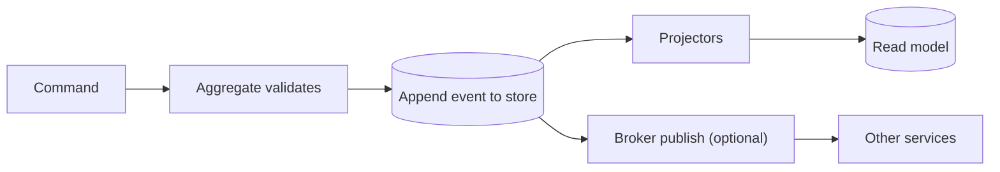
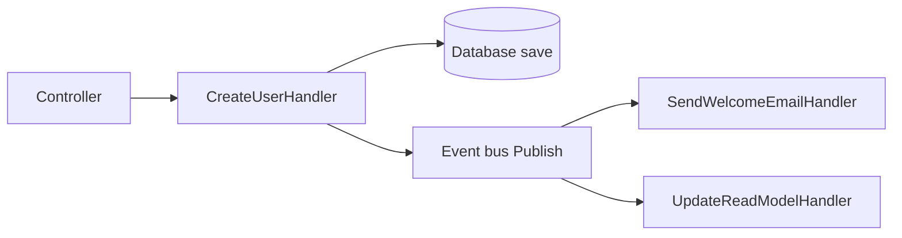
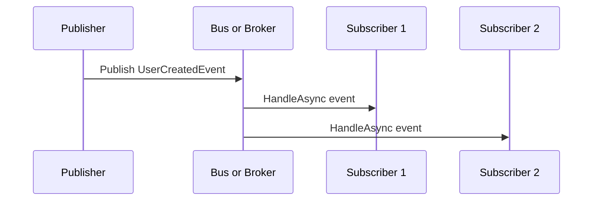

# About event-driven building blocks in C#

This guide answers your questions from the first to the last in one place. You asked what a handler is, what an event is, what commands and queries are, how event-driven architecture works, whether delegates and reflection are required, whether you need RabbitMQ or Kafka or MediatR, and what brokers, sourcing, and routers are. Read the sections in order. Each one builds on the last.

## Overview

A handler is a worker with one job. A command asks the system to do something. A query asks the system to return something. An event reports something that already happened. An event bus delivers that report to interested handlers. A broker does the same delivery across processes. A router picks which handlers get the report. Event sourcing stores the reports as the database itself.

This repo uses only the first half of that list. Controllers call plain handler classes directly. There is no bus, no broker, no router, and no sourcing here. The rest of this guide teaches the general patterns so you can read other codebases, then shows where this repo deliberately stops.

## Key concepts

| # | Term | What it means |
|---|---|---|
| 1 | Handler | A sealed class with one public method that runs one use case |
| 2 | C# event | A language feature for in-process callbacks, built on delegates |
| 3 | Domain event | An immutable record that describes a fact, such as `UserCreated` |
| 4 | Command | An instruction to change state, such as `CreateUser` |
| 5 | Query | A question that reads state without changing it, such as `GetUser` |
| 6 | Delegate | A type-safe method reference, such as `Func` or `Action` |
| 7 | Event bus | An in-process object that keeps subscriptions and calls handlers |
| 8 | Event broker | External infrastructure that moves messages between processes |
| 9 | Event router | The decision logic that maps an event to its handlers |
| 10 | Event sourcing | A persistence model where the event log is the source of truth |

## How it works

### A handler does one job

A handler is an ordinary class. It takes its dependencies through the constructor and exposes one method. You register it in DI with `AddScoped` and call it directly.

```csharp
public sealed class GetUserHandler
{
    private readonly IUserRepository _users;

    public GetUserHandler(IUserRepository users)
    {
        _users = users;
    }

    public async Task<UserDto?> HandleAsync(Guid userId, CancellationToken ct)
    {
        var user = await _users.GetAsync(userId, ct);
        if (user is null)
        {
            return null;
        }
        return new UserDto(user.Id, user.Email);
    }
}
```

You use it by injecting it into an endpoint and calling the method. Tests create it with `new` and a fake store. There is no runtime lookup. The stack trace names the handler.

### An event has two meanings

The C# `event` keyword is an in-process callback. The publisher owns it. Subscribers attach with `+=`. The publisher fires it with `?.Invoke`. Delivery is synchronous and dies with the process.

```csharp
public sealed class Order
{
    public event EventHandler? Placed;

    public void Place()
    {
        Placed?.Invoke(this, EventArgs.Empty);
    }
}
```

A domain event is different. It is a plain immutable record that carries data about the past. You create it after state changes and pass it as a method argument. You never inject it through a constructor.

```csharp
public sealed record UserCreatedEvent(Guid UserId, string Email, DateTimeOffset At);
```

Name event records in the past tense. Keep them immutable. Carry data only.

### Commands change, queries read

A command says "do this". It has exactly one handler. It returns a result, an id, or nothing. A query says "show me this". It changes nothing and returns a DTO. CQRS only means you keep those two paths apart. Most apps need no more than separate request shapes and separate handler classes. Separate databases are the expensive third level and you only pay for it when reads and writes must scale apart.

| # | Question | Command | Query | Event |
|---|---|---|---|---|
| 1 | Intent | Do this | Tell me this | This happened |
| 2 | Naming | `CreateUser` | `GetUser` | `UserCreated` |
| 3 | Handler count | Exactly one | Exactly one | Zero or more |
| 4 | Return | Result, id, or nothing | DTO | Nothing |
| 5 | Caller knows | The handler | The handler | Only the bus |

### Delegates are required, reflection is not

Every .NET event runs on delegates. `EventHandler` is a delegate type. `Func` and `Action` are delegate types. There is no alternative mechanism, so delegates are required.

Reflection is optional. It only scans assemblies at startup to find handler classes so you skip manual registration. Manual registration with `AddScoped` works the same and keeps the call graph visible. Source generators sit in the middle and avoid the runtime scan.

### The bus, the broker, and the router

An event bus is a class in your process. It holds a table from event type to handler list and calls each handler when you publish. It has no durability and no retry.

An event broker is a separate server. Your app publishes to it over the network. It persists the message, routes it, retries failures, and parks poison messages in a dead-letter queue. You need one when handlers live in another process, when the event must survive a restart, or when producers and consumers scale apart. You do not need one for a single-process app.

An event router is the decision step inside either one. It answers which handlers get this event. The dictionary lookup in a hand-rolled bus is a type router. Topic wildcards such as `orders.*`, header filters, and content rules such as `amount > 1000` are the broker versions of the same idea.

### Event sourcing stores facts, not state

Event sourcing persists the append-only list of events instead of the current row. You rebuild state by replaying the list. Snapshots bound the replay cost. Projections build read models from the stream. You gain a full audit trail and time travel. You pay with schema evolution, projection lag, and harder deletes. A normal table with in-place updates is the opposite choice and fits most apps.



| # | Layer | What it is | Scope | Durability |
|---|---|---|---|---|
| 1 | In-process bus | A class that calls handlers | One process | None |
| 2 | Broker | External messaging servers | Across processes | Persists, retries |
| 3 | Router | Rule set inside a bus or broker | Picks recipients | Follows its host |
| 4 | Sourcing | Append-only log as database | One aggregate over time | The store is the truth |

### Who calls whom on a bus

```text
Controller calls CreateUserHandler
CreateUserHandler saves to the database
CreateUserHandler publishes UserCreatedEvent to the bus
Bus looks up subscribers and calls each handler
SendWelcomeEmailHandler sends the mail
UpdateReadModelHandler updates the read model
```

The publisher never names the subscribers. The bus owns the subscription table. Each subscriber runs its own reaction.





## Where things live

| # | Path | What you find there |
|---|---|---|
| 1 | `docs/14-application-patterns.md` | The no-bus rule and the explicit handler shape |
| 2 | `docs/10-adr/0011-no-cqrs-mediatr.md` | The decision record behind the ban |
| 3 | `src/backend/JobScrape.Domain/Abstractions/DomainEvent.cs` | The abstract event base in this repo |
| 4 | `src/backend/JobScrape.Domain/Abstractions/AggregateRoot.cs` | The per-aggregate event buffer |
| 5 | `src/backend/JobScrape.Infrastructure/Composition/UseCaseRegistration.cs` | Explicit handler registration with no scanning |
| 6 | `src/backend/JobScrape.Architecture.Tests/GuardrailTests.cs` | Tests that reject mediator-shaped types |

## Gotchas

There is no C# `event` keyword in production code here. A repo-wide search for `public event` returns zero. The word event means domain event records, server-sent events on the wire, or Serilog request entries. None of them use `+=` or delegates as events.

The domain event buffer in this repo is inert. Aggregates raise events into `AggregateRoot._domainEvents`. EF configurations ignore that collection, so nothing reaches SQLite. No production code reads or clears the buffer. Tests assert on it with `Assert.Single`. The documented dispatcher after `SaveChangesAsync` was never built. Read the buffer in tests only and do not assume a pipeline exists.

A hand-rolled `Dictionary<Type, List<Handler>>` bus is banned here even without MediatR. The rule covers any mediator-shaped dispatcher under another name. The sanctioned path is an explicit call to the next use case after persistence.

MediatR is in-process only. Its `Send` targets one handler. Its `Publish` targets zero or more notification handlers. Neither crosses a process. Version 12 and later carry commercial license terms, so pin the version on purpose in codebases that use it.

Broker delivery is at least once. Consumers must handle duplicates with idempotency keyed by event id. Ordering holds only within a partition key or session, never globally for free.

## References

| # | Source | What it covers |
|---|---|---|
| 1 | `docs/14-application-patterns.md` section 2 | Handler shape, banned types, replacements |
| 2 | `docs/10-adr/0011-no-cqrs-mediatr.md` | Why this repo skips buses and mediators |
| 3 | `docs/03-domain-model.md` section 7 | Domain events and the no-outbox decision |
| 4 | Prior session reports | Handler, event, CQRS, bus, broker, router, and sourcing walkthroughs |
