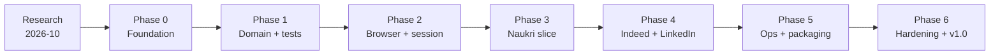

# JobLens — Documentation & Delivery Plan

> **Working name:** JobLens (rename is a mechanical change; see [Open Decisions](11-open-decisions.md)).
>
> **Status:** Research and planning complete. No implementation code yet.
>
> **Last updated:** 2026-10-29
>
> **Target stack:** .NET 10 (LTS) · xUnit.net v3 · Playwright for .NET · SQLite/EF Core 10 · React 19/Bun 1.4 cockpit (v2)

---

## What this is

A brand-new, cross-platform .NET 10 solution for **polite, low-volume job-board automation and public job-posting collection**. The first three sources are:

- **Naukri** — `https://www.naukri.com`
- **LinkedIn** — `https://www.linkedin.com`
- **Indeed India** — `https://in.indeed.com`

The solution will search public job pages, extract and validate postings, store them in SQLite, enrich job details, analyse skill demand, and export CSV/Excel. It is designed as a **modular monolith** using Clean Architecture and DDD where the domain is genuinely complex (runs, sessions, anti-bot policy, deduplication), with simple read models for reporting.

This is **not** a rewrite of the old Python project line-for-line. The old project is a **reference for hard-won lessons**, especially its anti-bot measurements and site-specific quirks. The new codebase will be smaller, typed, testable, and easier to extend.

---

## Read in this order

| # | Document | What it answers |
|---|---|---|
| 1 | [Executive Summary](00-executive-summary.md) | What are we building, why this stack, what is in/out of scope, what is the timeline? |
| 2 | [Research Analysis](01-research-analysis.md) | What did we verify about .NET 10, xUnit v3, Playwright, the three sites, anti-bot systems, and build-vs-buy options? |
| 3 | [Architecture](02-architecture.md) | How is the system structured? What are the layers, ports, adapters, runtime flows, and deployment options? |
| 4 | [Domain Model](03-domain-model.md) | What are the bounded contexts, aggregates, value objects, invariants, events, and persistence tables? |
| 5 | [Solution & Tooling](04-solution-and-tooling.md) | What exactly are the projects, package versions, SDK pin, configuration, and commands? |
| 6 | [Gameplan](05-gameplan.md) | How will we execute it week by week, with phases, milestones, backlog, risks, and exit criteria? |
| 7 | [Testing Strategy](06-testing-strategy.md) | How do TDD, xUnit v3, Playwright tests, fixtures, contract tests, coverage, and CI work? |
| 8 | [Anti-Bot & Compliance](07-anti-bot-and-compliance.md) | What detection signals exist, what did the old project measure, what will we do — and refuse to do? |
| 9 | [Site Playbooks](08-site-playbooks.md) | How does each source work: URLs, selectors, pagination, challenges, caps, fixtures, and acceptance tests? |
| 10 | [Operations Runbook](09-operations-runbook.md) | How do we install, run, schedule, back up, troubleshoot, and upgrade on macOS/Linux/Windows? |
| 11 | [Open Decisions](11-open-decisions.md) | What needs your approval before Phase 0 starts? |
| 12 | [Web Cockpit (v2)](12-web-cockpit.md) | What is the React + Bun control plane, how does it command the .NET API, and how is it built, secured, and tested? |
| 13 | [Conventional Commits](13-conventional-commits.md) | How are commit messages written, reviewed, and validated? |
| 14 | [Application Patterns](14-application-patterns.md) | How do Result, Options, Specification, and Problem Details work — and why is there no CQRS/MediatR? |
| 15 | [Runtime Hardening](15-runtime-hardening.md) | How do structured logs, global errors, Polly resilience, async/cancellation, and resource cleanup work? |
| 16 | [ADRs](10-adr/README.md) | Why were the key technical decisions made? |

---

## At a glance

| Area | Decision |
|---|---|
| Runtime | **[.NET 10 LTS](10-adr/0001-dotnet-10-lts.md)** (installed: SDK `10.0.403`, runtime `10.0.14`; supported to 2028-11-14) |
| Test framework | **xUnit.net v3** (`xunit.v3` `4.0.2`, VS adapter `4.0.1`) |
| Browser automation | **Playwright for .NET** `1.64.1` (Chromium 156, Firefox 157, WebKit 27.2; Chrome/Edge 155 channels) |
| Architecture | Modular monolith, Clean Architecture, DDD for Sourcing + Access; CLI first |
| Persistence | SQLite via EF Core `10.0.14`; PostgreSQL later if scale demands it |
| CLI | [`System.CommandLine`](04-solution-and-tooling.md#6-target-cli-surface) `2.0.14` + `Microsoft.Extensions.Hosting` `10.0.14` + Serilog |
| HTML parsing | [AngleSharp](02-architecture.md#9-source-adapter-design) `1.8.6` for offline fixtures and server-rendered pages |
| Export | CSV + Excel ([ClosedXML](04-solution-and-tooling.md#3-package-matrix) `0.105.1`) |
| Control plane (v2) | React `19.3.1` + TypeScript `7.0.2` + Tailwind `4.3.3` + shadcn/ui `4.23.0`; Bun `1.4.4` runtime/package manager/BFF; no Node.js |
| Application patterns | Explicit use-case handlers; Result, Options, Specification, Problem Details; **no CQRS/MediatR** ([details](14-application-patterns.md)) |
| Logging & resilience | Serilog compact JSON logs, daily rolling + 90-day retention, standard enrichers; global exception handling; `IHttpClientFactory` + Polly v8 retry/circuit/timeout/fallback ([details](15-runtime-hardening.md)) |
| Browser policy | Headed first contact, persistent profile per source, one run at a time |
| Anti-bot policy | Low-signal, consistent, polite, stop-on-wall. **No CAPTCHA solving, no fingerprint spoofing, no auth-wall bypass, no proxy rotation to evade bans.** |
| Default sources | Naukri enabled; Indeed opt-in; LinkedIn high-risk opt-in and disabled by default |
| OS targets | macOS 14+, Windows 11+/Server 2019+, Debian 12/13, Ubuntu 22.04/24.04/26.04 |
| Deployment | Local CLI + OS scheduler (cron/launchd/Task Scheduler); v2: local .NET API + Bun cockpit |

---

## One-page gameplan

The critical path is:

1. **Walking skeleton first** — one Naukri search page → validated posting → SQLite → CSV, before adding breadth.
2. **Test the domain and parsers without a browser** — fast TDD loop.
3. **Add browser/session infrastructure once** — reuse for every source.
4. **Add sources behind contracts** — Naukri, then Indeed, then LinkedIn (opt-in).
5. **Harden and package** — cross-OS publish, runbook, release.

Full detail: [Gameplan](05-gameplan.md).

---

## Non-negotiables

These are architectural and ethical constraints, not suggestions:

1. **One polite pass at a time.** No parallel workers against the same source. No concurrent browser contexts sharing a profile.
2. **Stop on a wall.** On CAPTCHA, Cloudflare/Akamai challenge, auth wall, 403, or 429: pause, capture evidence, cool down, and require a human. Never hammer through.
3. **No evasion tooling.** No CAPTCHA farms/solvers, no fingerprint-spoofing packages, no account rotation, no proxy rotation to evade bans, no auth-wall bypass, no TLS impersonation on the browser path.
4. **Consistency beats spoofing.** Use the browser's genuine user agent, locale, timezone, viewport, and a persistent profile. Do not stub `navigator`, plugins, WebGL, or languages.
5. **Public pages only in v1.** No recruiter email harvesting, no profile scraping, no auto-apply, no messaging.
6. **Tests before implementation** for domain rules and parsers. No live-site scraping in CI.
7. **Secrets and profiles never committed.** Browser profiles contain cookies and are treated as credentials.
8. **Measure, don't guess.** Every wall event produces an artifact and a classification. Every change to caps/selectors is backed by a fixture or canary.

> **Honest constraint:** no browser stack is undetectable. The old Python project's own measurements found CDP detectable (`hasCDP: true`), and TLS/network/behaviour signals remain. The goal is not a fake “human” verdict; it is **low-signal automation that avoids bans by being consistent, polite, and willing to stop**. See [Anti-Bot & Compliance](07-anti-bot-and-compliance.md).

---

## Working assumptions

- Single user, personal job search/analysis, not a multi-tenant SaaS.
- Local-first: SQLite and local browser profiles; no cloud dependency required.
- The machine has a desktop session for the first headed login/challenge solve.
- The operator can provide a normal residential/office network; no datacenter proxy farm.
- LinkedIn is legally sensitive; the adapter is opt-in and may remain disabled.
- Data collected is public job-posting data; no personal profiles or contact details in v1.
- English/India job market first (`en-IN`, `Asia/Kolkata`), but locale/timezone are configurable.

These assumptions are the basis for the scope in the [Executive Summary](00-executive-summary.md) and the [Gameplan](05-gameplan.md).

---

## Document conventions

- **MUST / SHOULD / MAY** are used in the RFC sense.
- Versions were verified on **2026-10-29** against NuGet and the official docs.
- Mermaid diagrams render on GitHub, GitLab, Azure DevOps, and VS Code with a Mermaid extension.
- “Old project” means `/Users/aslamshaikh/Projects/PythonWebScraping`.
- “v1” means the first shippable release described in the [Gameplan](05-gameplan.md).
- Code snippets are illustrative design sketches, not final implementation.

---

## Change log

| Date | Change |
|---|---|
| 2026-10-29 | Initial research, architecture, domain model, gameplan, testing, anti-bot, site playbooks, runbook, and ADRs created. |
| 2026-10-29 | Added the v2 web cockpit specification (React 19, Bun 1.4.4, Tailwind 4.3, shadcn/ui; no Node.js) and ADR-0010. |
| 2026-10-29 | Added the application-patterns guide (Result, Options, Specification, Problem Details) and ADR-0011 rejecting CQRS/MediatR. |
| 2026-10-29 | Added the runtime-hardening guide (Serilog enrichers/file retention, global exceptions, Polly HTTP resilience, async/disposal/resource rules) and ADR-0012. |
